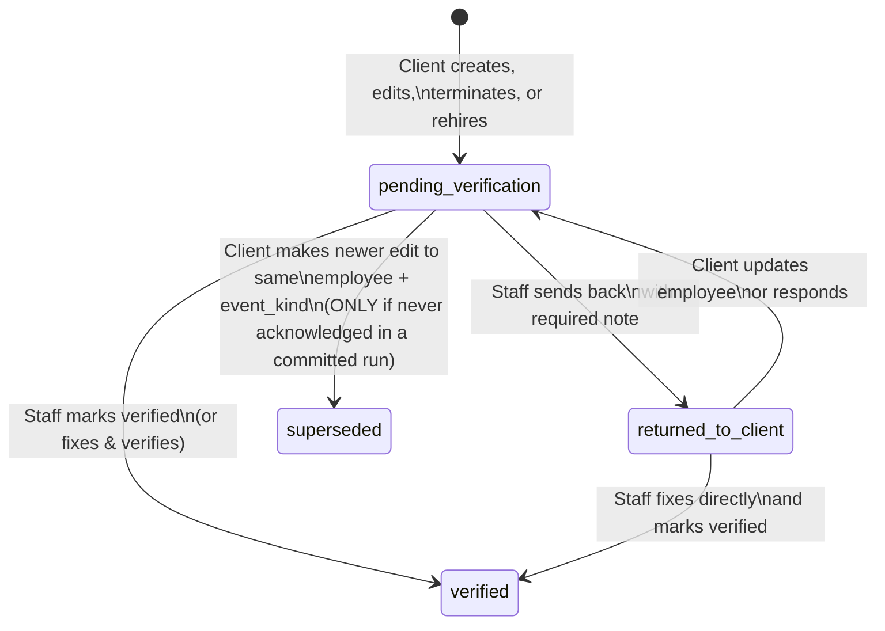

# Client-managed employee lifecycle: build plan

**Status:** Proposed build plan (revised after independent review rounds 1 and 2, and CodeRabbit review). No application code has changed.
**Date:** November 28, 2026.
**Codebase baseline:** `Shimizu-Technology/cornerstone-payroll` `origin/main` at `55bc42f83`.
**Builds on:** [Product architecture decision](PRODUCT_ARCHITECTURE_DECISION_2026-11-19.md) (§6 milestones and go-live rule), [Milestone 4 build plan](MILESTONE_4_EMPLOYEE_APP_BUILD_PLAN_2026-11-24.md) (employee identity, contact changes, address requests, and RLS standards).

> All person, company, and employee names used in examples below (such as Harborview Bistro, Pacific Trade Works, Sloane Owner, Jordan Sample, and Morgan Example) are fictional.

---

## Summary

Today, Cornerstone Payroll uses an **approve-first** model for client employee changes: when a client manager adds a new hire or changes pay, W-4 withholding, SSN, or contractor tax details, the change waits in an `EmployeeChangeRequest` queue until Cornerstone staff approve it. New hires stay inactive (`portal_pending_approval: true`) until approved, and clients cannot terminate or rehire workers at all.

This plan adds an opt-in, per-company mode — **"Client manages, Cornerstone verifies"** (`client_managed`) — modeled on Gusto and ADP:

1. **Client managers run the employee lifecycle directly (with no self-dealing).** Client managers (client portal users who are not `client_viewer`) add new hires, edit pay rates, W-4s, payment methods, addresses, and titles, and terminate or rehire workers. Hard-deleting employees remains forbidden for everyone. A dual-role client manager who is also an employee cannot directly change their own pay, W-4, SSN, payment method, address, or employment status; those self-edits require a different approver.
2. **New hires get a period-aware "Ready to pay" checklist.** A new hire can be saved while still incomplete, but until every required item is complete for the target pay period, they stay **Incomplete** and are automatically left out of pay runs by default (`regular`, `off_cycle_tips`, `bonus`, `commission`, etc. — exempting only paychecks on system-generated `correction` runs that are linked to a verified source paycheck for the same employee and company, genuinely `terminated` workers on `final` runs, and authorized earned-wage `adjustment` cases per §6.4) with a clear reason (for example, *"Can't be paid yet: W-4 missing"*). Once every item is complete for the period, they are paid in the next payroll with no approval step.
3. **Cornerstone verifies after the fact under one permission bar.** Every new hire, termination, rehire, and pay-affecting change lands on a staff **"To verify"** queue with a `PortalNotifications` alert. Staff with `:manage_client_configuration` (managers, admins, org/super admins, or delegated accountants) mark each item verified, fix it and verify, or send it back to the client with a note (which notifies client managers).
4. **Fail-closed pay-run safety nets.**
   - **Readiness gate:** `approve!` and `commit!` fail closed over **every financially reportable paycheck** across all `PayPeriod::RUN_PURPOSES` by default (exempting only paychecks on system-generated `correction` runs that are linked to a verified source paycheck for the same employee and company, `terminated` workers on `final` runs, and authorized earned-wage `adjustment` cases per §6.4), regardless of which path created the paycheck (roster, manual add, timecard import, or workbook import).
   - **Stale-calculation gate:** For `readiness_gate_enforced` employees and `client_managed` companies (leaving `approval_first` companies unchanged), every paycheck stores a canonical input fingerprint (`paycheck_input_fingerprint` covering dated pay rate/wage rates, W-4 as of `pay_date`, SSN/TIN digest, status, deductions/fields/retirement — excluding `employee_loans`, which enforce their own balance/schedule check on commit) alongside state-aware payment-delivery snapshots. If pay-affecting inputs change after calculation, `approve!` and `commit!` fail closed until the run is recalculated; changing an employee's payment-method default blocks `approve!` on a `calculated` run until recalculated, while an `approved` item that already holds a materialized `payment_delivery_method` remains committable when only the employee's future default changes (§6.3B).
   - **Unverified-changes commit gate:** Any open pay run surfaces *"Changed since last payroll, not verified"* items for workers on that run. This never blocks the client; it blocks staff **commit** until staff verify each item or explicitly acknowledge every unverified item by snapshot ID (`id` + `updated_at`). Acknowledging an item at commit leaves it in **To verify** and prevents later edits from superseding it.
5. **Single override gate (org-admin / super-admin only).** Only a Cornerstone `org_admin` or `super_admin` can let an Incomplete `readiness_gate_enforced` employee be paid anyway, with step-up authentication, a written reason, and an audit trail. Legacy 24-hour `EmployeeIntakePolicy` windows are disabled in `client_managed` companies, and `EmployeeIntakeExceptionReviewService` rejects `readiness_gate_enforced` employees so there is one gate, one capability, and one evaluator. If the employee is missing a W-4, withholding defaults to **Single with no adjustments** per IRS Publication 15-T and the Guam Territorial Income Tax mirror code.
6. **Existing employees keep getting paid.** Pre-rollout employees (including imported rosters and staff-created hires) stay `readiness_gate_enforced: false`. They are never blocked retroactively, keep any existing staff document gates untouched (including if later rehired through the client portal), treat `payment_delivery_method: NULL` as `paper_check`, and show a non-blocking **"Missing items"** badge for cleanup. The hard pay block applies only to employees stamped `readiness_gate_enforced = true` via explicit client-portal creation or client-portal rehire (with rehires accepting legacy W-4s and `NULL` = paper check; see §12 Q2).
7. **Locked until complete and switched off by default.** Every company defaults to today's **"Cornerstone approves first"** (`approval_first`) mode. During the 5-PR build, `client_portal.employee_lifecycle_mode` remains locked through `OperatingProfileCatalog::LOCKED_TOGGLE_MILESTONES` / `locked_milestone_for` (with `ClientOperatingProfile#locked_switches_off`, `ClientOperatingProfiles::UpdateService`, and `CompanyFeatures::LOCKED_OFF` extended to locked enum defaults) until all exclusion, fingerprint, commit, verification, override, and UI pieces are merged. Rollout then follows [PRODUCT_ARCHITECTURE_DECISION_2026-11-19.md](PRODUCT_ARCHITECTURE_DECISION_2026-11-19.md) §6: internal payroll-team acceptance testing, practice-lead sign-off, one pilot client for a full pay period, then broader rollout.

### What this feature deliberately does not change

- **Hard deletes remain blocked.** Neither clients nor staff can hard-delete employees (`api/app/controllers/api/v1/admin/employees_controller.rb:285-289`).
- **Employee-initiated home-address requests stay as they are.** Employees still submit address changes in the employee app for client-manager approval (with no self-approval) under Milestone 4's `EmployeeChangeRequest#profile_address?` flow.
- **W-2 ↔ 1099 classification changes stay staff-only.** Changing an employee's tax classification in place remains forbidden (`api/app/models/employee.rb:775-787`; `ClientEmployeeUpdateService#validate_tax_classification_change!`, `api/app/services/client_employee_update_service.rb:411-417`).
- **Bank routing/account capture is not added here.** Choosing `paper_check` vs. `direct_deposit` satisfies the client checklist item; bank account collection and employee bank-change self-service remain deferred per Milestone 4 §0 D3. When `direct_deposit` is chosen with no bank details on file, the staff verification item displays a clear callout so Cornerstone confirms ACH setup before payday (§3.1).
- **`approval_first` companies behave identically to today.**

---

## 1. Where things stand today (codebase audit)

Every reference below was verified against `origin/main` (`55bc42f83`).

### 1.1 Client employee creation and updates

- **`ClientEmployeeUpdateService`** (`api/app/services/client_employee_update_service.rb`):
  - `DIRECT_FIELDS` (`:14-30`): `first_name`, `middle_name`, `name_suffix`, `last_name`, `job_title`, `email`, `date_of_birth`, `hire_date`, `department_id`, `address_line1`, `address_line2`, `city`, `state`, `zip`, `phone` apply immediately.
  - `APPROVAL_FIELDS` (`:31-61`): `ssn_encrypted`, `employment_type`, `salary_type`, `pay_rate`, `pay_frequency`, W-4 fields (`filing_status` through `w4_election_received`), legacy retirement rates, contractor fields (`business_name`, `contractor_ein`, `contractor_type`, `contractor_pay_type`, `w9_on_file`), `default_custom_earnings`, `default_payroll_adjustments`, and `wage_rates` create a pending `EmployeeChangeRequest` instead of saving onto `Employee`.
  - `payment_delivery_method` is in neither list, is not permitted in `Client::EmployeesController#employee_params` (`api/app/controllers/api/v1/client/employees_controller.rb:154-219`), and is rendered `disabled={isClient}` in `web/src/pages/employees/EmployeeForm.tsx:1638`.
  - `create!` (`client_employee_update_service.rb:105-164`) locks `company`, calls `EmployeeIntakePolicy.prepare!(candidate, actor: requested_by)` (`:375`), creates the `Employee` with `pay_rate: 0`, `status: "inactive"`, `portal_pending_approval: true` (`:118-125`), seeds `EmployeeDocumentReadiness` (`:137`), and opens a `create` `EmployeeChangeRequest` proposing `status: "active"`, `portal_pending_approval: false`, and `approval_attrs` (`:139-145`).
  - **Self-edit coverage today:** `extract_own_address!` (`:201-202, 432-445`) runs only when `profile_requests_enabled?` is true and only intercepts `ADDRESS_FIELDS`, relying on `EmployeeProfileIdentity.own_record?` (`api/app/services/employee_profile_identity.rb:4-19`), which matches only an employee-app link, a contact-email link decision, or a `confirm_same_person_email` audit row (missing managers with no app link, and not checking self-creation). In addition, `create_change_request!` (`client_employee_update_service.rb:492`) sets `sensitive_payload: own_record ? nil : ...`, `EmployeeChangeRequest#validate_profile_address_origin` (`employee_change_request.rb:74, 220-233`) currently restricts all `own_record: true` requests to address fields, and `Client::EmployeeChangeRequestsController#decide` (`api/app/controllers/api/v1/client/employee_change_requests_controller.rb:61`) approves `profile_address?` requests only. Section 6.2 addresses each of these.
  - **SSN confirmation today:** `Client::EmployeesController` calls `require_ssn_confirmation!` on `create` (`:49`) and SSN-changing `update` (`:85`), validated by `Employee#matching_ssn_confirmation` (`api/app/models/employee.rb:920-930`). `ClientEmployeeUpdateService#update!` clears `employee.require_ssn_confirmation = false` (`:205-206`) after validating the candidate because `approval_first` writes the SSN to a change request rather than directly to `employee`. In `client_managed` mode, direct SSN writes in `ClientEmployeeUpdateService` must retain `require_ssn_confirmation`, check for duplicate SSNs in the company **only when the SSN changes** (`encrypts :ssn_encrypted, deterministic: true`, `employee.rb:161`), and flag tax-filing impact.
  - `PortalNotifications.employee_change_submitted!` fires only inside `create_change_request!` (`:499`). Direct-only edits notify nobody, except when `employee_portal.features.profile_requests` is enabled and email/phone/address changes write `EmployeeContactChangeToConfirm` (`:221, 447-451`).
- **`Api::V1::Client::EmployeesController`** (`api/app/controllers/api/v1/client/employees_controller.rb`, routes at `api/config/routes.rb:121-123`): exposes `index`, `show`, `create`, and `update` only — no `terminate`, `rehire`, or `destroy`.
- **Client viewer protection:** `ClientPortalAccess` (`api/app/controllers/concerns/client_portal_access.rb:13-53`) blocks every non-GET/HEAD write from `User#client_viewer?` (`:41-46`, except two read-receipt endpoints), returning HTTP 403 (`code: "client_view_only"`). `revalidate_client_company_write_access!` (`:31-39`) re-verifies `!actor.client_viewer?` under the company row lock.

### 1.2 Termination, deactivation, and rehire

- **UI gating:** `web/src/pages/employees/EmployeeForm.tsx` gates the inactive/terminated banner and Reactivate button (`:1289-1317`), status history (`:1799`), and Terminate/Deactivate buttons (`:2443-2459`) behind `!isClient`.
- **Service rules:** `EmployeeStatusTransitionService` (`api/app/services/employee_status_transition_service.rb:41-169`):
  - `terminate!` (`:41-72`) requires `StaffRolePolicy.allowed?(@actor, :manage_client_configuration)`, forbids future dates (`effective_date > PayrollBusinessClock.today`, `:44`), checks `effective_date >= hire_date` and not before the latest `EmployeeStatusEvent`, blocks if an `approved` regular pay run has `start_date >= effective_date` (`block_approved_runs!`, `:145-149`), sets `status: "terminated"` and `termination_date: effective_date`, appends an immutable `EmployeeStatusEvent` (`api/app/models/employee_status_event.rb:3-48`), and calls `EmployeeLinks::Retire.terminated!` (`:69`).
  - **Lock-order mismatch found:** `terminate!` (`:48, 146`), `deactivate!` (`:81, 87`), and `reactivate!` (`:113`) lock `@employee` first and then `PayPeriod` inside `block_approved_runs!` without locking `Company` first, whereas `PayPeriodLifecycleService` (`:275-276`), `EmployeePaymentDefaultService` (`:19, 28, 36`), and `ClientEmployeeUpdateService` (`:113, 175-176`) lock **Company → PayPeriod → Employee**. Section 4.2 standardizes the lock order.
  - **Backdated terminations:** `block_approved_runs!` checks only open `draft`/`calculated`/`approved` runs (`:10`); a backdated termination entered after a later regular run has already `committed` is currently not flagged.
  - `reactivate!` (`:107-141`) requires `manage_employee_status` (plus `manage_client_configuration` for terminated workers), enforces `effective_date > termination_date` and after the latest status event, sets `status: "active"` and `termination_date: nil`, and appends a `reactivated` event.
  - **Check constraint to expand:** `employee_status_events` restricts `source` to `('operator', 'production_migration')` (`api/app/models/employee_status_event.rb:6`, `api/db/schema.rb`). Client-initiated transitions need `'client_portal'` added.
  - **Payroll date boundary & run purposes:** `PayPeriod::RUN_PURPOSES` (`api/app/models/pay_period.rb:27`) defines `%w[regular off_cycle_tips bonus commission correction final adjustment]`, and `Admin::PayPeriodsController#create` (`:150-152`) permits operators to create ad-hoc runs with `run_purpose_source: "operator_selected"` (whereas `IssueCorrectivePaycheckService:870` and `PayPeriodCorrectionService:215` stamp `run_purpose_source: "system_correction"`). `Employee.eligible_for_period` (`api/app/models/employee.rb:256-303`) already keeps a terminated worker eligible for periods where `termination_date >= period_start` (so final pay for days worked happens) and excludes them from periods starting strictly after `termination_date`. `Employee.eligible_for_payroll_run` (`:247-255`) explicitly relaxes status eligibility when `explicitly_selected && %w[final correction adjustment].include?(period.run_purpose)` — allowing explicitly selected `active` or `deactivated` (`:manage_employee_status`, available to every `accountant` at `staff_role_policy.rb:30`) employees into `final`, `correction`, and `adjustment` runs, which §6.4 narrows so neither active/deactivated hires nor operator-selected runs can bypass the org-admin override.

### 1.3 Existing review queues, notifications, and staff roles

- **Change requests:** `EmployeeChangeRequest` (`api/app/models/employee_change_request.rb:3-423`) has statuses `pending | approved | rejected | cancelled | superseded` (`:68`) and a partial unique index `idx_employee_change_requests_one_pending` allowing only one pending request per employee (`api/db/schema.rb`). Staff approve/reject via `Admin::EmployeeChangeRequestsController` (`api/app/controllers/api/v1/admin/employee_change_requests_controller.rb`, `:manage_client_configuration`, `staff_role_policy.rb:227-230`), surfaced in `web/src/pages/AdminEmployeeChangeRequestsPage.tsx` (Sidebar "Client Changes", `web/src/components/layout/Sidebar.tsx:141`) and aggregated across companies in `ClientInboxQuery` (`api/app/services/client_inbox_query.rb:105-106`).
- **Contact confirmations (M4-7):** `EmployeeContactChangeToConfirm` (`api/app/models/employee_contact_change_to_confirm.rb`) tracks contact, address, and delivery-consent changes when `employee_portal.features.profile_requests` or `delivery_consent` is enabled, rendered at `web/src/pages/EmployeeContactChangesToConfirm.tsx` and shown as a non-blocking count when creating a pay period (`api/app/controllers/api/v1/admin/pay_periods_controller.rb:174`).
- **Notifications:** `PortalNotifications` (`api/app/services/portal_notifications.rb:16-135`), `PortalNotifications::Recipients` (`api/app/services/portal_notifications/recipients.rb:11-324`), and `PortalNotifications::Email` (`api/app/services/portal_notifications/email.rb:8-479`) manage privacy-safe email alerts (company name, heading, scoped URL; no SSNs, wages, or employee names in email bodies).
  - Staff alerts (`staff_targets`, `recipients.rb:191-242`) reach **only** users and extra emails listed in `PortalNotificationRecipient` for that company (except `super_admin_alert?` events). If a company has no listed `PortalNotificationRecipient` rows, staff alerts are sent to nobody.
  - Staff `employee_changes` (`default_mode: "digest"`) goes to company-listed `PortalNotificationRecipient` users with `:manage_client_configuration` (`recipients.rb:276`), plus extra emails.
  - Client `employee_change_decisions` goes only to `subject.requested_by_id` (`recipients.rb:245-247, 283`), whereas events flagged `client_managers_only: true` go to all active non-viewer client users assigned to the company (`recipients.rb:249-250, 281`).
- **Staff capabilities:** `StaffRolePolicy` (`api/app/policies/staff_role_policy.rb:7-46, 227-250`) defines roles `super_admin`, `org_admin`, `admin`, `manager`, `accountant`, with per-company `client_management` delegation on `CompanyAssignment` for `DELEGATABLE_CAPABILITIES` (`:4, 299-311`). Approving client employee changes (`admin/employee_change_requests`), terminating (`admin/employees#terminate`), and reviewing intake exceptions (`admin/employees#review_intake_exception`) all require `:manage_client_configuration`. Sensitive org-level powers (`:manage_time_tracking_lock`, `:recover_clerk_invitation`, `:reveal_hidden_employee_notes`, `:manage_employee_app_switch`) are restricted strictly to `%w[super_admin org_admin]` (`:26, 33, 40, 44`).

### 1.4 Operating profiles and per-company settings

- **`OperatingProfileCatalog`** (`api/app/services/operating_profile_catalog.rb`), **`CompanyFeatures`** (`api/app/services/company_features.rb`), and **`ClientOperatingProfiles::UpdateService`** (`api/app/services/client_operating_profiles/update_service.rb`) store effective-dated, versioned, audited per-company settings.
- **`ClientOperatingProfile.tsx:105-109, 184-194`** renders every catalog entry automatically unless its ID appears in `profile.locked_keys` (`OperatingProfileCatalog.locked_keys`, `operating_profile_catalog.rb:682-684`), and displays `"Available in Milestone {field.locked_until_milestone}"` (`:108`) from `OperatingProfileCatalog.locked_milestone_for` (`:674-680`), which reads `OperatingProfileCatalog::LOCKED_TOGGLE_MILESTONES` (`:69-81`). Today `ClientOperatingProfile#locked_switches_off` (`api/app/models/client_operating_profile.rb:125-133`), `ClientOperatingProfiles::UpdateService` (`:81-87, 104-106`), and `EmployeeAppSwitch::ProfileWriter#merged_values` (`api/app/services/employee_app_switch/profile_writer.rb:116`) assume locked keys are booleans (`== true` / `!= false` / `index_with(false)`), so locking an enum requires registering it in `LOCKED_TOGGLE_MILESTONES` and extending those enforcers plus `CompanyFeatures::LOCKED_OFF` to use each entry's locked default.
- **`CompanyFeatures.for(company, on: PayrollBusinessClock.today)`** (`company_features.rb:13-20`) resolves effective-dated rows against the passed `on:` date (defaulting to today in Guam business time). Because `ClientOperatingProfiles::EffectiveDates#date_error` (`api/app/services/client_operating_profiles/effective_dates.rb:42-44`) requires `effective_on` to be the `start_date` of a `draft` pay period, switches saved through `UpdateService` are frequently future-dated; like `EmployeeAppSwitch` (`company_features.rb:112-120`), a future-dated profile row must not auto-activate without rechecking preconditions (§4.1, §5.1).
- Five legacy booleans (`client_portal.review_first.{profile,contact,address,pay,termination}`) plus `ALWAYS_REVIEWED_GROUPS = %w[bank w4 identity]` exist in the catalog (`operating_profile_catalog.rb:60-61, 224-292`), and `CompanyFeatures#review_first?` (`company_features.rb:91-99`) has no production callers (only specs). This plan introduces `client_portal.employee_lifecycle_mode` and retires the unused `review_first.*` UI/catalog exposure while keeping existing saved JSON rows valid.

### 1.5 Pay runs, exclusions, payment defaults, W-4s, and document readiness

- **All paycheck creation paths:**
  - `PayPeriodDefaultRoster` (`api/app/services/pay_period_default_roster.rb:12-29`) builds the default draft roster from `Employee.eligible_for_period` minus `pay_period_excluded_employees`.
  - `Admin::PayPeriodsController#run_payroll` (`api/app/controllers/api/v1/admin/pay_periods_controller.rb:371-411`) filters selected employees through `Employee.eligible_for_payroll_run`.
  - **Additional paths that create `PayrollItem` rows directly:** `Admin::PayrollItemsController#create` (`api/app/controllers/api/v1/admin/payroll_items_controller.rb:72-97`), `Admin::TimecardImportsController#apply` (`api/app/controllers/api/v1/admin/timecard_imports_controller.rb:55-76`), and `PayrollImport::ImportService` (`#restore_without_hours!` `:168`, variable-salary check `:268`, `#apply_locked!` `:300`).
  - `PayrollRunEligibility` (`api/app/services/payroll_run_eligibility.rb:13-18`) inspects only `status_affected` workers (`inactive`/`terminated` or deactivated/terminated status events), so an `active` Incomplete hire with an existing `PayrollItem` is invisible to `PayrollRunEligibility`.
- **Stale calculation inputs & compensation defaults:**
  - `EmployeeCompensationChangeService.next_uncommitted_period_start` (`api/app/services/employee_compensation_change_service.rb:104-118`) locks only `LOCKING_STATUSES = %w[approved committed]` (`:32`), so a raise on a **`calculated`** run defaults its `effective_on` into that already-calculated run.
  - `PayrollCalculationContext.intake_setup_fingerprint` (`api/app/services/payroll_calculation_context.rb:57, 68-89`) already hashes dated employee setup, wage rates, deductions, payroll fields, retirement, and loans (`:86`) — currently only when `employee.intake_exception.present?`. Note that `EmployeeLoan#record_payment!` (`api/app/models/employee_loan.rb:57-100`) mutates loan rows when a run commits (and already checks loan schedule/balance freshness at `:71-86`), so hashing live loan rows in a broader paycheck fingerprint would cause committing one run to falsely mark another open run stale.
- **Payment method defaults & unapprove side effect:**
  - Across the codebase (`employee_payment_default_service.rb:23`, `payroll_item.rb:102-104`, `payroll_items_controller.rb:88`, `payroll_import/import_service.rb:207`), `employee.payment_delivery_method.presence || "paper_check"` means **`NULL` is treated as paper check today**.
  - `PayrollItem#calculate!` (`api/app/models/payroll_item.rb:803`) already runs `self.payment_delivery_method ||= effective_payment_delivery_method`, materializing `payment_delivery_method` onto newly calculated items. `EmployeePaymentDefaultService#call` (`api/app/services/employee_payment_default_service.rb:24-37`) intentionally preserves already-materialized items (updating only `employee.payment_delivery_method` for future runs), and only touches uncommitted (`draft`, `calculated`, `approved`) `payroll_items` whose `payment_delivery_method` is still `nil` — writing `old_method` onto those `nil` items and calling `PayrollPaymentMethodService.refresh_review!(period: period, actor: actor)` (`api/app/services/payroll_payment_method_service.rb:114-128`), which **unapproves an `approved` period (`status: "calculated"`) and supersedes its `PayrollReviewPackage`**. `PayPeriodLifecycleService#commit!` (`:132-134`) commits each item using `item.effective_payment_delivery_method` (which honors the materialized item value over any later employee default change).
- **Approve, client review, and commit:**
  - `PayPeriodLifecycleService#approve!` (`api/app/services/pay_period_lifecycle_service.rb:34-63`) and `#commit!` (`:92-161`) lock `Company` then `PayPeriod` (`:273-279`), run eligibility, expected-entry, variable-pay, `EmployeeDocumentReadiness`, FICA, and payment-delivery validations, and enforce snapshot acknowledgements (`validate_file_request_snapshot!`, `validate_check_number_snapshot!`) with HTTP 409 `CommitConflict` handling in `web/src/components/payroll/PayrollCommitDialog.tsx:61-114, 143-159`.
- **W-4 elections and calculator:**
  - `EmployeeW4Election` (`api/app/models/employee_w4_election.rb:3-88`) is append-only with `DEFAULT_PROFILE_ATTRIBUTES` (`filing_status: "single"`, all adjustments `0`, `w4_step2_multiple_jobs: false`, `w4_form_version: 2020`) and `SOURCES` check constraint.
  - `PayrollCalculator` (`api/app/services/payroll_calculator.rb:935-956`) resolves compensation/basis on **`pay_period.end_date`** and W-4 election on **`pay_period.pay_date`**, falling back to `DEFAULT_PROFILE_ATTRIBUTES` when no election covers `pay_period.pay_date`. `GuamTaxCalculatorV2#calculate_pub_15_t_withholding` (`api/app/services/guam_tax_calculator_v2.rb:192-202`) applies IRS Pub 15-T (2026) Worksheet 1A (`AnnualTaxConfig::OFFICIAL_2026_WITHHOLDING`, `api/app/models/annual_tax_config.rb:13-32`).
- **Overlapping intake-exception & document-readiness gates (must be reconciled cleanly):**
  1. `Employee#required_filing_fields` (`api/app/models/employee.rb:808-833`) and `Employee#valid_supplied_intake_dates` (`:835-847`, specifically `require_initial_w4_effective_on` at `:836`) block saving a new hire without SSN/EIN, hire date, address, or initial `w4_effective_on` unless `portal_pending_approval?` is true or a 24-hour company-wide `EmployeeIntakePolicy` window is open (`api/app/services/employee_intake_policy.rb:3-44`).
  2. `EmployeeIntakeExceptionReviewService.call!` (`api/app/services/employee_intake_exception_review_service.rb:7, 25-35`) lets any user with `:manage_client_configuration` (manager, admin, or delegated accountant) confirm payroll setup with `default_withholding` W-4, and `Admin::EmployeeIntakeSettingsController#update` (`api/app/controllers/api/v1/admin/employee_intake_settings_controller.rb:31`) lets `:manage_client_administration` open the 24-hour window. Leaving this open alongside `client_managed` mode would let non-org-admins bypass the org-admin readiness override.
  3. `EmployeeDocumentReadiness.require_payroll_ready!` (`api/app/services/employee_document_readiness.rb:41-84`) checks **four** distinct things: stale intake setup (`:44-52`), stale withholding (`:53-61`), `EmployeeIntakePolicy.payroll_ready?` (`:62-67`), and required new-hire document uploads (`:68-83`, querying `document_readiness_required: true`). Skipping the entire method — or filtering lines 68–72 by `readiness_gate_enforced: false` — would strip document gates from existing staff-created hires (including if they are later rehired via the client portal). Section 4.2 keeps `require_payroll_ready!` lines 44–83 **untouched** and scopes only `seed_new_hire!` so new `client_managed` hires default to `document_readiness_required = false`.
- **Employee app & classification transitions:**
  - `EmployeeLinks::Retire.terminated!` (`api/app/services/employee_links/retire.rb:18-26`) moves active links to `former` with `former_access_until = termination_date + former_access_years` (default 2 years, `operating_profile_catalog.rb:439`) and revokes unused invites. `EmployeeLinks::Invite` (`api/app/services/employee_links/invite.rb:38, 77-89`) allows client managers to send email invites for active employees and reuses a rehired worker's prior login.
  - `EmployeeClassificationTransitionService` (`api/app/services/employee_classification_transition_service.rb:24-31`) creates a *new* `Employee` record when staff move an existing worker between W-2 and 1099; a blind model callback stamping `readiness_gate_enforced` on every `Employee` create would wrongly block transitioned grandfathered workers.
- **Row-level security & composite tenant FKs:** `api/lib/rls_tables.rb` classifies every table, enforced in CI by `api/spec/security/company_rls_isolation_spec.rb`. Both `employees(id, company_id)` (`idx_employees_document_readiness_tenant_key`, `schema.rb:1916`) and `pay_periods(id, company_id)` (`idx_pay_periods_aire_calendar_tenant_key`, `schema.rb:3295, 5453`) already have unique composite tenant indexes. `employee_w4_elections` (`schema.rb:1692-1718`) and `admin_overrides` (`schema.rb:18-36`) have `company_id NOT NULL` and need concurrent unique `(id, company_id)` indexes to support composite tenant FKs.

---

## 2. User journeys (desktop and mobile)

### 2.1 Client manager

Client managers are active `client` users with `!client_viewer?` assigned to the company. Client viewers see the same screens read-only (badges, checklists, verification status) with all mutation controls hidden and blocked server-side.

#### A. Add a new hire (desktop & phone)
1. Client manager opens **Employees → Add employee** (single-column stacked form on mobile with 44px touch targets; two-column card sections on desktop).
2. Chooses worker type (**W-2 Employee** — hourly, fixed salary, or variable salary — or **1099 Contractor** — individual or business, hourly or flat fee).
3. Enters whatever they have now (even just first name, last name, and worker type) and clicks **Save employee**.
   - If an SSN is entered, `ClientEmployeeUpdateService` requires **SSN confirmation** (double entry, `require_ssn_confirmation`) and validates that the SSN is not already assigned to another employee in the same company (§3.1).
   - **Self-created hire flag:** If the new hire's normalized email or full name matches the creating client manager (or `same_person_confirmed?`), the `new_hire` verification item is flagged with `possible_self_created_hire: true` so Cornerstone reviews it with heightened visibility (§6.2).
   - **If all checklist items are complete (for the upcoming pay period):** employee is saved as `active` with `readiness_gate_enforced: true` and computed status **Ready to pay**. A confirmation banner states *"Jordan Sample is ready for payroll. Cornerstone will verify their details."* A `new_hire` item is queued for Cornerstone verification.
   - **If any checklist item is missing (or future-dated past the next pay period):** employee is saved as `active` with `readiness_gate_enforced: true` and computed status **Incomplete**. No `EmployeeChangeRequest` is created, no `intake_exception` is created, and no Cornerstone approval is required.
4. On the employee overview (`ClientEmployeeOverview`) and employee list (`EmployeeList`), an Incomplete worker shows:
   - An amber **Incomplete — can't be paid yet** badge and a checklist card listing each item with green checkmarks for completed items and plain-English missing prompts (e.g., *"W-4 withholding details missing"*, *"Payment method not chosen"*).
   - A direct **Complete setup** button that scrolls straight to the first missing section in `EmployeeForm` (works smoothly on mobile without horizontal scrolling).
   - If `direct_deposit` is selected without bank details on file, an info note explains *"Direct deposit selected — Cornerstone will confirm bank/ACH setup before payday."*
5. When the manager fills in the remaining items and saves, the checklist turns **Ready to pay** immediately. They appear in the next payroll run automatically, and the `new_hire` verification item updates with the completed details for Cornerstone to verify.

#### B. Edit an active employee (pay rate, W-4, payment method, address, title, SSN)
1. Manager edits any supported field on `EmployeeForm` or `EmployeeContactDetails` and clicks **Save**.
2. **Self-edit guard (no self-dealing):** Before applying any edit, the service always evaluates self-record detection (`EmployeeProfileIdentity.own_record?` **plus** normalized email and normalized full-name matching against `requested_by`, §6.2), **regardless** of whether `employee_portal.features.profile_requests` is enabled.
   - If the client manager is editing **their own** employee record, any change to pay rate, wage rates, pay frequency, salary type, W-4, SSN/TIN, payment delivery method, contractor tax fields, recurring pay defaults, or home address **does not apply directly** — it creates an `own_record: true` `EmployeeChangeRequest` requiring approval by a **different** authorized reviewer (`!same_person_reviewer?`). **Non-address own-record requests (including SSN/EIN, pay, W-4, and payment method) retain `sensitive_payload` and route to Cornerstone staff** (`Admin::EmployeeChangeRequestsController`), because the client approve route handles address-only (`profile_address?`) requests only (§6.2). Address-only own-record requests can be approved by another non-self client manager (when `profile_requests` is enabled) or Cornerstone staff. If the identity check cannot run, the write fails closed with HTTP 503.
3. **Editing another employee's record** applies directly:
   - **Pay rate / wage rates / pay frequency:** defaults effective date to `EmployeeCompensationChangeService.next_uncommitted_period_start`, showing which pay period the change starts on. If the effective date falls inside an already-`calculated` run, the UI warns that Cornerstone will need to recalculate that run before approval/commit (enforced server-side by the paycheck input fingerprint, §6.3).
   - **W-4:** requires signed date or source reference and effective date (`>= w4_signed_on`). Appends a new `EmployeeW4Election` (`source: "client_direct"`). Defaults `w4_effective_on` to the next uncommitted/unapproved payday so it does not unexpectedly stale an approved run; if set on or before an open run's `pay_date`, recalculation is required before approve/commit.
   - **Payment method (`paper_check` / `direct_deposit`):** updates future runs via `EmployeePaymentDefaultService`. If the employee has an `approved` run whose legacy `payroll_item.payment_delivery_method` is still `NULL`, the client edit is blocked with HTTP 422 rather than silently unapproving the run (§6.3).
   - **SSN / TIN:** requires double entry (`require_ssn_confirmation`), checks for duplicate SSNs within the company **only when the SSN changes** (inside `ClientEmployeeUpdateService`, never blocking staff edits or non-SSN edits), and — if the employee already has committed reportable pay in the current/prior tax year or a filed quarter — flags W-2c / 941-GU amendment review on both the confirmation banner and the staff verification item.
   - **Address, phone, email, title, department:** apply immediately (and supersede any pending employee-submitted `profile_address?` request).
4. Banner confirms *"Saved. Cornerstone has been notified to verify this change."* Pay-affecting, identity, and tax changes create an `employee_verification_item` in Cornerstone's **To verify** queue.

#### C. Terminate and rehire
1. **Terminate:** on an active (or incomplete) employee's overview/edit page, manager clicks **Terminate** (responsive modal; full-screen sheet feel on mobile). A manager cannot terminate their own employee record (HTTP 403 `self_lifecycle_forbidden`).
   - Enters **Last day worked**, **Termination date** (defaults to last day worked; must be `>= last_worked_on`, `>= hire_date`, and **not in the future** — `effective_date <= PayrollBusinessClock.today`, matching `EmployeeStatusTransitionService:44`), **Reason** (from `EmployeeStatusEvent::TERMINATION_REASONS`), optional **Final pay / accrued PTO payout notes**, and optional general note.
   - Preview block explains in plain English: *"Jordan Sample will stay eligible for final pay covering work through [termination date] (in the next regular run or an off-cycle final run), will be left out of regular pay runs starting after that date, and their employee app access will become read-only for [2] years."* If an `approved` (including client-approved) pay run covers `effective_date`, the modal also notes that terminating mid-period will require Cornerstone to unapprove, recalculate, republish, and ask the client to re-approve that run before commit (§6.3C).
   - **Backdated termination check:** If `effective_date` is earlier than an already-**committed** regular pay run that paid this employee, the API succeeds (recording the true separation date) **and** returns a prominent warning to the manager while tagging the `termination` verification item with `post_termination_committed_pay_period_ids` so Cornerstone immediately reviews for overpayment/void/correction.
   - On confirm, the employee becomes `terminated`, `EmployeeLinks::Retire.terminated!` updates their app access, and a `termination` verification item lands in Cornerstone's **To verify** queue.
2. **Rehire:** on a terminated employee's page, manager clicks **Rehire** (self-rehire is forbidden with HTTP 403).
   - Enters **Rehire date** (`> termination_date`, not in the future) and optional note.
   - Modal previews the **Ready to pay** checklist (applying the rehire rule in §3.1 / §12 Q2: valid legacy W-4 elections and `payment_delivery_method: NULL` = paper check are accepted so seasonal rehires do not stall unnecessarily, while missing SSN, DOB, address, or pay setup are clearly listed).
   - On confirm, the employee returns to `active` (`termination_date` cleared), `readiness_gate_enforced` is set to `true` (preserving any existing staff-created `document_readiness_required = true` document requirements, §3.2), checklist status is recomputed (**Ready** or **Incomplete**), and a `rehire` verification item lands in Cornerstone's **To verify** queue. No employee app invite is sent automatically; the manager can send one once eligible (§6.6).

#### D. Respond to a "Sent back" item from Cornerstone
1. Client managers receive a `PortalNotifications` email (*"Action needed on employee details — Harborview Bistro"*) and see a **"Needs attention"** count in their portal navigation / employee list filter.
2. Opening the employee shows a highlighted callout with Cornerstone's note (e.g., *"W-4 signed date is 2026-11-15 but effective date was entered as 2026-11-01 — please confirm"*).
3. Manager edits the record and clicks **Save** (or clicks **Reply / confirm no change needed** with a note if the data is already right). Saving automatically moves the item back to `pending_verification` in Cornerstone's queue.

### 2.2 Cornerstone staff

Read-only queue viewing and pay-run operations require `:payroll_operations` (all assigned staff). **Verifying, Fix & verify, and Send back** require **`:manage_client_configuration`** (managers, admins, org/super admins, or accountants with per-company `client_management` delegation) — the same single permission bar used for `EmployeeChangeRequest` approvals and terminations today.

#### A. Work the "To verify" queue (desktop & mobile)
1. Staff open **To verify** from the company sidebar (alongside **Client Changes**, and surfaced in the cross-company **Client Inbox** with a waiting count).
2. Desktop uses the split-pane layout (`AdminEmployeeChangeRequestsPage.tsx`): filterable table on the left (filters: status `Pending verification` / `Sent back to client` / `Verified`, event kind `New hire` / `Pay & tax` / `Termination` / `Rehire`, search by employee), detail panel on the right. Mobile uses stacked tappable cards that jump to the detail view with a Back link.
3. Each item shows: employee name & link to employee record, event type, who made the change and when, before/after comparison from the **last verified baseline** (`ChangeComparison`, with SSN/EIN masked to last 4), checklist state, any prior send-back notes, and contextual warning callouts when applicable:
   - **Committed-run badge:** *"Paid in committed run #[id] — still needs verification"* (for items acknowledged at commit).
   - **Termination prompt:** *"Review final hours, accrued PTO payout, and whether an off-cycle `final` pay run is needed"* (with quick link to create a `final` run), plus a high-priority **"Backdated termination — paid after termination date"** alert if `post_termination_committed_pay_period_ids` is present.
   - **Direct-deposit callout:** *"Direct deposit chosen with no bank details on file — confirm ACH / NACHA setup before payday."*
   - **Tax-filing impact callout:** *"SSN or legal name changed after committed pay in [year(s)] / filed quarter(s) — review W-2c / Form 941-GU amendment impact."*
   - **Possible self-created hire callout:** *"Possible self-created employee — actor's login email or name matches this new hire; verify independence before committing payroll"* (when `metadata["possible_self_created_hire"]` is true, §6.2).
4. Staff with `:manage_client_configuration` choose one of three actions:
   - **Mark verified** (optional internal note) → moves to `verified`, clears the item from pay-run commit warnings.
   - **Fix & verify** → opens the employee record in an edit view (carrying `?verify_item_id=123`) so staff can correct the underlying field; on save, prompts to mark the item `verified` with `fixed_by_staff: true` and an audit link to what staff changed.
     - **Client-approved pay run warning:** If the employee is on an `approved` pay period (including one already approved by the client via `PayrollReviewPackage`), the edit screen displays a clear warning before save: *"This employee is on approved pay run #[id]. Changing pay-affecting details for that period will require unapproving the run, recalculating, republishing the review package, and getting client re-approval before commit. Set the effective date to the next period if this fix applies going forward."*
   - **Send back to client** → requires a note (5–1,000 chars) explaining what the client needs to fix. Moves item to `returned_to_client` and sends `employee_verification_returned` to the company's client managers. A `returned_to_client` item is **still unverified**, so it still appears in the pay-run commit safety net until resolved and verified.

#### B. Run payroll with the safety net
1. **Worksheet / draft / imports:**
   - Eligible **Ready** employees (plus grandfathered pre-rollout employees, who show a small info tag *"Missing items"* if incomplete) appear on the payroll roster as normal.
   - **Incomplete** `readiness_gate_enforced` hires (evaluated **for this pay period**, no covering override) are kept off the payable roster on all gated run purposes (`regular`, `off_cycle_tips`, `bonus`, `commission`, etc. — exempting only paychecks on system-generated `correction` runs that are linked to a verified source paycheck for the same employee and company, `terminated` workers on `final` runs, and authorized earned-wage `adjustment` cases; §6.4) and listed in a collapsible **"Not included — incomplete setup"** panel under the roster showing each worker's exact reason (e.g., *"Morgan Example — Can't be paid yet: W-4 missing, payment method not chosen"*) with links to open their profile (plus an **Override** button visible only to `org_admin` / `super_admin`).
   - Direct add (`PayrollItemsController#create`) refuses adding an Incomplete `readiness_gate_enforced` employee to any non-exempt run (HTTP 422 with exact reason). Timecard and workbook imports (`TimecardImportsController#apply`, `PayrollImport::ImportService`) skip Incomplete `readiness_gate_enforced` employees on non-exempt runs and surface each skipped worker with the exact missing-item reason in the import summary so hours are never dropped silently.
   - Manual exclusions (`pay_period_excluded_employees`) remain in their own **"Excluded from this run"** panel.
2. **Calculate & Approve (fail-closed readiness + stale-input gates):**
   - `PayPeriodLifecycleService#approve!` checks **every financially reportable `PayrollItem`** on the run (no matter how it was created):
     1. **Readiness check** (all `PayPeriod::RUN_PURPOSES` by default, exempting only paychecks on system-generated `correction` runs that are linked to a verified source paycheck for the same employee and company, employees `terminated` on or before `pay_period.end_date` on `final` runs, and authorized earned-wage `adjustment` cases; §6.4): blocks `approve!` if any `readiness_gate_enforced` employee is Incomplete as of `(rates_on: pay_period.end_date, w4_on: pay_period.pay_date)` without an active override covering all currently missing items.
     2. **Stale-calculation check** (scoped strictly to `readiness_gate_enforced` employees or `client_managed` companies, across all run purposes except system-generated `correction` which freezes its source snapshot): compares each scoped item's stored `paycheck_input_fingerprint` against live inputs as of `(pay_period.end_date, pay_period.pay_date)` — excluding `employee_loans` — plus the state-aware payment-delivery check (§6.3B), and blocks `approve!` until recalculated if pay rate, wage rates, W-4, SSN/TIN, employee payment default, deductions/fields/retirement, or status changed after calculation.
   - Unverified client changes **do not block** Calculate, Approve, or publishing a `PayrollReviewPackage` to the client for payroll approval. Throughout the pay-run workspace, a prominent warning banner lists **"Changed since last payroll, not verified (N)"** with quick links to verify each item before commit.
3. **Commit (fail-closed readiness + stale-input + verification acknowledgement):**
   - `PayPeriodLifecycleService#commit!` re-runs the fail-closed readiness and `paycheck_input_fingerprint` checks under lock over every financially reportable paycheck.
   - `PayrollCommitDialog` loads fresh pay-period state (`payPeriodsApi.get`), including `unverified_employee_changes`: every `employee_verification_item` with `status IN ('pending_verification', 'returned_to_client')` and `affects_pay: true` for any employee who either (a) has a financially reportable `payroll_item` in this pay run, OR (b) was terminated/rehired/added with an effective date on or before `pay_period.end_date` since the last committed regular run.
   - Each unverified item appears as an explicit row in the Commit dialog (employee name, change summary, status, link to open) with a per-item checkbox that staff must tick for every listed item before **Confirm commit** enables (when more than 10 items are present, rows group by employee with expand/collapse and individual per-item checkboxes — never a blind "select all" shortcut).
   - Client sends `acknowledged_verification_items: [{ id, updated_at }]` to `POST /api/v1/admin/pay_periods/:id/commit`.
   - Server locks the company and pay period, recomputes the exact list of required unverified items, and **fails closed** (HTTP 409 `code: "unverified_changes_changed"`) if any item was added, edited, or changed after the dialog loaded. The dialog reloads the updated list, clears checkboxes, focuses the conflict alert, and requires re-confirmation — identical to `outstanding_file_requests_changed` and `check_number_changed` (`PayrollCommitDialog.tsx:83-107`).
   - Acknowledging an item to commit **does not** mark it `verified`; it records an immutable `pay_period_verification_acknowledgement` row, pins the item so later edits cannot supersede it (§4.3), and leaves the item in the **To verify** queue.

### 2.3 Cornerstone org admin / super admin

1. **Enable or switch mode per company:** on **Company settings → Operating profile**, an authorized admin (`:manage_organization`, or `:manage_employee_lifecycle_mode` if restricted strictly to `org_admin`/`super_admin`) selects `client_portal.employee_lifecycle_mode` (`Cornerstone approves first` vs. `Client manages, Cornerstone verifies`), enters an effective date and reason, and reviews the preflight summary. Switching into `client_managed` is blocked until:
   - Zero non-address `EmployeeChangeRequest` rows are pending (§5.1);
   - No 24-hour `EmployeeIntakePolicy` window is active (§4.2, §5.1);
   - At least one qualifying staff `PortalNotificationRecipient` (active user with `:manage_client_configuration` or extra email) is configured for the company so verification alerts are delivered (§5.1, §7).
   - If the switch is scheduled for a **future** `effective_on` date, all three preconditions are rechecked under `Company.lock` when `effective_on` arrives; if any precondition drifted in the interim, the company stays fail-closed in `approval_first`, staff and org/super admins are alerted, and Operating Profile shows a **Retry activation** / **Revert to approval_first** banner (§4.1, §5.1).
2. **Grant an Incomplete-employee pay override:**
   - Available only to `org_admin` and `super_admin` (non-delegatable capability `:override_employee_readiness`), never while using View-as (`Current.view_as_grant`), and gated by fresh step-up verification (`RecentVerification`, `require_direct_recent_verification!`).
   - On an Incomplete employee's record (or from the pay run's "Not included — incomplete setup" panel), clicks **Allow in payroll (Admin override)**.
   - Modal shows the exact missing checklist items for the target period, requires:
     - Scope: specific draft/open **Pay period** (recommended default) or an expiry date up to 30 days out;
     - Written **Reason** (10–1,000 characters);
     - If W-4 is missing (W-2 employee): mandatory checkbox *"I acknowledge that federal/Guam income tax will be withheld at Single with no adjustments (IRS Pub 15-T default) until a signed Form W-4 is recorded."*
   - On confirm: creates `employee_readiness_override` + `admin_override` + `audit_log`, records a `default_withholding` `EmployeeW4Election` if W-4 is missing, and sends `PortalNotifications.admin_override!` (mandatory alert to `super_admins` + account team).
   - The employee immediately becomes eligible for that pay run with an **"Override active"** badge. The override can be revoked at any time before the run is committed (revoking invalidates readiness on uncommitted runs).
3. **Clear `readiness_gate_enforced` (exceptional escape hatch):** Only `org_admin` and `super_admin` (with `:override_employee_readiness`, step-up verification, and a written reason via `AdminOverrideService`) can clear `readiness_gate_enforced` on an employee (e.g. a legacy roster record accidentally entered through the client portal).

---

## 3. Exact "Ready to pay" checklist rules & IRS Pub 15-T withholding

### 3.1 Period-aware checklist matrix by worker type and pay basis

One shared service, **`EmployeeReadinessEvaluator`**, evaluates every item from live database columns and associations **as of a target period**:

```ruby
EmployeeReadinessEvaluator.evaluate(employee, rates_on:, w4_on:)
```

- **Inside any pay period** (default roster, `run_payroll`, `PayrollItemsController#create`, imports, `approve!`, `commit!`): called with `rates_on: pay_period.end_date, w4_on: pay_period.pay_date` — matching `PayrollCalculator` (`payroll_calculator.rb:936, 949`).
- **On the employee profile / list UI** (outside a specific pay period): called with the company's next open (`draft`/`calculated`) regular pay period's `(end_date, pay_date)`, falling back to `PayrollBusinessClock.today` when no open regular period exists. If a W-4 or pay rate exists only for a future date after `w4_on`/`rates_on`, the item fails with an explicit dated reason (e.g., *"W-4 not effective until Dec 15, 2026 — missing for Nov 30 payday"*) rather than falsely displaying "Ready".

| Checklist item | Key | W-2 Hourly (single or multi-rate) | W-2 Fixed Salary (`annual` / `per_period`) | W-2 Variable Salary (`variable`) | 1099 Individual Contractor (`hourly` / `flat_fee`) | 1099 Business Contractor (`hourly` / `flat_fee`) | Plain-English missing label |
|---|---|---|---|---|---|---|---|
| **Legal name** | `legal_name` | `first_name` & `last_name` present | `first_name` & `last_name` present | `first_name` & `last_name` present | `first_name` & `last_name` present | `first_name`, `last_name`, & `business_name` present | `"legal name missing"` (or `"business name missing"`) |
| **Tax ID (SSN / TIN)** | `tax_id` | 9-digit SSN (`valid_filing_ssn?`) | 9-digit SSN (`valid_filing_ssn?`) | 9-digit SSN (`valid_filing_ssn?`) | 9-digit SSN or 9-digit EIN (`form_1099_tin.present?`) | 9-digit `contractor_ein` (`form_1099_tin[:type] == "EIN"`) | `"SSN missing"` (W-2) / `"TIN (SSN or EIN) missing"` (1099 individual) / `"business EIN missing"` (1099 business) |
| **Date of birth** | `date_of_birth` | `date_of_birth` present (valid past date, year >= 1900) | Same | Same | Optional (see §12 Q4) | Not applicable | `"date of birth missing"` |
| **Hire / start date** | `hire_date` | `hire_date` present (plausible date, and `<= rates_on` when checking a period) | Same | Same | `hire_date` present (start date, `<= rates_on`) | `hire_date` present (start date, `<= rates_on`) | `"hire date missing"` (W-2) / `"start date missing"` (1099) |
| **Home / mailing address** | `home_address` | `address_line1`, `city`, `state`, `zip` all present | Same | Same | Same | Same (business/mailing address for 1099-NEC) | `"home address missing"` (W-2) / `"mailing address missing"` (1099) |
| **Pay type, rate & frequency** | `pay_setup` | Using `payroll_compensation_on(rates_on)`: `pay_frequency` present AND (`pay_rate > 0` OR active `wage_rates_on(rates_on)` with `rate > 0`) | `salary_type` in `annual`/`per_period`, `pay_frequency` present, AND `pay_rate > 0` as of `rates_on` | `salary_type == "variable"` AND `pay_frequency` present as of `rates_on` (`pay_rate` may be `0`; period pay entered per run via `salary_override`) | `contractor_pay_type` & `pay_frequency` present as of `rates_on`; if `hourly`: `pay_rate > 0` OR active `wage_rates_on(rates_on) > 0`; if `flat_fee`: `pay_rate >= 0` (`ContractorPayrollCalculator:41-55`) | Same as individual contractor | `"pay rate missing"` / `"pay rate not effective for this period"` / `"pay setup incomplete"` |
| **Tax form (W-4 or W-9)** | `tax_form` | `w4_election_on(w4_on)` exists with `source != "default_withholding"` (`w4_form_version >= 2020` for new hires; any valid `w4_form_version` accepted on rehire — §12 Q2) | Same | Same | `w9_on_file == true` (paired with valid TIN above) | `w9_on_file == true` (paired with valid EIN above) | `"W-4 missing"` / `"W-4 not effective for this payday"` (W-2) / `"W-9 not marked on file"` (1099) |
| **Payment method** | `payment_method` | **New client-portal hires:** explicit `payment_delivery_method` in `%w[paper_check direct_deposit]` (not `NULL`).<br>**Grandfathered employees & rehires:** `NULL` means `paper_check` (satisfied, matching existing codebase semantics). | Same | Same | Same | Same | `"payment method not chosen"` (new hires only) |

**Reason formatting:** `EmployeeReadinessEvaluator.reason_for(employee, rates_on:, w4_on:)` joins missing labels cleanly into a single message shown on the employee record and pay run, e.g.:
- 1 item: `"Can't be paid yet: W-4 missing."`
- 2 items: `"Can't be paid yet: SSN missing and payment method not chosen."`
- 3+ items: `"Can't be paid yet: W-4 missing, date of birth missing, and 2 more items."` (with full list in tooltip/detail).

**Important nuances verified against the code:**
- **Period-dated rates and W-4s:** `PayrollCalculator` reads compensation/wage rates on `pay_period.end_date` and W-4 on `pay_period.pay_date`. Evaluating readiness on `(rates_on, w4_on)` guarantees a future-dated W-4 or future-dated rate never shows "Ready" for an earlier payday.
- **Multi-rate hourly workers:** Inspects both dated `pay_rate > 0` and `employee.wage_rates_on(rates_on)` with `active == true && rate > 0`.
- **Variable salary & flat-fee contractors:** `variable` salary employees legitimately have `pay_rate = 0` (`PayPeriodLifecycleService#validate_variable_period_pay!`, `:281-289`), and `flat_fee` contractors can be paid per invoice via `salary_override` (`ContractorPayrollCalculator:41-55`).
- **Payment method semantics (`NULL` vs `direct_deposit`):**
  - Throughout the codebase (`employee_payment_default_service.rb:23`, `payroll_items_controller.rb:88`, `payroll_import/import_service.rb:207`), `payment_delivery_method: NULL` means `paper_check`. Grandfathered employees and rehired employees therefore treat `NULL` as satisfied (`paper_check`), avoiding false warnings across live rosters and seasonal rehires.
  - Newly created client-portal hires (`readiness_gate_enforced: true`, no prior committed payroll or rehire event) require an explicit choice of `paper_check` or `direct_deposit` so managers make a deliberate choice during onboarding.
  - Because bank routing/account collection is out of scope for this milestone (Milestone 4 §0 D3), choosing `direct_deposit` satisfies `payment_method` even when `bank_routing_number_encrypted` / `bank_account_number_encrypted` are blank — **and** sets `direct_deposit_missing_bank_details: true` in the verification item metadata so Cornerstone sees an explicit callout (*"Direct deposit chosen with no bank details on file — confirm ACH / NACHA setup before payday"*). Demo bank routing validation (`demo_bank_details_are_fictional`, `employee.rb:724-728`) stays intact whenever bank numbers are present.
- **Default withholding never completes W-4:** An `EmployeeW4Election` with `source == "default_withholding"` created by an org-admin override lets the calculator run, but `tax_form` stays **missing** until a real W-4 election (`source != "default_withholding"`) covering `w4_on` is recorded.
- **SSN double entry, duplicate SSN check, and W-2c / filed-quarter impact:**
  - Any client-portal creation or update supplying/changing an SSN keeps `require_ssn_confirmation = true` (requiring `ssn_confirmation` double entry via `Employee#matching_ssn_confirmation`, `employee.rb:920-930`).
  - **Duplicate SSN check (client-portal service only, on SSN change only):** Never add a global `Employee` model validation (which would break imports, staff edits, and unrelated saves on existing production records that share an SSN). Instead, inside `ClientEmployeeUpdateService` under the company lock, run the duplicate-SSN check **only when `ssn_encrypted` is being set on create or changed on update** (`new_digits.present? && new_digits != existing_digits`), normalizing digits across the company's employees (excluding an employee's own W-2↔1099 `previous_employee_id` / `next_employee` transition pair). Errors never expose another worker's SSN (*"This Social Security Number is already assigned to another employee in this company."*). Run a read-only production count of existing duplicate SSNs before rollout (§10.1).
  - If an SSN (or legal name) changes on an employee with committed reportable pay in any tax year (or filed Form 941-GU / Form 500 / posted W-2GU quarter), the `identity_tax_change` verification item records `tax_filing_impact` (`committed_tax_years`, `filed_quarters`, `w2c_or_941c_review_required: true`) and surfaces a prominent amendment-review alert.
- **No silent clearing of completed fields:** Once a client manager has filled in SSN, EIN, DOB, hire date, address, or W-4 on a `readiness_gate_enforced` employee, client updates cannot blank them back out to `nil`/`""`.
- **Single evaluator, no overlap with `EmployeeIntakePolicy`:** `EmployeeReadinessEvaluator` is the sole readiness evaluator for `readiness_gate_enforced` employees. `Employee.intake_incomplete` (`employee.rb:214-224`) remains scoped exclusively to legacy `intake_exception != '{}'` records created while `approval_first` was active; new `client_managed` hires never receive an `intake_exception`.

### 3.2 Existing (grandfathered) employees vs. new hires

Existing employees across live companies — especially QuickBooks-imported rosters — may lack `date_of_birth`, `address_line1`, `w9_on_file`, or a 2020+ `EmployeeW4Election`. Blocking them when a company turns on `client_managed` mode would break payroll on day one.

**Exact grandfathering & stamping rule (explicit source allowlist — never a blind `Employee` callback):**
- Add `employees.readiness_gate_enforced` (`boolean, null: false, default: false`).
- All existing rows stay `readiness_gate_enforced = false`.
- Stamp `readiness_gate_enforced = true` **only** in these two explicit service paths when `CompanyFeatures.for(company).client_managed_employee_lifecycle?` is true:
  1. **`ClientEmployeeUpdateService#create!`** (client-portal new hire — requires explicit `payment_delivery_method` and 2020+ W-4);
  2. **Client-portal rehire (`POST /api/v1/client/employees/:id/rehire`)** (re-evaluates checklist accepting legacy W-4s and `NULL` = paper check; §12 Q2 — **keeping any existing `document_readiness_required = true` document requirements intact** so rehiring a staff-created hire whose documents are still pending never drops their document gate).
- **Explicitly excluded from stamping `readiness_gate_enforced`:**
  - `Admin::EmployeesController#create` (staff creation keeps its existing staff workflow and document readiness);
  - `EmployeeClassificationTransitionService` (`:24-31`) — **copies `previous_employee.readiness_gate_enforced`** onto the successor record instead of newly enabling the hard block on a grandfathered worker transitioning between W-2 and 1099;
  - `EmployeeBulkImport::ImportService`, `QuickbooksHistory::ImportService`, `HistoricalPayrollImports::ImportService`, and `DemoCompany::Seed` (except dedicated `client_managed` demo showcase fixtures).
- **Who can clear `readiness_gate_enforced`:**
  - Client managers, accountants, managers, and admins can **never** clear `readiness_gate_enforced`.
  - Only **`org_admin` or `super_admin`** (`:override_employee_readiness`, fresh step-up verification, written reason 10–1,000 chars, recorded via `AdminOverrideService.perform!`) can clear `readiness_gate_enforced` to `false` (escape hatch for data-entry/migration mistakes).
- **Behavior:**
  - `readiness_gate_enforced == true` and missing items > 0 for the period and no covering `employee_readiness_override`: **Hard block** on all pay runs by default (exempting only paychecks on system-generated `correction` runs that are linked to a verified source paycheck for the same employee and company, `terminated` employees on `final` runs, and authorized earned-wage `adjustment` cases; §6.4) — displays **Incomplete**, excluded with exact reason.
  - `readiness_gate_enforced == false` and missing items > 0: **Soft warning** — employee stays eligible for every pay run; displays **"Missing items (N)"** badge and a non-blocking checklist card.

### 3.3 Missing W-4 default withholding — IRS Pub 15-T and Guam verification

- **Legal citation:**
  - **IRS Publication 15-T (2026), *Federal Income Tax Withholding Methods*** ("Introduction — Employees who fail to furnish a Form W-4", alongside IRS Publication 15 and **26 CFR § 31.3402(f)(2)-1**): when an employee first paid wages in 2020 or later fails to furnish a valid Form W-4, the employer must withhold federal income tax as if the employee checked **"Single or Married filing separately"** in Step 1(c) and made **no entries in Steps 2, 3, or 4** (Single Worksheet 1A adjustment, `$0` dependent credit, `$0` other income, `$0` extra deductions, `$0` extra withholding).
  - **Guam Territorial Income Tax (GTIT) mirror code:** Under **48 U.S.C. § 1421i** (Organic Act of Guam § 31), the Internal Revenue Code and IRS withholding tables apply in Guam as the Guam Territorial Income Tax, remitted to Guam DRT (Form 500 / 941-GU). Social Security (6.2% up to the annual wage base) and Medicare (1.45%, plus 0.9% Additional Medicare over $200,000) apply independently of Form W-4.
- **How the codebase applies it today (verified):**
  1. `EmployeeW4Election::DEFAULT_PROFILE_ATTRIBUTES` (`api/app/models/employee_w4_election.rb:22-27`): `filing_status: "single"`, `allowances: 0`, `additional_withholding: 0`, `w4_dependent_credit: 0`, `w4_step2_multiple_jobs: false`, `w4_step4a_other_income: 0`, `w4_step4b_deductions: 0`, `w4_form_version: 2020`.
  2. `PayrollCalculator#w4_profile_for_calculation` (`api/app/services/payroll_calculator.rb:952-956`) returns `w4_election_for_calculation&.profile_attributes || EmployeeW4Election::DEFAULT_PROFILE_ATTRIBUTES`.
  3. `GuamTaxCalculatorV2#calculate_pub_15_t_withholding` (`api/app/services/guam_tax_calculator_v2.rb:192-202`) uses `AnnualTaxConfig::OFFICIAL_2026_WITHHOLDING["single"]` (`api/app/models/annual_tax_config.rb:13-32`).
- **How the org-admin override wires into it:**
  - When an org admin or super admin grants an `employee_readiness_override` for a W-2 employee with no W-4 election covering the target pay date, the override service requires `default_w4_acknowledged: true` and writes an explicit append-only `EmployeeW4Election` row with `source: "default_withholding"`, `effective_on: [target_pay_date, employee.hire_date].compact.min`, `w4_source_reference: "Admin readiness override ##{override.id} — IRS Pub 15-T default (Single, no adjustments)"`, and `DEFAULT_PROFILE_ATTRIBUTES`.
  - Writing that explicit election row ensures `tax_rule_snapshot["w4"]` captures a concrete `election_id` and `source: "default_withholding"`, and guarantees that when the signed Form W-4 arrives later, `EmployeeW4ElectionChangeService#validate_default_replacement!` (`api/app/services/employee_w4_election_change_service.rb:75-89`) enforces signed-date/source evidence before replacing it.

---

## 4. Data model, migrations (RLS), locking, state machines, and API

### 4.1 Per-company mode setting, rollout lock, and effective-date semantics

Add one option entry to `OperatingProfileCatalog::ENTRIES` (`api/app/services/operating_profile_catalog.rb`):

- **ID:** `client_portal.employee_lifecycle_mode`
- **Section:** `client_portal`
- **Storage:** `:option` (stored inside `client_operating_profiles.options`)
- **Type:** `"enum"`
- **Allowed:** `%w[approval_first client_managed]`
- **Default:** `"approval_first"` (UI label: **"Cornerstone approves first"**; `client_managed` label: **"Client manages, Cornerstone verifies"**)
- **Requires:** `[ "client_portal_enabled" ]`
- **Capability:** `:manage_organization` (`super_admin`, `org_admin`, `admin`) — or `:manage_employee_lifecycle_mode` if restricted strictly to `org_admin`/`super_admin`.
- **Help copy (`what`, `effect`, `example`):** Clear, plain-English catalog help text explaining direct client management with post-change Cornerstone verification, the Ready-to-pay checklist, and fail-closed commit checks (using fictional company examples).
- **Rollout lock during the 5-PR build (eliminates premature activation):**
  - Register `"client_portal.employee_lifecycle_mode"` directly in the existing **`OperatingProfileCatalog::LOCKED_TOGGLE_MILESTONES`** (`api/app/services/operating_profile_catalog.rb:69-81`, e.g., `"client_portal.employee_lifecycle_mode" => 4`) so **`OperatingProfileCatalog.locked_milestone_for(entry)`** (`:674-680`), `Entry#as_json` (`locked_until_milestone`, `:44`), and `OperatingProfileCatalog.locked_keys` (`:682-684`) all populate automatically — ensuring `ClientOperatingProfile.tsx:108` renders a real milestone badge (`"Available in Milestone 4"`) instead of `"Available in Milestone undefined"`.
  - Add a small helper `OperatingProfileCatalog.locked_default_for(key)` returning `find(key)&.default` (`false` for booleans, `"approval_first"` for `client_portal.employee_lifecycle_mode`), and extend all four lock enforcers from boolean-only to locked-default-aware:
    1. **`ClientOperatingProfile#locked_switches_off`** (`api/app/models/client_operating_profile.rb:125-133`): instead of checking only `option_value(key) == true`, check `option_value(key) != locked_default` (while keeping lines 129's grandfather allowance when `before` already held a non-default value so legacy rows can still be closed/sanitized).
    2. **`ClientOperatingProfiles::UpdateService`** (`api/app/services/client_operating_profiles/update_service.rb:81-87, 104-106`): compare against `OperatingProfileCatalog.locked_default_for(key)` instead of hardcoding `!= false`.
    3. **`EmployeeAppSwitch::ProfileWriter#merged_values`** (`api/app/services/employee_app_switch/profile_writer.rb:116`): replace `CompanyFeatures::LOCKED_OFF.index_with(false)` with `CompanyFeatures::LOCKED_OFF.index_with { |key| OperatingProfileCatalog.locked_default_for(key) }` so saving an employee-app switch never writes `false` into an enum option.
    4. **`CompanyFeatures::LOCKED_OFF`** (`api/app/services/company_features.rb:9`): automatically includes `"client_portal.employee_lifecycle_mode"` while it is in `LOCKED_TOGGLE_MILESTONES` (and not in `EMPLOYEE_APP_SWITCH_IDS`), forcing `employee_lifecycle_mode` to `"approval_first"` on read.
  - Keep `"client_portal.employee_lifecycle_mode"` in `LOCKED_TOGGLE_MILESTONES` through **PR 1, PR 2, PR 3, and PR 4**, and remove that single entry in **PR 5** once all exclusion gates, fingerprint staleness gates, commit safety nets, verification/override APIs, and UI screens are merged.
- **Effective-date resolution & fail-closed scheduled activation semantics:**
  - `CompanyFeatures.for(company, on: PayrollBusinessClock.today)` resolves effective-dated `ClientOperatingProfile` rows against `on:`. Because `ClientOperatingProfiles::EffectiveDates#date_error` (`:42-44`) requires `effective_on` to be the `start_date` of a `draft` pay period, a switch to `client_managed` saved via `UpdateService` is often **future-dated** (`effective_on > PayrollBusinessClock.today`).
  - **Explicit activation latch on `client_operating_profiles`:** Add `lifecycle_mode_activated_at` (`datetime`), `lifecycle_mode_activation_failed_at` (`datetime`), and `lifecycle_mode_activation_blockers` (`jsonb, null: false, default: {}`) to `client_operating_profiles`. A profile row with `client_portal.employee_lifecycle_mode == "client_managed"` **never activates automatically on date rollover without passing activation under `Company.lock`** (mirroring the M4-9d pattern on `CompanyFeatures#employee_portal_enabled?`, `company_features.rb:112-120`):
    - **Immediate switches (`effective_on <= PayrollBusinessClock.today`):** `ClientOperatingProfiles::UpdateService` already runs all three preflight checks under `Company.lock` and stamps `lifecycle_mode_activated_at = Time.current` in the same transaction.
    - **Already-activated `client_managed` companies editing unrelated profile settings:** `ClientOperatingProfiles::UpdateService` carries `lifecycle_mode_activated_at` forward onto the successor profile row when staying `client_managed`, so routine profile edits never disrupt an already-active company.
    - **Future-dated switches (`effective_on > PayrollBusinessClock.today`):** `UpdateService` runs the three preflight checks at save time and saves the scheduled row with `lifecycle_mode_activated_at: nil`. While the switch is scheduled:
      - **Proactive staff guardrails:** `Admin::EmployeeIntakeSettingsController#update` refuses opening a 24-hour intake window while `client_managed` is active **or** scheduled for a future date, and `PortalNotifications::RecipientListUpdate` refuses removing the last qualifying staff recipient while `client_managed` is active **or** scheduled.
      - *(Clients in `approval_first` remain free to submit ordinary `EmployeeChangeRequest`s before `effective_on`, and staff users can still be deactivated/reassigned independently — which is why activation-time rechecking is mandatory.)*
    - **Activation on/after `effective_on` (`ClientOperatingProfiles::LifecycleModeActivationService`):**
      - Triggered by `ActivateScheduledLifecycleModesJob` (runs at `00:00` Guam time daily with an hourly backstop), **on-demand under `Company.lock`** on the first live portal/admin write once `profile.effective_on <= PayrollBusinessClock.today && profile.lifecycle_mode_activated_at.nil? && profile.lifecycle_mode_activation_failed_at.nil?` (so activation does not wait for a cron tick), and manually via `POST /api/v1/admin/companies/:company_id/operating_profile/activate_lifecycle_mode` (`:manage_organization`).
      - Acquires `Company.lock`, reloads the active profile for `PayrollBusinessClock.today`, and rechecks all three §5.1 preconditions (zero pending non-address `EmployeeChangeRequest` rows, no active `EmployeeIntakePolicy` window, `>= 1` qualifying staff `PortalNotificationRecipient`).
      - **Pass:** Stamps `lifecycle_mode_activated_at = Time.current`, clears `lifecycle_mode_activation_failed_at` and `lifecycle_mode_activation_blockers`, and writes `AuditLog` (`client_operating_profile.lifecycle_mode_activated`).
      - **Fail (fail-closed reporting & recovery):** Leaves `lifecycle_mode_activated_at = nil` (company stays safely in `"approval_first"`), records `lifecycle_mode_activation_failed_at = Time.current` and structured `lifecycle_mode_activation_blockers` JSONB (exact counts/flags per failed check), writes `AuditLog` (`client_operating_profile.lifecycle_mode_activation_blocked`), sends `PortalNotifications` alert `lifecycle_mode_activation_blocked` to company-listed `:manage_client_configuration` staff **plus** `org_admin`/`super_admin` fallback (ensuring delivery even when zero staff recipients caused the failure), and surfaces a prominent **"Scheduled switch to Client-managed mode blocked"** banner with remediation links in **Operating profile** and **Client Inbox**.
      - **Recovery:** Admin either (1) clears the blockers and clicks **Retry activation** (`POST .../activate_lifecycle_mode`, re-running `LifecycleModeActivationService` under `Company.lock` and activating immediately once clean or returning HTTP 422 with remaining blockers), or (2) switches the operating profile back to `"approval_first"` (always allowed immediately, clearing the blocked state).
  - **Live portal and admin actions** (client create/update/terminate/rehire, UI mode display, blocking 24-hour intake windows, mode-switch preflight) resolve `client_portal.employee_lifecycle_mode` through `CompanyFeatures.for(company, on: PayrollBusinessClock.today)` (with live portal/admin writes calling `LifecycleModeActivationService.ensure_attempted!(company)` when an unattempted due profile row exists on/after `effective_on`), so every live path follows the exact fail-closed activation rule above.
  - **Pay-period enforcement** (readiness exclusion, stale-input fingerprint gate, commit acknowledgement) is driven directly by each employee's stamped `readiness_gate_enforced` flag, the company's active mode, and open `employee_verification_items` — **not** by re-evaluating the mode against `pay_period.start_date` or `pay_period.pay_date`. That way, scheduling a mode switch, blocking a failed activation, or rolling back to `approval_first` never silently drops an open verification item or breaks an in-flight pay run.
- **`CompanyFeatures` helper** (`api/app/services/company_features.rb`):
  ```ruby
  def employee_lifecycle_mode
    return "approval_first" unless client_portal_enabled?
    return "approval_first" if LOCKED_OFF.include?("client_portal.employee_lifecycle_mode")
    return "approval_first" unless option("client_portal.employee_lifecycle_mode") == "client_managed"
    return "approval_first" if profile.persisted? && profile.lifecycle_mode_activated_at.blank?

    "client_managed"
  end

  def client_managed_employee_lifecycle?
    employee_lifecycle_mode == "client_managed"
  end
  ```
- **Retiring `client_portal.review_first.*`:**
  - Keep the five `client_portal.review_first.{profile,contact,address,pay,termination}` keys accepted by `OperatingProfileCatalog.validate_options` so existing saved `client_operating_profiles` rows stay valid, mark them `deprecated: true` in catalog serialization so `ClientOperatingProfile.tsx` hides them and `ClientOperatingProfiles::UpdateService` does not expose them as editable controls, and deprecate `CompanyFeatures#review_first?` with updated specs in PR 1 / PR 5.

### 4.2 Schema changes, zero-downtime migrations, RLS, and locking

Every new tenant-scoped table follows the repo's RLS pattern (`api/db/migrate/20261128020000_create_delivery_preferences.rb:12-55`): `SET LOCAL lock_timeout = '5s'`, `company_id NOT NULL` FK (`on_delete: :restrict`), composite tenant FKs `(..., company_id)` referencing parent `(id, company_id)`, policy installation via `db/rls_policies.sql` (`pg_temp.install_company_policy`), `ENABLE ROW LEVEL SECURITY` + `FORCE ROW LEVEL SECURITY` (matching live enforcement), registration in `RlsTables::RLS_PROTECTED_TABLES` (`api/lib/rls_tables.rb`), and cross-company isolation specs under RLS `raise` (`api/spec/security/company_rls_isolation_spec.rb`).

#### Migration 1a (`disable_ddl_transaction!`, separate short transactions): `employees` / `client_operating_profiles` columns + `NOT VALID` / `VALIDATE` CHECK constraints
Following the repo's zero-downtime DDL pattern (`api/db/migrate/20261009010100_expand_employee_w4_election_sources.rb:38-56` and `api/db/migrate/20261127190000_widen_payroll_submission_documents_role_for_descriptors.rb:38-80`), **never run `ADD COLUMN`, `ADD CONSTRAINT ... NOT VALID`, `VALIDATE CONSTRAINT`, and constraint swap in one transaction** — PostgreSQL retains the `ACCESS EXCLUSIVE` / `SHARE ROW EXCLUSIVE` locks until `COMMIT`, which would block concurrent traffic during validation scans. Instead, use `disable_ddl_transaction!` (or separate migration files) so every lock commits and releases before validation begins:
1. **Transaction 1 (`SET LOCAL lock_timeout = '5s'`):** Add `employees.readiness_gate_enforced` (`boolean, null: false, default: false`; Postgres 11+ metadata-only `ADD COLUMN` with no table rewrite) and **commit immediately** so the `employees` table lock is released before any subsequent DDL or scan.
2. **Transaction 2 (`SET LOCAL lock_timeout = '5s'`):** Add `client_operating_profiles.lifecycle_mode_activated_at` (`datetime`), `lifecycle_mode_activation_failed_at` (`datetime`), and `lifecycle_mode_activation_blockers` (`jsonb, null: false, default: {}`) and **commit immediately**.
3. **Widen `employee_status_events` source check constraint across three separate transactions:**
   - *Tx 3a (`SET LOCAL lock_timeout = '5s'`):* `add_check_constraint :employee_status_events, ..., name: "employee_status_events_source_check_v2", validate: false` allowing `('operator', 'production_migration', 'client_portal')`, then **commit** so the constraint-add lock is released.
   - *Step 3b (standalone transaction / outside DDL lock):* `validate_check_constraint :employee_status_events, name: "employee_status_events_source_check_v2"` (holds `SHARE UPDATE EXCLUSIVE` only, allowing concurrent reads and writes; rescue `PG::CheckViolation` to drop the temporary constraint on rollback failure, matching `20261009010100:57-67`).
   - *Tx 3c (`SET LOCAL lock_timeout = '5s'`):* Drop old `employee_status_events_source_check` and `RENAME CONSTRAINT employee_status_events_source_check_v2 TO employee_status_events_source_check`, then **commit**. Update `EmployeeStatusEvent::SOURCES`.
4. **Widen `employee_w4_elections` source check constraint across three separate transactions** with the exact same committed `NOT VALID` → standalone `VALIDATE CONSTRAINT` → committed drop/rename swap pattern to allow `('staff', 'client_approved', 'client_direct', 'employee_creation', 'legacy_profile', 'quickbooks_history', 'default_withholding')`. Update `EmployeeW4Election::SOURCES` and include `'client_direct'` in `EmployeeW4Election#effective_before_signature?` (`api/app/models/employee_w4_election.rb:59-62`).

#### Migration 1b (`disable_ddl_transaction!`): concurrent indexes on existing tables
- `add_index :employees, [:company_id, :id], where: "readiness_gate_enforced = true", name: "idx_employees_readiness_gate_enforced", algorithm: :concurrently`
- `add_index :employee_w4_elections, [:id, :company_id], unique: true, name: "idx_employee_w4_elections_tenant_key", algorithm: :concurrently` (target for composite tenant FK)
- `add_index :admin_overrides, [:id, :company_id], unique: true, name: "idx_admin_overrides_tenant_key", algorithm: :concurrently` (target for composite tenant FK)
- *(Note: `employees(id, company_id)` already exists as `idx_employees_document_readiness_tenant_key` at `schema.rb:1916`, and `pay_periods(id, company_id)` already exists as `idx_pay_periods_aire_calendar_tenant_key` at `schema.rb:3295`.)*

#### Migration 2: `employee_verification_items` (RLS-protected)
Tracks every client-managed lifecycle action Cornerstone must verify after the fact.

| Column | Type / Constraints | Purpose |
|---|---|---|
| `id` | `bigint` PK | |
| `company_id` | `bigint, null: false`, FK `companies` (`on_delete: :restrict`) | Tenant key for RLS |
| `employee_id` | `bigint, null: false`, composite FK `(employee_id, company_id)` → `employees(id, company_id)` (`on_delete: :restrict`) | Subject employee |
| `event_kind` | `string, null: false`, CHECK in `%w[new_hire compensation_change w4_change payment_method_change identity_tax_change contractor_tax_change termination rehire profile_change]` | Categorizes the queue row |
| `status` | `string, null: false, default: 'pending_verification'`, CHECK in `%w[pending_verification returned_to_client verified superseded]` | Verification workflow state |
| `affects_pay` | `boolean, null: false, default: true` | `true` for all pay-affecting kinds (`new_hire`, `compensation_change`, `w4_change`, `payment_method_change`, `identity_tax_change`, `contractor_tax_change`, `termination`, `rehire`); `false` for non-pay profile edits (e.g., job title/department only) |
| `effective_on` | `date` | Effective date of compensation/W-4/termination/rehire (or hire date) — used to match against pay periods |
| `source_actor_id` | `bigint`, FK `users` (`on_delete: :nullify`) | Client manager who made the change |
| `source_record_type` / `source_record_id` | `string` / `bigint` | Optional link to `EmployeeStatusEvent`, `EmployeeCompensationChange`, or `EmployeeW4Election` |
| `changed_fields` | `jsonb, null: false, default: []` | Array of changed field names |
| `before_values` | `jsonb, null: false, default: {}` | Masked display values from the **last verified state** (SSN/EIN always masked `***-**-1234` / `Ending in 1234`) |
| `after_values` | `jsonb, null: false, default: {}` | Masked display values after edit |
| `metadata` | `jsonb, null: false, default: {}` | Structured callouts: `direct_deposit_missing_bank_details`, `tax_filing_impact` (`committed_tax_years`, `filed_quarters`, `w2c_or_941c_review_required`), `post_termination_committed_pay_period_ids`, `final_pay_notes`, `possible_self_created_hire`, `prior_unverified_item_id` |
| `verified_by_id` | `bigint`, FK `users` | Staff member who marked verified |
| `verified_at` | `datetime` | Timestamp of verification |
| `verification_note` | `text` | Optional internal staff note |
| `fixed_by_staff` | `boolean, null: false, default: false` | Set `true` when staff corrected the employee record before verifying |
| `returned_by_id` | `bigint`, FK `users` | Staff member who sent item back |
| `returned_at` | `datetime` | Timestamp sent back |
| `return_note` | `text` | Required note visible to client managers |
| `resubmitted_at` | `datetime` | Set when client manager edits/resubmits after a send-back |
| `superseded_by_id` | `bigint`, composite FK `(superseded_by_id, company_id)` → `employee_verification_items(id, company_id)` (`on_delete: :restrict`) | Newer item that replaced this unacknowledged open item for the same `(employee_id, event_kind)` |
| `created_at` / `updated_at` | `datetime, null: false` | `updated_at` also serves as optimistic revision token for commit acknowledgement |

Indexes:
- `(id, company_id)` unique (tenant composite target for acknowledgements and self-FK `superseded_by_id`).
- `(company_id, status, created_at)` for the staff **To verify** queue and Client Inbox.
- `(company_id, employee_id, status)` for employee overview and pay-run safety net lookups.
- `(company_id, employee_id, event_kind) WHERE status IN ('pending_verification', 'returned_to_client')` (partial index for fast coalescing/supersession).

#### Migration 3: `pay_period_verification_acknowledgements` (RLS-protected)
Immutable record of every unverified item staff explicitly acknowledged when committing a pay period.

| Column | Type / Constraints | Purpose |
|---|---|---|
| `id` | `bigint` PK | |
| `company_id` | `bigint, null: false`, FK `companies` (`on_delete: :restrict`) | Tenant key for RLS |
| `pay_period_id` | `bigint, null: false`, composite FK `(pay_period_id, company_id)` → `pay_periods(id, company_id)` (`on_delete: :restrict`) | Committed pay run |
| `employee_verification_item_id` | `bigint, null: false`, composite FK `(employee_verification_item_id, company_id)` → `employee_verification_items(id, company_id)` (`on_delete: :restrict`) | Acknowledged verification item |
| `employee_id` | `bigint, null: false`, composite FK `(employee_id, company_id)` → `employees(id, company_id)` (`on_delete: :restrict`) | Subject employee |
| `acknowledged_by_id` | `bigint, null: false`, FK `users` (`on_delete: :restrict`) | Staff user who committed |
| `acknowledged_at` | `datetime, null: false` | Commit timestamp |
| `item_status_snapshot` | `string, null: false` | `pending_verification` or `returned_to_client` at commit time |
| `item_updated_at_snapshot` | `datetime, null: false` | Exact `updated_at` of the item staff reviewed |
| `created_at` / `updated_at` | `datetime, null: false` | |

Indexes: unique on `(pay_period_id, employee_verification_item_id)` and index on `(company_id, employee_verification_item_id)` for fast committed-acknowledgement lookup during supersession checks. Immutable (`before_update` / `before_destroy` abort, like `EmployeeStatusEvent`).

#### Migration 4: `employee_readiness_overrides` (RLS-protected)
Tracks org-admin / super-admin overrides letting an Incomplete employee be paid.

| Column | Type / Constraints | Purpose |
|---|---|---|
| `id` | `bigint` PK | |
| `company_id` | `bigint, null: false`, FK `companies` (`on_delete: :restrict`) | Tenant key for RLS |
| `employee_id` | `bigint, null: false`, composite FK `(employee_id, company_id)` → `employees(id, company_id)` (`on_delete: :restrict`) | Incomplete employee |
| `pay_period_id` | `bigint`, composite FK `(pay_period_id, company_id)` → `pay_periods(id, company_id)` (`on_delete: :restrict`) | Optional: pins override to one specific pay period (`MATCH SIMPLE` allows `NULL`) |
| `expires_on` | `date` | Optional: date bound (max 30 days from grant). CHECK: `pay_period_id IS NOT NULL OR expires_on IS NOT NULL` |
| `missing_items_snapshot` | `jsonb, null: false, default: []` | Checklist keys missing at grant time; override only covers these keys (fails closed if a *new* item becomes missing) |
| `default_w4_acknowledged` | `boolean, null: false, default: false` | Required `true` when `tax_form` is missing on a W-2 employee |
| `default_w4_election_id` | `bigint`, composite FK `(default_w4_election_id, company_id)` → `employee_w4_elections(id, company_id)` (`on_delete: :restrict`) | Link to the `default_withholding` election row written on grant |
| `reason` | `text, null: false` | 10–1,000 characters |
| `granted_by_id` | `bigint, null: false`, FK `users` (`on_delete: :restrict`) | Org admin or super admin |
| `granted_at` | `datetime, null: false` | |
| `revoked_by_id` | `bigint`, FK `users` | Optional early revocation |
| `revoked_at` | `datetime` | |
| `revoke_reason` | `text` | |
| `admin_override_id` | `bigint, null: false`, composite FK `(admin_override_id, company_id)` → `admin_overrides(id, company_id)` (`on_delete: :restrict`) | Links directly to the `AdminOverrideService` ledger |
| `created_at` / `updated_at` | `datetime, null: false` | |

Indexes:
- `(company_id, employee_id) WHERE revoked_at IS NULL`
- Unique `(employee_id, pay_period_id) WHERE revoked_at IS NULL AND pay_period_id IS NOT NULL`

#### Preserving `EmployeeDocumentReadiness` safely (never weaken `require_payroll_ready!` or drop documents on rehire)
`EmployeeDocumentReadiness.require_payroll_ready!` (`api/app/services/employee_document_readiness.rb:41-84`) enforces four checks:
1. Lines 44–52: stale intake setup (`intake_setup_fingerprint`) — **keeps running unconditionally**.
2. Lines 53–61: stale withholding (`tax_rule_snapshot["w4"]["election_id"]`) — **keeps running unconditionally**.
3. Lines 62–67: `EmployeeIntakePolicy.payroll_ready?` — **keeps running unconditionally** (covers any pre-existing `intake_exception` employees).
4. Lines 68–83: uploaded document requirements (`document_readiness_required: true`) — **keeps running unconditionally**.

**Exact change:**
- **Keep `EmployeeDocumentReadiness.require_payroll_ready!` lines 44–83 completely untouched** (do **not** filter lines 68–72 by `readiness_gate_enforced: false`). That way, **both** (a) staff-created hires whose required new-hire documents are still pending (`document_readiness_required: true`) and who are later rehired through the client portal, **and** (b) `readiness_gate_enforced: true` hires for whom staff explicitly opt into `document_readiness_required = true`, keep their document requirements enforced on payroll rather than being silently bypassed.
- Update only `EmployeeDocumentReadiness.seed_new_hire!`: when called for a newly created `client_managed` client-portal hire (`employee.readiness_gate_enforced?` with `document_readiness_required: false`), create `EmployeeDocumentRequirement` rows for record-keeping/uploads with `required_for_payroll: false` and leave `employee.document_readiness_required = false` by default (unless staff explicitly opt in).
- `PayPeriodLifecycleService#approve!` and `#commit!` separately run the fail-closed `EmployeeReadinessEvaluator` gate and scoped `paycheck_input_fingerprint` gate over every financially reportable paycheck (§6.3).

#### Disabling the overlapping `EmployeeIntakePolicy` path in `client_managed` mode
To preserve one gate, one capability (`:override_employee_readiness`), and one evaluator:
- `Admin::EmployeeIntakeSettingsController#update` refuses opening a 24-hour intake window when `CompanyFeatures.for(current_company).client_managed_employee_lifecycle?` is true **or** when a future-dated `ClientOperatingProfile` switch to `client_managed` is scheduled for that company (HTTP 422).
- `ClientOperatingProfiles::UpdateService` (at save time) and `ClientOperatingProfiles::LifecycleModeActivationService` (at activation time for future-dated switches) refuse activating `client_managed` while an `EmployeeIntakePolicy` window is active (`employee_intake_expires_at > Time.current`).
- `ClientEmployeeUpdateService` does **not** call `EmployeeIntakePolicy.prepare!` when `client_managed_employee_lifecycle?` is true.
- `EmployeeIntakeExceptionReviewService.call!` refuses to run on any employee with `readiness_gate_enforced == true` (HTTP 422 / `Error`: *"Use the organization-admin readiness override for client-managed employees."*).

#### Relaxing `Employee#required_filing_fields` and `valid_supplied_intake_dates` safely
- `Employee#filing_data_validation_required?` (`api/app/models/employee.rb:828-833`): when `readiness_gate_enforced?` is true, blank SSN, EIN, DOB, hire date, address, W-4, and `payment_delivery_method` are **permitted to save** on creation and while still blank, while format validations (`filing_ssn_format`, `business_ein_format`, `plausible_hire_date`, `matching_ssn_confirmation`) **still run** whenever a value IS provided. *(Company-scoped duplicate-SSN checking is intentionally NOT an `Employee` model validation — it runs only inside `ClientEmployeeUpdateService` when the SSN changes, §3.1.)*
- `Employee#valid_supplied_intake_dates` (`api/app/models/employee.rb:835-847`):
  - Guard line 836 (`require_initial_w4_effective_on`) with `&& !readiness_gate_enforced?` (and do not set `require_initial_w4_effective_on = true` for `client_managed` hires) so Incomplete W-2 hires without `w4_effective_on` can save!
  - Extend line 839's no-clearing check from `if intake_exception.present?` to `if (intake_exception.present? || readiness_gate_enforced?)` so client users cannot clear a saved `w4_effective_on` (matching the no-blanking rule for SSN, EIN, DOB, hire date, and address).
  - Malformed date strings (`*_before_type_cast.present?`, lines 842–846) continue to fail validation.

#### Canonical lock order (preventing deadlocks)
Every transaction touching companies, pay periods, and employees acquires row locks in one strict order:
**`Company` → `PayPeriod` (ordered by `:id`) → `Employee` (ordered by `:id`)**.

- Update `EmployeeStatusTransitionService#terminate!`, `#deactivate!`, and `#reactivate!` (`api/app/services/employee_status_transition_service.rb:47-149`) — for both client and staff callers — to lock `Company.lock.find(@employee.company_id)` first, then lock candidate open `PayPeriod` rows ordered by `:id` (in `block_approved_runs!`), then `@employee.lock!`, fixing the existing employee-before-pay-period inversion.
- All new client lifecycle endpoints (`create`, `update`, `terminate`, `rehire`, `respond`), staff verification endpoints (`verify`, `return_to_client`), and readiness override endpoints (`create`, `destroy`, `clear_readiness_gate`) acquire `Company.lock` first, then `PayPeriod.lock` (if targeting/checking a period), then `Employee.lock`.

### 4.3 State machines

#### Employee pay-readiness state (computed per period by `EmployeeReadinessEvaluator`)

```mermaid
stateDiagram-v2
    [*] --> Incomplete : Client creates hire\n(readiness_gate_enforced=true,\nchecklist missing items for period)
    [*] --> Ready : Client creates hire\n(all checklist items complete for period)
    [*] --> LegacyPayable : Pre-rollout or staff-created employee\n(readiness_gate_enforced=false;\nshows "Missing items" if incomplete)

    Incomplete --> Ready : Client or staff completes\nall checklist items for period
    Incomplete --> IncompleteOverridden : Org/Super admin grants\nreadiness override\n(Pub 15-T default if W-4 missing)
    IncompleteOverridden --> Incomplete : Override expires, revoked,\nor new item missing
    IncompleteOverridden --> Ready : Missing checklist items\ncompleted (incl. real W-4)

    Ready --> Terminated : Client manager or staff\nterminates (last day + reason)
    Incomplete --> Terminated : Client manager or staff\nterminates
    LegacyPayable --> Terminated : Client manager or staff\nterminates

    Terminated --> Ready : Client manager rehires\n(checklist complete; legacy W-4 & NULL=paper OK)
    Terminated --> Incomplete : Client manager rehires\n(readiness_gate_enforced=true,\nchecklist missing items)
```

#### Verification item state (`employee_verification_items.status`)



> **Commit acknowledgement & supersession invariants:**
> 1. Both `pending_verification` and `returned_to_client` items with `affects_pay: true` appear in the pay-run commit gate. Acknowledging them during commit writes an immutable `pay_period_verification_acknowledgements` row and allows that run to commit, without moving the item to `verified`.
> 2. **No supersession after acknowledgement:** An item that has any `pay_period_verification_acknowledgements` row can **never** transition to `superseded` (enforced in model validation and service logic). If the client later makes another edit to the same `(employee_id, event_kind)`, the acknowledged item stays `pending_verification` (or `returned_to_client`) so the committed paycheck's inputs must still be verified, and the newer edit creates a new `pending_verification` item.
> 3. **Last-verified baseline for `before_values`:** Whenever a newer item supersedes an unacknowledged open item — or follows an acknowledged-but-unverified item — its `before_values` captures the **last verified state** (not an unverified intermediate edit), with `metadata["prior_unverified_item_id"]` linking the chain.

### 4.4 API endpoints and permissions

#### New / updated client endpoints (`/api/v1/client/...`)

| Method & Path | Mode | Who | Behavior |
|---|---|---|---|
| `POST /api/v1/client/employees` | `approval_first` | Client manager | Unchanged (creates inactive `portal_pending_approval` + `EmployeeChangeRequest`). |
| `POST /api/v1/client/employees` | `client_managed` | Client manager | Locks `Company`; saves `active` employee directly with `readiness_gate_enforced: true` (no `intake_exception`, `document_readiness_required: false`); accepts `payment_delivery_method`; permits partial fields; enforces `require_ssn_confirmation` & service-level duplicate-SSN check when SSN supplied; creates `new_hire` `EmployeeVerificationItem` (flagging `possible_self_created_hire: true` if normalized email or name matches actor); returns period-aware `readiness` summary. |
| `PATCH /api/v1/client/employees/:id` | `approval_first` | Client manager | Unchanged. |
| `PATCH /api/v1/client/employees/:id` | `client_managed` | Client manager | Locks `Company → PayPeriod (if needed) → Employee`. Always checks self-record detection (`EmployeeProfileIdentity.own_record?` + normalized email/name match, §6.2): pay-affecting, identity, tax, payment-method, and address edits to the actor's **own** record route to an `own_record: true` `EmployeeChangeRequest` (preserving `sensitive_payload` for non-address fields such as SSN/EIN and routing non-address requests to Cornerstone staff; address-only requests remain `profile_address?`). For other employees, applies direct fields, compensation (`EmployeeCompensationChangeService`), W-4 (`EmployeeW4ElectionChangeService`, `source: "client_direct"`), payment method (`EmployeePaymentDefaultService`, returning 422 if an `approved` run still has legacy `NULL` payment method), and SSN/EIN (double entry + service-level duplicate check **only when SSN changes** + W-2c/filed-quarter impact flag). Queues `EmployeeVerificationItem` (respecting no-supersession-after-acknowledgement and last-verified `before_values`) and re-queues any `returned_to_client` item on touched fields. |
| `POST /api/v1/client/employees/:id/terminate` | `client_managed` only (403/404 in `approval_first`) | Client manager | Refuses self-termination (403 `self_lifecycle_forbidden`, using extended self-detection). Validates `last_worked_on`, `effective_date` (`<= today`), `reason_category`, optional `final_pay_notes`, optional `notes`. Locks `Company → PayPeriod → Employee`. Calls `EmployeeStatusTransitionService.terminate!` (`source: "client_portal"`), retires employee-app links, detects any committed regular runs after `effective_date` (`post_termination_committed_pay_period_ids`), and creates `termination` verification item. |
| `POST /api/v1/client/employees/:id/rehire` | `client_managed` only | Client manager | Refuses self-rehire (403 `self_lifecycle_forbidden`, using extended self-detection). Validates `effective_date` (`> termination_date`, `<= today`), optional `notes`. Locks `Company → Employee`. Calls `EmployeeStatusTransitionService.reactivate!` (`source: "client_portal"`), sets `readiness_gate_enforced = true` (preserving any existing `document_readiness_required = true` document requirements), recomputes checklist (accepting legacy W-4s and `NULL` = paper check), creates `rehire` verification item. |
| `GET /api/v1/client/verification_items` | `client_managed` | Client manager & viewer | Lists company's verification items (filterable by `status=returned_to_client`, `employee_id`); returns `return_note`, status, masked before/after. |
| `POST /api/v1/client/verification_items/:id/respond` | `client_managed` | Client manager | Lets a manager respond with a note to a `returned_to_client` item when no field edit is needed (moves back to `pending_verification`). |
| `DELETE /api/v1/client/employees/:id` | Never exists | Nobody | Hard delete is never exposed. |

#### New / updated staff endpoints (`/api/v1/admin/...`)

| Method & Path | Capability (`StaffRolePolicy`) | Behavior |
|---|---|---|
| `GET /api/v1/admin/employee_verification_items` | `:payroll_operations` | Read-only company-scoped queue (filters: `status`, `event_kind`, `employee_id`, `affects_pay`, `search`, paginated). |
| `GET /api/v1/admin/employee_verification_items/:id` | `:payroll_operations` | Read-only full detail with masked before/after (from last verified baseline), checklist state, metadata warnings (committed-run badge, backdated termination, direct-deposit bank callout, W-2c impact), audit references, and commit acknowledgements. |
| `POST /api/v1/admin/employee_verification_items/:id/verify` | **`:manage_client_configuration`** | Marks `verified` (`verification_note`, `fixed_by_staff` flag), audits, refreshes Client Inbox counts. Same permission bar as approving `EmployeeChangeRequest`s and terminating workers. |
| `POST /api/v1/admin/employee_verification_items/:id/return_to_client` | **`:manage_client_configuration`** | Requires `return_note` (5–1,000 chars); sets `returned_to_client`; fires `employee_verification_returned` notification to client managers. |
| `POST /api/v1/admin/employees/:id/readiness_override` | `:override_employee_readiness` (**`super_admin`, `org_admin` only**, non-delegatable) | Requires fresh step-up verification (`require_direct_recent_verification!`), non-impersonated session, `reason` (10–1,000 chars), `pay_period_id` or `expires_on` (<= 30 days), and `default_w4_acknowledged: true` when W-4 is missing. Runs via `AdminOverrideService.perform!`. |
| `DELETE /api/v1/admin/employees/:id/readiness_override/:override_id` | `:override_employee_readiness` | Revokes an active override (requires `reason`); refuses if the override's pinned pay period is already committed. |
| `POST /api/v1/admin/employees/:id/clear_readiness_gate` | `:override_employee_readiness` | Exceptional escape hatch: clears `readiness_gate_enforced` to `false` via `AdminOverrideService.perform!` with fresh step-up verification and written reason (10–1,000 chars). |
| `GET /api/v1/admin/pay_periods/:id` | `:payroll_operations` | Adds `readiness_excluded_employees` (period-evaluated Incomplete hires with exact missing items & reason), `stale_calculation_employees` (items whose `paycheck_input_fingerprint` no longer matches live period inputs), and `unverified_employee_changes` (`id`, `updated_at`, `employee_id`, `employee_name`, `event_kind`, `status`, `summary`). |
| `POST /api/v1/admin/pay_periods/:id/approve` | `:payroll_operations` | Enforces fail-closed period readiness over every financially reportable paycheck across all run purposes except narrowed exemptions (§6.4), and scoped `paycheck_input_fingerprint` + calculated-run payment-default freshness (for `readiness_gate_enforced` employees or `client_managed` companies, excluding `employee_loans`, on all run purposes except system-generated `correction`; §6.3B). |
| `POST /api/v1/admin/pay_periods/:id/commit` | `:payroll_operations` | Re-enforces fail-closed period readiness and scoped `paycheck_input_fingerprint` + materialized-item payment-delivery freshness (ignoring later changes to `employee.payment_delivery_method` when `payroll_item.payment_delivery_method` is already materialized; §6.3B), and accepts `acknowledged_verification_items: [{ id, updated_at }]`. Fails closed with HTTP 409 `code: "unverified_changes_changed"` if the set or any `updated_at` differs from the locked database state. |
| `GET /api/v1/admin/companies/:company_id/operating_profile` | `:payroll_operations` | Includes mode-switch preflight summary (`pending_non_address_change_requests_count`, `active_intake_window`, `qualifying_staff_notification_recipients_count`) plus scheduled activation status (`lifecycle_mode_activation_status`: `active` / `scheduled` / `blocked`, `lifecycle_mode_activation_blockers`). |
| `POST /api/v1/admin/companies/:company_id/operating_profile/activate_lifecycle_mode` | `:manage_organization` | Manually retries `ClientOperatingProfiles::LifecycleModeActivationService` under `Company.lock` for a due/blocked scheduled `client_managed` profile; activates immediately once all three preflight checks pass or returns HTTP 422 with remaining blockers. |

#### Role & permission matrix

| Action | Client Viewer | Client Manager | Accountant | Accountant + `client_management` | Manager | Admin | Org Admin | Super Admin |
|---|:---:|:---:|:---:|:---:|:---:|:---:|:---:|:---:|
| View employee checklist & verification status | Yes | Yes | Yes | Yes | Yes | Yes | Yes | Yes |
| Create / edit / terminate / rehire *other* employees (in `client_managed`) | No (403) | Yes | — *(uses admin)* | — | — | — | — | — |
| Edit own pay/W-4/SSN/payment (dual-role manager) | No (403) | Request → Cornerstone staff | — | — | — | — | — | — |
| Edit own home address (dual-role manager) | No (403) | Request → other manager or Cornerstone | — | — | — | — | — | — |
| Terminate / rehire own employee record | No (403) | No (403) | — | — | — | — | — | — |
| Hard-delete employee | No | No | No | No | No | No | No | No |
| Verify / Fix & verify / Send back verification items (`:manage_client_configuration`) | No | No | No (403) | **Yes** | **Yes** | **Yes** | **Yes** | **Yes** |
| Acknowledge unverified changes on pay-run commit (`:payroll_operations`) | No | No | Yes | Yes | Yes | Yes | Yes | Yes |
| Grant / revoke readiness override or clear `readiness_gate_enforced` (`:override_employee_readiness`) | No | No | No (403) | No (403) | No (403) | No (403) | **Yes** (step-up) | **Yes** (step-up) |
| Switch company `employee_lifecycle_mode` (`:manage_organization`) | No | No | No | No | No | Yes | Yes | Yes |

*(Note: If Cornerstone prefers restricting the mode switch itself strictly to `org_admin` and `super_admin` like `manage_employee_app_switch`, swap `:manage_organization` for a dedicated `:manage_employee_lifecycle_mode` capability.)*

---

## 5. Switching modes and preflight checks

### 5.1 Switching `approval_first` → `client_managed`

`ClientOperatingProfiles::UpdateService` (at save time) and `ClientOperatingProfiles::LifecycleModeActivationService` (at activation time for future-dated switches) enforce three fail-closed preflight checks under `Company.lock` before `client_portal.employee_lifecycle_mode = "client_managed"` becomes active (returning HTTP 422 on save/retry with structured counts/remediation links if any fail):

1. **Pending non-address `EmployeeChangeRequest` rows (`!profile_address?`, `status: :pending`):**
   - Refuse activation until they are decided (*"Approve or reject 2 pending employee change requests before switching to Client manages, Cornerstone verifies."*).
   - Pending employee-initiated `profile_address?` requests are **untouched** and continue through Milestone 4's client-approval flow.
2. **Active 24-hour `EmployeeIntakePolicy` window (`company.employee_intake_expires_at > Time.current`):**
   - Refuse activation until the intake window is closed (*"Close the open incomplete-employee entry window before switching to Client-managed mode."*), preventing dual-gate ambiguity (§4.2).
3. **Staff notification recipients preflight (`PortalNotificationRecipient`):**
   - Because `PortalNotifications::Recipients#staff_targets` (`recipients.rb:191-242`) delivers staff alerts only to company-listed `PortalNotificationRecipient` rows, refuse activation if the company has **zero** qualifying staff recipients (active user with `:manage_client_configuration` or extra email address): *"Add at least one staff notification recipient for this company before turning on Client-managed mode so verification alerts aren't missed."*
- **Future-dated switches (`effective_on > PayrollBusinessClock.today`):**
  - Saving a future-dated switch passes preflight at save time and leaves `lifecycle_mode_activated_at = nil` (failing closed to `approval_first` until activated; §4.1).
  - While scheduled, `Admin::EmployeeIntakeSettingsController#update` refuses opening an intake window and `PortalNotifications::RecipientListUpdate` refuses removing the last qualifying staff recipient.
  - On/after `effective_on`, `LifecycleModeActivationService` rechecks all three preconditions under `Company.lock` (via `ActivateScheduledLifecycleModesJob`, on-demand on first live write, or manual retry). If any precondition drifted (e.g., an `approval_first` client submitted a pending change request before `effective_on` or a listed staff user was deactivated), the company **stays in `approval_first`**, records `lifecycle_mode_activation_failed_at` + `lifecycle_mode_activation_blockers`, writes `AuditLog`, alerts listed staff + `org_admin`/`super_admin` fallback (`lifecycle_mode_activation_blocked`), and displays a remediation banner with **Retry activation** (`POST .../activate_lifecycle_mode`) and **Revert to approval_first** actions.
- **Existing employees:** Keep `readiness_gate_enforced = false` so none are blocked retroactively.

### 5.2 Switching `client_managed` → `approval_first` (rollback)

- Always allowed immediately (never blocked by open verification items), following [PRODUCT_ARCHITECTURE_DECISION_2026-11-19.md](PRODUCT_ARCHITECTURE_DECISION_2026-11-19.md) §6.
- **Nothing is hidden or deleted:**
  - Open `employee_verification_items` stay visible in Cornerstone's **To verify** queue and still trigger the pay-run commit safety net until verified.
  - Existing `employee_readiness_overrides`, `pay_period_verification_acknowledgements`, and audit logs stay readable.
  - Employees already stamped `readiness_gate_enforced = true` keep their checklist status; any further client edits route through `EmployeeChangeRequest` (`approval_first`), and client Terminate/Rehire controls hide immediately.

---

## 6. Interactions with existing features

### 6.1 Existing `approval_first` mode
Zero behavioral change when `client_portal.employee_lifecycle_mode == "approval_first"`. `ClientEmployeeUpdateService`, `Client::EmployeesController`, `EmployeeDocumentReadiness`, `EmployeeIntakePolicy`, and `EmployeeForm` run their existing code paths untouched.

### 6.2 Employee-initiated requests and dual-role manager self-edits
- Employees continue to request home-address changes via `POST /api/v1/employee/address_requests` (`EmployeeChangeRequest#profile_address?`), approved by a client manager (with no self-approval) and logged in `EmployeeContactChangeToConfirm`.
- When a client manager directly updates **another** employee's home address in `client_managed` mode, `EmployeeChangeRequest.supersede_pending_address!` (`api/app/models/employee_change_request.rb:92-106`) still supersedes any pending employee address request.
- **Self-record detection (improved, with documented residual gap):**
  - Today `EmployeeProfileIdentity.own_record?` (`api/app/services/employee_profile_identity.rb:4-19`) matches only on an employee-app link (`EmployeeAccountLink.exists?`), a contact-email link decision, or an `employees#confirm_same_person_email` audit row — so a manager with no employee-app link is missed, and self-creation is not checked.
  - In `client_managed` mode, always run an expanded check (`EmployeeProfileIdentity.own_record_for_client_managed?(employee, requested_by)`, regardless of whether `profile_requests` is enabled) combining:
    1. All existing `EmployeeProfileIdentity.own_record?` signals (failing closed with HTTP 503 if `LinkCheckUnavailable` is raised);
    2. **Normalized email match:** `EmployeeContactValidator.normalize_email(employee.email) == EmployeeContactValidator.normalize_email(requested_by.email)` when both are present;
    3. **Normalized full-name match:** case/whitespace/punctuation-folded `"#{employee.first_name} #{employee.last_name}"` matching normalized `requested_by.name`.
  - **Self-created hires:** When `ClientEmployeeUpdateService#create!` creates a new hire whose normalized email or full name matches `requested_by` (or `same_person_confirmed?`), stamp `metadata["possible_self_created_hire"] = true` on the `new_hire` `EmployeeVerificationItem` so Cornerstone receives a high-priority independence callout before payroll commits.
  - **Documented residual gap:** A client manager who creates or edits their own employee record using *both* a different email address and a different name/nickname than their portal login (with no employee-app link) cannot be automatically detected by email/name heuristics alone. Compensating controls: every new hire and pay-affecting change lands in Cornerstone's **To verify** queue displaying `source_actor_id` (who submitted the change) alongside the employee's name, and the pay-run commit safety net surfaces every unverified item before payroll commits.
- **Own-record routing and preserving `sensitive_payload` (SSN/EIN):**
  - When a dual-role client manager edits **their own** record in `client_managed` mode:
    - **Address-only edits** create a `profile_address?` `own_record: true` `EmployeeChangeRequest` (`sensitive_payload: nil`), approvable by another non-self client manager (when `profile_requests` is enabled) or Cornerstone staff (`!same_person_reviewer?`).
    - **Non-address edits** (pay rates, wage rates, pay frequency, salary type, W-4, SSN/TIN, payment delivery method, contractor tax fields, recurring pay defaults) create an `own_record: true` `EmployeeChangeRequest` that **keeps `sensitive_payload`** — fix `ClientEmployeeUpdateService#create_change_request!` (`api/app/services/client_employee_update_service.rb:492`) so `sensitive_payload` is set to `nil` **only** for address-only (`profile_address?`) requests, never dropping `proposed_protected` / `original_protected` for SSN or EIN, and update `request_notes` (`:474-475`) to distinguish own-record payroll/tax requests from own-record address requests.
    - Narrow `EmployeeChangeRequest#validate_profile_address_origin` (`api/app/models/employee_change_request.rb:74, 220-233`) so `requested_by_link_id.present?` (employee app) remains strictly address-only, while `own_record: true` client-manager requests may carry non-address fields + `sensitive_payload` (still verifying own-record identity and enforcing `!same_person_reviewer?` in `authorized_review_actor!`, `:206`). Add `:payment_delivery_method` to `EmployeeChangeRequest::PERMITTED_EMPLOYEE_UPDATE_KEYS` (`:11-56`) and apply it through `EmployeePaymentDefaultService` inside `apply_proposed_changes!` (`:262-300`).
    - **Cornerstone routing for non-address own-record requests:** Non-address `own_record: true` requests route exclusively to **Cornerstone staff** (`Admin::EmployeeChangeRequestsController`, `:manage_client_configuration`), because `Client::EmployeeChangeRequestsController#decide` (`api/app/controllers/api/v1/client/employee_change_requests_controller.rb:61`) and `EmployeeChangeRequest#client_address_reviewer?` (`:216`) handle `profile_address?` requests only.
    - Self-termination and self-rehire return HTTP 403 (`code: "self_lifecycle_forbidden"`).

### 6.3 Pay runs: fail-closed readiness, stale calculations, payment methods, client re-approval, and terminations

#### A. Fail-closed readiness across every paycheck path and every run purpose by default
Paychecks can be created by `PayPeriodDefaultRoster` / `run_payroll`, `Admin::PayrollItemsController#create` (`:87`), `Admin::TimecardImportsController#apply` (`:65`), and `PayrollImport::ImportService` (`:168, 268, 300`).

Because `PayPeriod::RUN_PURPOSES` (`api/app/models/pay_period.rb:27`) includes `regular`, `off_cycle_tips`, `bonus`, `commission`, `correction`, `final`, and `adjustment`, gating only `"regular"` runs would allow an Incomplete hire with no SSN or W-4 to be paid via `off_cycle_tips`, `bonus`, or `commission`. Therefore, the readiness gate **enforces on every `PayPeriod::RUN_PURPOSES` value by default** and exempts **only** the narrowed named cases in §6.4 (paychecks on system-generated `correction` runs that are linked to a verified source paycheck for the same employee and company, genuinely `terminated` workers on `final` runs, and authorized earned-wage `adjustment` cases).

- **Entry-point guards (all non-exempt run/employee pairs):**
  - `PayPeriodDefaultRoster` and `run_payroll` omit Incomplete `readiness_gate_enforced` employees (evaluated as of `pay_period.end_date` / `pay_period.pay_date`) unless covered by an active override or §6.4 exemption, returning them in `readiness_excluded_employees`.
  - `Admin::PayrollItemsController#create` returns HTTP 422 with `EmployeeReadinessEvaluator.reason_for(...)` if staff try to manually add a non-exempt Incomplete `readiness_gate_enforced` employee.
  - `Admin::TimecardImportsController#apply` and `PayrollImport::ImportService#apply_locked!` / `#restore_without_hours!` skip non-exempt Incomplete `readiness_gate_enforced` employees, record them in `results[:skipped]` with the exact missing-item reason (e.g., *"Skipped — Can't be paid yet: W-4 missing. Hours were not imported."*), and surface a visible banner in the import review UI so hours are never dropped silently.
- **Final fail-closed backstop:** `PayPeriodLifecycleService#approve!` and `#commit!` inspect **every `pay_period.payroll_items.financially_reportable` row** across **all run purposes by default** (regardless of how the item was created) and block with `InvalidTransitionError` if any non-exempt `readiness_gate_enforced` employee is Incomplete as of `(pay_period.end_date, pay_period.pay_date)` without an active override covering all currently missing items.

#### B. Stale-calculation input fingerprint (`paycheck_input_fingerprint`, scoped, loan-free & state-aware payment delivery)
To guarantee that verifying an employee never allows a paycheck calculated with *old* inputs to be approved or committed — **without changing live behavior for `approval_first` companies and without blocking commit of an `approved` item when only the employee's future payment default changes**:
- **Strict scope:** Compute, store, and enforce `paycheck_input_fingerprint` and payment-delivery snapshots **only when `employee.readiness_gate_enforced? || CompanyFeatures.for(pay_period.company).client_managed_employee_lifecycle?`**. Existing `approval_first` companies with `readiness_gate_enforced: false` employees experience **zero** live behavior change (keeping their existing `intake_setup_fingerprint` for `intake_exception` rows untouched).
- Generalize `PayrollCalculationContext.intake_setup_fingerprint` (`api/app/services/payroll_calculation_context.rb:68-89`) into **`PayrollCalculationContext.paycheck_input_fingerprint(employee:, pay_period:)`**, saved in `payroll_items.calculation_context_snapshot["paycheck_input_fingerprint"]` on every new calculation for scoped employees/companies (existing committed items are never mutated).
- The canonical SHA-256 `paycheck_input_fingerprint` hashes live period-resolved **calculation** inputs (intentionally separating `payment_delivery_method` into state-aware snapshot keys below):
  - Dated compensation & basis as of `pay_period.end_date` (`pay_rate`, `employment_type`, `salary_type`, `pay_frequency`, `contractor_pay_type`, `contractor_type`, `default_custom_earnings`, `default_payroll_adjustments`, and `wage_rates_on(pay_period.end_date)`),
  - W-4 election as of `pay_period.pay_date` (`election_id` + effective profile attributes / `source`),
  - Non-reversible keyed digest of `ssn_digits` / `contractor_ein` (detects tax-ID corrections without placing raw SSNs in JSON),
  - Status / date boundaries (`status`, `hire_date`, `termination_date`),
  - Deductions, payroll field assignments, and retirement elections/year inputs.
- **Loans deliberately excluded:** Unlike `intake_setup_fingerprint` (`:86`), `paycheck_input_fingerprint` **omits `employee_loans`**. Committing one pay period mutates `employee_loans.current_balance` / `status` (`EmployeeLoan#record_payment!`, `api/app/models/employee_loan.rb:57-100`), which would otherwise falsely mark another open pay run for the same employee stale; `EmployeeLoan#record_payment!` (`:71-86`) already enforces loan schedule/balance freshness at commit time.
- **State-aware payment-delivery tracking (`item_payment_delivery_method` vs. `employee_payment_default_at_calculation`):**
  - On `PayrollItem#calculate!` (`api/app/models/payroll_item.rb:803`, which already executes `self.payment_delivery_method ||= effective_payment_delivery_method`), record two additional snapshot keys inside `calculation_context_snapshot` for scoped employees/companies:
    - `"item_payment_delivery_method" => payroll_item.effective_payment_delivery_method` (the method materialized on this payroll item);
    - `"employee_payment_default_at_calculation" => employee.payment_delivery_method.presence || "paper_check"` (the employee's default when calculated).
  - **At `approve!` (Calculated → Approved):** Enforce **both** (1) `paycheck_input_fingerprint` matches live period inputs, **and** (2) `payroll_item.effective_payment_delivery_method == snapshot["item_payment_delivery_method"]`, **and** (3) `employee.payment_delivery_method.presence || "paper_check"` matches `snapshot["employee_payment_default_at_calculation"]` (unless staff explicitly updated this item via `PayrollPaymentMethodService`, which syncs both snapshot keys). Therefore, changing an employee's payment method while a run is **`calculated`** blocks `approve!` (and therefore `commit!`) until staff recalculate the run (which refreshes an un-overridden item's `payment_delivery_method` to the new default and updates the snapshot) or explicitly confirm the item's method via `PayrollPaymentMethodService`.
  - **At `commit!` (Approved → Committed):** Enforce (1) `paycheck_input_fingerprint` matches live period inputs, **and** (2) `payroll_item.effective_payment_delivery_method == snapshot["item_payment_delivery_method"]` — **ignoring later changes to `employee.payment_delivery_method` whenever `payroll_item.payment_delivery_method` is already materialized**. An `approved` item holding materialized `"paper_check"` therefore commits cleanly using `"paper_check"` even if the client changes the employee's future default to `"direct_deposit"` after approval! Conversely, if a legacy `approved` item still has `payroll_item.payment_delivery_method IS NULL`, `effective_payment_delivery_method` falls back to `employee.payment_delivery_method`, so any drift still fails closed at `commit!` (in addition to client edits returning HTTP 422).
  - **Per-item staff changes (`PayrollPaymentMethodService#change_uncommitted!`):** When staff intentionally switch one uncommitted item's delivery method (which already unapproves an `approved` run and supersedes its `PayrollReviewPackage` without recalculating gross/tax), update `snapshot["item_payment_delivery_method"]` and `snapshot["employee_payment_default_at_calculation"]` so the intentional per-item switch stays consistent without forcing an unnecessary gross/tax recalculation.
- `PayPeriodLifecycleService#approve!` and `#commit!` run these checks for every scoped financially reportable `PayrollItem` across **all run purposes except system-generated `correction`** (which freezes its source snapshot) whenever the item carries `paycheck_input_fingerprint`, and **block with `InvalidTransitionError`** (*"Recalculate payroll — employee pay, withholding, tax ID, payment method, or status changed after calculation for: [names]."*) until resolved.

#### C. Interaction matrix by pay period status

| Pay period status | Client or staff action | Exact behavior |
|---|---|---|
| **Draft** | New hire (Ready), pay-rate/W-4/payment edit, termination, rehire | Next `run_payroll` picks up current values and period eligibility automatically. Incomplete `readiness_gate_enforced` hires stay out in `readiness_excluded_employees`. Unverified changes appear on the run's "Changed since last payroll, not verified" list. |
| **Calculated** (not yet approved) | Pay-rate, W-4 (`<= pay_date`), SSN, payment-method, or status edit | `EmployeeCompensationChangeService` allows `effective_on <= period.end_date` on `calculated` runs. For scoped employees/companies, `paycheck_input_fingerprint` or `employee_payment_default_at_calculation` becomes stale, so **`approve!` and `commit!` are blocked** until staff recalculate the run (or confirm the item's method via `PayrollPaymentMethodService`). The pay-period banner names each stale employee with a **Recalculate** action. |
| **Calculated** | Termination with `effective_date < period.start_date` | `PayrollRunEligibility` (`:13-36`) and the fingerprint gate block `approve!` until staff remove the worker from the run. |
| **Calculated** | Termination with `start_date <= effective_date <= end_date` | Employee remains eligible for final pay for days worked; the fingerprint check prompts recalculation/review of final hours/proration, and the `termination` verification item surfaces on the pay run and commit dialog (with an off-cycle `final` run / PTO payout prompt). |
| **Approved** (including awaiting or holding client payroll approval) | Pay-rate / pay-frequency / wage-rate edit | `EmployeeCompensationChangeService` locks `approved` runs (`LOCKING_STATUSES = %w[approved committed]`). Client edits default `effective_on` to `next_uncommitted_period_start` (`approved_period.end_date + 1`), applying cleanly to the **next** period without invalidating the approved run or client `PayrollReviewPackage`. |
| **Approved** | Payment-method edit (future default) | `PayrollItem#calculate!` (`payroll_item.rb:803`) already materializes `payroll_items.payment_delivery_method` on calculated items, and `approve!` ensures every scoped item on an `approved` run holds a non-null materialized method (zero change for `approval_first` companies). When a client updates `employee.payment_delivery_method`, `EmployeePaymentDefaultService` updates only the future default without unapproving the run, and **`commit!` uses the item's materialized `payment_delivery_method` and ignores the later future-default change** (§6.3B) — so the approved item commits cleanly with its reviewed method while the next draft run picks up the new default. Only if a legacy `approved` run still has `payroll_items.payment_delivery_method: NULL` for that employee do client-portal edits return HTTP 422 (*"This employee is on an approved pay run awaiting commit — wait until commit or ask Cornerstone to update it"*) instead of silently unapproving the run via `PayrollPaymentMethodService.refresh_review!`. |
| **Approved** | W-4 edit | Client UI defaults `w4_effective_on` to the next uncommitted/unapproved payday (no impact on the approved run). If a client explicitly backdates `w4_effective_on <= approved_period.pay_date`, `paycheck_input_fingerprint` turns stale and **blocks `commit!`** until staff unapprove, recalculate, republish, and obtain client re-approval (never silently committing stale withholding). |
| **Approved** | Staff **"Fix & verify"** affecting an approved run | Before saving a pay-affecting fix for the approved period, the UI warns staff that changing the approved run forces **unapprove → recalculate → republish `PayrollReviewPackage` → client re-approval** before commit (unless the fix is effective on the next period). |
| **Approved** | Termination with `effective_date <= approved_period.start_date` | `EmployeeStatusTransitionService#block_approved_runs!` (`:145-149`) blocks removing a worker from an approved run without unapproving it. Client API returns HTTP 422: *"This employee is on an approved pay run for [dates]. Ask Cornerstone to unapprove that run before terminating effective [date]."* |
| **Approved** (including client-approved) | **Mid-period termination** (`start_date < effective_date <= end_date`) | Termination succeeds (recording the separation date and leaving the worker eligible for final pay for days worked), turns `paycheck_input_fingerprint` stale, and **intentionally forces unapprove → recalculate → republish `PayrollReviewPackage` → client re-approval** before commit. **This client re-approval is an accepted client-facing step** so final pay for a newly terminated worker is never committed silently under a pre-termination approval. The client Terminate modal notes this clearly whenever an `approved` run covers `effective_date`. |
| **Committed** | Backdated termination (`effective_date < committed_period.end_date`) | Succeeds (recording the real separation date), warns the client manager, stores `post_termination_committed_pay_period_ids` on the `termination` verification item, and raises a high-priority **"Backdated termination — paid after termination date"** alert for Cornerstone to review for void/correction. |

### 6.4 Run-purpose readiness exemptions (narrowed) & corrective paychecks
- **Default-gated rule:** Every `PayPeriod::RUN_PURPOSES` value (`regular`, `off_cycle_tips`, `bonus`, `commission`, and any future purpose) enforces the `readiness_gate_enforced` Incomplete hard block by default in `Employee.eligible_for_payroll_run`, entry-point guards, and `PayPeriodLifecycleService#approve!` / `#commit!`.
- **Narrowed exemptions (prevents bypassing the org-admin override):** Because `Employee.eligible_for_payroll_run` (`api/app/models/employee.rb:248-251`) permits explicitly selected `active` or `deactivated` employees into `final`, `correction`, and `adjustment` runs — and because any `:payroll_operations` accountant can both create an operator-selected run (`Admin::PayPeriodsController#create:150-152`) and deactivate/reactivate an `inactive` employee (`:manage_employee_status`, `staff_role_policy.rb:30`; `employee_status_transition_service.rb:82, 114-119`) — a blanket run-purpose exemption or a `deactivated` exemption would let an accountant pay an Incomplete hire without an org-admin override. Therefore, exemptions are narrowed to authorized earned-wage and system-correction cases only:
  1. **System-generated `correction` runs:** Exempt **only** when the run is a system-created correction (`run_purpose == "correction"` AND `(run_purpose_source == "system_correction" || corrects_pay_period_id.present? || correction_status == "correction")`, i.e., `IssueCorrectivePaycheckService` / `PayPeriodCorrectionService`, which recomputes strictly against the original committed item's frozen `calculation_context_snapshot` and `tax_rule_snapshot`). An operator-created ad-hoc `run_purpose: "correction"` draft (`run_purpose_source == "operator_selected"`, no `corrects_pay_period_id`) is **not** exempt. The exemption applies **per paycheck, not per run**: an item on a system correction run is exempt only when it is linked to a verified source paycheck for the **same employee and company** on the corrected run (the source item the corrective paycheck recomputes). Any item without that link, such as an unrelated employee added to the correction draft through `Admin::PayrollItemsController#create`, gets the normal readiness gate. PR 2 acceptance tests: (a) an unrelated Incomplete employee added to a correction draft is blocked at entry and at `approve!`/`commit!`; (b) a valid corrective paycheck for an employee on the source run still commits.
  2. **`final` runs (terminated final-pay workflow only):** Exempt **only** for employees who are genuinely **`terminated`** on or before `pay_period.end_date` (`status == "terminated"` with `termination_date <= pay_period.end_date`). Both **`active`** employees and **`inactive`/`deactivated`** employees remain **blocked** on `final` runs without an org-admin override (closing the accountant `deactivate!` → `final` → `reactivate!` bypass, since `terminate!` requires `:manage_client_configuration` or a client manager and retires employee-app links). When a terminated Incomplete W-2 worker lacks a W-4, `PayrollCalculator` applies IRS Pub 15-T Single/no-adjustments default withholding.
  3. **`adjustment` runs (authorized earned-wage adjustments only):** Exempt **only** when either (a) the run is a `TimeTrackingLateHoursRun`-linked adjustment (`pay_period.late_hours_run.present?`) whose `origin_pay_period` is committed and where the employee has earned-wage late-hours allocations for that origin period, **or** (b) the employee is **`terminated`** on or before `pay_period.end_date` with prior committed financially reportable pay in the company. An **active** Incomplete `readiness_gate_enforced` hire cannot be paid via an ad-hoc operator-created `adjustment` run without an org-admin override (even if they previously received an overridden paycheck).
  4. **Every other purpose (`regular`, `off_cycle_tips`, `bonus`, `commission`, etc.):** Never exempt; requires Ready status or an org-admin readiness override.
- **Corrective paychecks:** `IssueCorrectivePaycheckService` (`api/app/services/issue_corrective_paycheck_service.rb:695-706`) recomputes strictly against the original committed payroll item's frozen `calculation_context_snapshot` and `tax_rule_snapshot`, and is never blocked by the Ready-to-pay checklist, `paycheck_input_fingerprint`, or open `employee_verification_items`.

### 6.5 Year-end W-2GUs, 1099-NECs, W-2c / 941-GU impact, and terminated employees
- `W2GuAggregator` (`api/app/services/w2_gu_aggregator.rb:47-48, 108-110`) includes every W-2 employee with reportable committed pay in the tax year, regardless of whether they were later terminated by a client manager.
- Terminated employees keep read-only employee app access until `former_access_until = termination_date + former_access_years` (default 2 years, `operating_profile_catalog.rb:439`), so they can still download their W-2GU and final pay stubs.
- If an employee was paid via an org-admin readiness override (or off-cycle `final` run) and is still missing SSN or home address at year-end, `FilingEmployeeCompleteness.for(employees)` (`w2_gu_aggregator.rb:83`) flags them and blocks W-2GU/1099-NEC filing readiness until resolved.
- When an employee's SSN or legal name changes after committed pay in a tax year or filed quarter, the `identity_tax_change` verification item flags W-2c / Form 941-GU amendment review (§3.1).

### 6.6 Employee app invites for new hires
- Today `EmployeeLinks::Invite#call` (`api/app/services/employee_links/invite.rb:38`) allows invites for any `active` employee with a valid personal email, and sign-up activation checks DOB + SSN last 4.
- **Rule (with Milestone 5 compatibility — see §12 Q3):**
  - Factor invite readiness into a single helper (`EmployeeLinks::InviteEligibility`) that explicitly separates **activation identity prerequisites** (`date_of_birth` present, valid 9-digit `ssn`, valid personal `email`) from the **full Ready-to-pay checklist**.
  - For now (Milestone 4 / this feature), `EmployeeLinks::Invite` refuses to invite a `readiness_gate_enforced` employee until their Ready-to-pay checklist is complete (*"Finish this employee's Ready to pay checklist before inviting them to the employee app."*).
  - When Milestone 5 W-4 self-onboarding launches, toggling that single policy helper to key invites on `DOB + SSN + email` lets new hires sign in to submit their W-4 without rewriting `EmployeeLinks::Invite`.
  - On termination, `EmployeeLinks::Retire.terminated!` revokes any unused invite and transitions active links to `former`. On rehire, no automatic invite fires; once eligible again, inviting reuses the worker's prior login (`EmployeeLinks::Invite#historical_login`, `:77-89`).

### 6.7 Demo companies (`DemoCompany::Seed`) and practice copies
- **Demo companies (`Company#demo?`):** Can turn on `client_managed` mode just like a live client so Cornerstone can test and demonstrate the full lifecycle safely. `DemoCompany::Seed` (`api/app/services/demo_company/seed.rb`) is extended (in PR 5, without altering committed QuickBooks/native history) to optionally seed or expose deterministic demo scenarios covering a grandfathered employee with missing items, an Incomplete client hire, a Ready hire with a pending verification item, and a Sent-back item. All existing demo guardrails remain enforced: `DemoOutbound` email allow-list (`portal_notifications.rb:346`), `[Demo]` email subject prefix (`portal_notifications/email.rb:218-221`), ABA checksum rejection on bank routing numbers (`employee.rb:724-728`), and exclusion from live Client Inbox counter totals (`client_inbox_query.rb:28`).
- **Practice copies (`Company#practice_copy?`):** Closed/expired practice copies refuse client writes (`client/employees_controller.rb:141-145`), practice copies never send notifications (`portal_notifications.rb:272`), and `AdminOverrideService` refuses overrides on practice copies (`admin_override_service.rb:144-146`).

---

## 7. Notifications

All alerts flow through `PortalNotifications` (`api/app/services/portal_notifications.rb`, `recipients.rb`, `email.rb`), respecting `PORTAL_EMAIL_NOTIFICATIONS_ENABLED`, per-user preferences, `DemoOutbound`, and the privacy rule (**no SSNs, wages, or employee names in email bodies — company name, event type, and scoped link behind sign-in only**).

Because `PortalNotifications::Recipients#staff_targets` (`recipients.rb:191-242`) delivers staff alerts **only** to company-listed `PortalNotificationRecipient` rows, switching a company into `client_managed` mode requires at least one qualifying staff recipient in the mode-switch preflight (§5.1).

| Event type | Category | Audience | Recipients (`PortalNotifications::Recipients`) | Default mode | Email subject / heading / body | Scoped link | `subject_available?` guard |
|---|---|---|---|---|---|---|---|
| `employee_verification_queued` | `employee_verifications` (new) | `staff` | Company's listed `PortalNotificationRecipient` users with **`:manage_client_configuration`** + extra addresses (excluding actor), matching `employee_changes` (`recipients.rb:276`) | `immediate` (2-min `BATCH_WINDOW` collapses bursts into 1 email; staff can switch to `digest` or `off`) | **Subject:** `Employee updates to verify — {Company}`<br>**Heading:** `Employee updates to verify`<br>**Body:** `A client manager added or updated employee details. Review and verify them before committing payroll. Sign in to view.` | `/companies/:id/verifications` | Subject is `EmployeeVerificationItem` with `status == "pending_verification"` and same `company_id` |
| `employee_verification_returned` | `employee_verification_followups` (new) | `client` (`client_managers_only: true`) | All active non-viewer client users assigned to the company (excluding actor) | `immediate` (2-min `BATCH_WINDOW`) | **Subject:** `Action needed on employee details — {Company}`<br>**Heading:** `Cornerstone asked you to review an employee update`<br>**Body:** `Cornerstone sent back an employee update with a note. Sign in to review and update the record.` | `/companies/:id/employees?filter=needs_attention` | Subject is `EmployeeVerificationItem` with `status == "returned_to_client"` and same `company_id` |
| `lifecycle_mode_activation_blocked` | `employee_verifications` + `payroll_super_admin` fallback | `staff` | Company's listed `:manage_client_configuration` recipients **plus** `org_admin`/`super_admin` fallback (so zero-recipient blockers still deliver) | `immediate` | **Subject:** `Scheduled Client-managed mode activation blocked — {Company}`<br>**Heading:** `Scheduled mode switch could not activate`<br>**Body:** `A scheduled switch to Client-managed employee lifecycle stayed in Cornerstone approves first because one or more preflight conditions changed. Sign in to review blockers and retry activation.` | `/companies/:id/settings/operating-profile` | Subject is `ClientOperatingProfile` with `lifecycle_mode_activated_at.nil?` and `lifecycle_mode_activation_failed_at.present?` |
| `admin_override` (existing) | `admin_override_staff` + `payroll_super_admin` (mandatory) | `staff` | Existing `account_team` + `super_admins` scopes (`portal_notifications.rb:231-238`; `client_managers: false` — internal Cornerstone override) | `immediate` (mandatory for `super_admins`) | Existing `CATALOG_COPY["admin_override"]`: `Administrative change recorded — {Company}` | `/companies/:id/employees/:employee_id` (or `/companies/:id/pay-runs`) | Existing `Company` check |

**Dedupe keys:**
- `employee_verification_queued:#{item.id}:#{item.updated_at.utc.iso8601(6)}` (fires once on creation and once on resubmission after send-back; coalesced inside the 2-minute `BATCH_WINDOW` when a manager edits 5 fields or hires 3 workers in a row).
- `employee_verification_returned:#{item.id}:#{item.returned_at.utc.iso8601(6)}`.
- `lifecycle_mode_activation_blocked:#{profile.id}:#{profile.lifecycle_mode_activation_failed_at.utc.iso8601(6)}`.
- `admin_override:#{entry.id}:#{scope}` (existing).

---

## 8. Audit and history

Every mutation writes its domain rows, verification/acknowledgement rows, and `AuditLog` row in **one database transaction** — if the audit write fails, the mutation rolls back (`Client::EmployeesController#with_employee_audit`, `api/app/controllers/api/v1/client/employees_controller.rb:494-517`).

| Action | Audit action string | Domain history table(s) |
|---|---|---|
| Client creates employee (`client_managed`) | `client_employees#create` | `employees`, `employee_compensation_changes`, `employee_w4_elections` (`source: "client_direct"` if W-4 supplied), `employee_verification_items` (`new_hire`) |
| Client edits employee (`client_managed`) | `client_employees#update` | `employees`, `employee_compensation_changes` / `employee_wage_rate_versions`, `employee_w4_elections` (`client_direct`), `employee_verification_items` (or `employee_change_requests` when `own_record: true`) |
| Client terminates employee | `client_employees#terminate` | `employee_status_events` (`event_type: "terminated"`, `source: "client_portal"`), `employee_account_links` (`former` / `revoked`), `employee_verification_items` (`termination`, with `post_termination_committed_pay_period_ids` if backdated) |
| Client rehires employee | `client_employees#rehire` | `employee_status_events` (`event_type: "reactivated"`, `source: "client_portal"`), `employee_verification_items` (`rehire`) |
| Staff verifies item | `employee_verification_items#verify` | `employee_verification_items` (`verified_by_id`, `verified_at`, `fixed_by_staff`, `verification_note`) |
| Staff sends item back | `employee_verification_items#return_to_client` | `employee_verification_items` (`returned_by_id`, `returned_at`, `return_note`) |
| Client responds to sent-back item | `employee_verification_items#respond` | `employee_verification_items` (`resubmitted_at`, back to `pending_verification`) |
| Org/Super admin grants override | `employee_readiness_override#grant` | `admin_overrides` + `employee_readiness_overrides` + (if W-4 missing) `employee_w4_elections` (`source: "default_withholding"`) |
| Org/Super admin revokes override | `employee_readiness_override#revoke` | `admin_overrides` + `employee_readiness_overrides` (`revoked_by_id`, `revoked_at`, `revoke_reason`) |
| Org/Super admin clears `readiness_gate_enforced` | `employee_readiness_gate#clear` | `admin_overrides` + `employees` (`readiness_gate_enforced: false`) |
| Staff commits pay run with unverified items | `pay_periods#commit` (metadata includes `acknowledged_verification_item_ids`) | `pay_period_verification_acknowledgements` (immutable) |
| Mode switch on operating profile | `client_operating_profile.update` (existing) | `client_operating_profiles` (effective-dated version history) |
| Scheduled mode activation passed / blocked | `client_operating_profile.lifecycle_mode_activated` / `client_operating_profile.lifecycle_mode_activation_blocked` | `client_operating_profiles` (`lifecycle_mode_activated_at`, `lifecycle_mode_activation_failed_at`, `lifecycle_mode_activation_blockers`) |

**PII hygiene:** `ssn_encrypted` and `contractor_ein` are always masked (`***-**-1234`, `Ending in 1234`) before writing to `audit_logs.metadata`, `employee_verification_items.before_values/after_values`, or `admin_overrides` snapshots; `paycheck_input_fingerprint` uses a non-reversible keyed digest rather than raw SSNs.

---

## 9. PR slicing plan (rollout-safe order)

Five vertical PRs built, reviewed, and merged in order. **Safety & independence invariant:** `client_portal.employee_lifecycle_mode` is locked to `"approval_first"` through `OperatingProfileCatalog::LOCKED_TOGGLE_MILESTONES` / `locked_milestone_for` (enforced by `ClientOperatingProfile#locked_switches_off`, `ClientOperatingProfiles::UpdateService`, and `CompanyFeatures::LOCKED_OFF`) across **PR 1 through PR 4**, and unlocked only in **PR 5** after all pay-run exclusion gates, scoped stale-calculation fingerprints, commit safety nets, staff verification/override APIs, and UI screens are merged.

- **Per-PR independence while the mode is locked:**
  - **PR 1:** Fully independent and inert in production (schema, RLS, locked mode setting, evaluator; no global duplicate-SSN model validation).
  - **PR 2:** Fully independent and inert for all `approval_first` companies — both `paycheck_input_fingerprint` and calculate/approve `payment_delivery_method` materialization are strictly scoped to `employee.readiness_gate_enforced? || CompanyFeatures.for(pay_period.company).client_managed_employee_lifecycle?`, so zero live behavior changes while the mode is locked.
  - **PR 3:** Client lifecycle paths are gated behind `client_managed_employee_lifecycle?`; the unified `Company → PayPeriod → Employee` lock order in `EmployeeStatusTransitionService` applies to staff callers too and ships with a dedicated concurrency/deadlock test.
  - **PR 4 & PR 5:** PR 4 ships dormant endpoints behind the locked mode; PR 5 ships UI/seed/copy and unlocks the selector with every company still defaulting to `"approval_first"`.

```text
PR 1 (Schema, zero-downtime migrations, RLS, locked mode switch, readiness evaluator, review_first deprecation)
  └──► PR 2 (Scoped pay-run exclusion, scoped loan-free fingerprint, fail-closed approve/commit & pay-run UI — fully independent with mode locked)
         └──► PR 3 (Client lifecycle API: create/update/terminate/rehire, improved self-edit/own-record SSN routing, lock order + deadlock test, intake mutual exclusion, preflights — mode still locked)
                └──► PR 4 (Staff "To verify" API, org-admin override, Pub 15-T W-4, notifications — mode still locked)
                       └──► PR 5 (Client & staff UI, DemoCompany::Seed, help copy, E2E QA, unlock mode switch)
```

### PR 1 — Foundations: schema, zero-downtime migrations, RLS, locked mode setting, and `EmployeeReadinessEvaluator`
- **Scope:**
  - Add `client_portal.employee_lifecycle_mode` to `OperatingProfileCatalog` (with help copy `what`/`effect`/`example`) **locked** in `OperatingProfileCatalog::LOCKED_TOGGLE_MILESTONES` (`locked_milestone_for`, `locked_keys`, `locked_until_milestone` integer in serialized JSON). Add `OperatingProfileCatalog.locked_default_for(key)` and extend **`ClientOperatingProfile#locked_switches_off`**, **`ClientOperatingProfiles::UpdateService`**, **`EmployeeAppSwitch::ProfileWriter#merged_values`**, and **`CompanyFeatures::LOCKED_OFF`** to enforce locked enum defaults (`"approval_first"`) alongside booleans (`false`). Wire `CompanyFeatures#employee_lifecycle_mode` to require `lifecycle_mode_activated_at.present?` before returning `"client_managed"`.
  - Mark `client_portal.review_first.*` catalog entries `deprecated: true` (keeping legacy JSON option validation passing for existing rows) and update operating-profile catalog/feature specs.
  - Zero-downtime migrations:
    - Non-transactional (`disable_ddl_transaction!`) with separate short `SET LOCAL lock_timeout = '5s'` transactions (matching `20261009010100_expand_employee_w4_election_sources.rb` and `20261127190000_widen_payroll_submission_documents_role_for_descriptors.rb`): commit `employees.readiness_gate_enforced` in its own transaction, commit `client_operating_profiles` activation columns (`lifecycle_mode_activated_at`, `lifecycle_mode_activation_failed_at`, `lifecycle_mode_activation_blockers`) in its own transaction, and widen `employee_status_events_source_check` (`client_portal`) and `employee_w4_elections_source_check` (`client_direct`) via committed `NOT VALID` → standalone `VALIDATE CONSTRAINT` → committed drop/rename swap.
    - Concurrent (`disable_ddl_transaction!`): partial index on `employees (company_id, id) WHERE readiness_gate_enforced = true`, unique `(id, company_id)` indexes on `employee_w4_elections` and `admin_overrides`.
    - RLS-protected tables with composite `(..., company_id)` tenant FKs across all parent links (`employees`, `pay_periods`, `employee_w4_elections`, `admin_overrides`, self-FK `superseded_by_id`): `employee_verification_items`, `pay_period_verification_acknowledgements`, and `employee_readiness_overrides`, registered in `api/lib/rls_tables.rb`.
  - Build period-aware `EmployeeReadinessEvaluator` (`evaluate(employee, rates_on:, w4_on:)`, covering all §3.1 cells, legacy W-4 & `NULL` = paper check on grandfathered/rehire, `direct_deposit` bank-detail metadata) + SQL scope `Employee.readiness_incomplete_for_period(rates_on:, w4_on:)` with Ruby/SQL parity spec.
  - Update `Employee#filing_data_validation_required?` and `Employee#valid_supplied_intake_dates` (`!readiness_gate_enforced?` guard on `require_initial_w4_effective_on`, no-blanking of completed fields including `w4_effective_on`). *(Do **not** add a model-level duplicate-SSN validation; that check belongs exclusively in `ClientEmployeeUpdateService` in PR 3 when the SSN changes.)*
- **Depends on / Blockers:** None.
- **Acceptance tests:**
  - `company_rls_isolation_spec.rb` passes under RLS `raise` for all three new tables (cross-company reads/writes rejected, composite FKs reject mismatched `company_id`).
  - Unit specs for `EmployeeReadinessEvaluator` covering every cell of §3.1, future-dated W-4/pay rate failing for an earlier period, `default_withholding` W-4 still missing, rehire accepting legacy W-4 & `NULL` payment method, and grandfathered `readiness_gate_enforced: false` never hard-blocked.
  - Parity spec asserting `Employee.readiness_incomplete_for_period` matches `EmployeeReadinessEvaluator.incomplete?`.
  - Operating-profile specs verifying `client_portal.employee_lifecycle_mode` is in `LOCKED_TOGGLE_MILESTONES` / `locked_keys`, serializes a non-nil `locked_until_milestone`, is rejected by both `ClientOperatingProfile#locked_switches_off` and `ClientOperatingProfiles::UpdateService` if set to `"client_managed"`, does not break `EmployeeAppSwitch::ProfileWriter`, is forced to `"approval_first"` in `CompanyFeatures` (including when `lifecycle_mode_activated_at` is nil), and existing `review_first.*` rows remain valid.

### PR 2 — Pay-run readiness exclusion, scoped stale-input fingerprint & fail-closed approve/commit safety net (API + pay-run UI)
- **Scope:**
  - Generalize `PayrollCalculationContext.intake_setup_fingerprint` into `PayrollCalculationContext.paycheck_input_fingerprint(employee:, pay_period:)` **excluding `employee_loans`**, paired with state-aware payment-delivery snapshot keys (`item_payment_delivery_method` and `employee_payment_default_at_calculation`), and compute/store/enforce them **only when `employee.readiness_gate_enforced? || CompanyFeatures.for(pay_period.company).client_managed_employee_lifecycle?`** (zero live change for `approval_first` companies). Sync both payment-delivery snapshot keys inside `PayrollPaymentMethodService#change_uncommitted!` for scoped items.
  - Enforce fail-closed checks in `PayPeriodLifecycleService#approve!` and `#commit!` over **every `financially_reportable` paycheck**:
    - Period-evaluated readiness for `readiness_gate_enforced: true` employees across **all `PayPeriod::RUN_PURPOSES` by default**, exempting **only** paychecks on system-generated `correction` runs linked to a verified source paycheck for the same employee and company (unlinked items, e.g. an unrelated employee added to the draft, are gated), genuinely `terminated` employees (on or before `pay_period.end_date`) on `final` runs, and authorized earned-wage `adjustment` cases (`TimeTrackingLateHoursRun`-linked adjustments with origin-period allocations, or `terminated` workers with prior committed pay) (§6.4);
    - Scoped `paycheck_input_fingerprint` freshness across all run purposes except system-generated `correction`, plus state-aware payment-delivery checks: **`approve!` blocks** on a `calculated` run when `employee.payment_delivery_method` changed after calculation until recalculated (or updated via `PayrollPaymentMethodService`), while **`commit!` checks the materialized `payroll_item.effective_payment_delivery_method` and ignores later changes to `employee.payment_delivery_method` on an `approved` item that already holds a materialized method** (§6.3B).
  - Keep `EmployeeDocumentReadiness.require_payroll_ready!` lines 44–83 **untouched** (preserving document gates for staff-created hires even if later rehired via the client portal, and for any `readiness_gate_enforced: true` hire explicitly opted into `document_readiness_required: true` by staff); update only `seed_new_hire!` so newly created `readiness_gate_enforced` client hires default to `document_readiness_required: false` / `required_for_payroll: false`.
  - Guard every paycheck creation path across all non-exempt run/employee pairs: `PayPeriodDefaultRoster`, `Admin::PayPeriodsController#run_payroll`, `Admin::PayrollItemsController#create` (422 with reason), `Admin::TimecardImportsController#apply` (skipped with reason), and `PayrollImport::ImportService#apply_locked!` / `#restore_without_hours!` (skipped with reason). Ensure every scoped item has `payroll_items.payment_delivery_method` materialized at calculate/approve time (and refresh un-overridden `calculated` items on recalculation, keeping PR 2 completely inert for `approval_first` companies).
  - Surface `readiness_excluded_employees`, `stale_calculation_employees`, and `unverified_employee_changes` on `GET /api/v1/admin/pay_periods/:id` and enforce fail-closed acknowledgement (`acknowledged_verification_items: [{ id, updated_at }]`) in `commit!` with HTTP 409 `code: "unverified_changes_changed"`, writing immutable `pay_period_verification_acknowledgements`.
  - Model invariant preventing `superseded` transition on any `EmployeeVerificationItem` with a `pay_period_verification_acknowledgement`.
  - Frontend pay-run UI: "Not included — incomplete setup" panel, skipped-hours notice on imports, stale-calculation banner, "Changed since last payroll, not verified" banner, and `PayrollCommitDialog.tsx` (per-item checkboxes + 409 conflict reload-and-reconfirm).
- **Depends on / Blockers:** PR 1. *(Mode switch remains locked; PR 2 is 100% independent with zero live change for `approval_first` companies.)*
- **Acceptance tests:**
  - Independence regression spec proving `approval_first` companies with `readiness_gate_enforced: false` employees neither write/enforce `paycheck_input_fingerprint` nor alter `payroll_items.payment_delivery_method` at calculate/approve time.
  - Specs proving an Incomplete `readiness_gate_enforced` hire cannot enter or be approved/committed via `run_payroll`, `PayrollItemsController#create`, `TimecardImportsController#apply`, or `PayrollImport::ImportService` across `regular`, `off_cycle_tips`, `bonus`, and `commission` runs, and that imports report the exact skip reason.
  - Narrowed-exemption specs: `final` runs exempt genuinely `terminated` Incomplete hires but **still block** both explicitly selected **`active`** and **`deactivated`/`inactive`** Incomplete hires; `adjustment` runs exempt only `TimeTrackingLateHoursRun`-linked origin-period adjustments or `terminated` workers with prior committed pay and **still block** ad-hoc `adjustment` runs for active Incomplete hires (even with a prior overridden paycheck); on system-generated `correction` runs and `IssueCorrectivePaycheckService`, only paychecks linked to a verified source paycheck for the same employee and company remain exempt: an unrelated Incomplete employee added to a correction draft is blocked at entry and at `approve!`/`commit!`, a valid corrective paycheck still commits, and operator-created ad-hoc `correction` drafts stay **blocked**; `W2GuAggregator` includes terminated and overridden workers.
  - Stale-fingerprint & payment-delivery state specs proving: (a) `approve!` and `commit!` block when pay rate, wage rates, W-4 (`<= pay_date`), SSN, or status changes after calculation until recalculated; (b) on a **`calculated`** run, changing `employee.payment_delivery_method` blocks `approve!` (and `commit!`) until recalculated (or updated via `PayrollPaymentMethodService`); (c) on an **`approved`** run whose item already holds a materialized `payment_delivery_method` (e.g. `paper_check`), changing `employee.payment_delivery_method` for future runs does **not** unapprove the run and **`commit!` succeeds** using the materialized `paper_check` (while a legacy `approved` item with `payment_delivery_method: NULL` still fails closed if drifted); and (d) committing a loan payment on another run does **not** falsely mark an open run stale.
  - Specs proving `EmployeeDocumentReadiness.require_payroll_ready!` still enforces lines 44–83 — both when a staff-created hire with pending documents (`document_readiness_required: true`) is rehired (`readiness_gate_enforced: true`) **and** when staff explicitly set `document_readiness_required: true` on a `readiness_gate_enforced: true` client hire.
  - Commit safety-net specs: unverified item does not block `run_payroll`, `approve!`, or client `PayrollReviewPackage` approval; `commit!` fails closed on missing/partial/stale acknowledgement (409); acknowledged item stays unverified and rejects supersession.
  - Frontend Vitest tests for `PayrollCommitDialog` and pay-run banners.

### PR 3 — Client-managed employee lifecycle API, no-self-dealing, lock order & mode preflights
- **Scope:**
  - Standardize `Company → PayPeriod (ordered by :id) → Employee (ordered by :id)` lock order in `EmployeeStatusTransitionService` (both staff and client callers) and all client lifecycle endpoints.
  - Branch `ClientEmployeeUpdateService` and `Client::EmployeesController` on `client_managed_employee_lifecycle?`:
    - Explicit `readiness_gate_enforced = true` stamping only on client-portal create and client-portal rehire (verifying `EmployeeClassificationTransitionService` preserves `previous_employee.readiness_gate_enforced`, staff/import paths do not stamp it, and rehire preserves any existing `document_readiness_required: true` document gate).
    - Expanded always-on self-record detection (`EmployeeProfileIdentity.own_record?` + normalized email match + normalized full-name match, regardless of `profile_requests`):
      - Own-record non-address edits (pay, W-4, SSN/EIN, payment method, contractor tax, recurring defaults) create an `own_record: true` `EmployeeChangeRequest` that **keeps `sensitive_payload`** (`client_employee_update_service.rb:492`), narrows `EmployeeChangeRequest#validate_profile_address_origin` (`:74, 220-233`), permits `:payment_delivery_method` in `EmployeeChangeRequest`, and routes to **Cornerstone staff** (`Admin::EmployeeChangeRequestsController`, never approvable via client address-request controller `:61`);
      - Own-record address-only edits remain `profile_address?` (`sensitive_payload: nil`);
      - Self-terminate and self-rehire return HTTP 403 (`self_lifecycle_forbidden`);
      - Manager-created new hires matching the actor's normalized email or full name flag `metadata["possible_self_created_hire"] = true` on the `new_hire` verification item.
    - SSN double entry (`require_ssn_confirmation`), service-level duplicate-SSN check **only inside `ClientEmployeeUpdateService` and only when `ssn_encrypted` changes** (never blocking staff edits, imports, or non-SSN edits on existing shared-SSN records), and W-2c / filed-quarter `tax_filing_impact` flagging.
    - Payment-method edit via `EmployeePaymentDefaultService`, returning HTTP 422 if a legacy `approved` run still has `payment_delivery_method: NULL` for that employee.
    - `EmployeeVerificationItem` creation, coalescing/supersession (respecting committed acknowledgements and preserving last-verified `before_values`), and `direct_deposit_missing_bank_details` callout metadata.
  - Add `POST /api/v1/client/employees/:id/terminate` (with `final_pay_notes` and backdated-committed-run detection), `POST /api/v1/client/employees/:id/rehire` (Q2 legacy W-4 & `NULL` = paper check; preserves `document_readiness_required`), `GET /api/v1/client/verification_items`, and `POST /api/v1/client/verification_items/:id/respond`.
  - Disable `EmployeeIntakePolicy` 24-hour windows in `Admin::EmployeeIntakeSettingsController` when `client_managed` is active **or scheduled for a future date**, and prevent `PortalNotifications::RecipientListUpdate` from removing the last qualifying staff recipient while `client_managed` is active or scheduled; skip `EmployeeIntakePolicy.prepare!` in `client_managed` client create.
  - Add `EmployeeLinks::InviteEligibility` (separating DOB/SSN/email prerequisites from full Ready check for Milestone 5 compatibility) and block inviting Incomplete hires in `EmployeeLinks::Invite`.
  - Add mode-switch preflight checks in `ClientOperatingProfiles::UpdateService` (stamping `lifecycle_mode_activated_at` immediately when `effective_on <= today` and carrying it forward on unrelated `client_managed` profile edits; leaving it `nil` for future-dated switches), plus **`ClientOperatingProfiles::LifecycleModeActivationService`**, **`ActivateScheduledLifecycleModesJob`**, on-demand activation attempt on first due live write, and **`POST /api/v1/admin/companies/:company_id/operating_profile/activate_lifecycle_mode`** (`:manage_organization`) for manual retry after resolving blockers (§4.1, §5.1).
- **Depends on / Blockers:** PR 2. *(Mode switch remains locked.)*
- **Acceptance tests:**
  - **Lock-order / deadlock regression test:** Concurrency spec running parallel threads of `EmployeeStatusTransitionService#terminate!` / `#deactivate!` / `#reactivate!` (both staff and client callers) alongside `PayPeriodLifecycleService#approve!` / `#commit!` and `EmployeePaymentDefaultService#call` on the same company, pay period, and employee — asserting clean serialization with zero `PG::TRDeadlockDetected` errors.
  - Request specs (stubbing the unlock flag in test) proving client manager can create Incomplete → Ready, edit pay/W-4/SSN/payment directly, terminate (retires link, flags backdated committed runs), and rehire (accepting legacy W-4 and `NULL` payment method while keeping any pending `document_readiness_required: true` document gate intact).
  - Security & self-dealing specs: `client_viewer` gets 403 on all mutations; dual-role manager self-edits are detected both with an app link and by normalized email/name without an app link; own-record SSN/EIN edits retain `sensitive_payload` and route to Cornerstone staff (returning 404 on client approve); manager self-created hires set `possible_self_created_hire: true`; self-terminate/rehire return 403; cross-company access returns 404; `DELETE` returns 404/405.
  - Specs proving `approval_first` companies are 100% unchanged; intake windows refused when `client_managed` is active or scheduled; removing the last qualifying staff recipient refused while active or scheduled; `EmployeeClassificationTransitionService` preserves grandfathering; SSN double entry, duplicate-SSN rejection **only when SSN changes in `ClientEmployeeUpdateService`** (confirming non-SSN edits and staff edits on existing shared-SSN records succeed), and W-2c flagging work; client payment-method edit refuses rather than silently unapproving a legacy `NULL` approved run; all three mode-switch preflights block and pass as expected; **and future-dated scheduled switches fail closed in `approval_first` if a pending non-address `EmployeeChangeRequest` or staff-recipient loss occurred before `effective_on`, record `lifecycle_mode_activation_blockers` + audit log, and activate cleanly once resolved via `activate_lifecycle_mode` (or clear when reverted to `approval_first`).**

### PR 4 — Staff "To verify" queue API, org-admin readiness override & notifications
- **Scope:**
  - Add `Admin::EmployeeVerificationItemsController` (`index`, `show` at `:payroll_operations`; `verify`, `return_to_client` at **`:manage_client_configuration`**), wired into `ClientInboxQuery` (live-only summary counters excluding demo companies).
  - Add `:override_employee_readiness` capability (`super_admin`, `org_admin` only, non-delegatable) to `StaffRolePolicy`, plus `Admin::EmployeeReadinessOverridesController` (`create`, `destroy`, `clear_readiness_gate`) backed by `AdminOverrideService.perform!` + `RecentVerification` + automatic IRS Pub 15-T `default_withholding` `EmployeeW4Election` creation when W-4 is missing.
  - Update `EmployeeIntakeExceptionReviewService.call!` to reject any employee with `readiness_gate_enforced: true` (closing the dual-override bypass).
  - Wire `employee_verification_queued` (staff recipients with `:manage_client_configuration`), `employee_verification_returned` (`client_managers_only: true`), and `lifecycle_mode_activation_blocked` (listed `:manage_client_configuration` staff + `org_admin`/`super_admin` fallback) into `PortalNotifications`, `Recipients`, and `Email` (privacy-safe copy, `[Demo]` prefix).
- **Depends on / Blockers:** PR 3. *(Mode switch remains locked until PR 5 ships the UI.)*
- **Acceptance tests:**
  - Request specs proving plain `accountant` gets 403 on `verify` and `return_to_client`, while `accountant + client_management`, `manager`, `admin`, `org_admin`, and `super_admin` succeed; read-only `index`/`show` work for `:payroll_operations`.
  - Capability & security specs proving `accountant`, `accountant + client_management`, `manager`, `admin`, and `client` receive 403 on readiness override and `clear_readiness_gate`, and `EmployeeIntakeExceptionReviewService` rejects `readiness_gate_enforced` employees; `org_admin` and `super_admin` succeed only with fresh step-up verification and no active `ViewAsGrant`.
  - Calculator spec proving an overridden W-2 employee with no W-4 calculates exact IRS Pub 15-T (2026) Single / no-adjustments withholding via `GuamTaxCalculatorV2`, snapshots `source: "default_withholding"`, and requires signed/source evidence when replaced later.
  - `PortalNotifications` catalog specs verifying `:manage_client_configuration` staff recipients, `client_managers_only` exclusion of viewers, `lifecycle_mode_activation_blocked` fallback delivery to `org_admin`/`super_admin` when zero staff recipients exist, `subject_available?` suppression after verification/activation, no PII/names in email bodies, and `DemoOutbound` containment.

### PR 5 — Client portal & staff verification UI, demo seed, help copy, E2E QA & mode unlock
- **Scope:**
  - Client portal UI (`web/src/pages/employees/`):
    - Period-aware "Ready to pay" checklist card on `ClientEmployeeOverview` and `EmployeeForm`; "Missing items" non-blocking badge for grandfathered workers; "Needs attention" banner and filter for `returned_to_client` items.
    - Partial-save new-hire flow and direct edits (enabling `payment_delivery_method` with `direct_deposit` bank-setup note, effective-dated pay rate, W-4, SSN double-entry confirmation + W-2c warning, and clear notice on dual-role self-edits).
    - Terminate (with no-future-date constraint, final-pay/PTO note, backdated-run warning, and mid-period approved-run re-approval notice) & Rehire (with checklist preview) modals (client managers only; hidden for `client_viewer`).
  - Staff UI:
    - **"To verify"** page (split-pane desktop + stacked cards mobile; Mark verified / Fix & verify / Send back with note gated by `:manage_client_configuration`; warning callouts for committed-run badge, possible self-created hire, backdated terminations, off-cycle `final` pay / PTO prompt, `direct_deposit` missing bank details, W-2c impact, and client-approved run re-approval warning on Fix & verify) + Sidebar link & Client Inbox integration.
    - Org-admin **Readiness override** & **Clear readiness gate** modals on `EmployeeWorkspace` / pay-run panel (with step-up prompt and Pub 15-T acknowledgement checkbox).
    - Operating-profile UI (`ClientOperatingProfile.tsx`): mode selector with all three preflight checks (pending requests, intake window, staff recipients), blocked-scheduled-activation alert banner with **Retry activation** / **Revert to approval_first** actions (also surfaced in Client Inbox), and hiding deprecated `client_portal.review_first.*` entries.
  - **Demo seed data & help copy:**
    - Extend `DemoCompany::Seed` (`api/app/services/demo_company/seed.rb`) with deterministic `client_managed` demo showcase scenarios (without altering existing committed demo history).
    - Update user-facing help copy in `web/src/components/users/RoleGuide.tsx`, `OperatingProfileCatalog` help popovers, and client portal employee/onboarding help text.
  - **Unlock `client_portal.employee_lifecycle_mode`:** Remove `"client_portal.employee_lifecycle_mode"` from `OperatingProfileCatalog::LOCKED_TOGGLE_MILESTONES` (default remains `"approval_first"` for every company).
  - Playwright E2E specs (desktop Chrome + mobile viewport) covering the full lifecycle loop.
- **Depends on / Blockers:** PR 4.
- **Acceptance tests:**
  - Vitest component tests for checklist states, Terminate/Rehire dialogs, `client_viewer` read-only mode, staff "To verify" actions (including `:manage_client_configuration` gating and client-approved re-approval warning), override modal, and `ClientOperatingProfile.tsx` preflight + hidden `review_first.*`.
  - `DemoCompany::Seed` spec verifying idempotent seeding and zero regressions on committed demo history.
  - Playwright desktop + mobile E2E tests covering client create (incomplete → ready), edit, self-edit restriction, terminate (including backdated warning), rehire, staff verify/fix-and-verify/send-back, stale-calculation block, commit acknowledgement, and org-admin override.
  - Zero-console-error check and advisory `impeccable` UI check on touched frontend paths.

---

## 10. Rollout plan and read-only production impact query

### 10.1 Read-only production impact query (baseline estimate counts only, no PII)

Run this **read-only** SQL query against production before enabling `client_managed` mode for any pilot client. It returns aggregate **baseline estimate** counts grouped by opaque `company_id` only — **no company names, no employee names, no emails, and no tax IDs**.

- **Target-period alignment:** Matches §3.1 (`EmployeeReadinessEvaluator` and `Employee#w4_election_on`, `employee.rb:482-491`) by resolving each company's next open (`draft`/`calculated`) regular pay period's `(end_date, pay_date)` (falling back to Guam business date `(NOW() AT TIME ZONE 'Pacific/Guam')::date`), selecting the latest W-4 election covering `target_w4_on` with `w4_signed_on IS NULL OR w4_signed_on <= target_w4_on` ordered by `(effective_on DESC, created_at DESC, id DESC)`, and checking `hire_date <= target_rates_on`.
- **Estimate note:** Because `ssn_encrypted` / `contractor_ein` format validation (`valid_filing_ssn?`) and effective-dated compensation/wage-rate versions (`employee_compensation_changes`, `employee_wage_rate_versions`) are evaluated in Ruby, treat the missing-item columns as a **pre-rollout baseline estimate** (run the optional read-only Rails console aggregate calling `EmployeeReadinessEvaluator` for exact checklist parity). For existing grandfathered workers, `payment_delivery_method IS NULL` means `paper_check` (tracked separately as an informational count rather than a missing item).

```sql
-- Read-only impact baseline estimate: counts of active employees estimated
-- missing "Ready to pay" checklist items against each company's next open
-- regular pay period (falling back to Pacific/Guam today), plus mode-switch
-- preflight indicators (pending non-address EmployeeChangeRequests, active
-- intake windows, and staff notification recipients) grouped by company_id
-- only (no names, emails, or identifiers).
WITH target_periods AS (
  SELECT DISTINCT ON (pp.company_id)
    pp.company_id,
    pp.end_date AS target_rates_on,
    pp.pay_date AS target_w4_on
  FROM pay_periods pp
  WHERE pp.status IN ('draft', 'calculated')
    AND pp.cycle = 'regular'
    AND pp.run_purpose = 'regular'
    AND pp.correction_status IS NULL
    AND pp.test_workspace_role IS NULL
    AND pp.parallel_run = FALSE
  ORDER BY pp.company_id, pp.pay_date ASC, pp.id ASC
),
active_employees AS (
  SELECT
    e.id,
    e.company_id,
    e.employment_type,
    e.salary_type,
    e.contractor_type,
    e.contractor_pay_type,
    e.pay_frequency,
    e.pay_rate,
    e.first_name,
    e.last_name,
    e.business_name,
    e.ssn_encrypted,
    e.contractor_ein,
    e.date_of_birth,
    e.hire_date,
    e.address_line1,
    e.city,
    e.state,
    e.zip,
    e.w4_effective_on,
    e.w9_on_file,
    e.payment_delivery_method,
    COALESCE(tp.target_rates_on, (NOW() AT TIME ZONE 'Pacific/Guam')::date) AS target_rates_on,
    COALESCE(tp.target_w4_on, (NOW() AT TIME ZONE 'Pacific/Guam')::date) AS target_w4_on,
    EXISTS (
      SELECT 1
      FROM employee_wage_rates r
      WHERE r.employee_id = e.id AND r.active = TRUE AND r.rate > 0
    ) AS has_positive_wage_rate,
    (active_w4.source IS NOT NULL AND active_w4.source <> 'default_withholding') AS has_effective_non_default_w4
  FROM employees e
  JOIN companies c ON c.id = e.company_id
  LEFT JOIN target_periods tp ON tp.company_id = e.company_id
  LEFT JOIN LATERAL (
    SELECT w.source
    FROM employee_w4_elections w
    WHERE w.employee_id = e.id
      AND w.effective_on <= COALESCE(tp.target_w4_on, (NOW() AT TIME ZONE 'Pacific/Guam')::date)
      AND (w.w4_signed_on IS NULL OR w.w4_signed_on <= COALESCE(tp.target_w4_on, (NOW() AT TIME ZONE 'Pacific/Guam')::date))
    ORDER BY w.effective_on DESC, w.created_at DESC, w.id DESC
    LIMIT 1
  ) active_w4 ON TRUE
  WHERE c.active = TRUE
    AND c.payroll_environment = 'live'
    AND c.demo = FALSE
    AND e.status = 'active'
),
evaluated AS (
  SELECT
    company_id,
    employment_type,
    (COALESCE(BTRIM(first_name), '') = '' OR COALESCE(BTRIM(last_name), '') = ''
      OR (employment_type = 'contractor' AND contractor_type = 'business' AND COALESCE(BTRIM(business_name), '') = '')) AS missing_name,
    CASE
      WHEN employment_type = 'contractor' AND contractor_type = 'business'
        THEN COALESCE(BTRIM(contractor_ein), '') = ''
      WHEN employment_type = 'contractor'
        THEN COALESCE(BTRIM(ssn_encrypted), '') = '' AND COALESCE(BTRIM(contractor_ein), '') = ''
      ELSE COALESCE(BTRIM(ssn_encrypted), '') = ''
    END AS missing_tax_id,
    (employment_type <> 'contractor' AND date_of_birth IS NULL) AS missing_dob,
    (hire_date IS NULL OR hire_date > target_rates_on) AS missing_or_future_hire_date,
    (COALESCE(BTRIM(address_line1), '') = '' OR COALESCE(BTRIM(city), '') = ''
      OR COALESCE(BTRIM(state), '') = '' OR COALESCE(BTRIM(zip), '') = '') AS missing_address,
    CASE
      WHEN COALESCE(BTRIM(pay_frequency), '') = '' THEN TRUE
      WHEN employment_type = 'hourly' THEN (pay_rate <= 0 AND NOT has_positive_wage_rate)
      WHEN employment_type = 'salary' AND salary_type <> 'variable' THEN (pay_rate <= 0)
      WHEN employment_type = 'contractor' AND contractor_pay_type = 'hourly' THEN (pay_rate <= 0 AND NOT has_positive_wage_rate)
      ELSE FALSE
    END AS missing_pay_setup,
    CASE
      WHEN employment_type = 'contractor' THEN NOT w9_on_file
      ELSE NOT has_effective_non_default_w4
    END AS missing_tax_form,
    (payment_delivery_method IS NULL) AS null_payment_method_paper_default,
    (payment_delivery_method IS NOT NULL AND payment_delivery_method NOT IN ('paper_check', 'direct_deposit')) AS invalid_payment_method
  FROM active_employees
),
pending_requests AS (
  SELECT
    ecr.company_id,
    COUNT(*) FILTER (
      WHERE NOT ((ecr.own_record OR ecr.requested_by_link_id IS NOT NULL)
        AND ecr.request_kind = 'update'
        AND ecr.sensitive_payload_encrypted IS NULL
        AND ecr.proposed_changes - ARRAY['address_line1','address_line2','city','state','zip']::text[] = '{}'::jsonb)
    ) AS pending_non_address_requests,
    COUNT(*) FILTER (
      WHERE (ecr.own_record OR ecr.requested_by_link_id IS NOT NULL)
        AND ecr.request_kind = 'update'
        AND ecr.sensitive_payload_encrypted IS NULL
        AND ecr.proposed_changes - ARRAY['address_line1','address_line2','city','state','zip']::text[] = '{}'::jsonb
    ) AS pending_address_requests
  FROM employee_change_requests ecr
  WHERE ecr.status = 0
  GROUP BY ecr.company_id
),
staff_recipients AS (
  SELECT
    pnr.company_id,
    COUNT(*) AS listed_staff_recipient_rows
  FROM portal_notification_recipients pnr
  GROUP BY pnr.company_id
),
duplicate_ssns AS (
  -- Counts duplicate non-blank deterministic ssn_encrypted values per company
  -- (excluding W-2 <-> 1099 transition pairs linked via previous_employee_id).
  -- Returns counts only; never outputs SSNs or employee identifiers.
  SELECT
    company_id,
    COUNT(*) AS duplicate_ssn_groups,
    SUM(row_count) AS employees_in_duplicate_ssn_groups
  FROM (
    SELECT
      e.company_id,
      e.ssn_encrypted,
      COUNT(*) AS row_count
    FROM employees e
    JOIN companies c ON c.id = e.company_id
    WHERE c.active = TRUE
      AND c.payroll_environment = 'live'
      AND c.demo = FALSE
      AND COALESCE(BTRIM(e.ssn_encrypted), '') <> ''
      AND NOT EXISTS (
        SELECT 1
        FROM employees linked
        WHERE linked.company_id = e.company_id
          AND (linked.id = e.previous_employee_id OR linked.previous_employee_id = e.id)
          AND linked.ssn_encrypted = e.ssn_encrypted
      )
    GROUP BY e.company_id, e.ssn_encrypted
    HAVING COUNT(*) > 1
  ) grouped
  GROUP BY company_id
)
SELECT
  ev.company_id,
  COUNT(*) AS active_workers,
  COUNT(*) FILTER (WHERE ev.employment_type <> 'contractor') AS active_w2,
  COUNT(*) FILTER (WHERE ev.employment_type = 'contractor') AS active_1099,
  COUNT(*) FILTER (WHERE ev.missing_name) AS est_missing_name,
  COUNT(*) FILTER (WHERE ev.missing_tax_id) AS est_missing_tax_id,
  COUNT(*) FILTER (WHERE ev.missing_dob) AS est_missing_dob,
  COUNT(*) FILTER (WHERE ev.missing_or_future_hire_date) AS est_missing_or_future_hire_date,
  COUNT(*) FILTER (WHERE ev.missing_address) AS est_missing_address,
  COUNT(*) FILTER (WHERE ev.missing_pay_setup) AS est_missing_pay_setup,
  COUNT(*) FILTER (WHERE ev.missing_tax_form) AS est_missing_tax_form,
  COUNT(*) FILTER (WHERE ev.null_payment_method_paper_default) AS null_payment_method_treated_as_paper,
  COUNT(*) FILTER (WHERE ev.invalid_payment_method) AS invalid_payment_method,
  COUNT(*) FILTER (
    WHERE ev.missing_name OR ev.missing_tax_id OR ev.missing_dob OR ev.missing_or_future_hire_date
       OR ev.missing_address OR ev.missing_pay_setup OR ev.missing_tax_form OR ev.invalid_payment_method
  ) AS est_active_workers_showing_missing_items_badge,
  COALESCE(pr.pending_non_address_requests, 0) AS pending_non_address_requests_to_clear,
  COALESCE(pr.pending_address_requests, 0) AS pending_address_requests_unaffected,
  (c.employee_intake_expires_at IS NOT NULL AND c.employee_intake_expires_at > NOW()) AS active_intake_window_to_close,
  COALESCE(sr.listed_staff_recipient_rows, 0) AS listed_staff_notification_recipients,
  COALESCE(ds.duplicate_ssn_groups, 0) AS existing_duplicate_ssn_groups,
  COALESCE(ds.employees_in_duplicate_ssn_groups, 0) AS existing_employees_sharing_ssn
FROM evaluated ev
JOIN companies c ON c.id = ev.company_id
LEFT JOIN pending_requests pr ON pr.company_id = ev.company_id
LEFT JOIN staff_recipients sr ON sr.company_id = ev.company_id
LEFT JOIN duplicate_ssns ds ON ds.company_id = ev.company_id
GROUP BY ev.company_id, c.employee_intake_expires_at, pr.pending_non_address_requests, pr.pending_address_requests, sr.listed_staff_recipient_rows, ds.duplicate_ssn_groups, ds.employees_in_duplicate_ssn_groups
ORDER BY ev.company_id;
```

*(Note: Because `ssn_encrypted` and `contractor_ein` are encrypted strings in Postgres and dated pay-rate/wage-rate versions live in `employee_compensation_changes` / `employee_wage_rate_versions`, this SQL returns a fast baseline estimate; run a lightweight read-only Rails console aggregate calling `EmployeeReadinessEvaluator.evaluate(employee, rates_on:, w4_on:)`, digit-normalized SSN grouping, and `StaffRolePolicy.allowed?(user, :manage_client_configuration, company:)` for exact checklist parity and malformed-SSN / qualifying-recipient counts without printing any identifiers.)*

### 10.2 Phased go-live sequence ([PRODUCT_ARCHITECTURE_DECISION_2026-11-19.md](PRODUCT_ARCHITECTURE_DECISION_2026-11-19.md) §6)

1. **Merge safely with mode locked until PR 5:** PRs 1–4 merge with `client_portal.employee_lifecycle_mode` locked to `"approval_first"` in `OperatingProfileCatalog::LOCKED_TOGGLE_MILESTONES`; PR 5 unlocks the selector with every company still defaulting to `"approval_first"`.
2. **Baseline measurement:** Run the §10.1 read-only query in production to verify counts of grandfathered workers who will display `"Missing items"`, existing duplicate SSNs per company, pending non-address requests, active intake windows, and staff notification recipients on the pilot company.
3. **Agent verification:** Run full backend RSpec (including RLS isolation specs), frontend Vitest, and Playwright desktop + mobile QA on local builds / CI / demo company.
4. **Deploy to production (switched off):** Verify migrations (zero-downtime concurrent indexes and validated constraints), RLS policies (`ENABLE` + `FORCE`), and zero regressions for existing `approval_first` companies.
5. **Internal payroll-team acceptance:** Two payroll specialists execute the written acceptance script (§11) end to end on a demo company covering client manager, client viewer, staff verification (`:manage_client_configuration`), stale-calculation gate, pay-run commit safety net, and org-admin override.
6. **Practice-lead sign-off:** Practice lead reviews acceptance evidence and signs off before enabling for any live client.
7. **One pilot client for one full pay period:** Clear any pending non-address `EmployeeChangeRequest` rows, close any open `EmployeeIntakePolicy` window, confirm at least one qualifying staff `PortalNotificationRecipient` is listed on the pilot company, switch its operating profile to `client_managed`, and run one complete pay cycle. Verify:
   - Existing grandfathered employees pay cleanly without disruption;
   - Any new hire, edit, termination, or rehire lands in **To verify** and notifies listed `:manage_client_configuration` staff;
   - Stale-calculation and commit safety nets catch unverified/changed items and never block the client;
   - Zero cross-company leaks in audit logs.
8. **Rollback plan:** If anything goes wrong during the pilot, switch the pilot company back to `approval_first` in its operating profile. Nobody else is affected, and all verification records, overrides, and audit logs remain intact.
9. **Broader rollout:** Enable `client_managed` one client at a time for remaining client-portal companies after pilot sign-off.

---

## 11. Application-QA scenario list

Run on both **desktop (1280×800)** and **mobile (390×844)** viewports before pilot go-live.

1. **Incomplete new hire blocked from every gated pay-run path & run purpose, then unlocked without approval:**
   - As client manager (Harborview Bistro), create W-2 hourly hire "Jordan Sample" with only name and hire date. Confirm saved as **Incomplete**, checklist lists missing SSN, DOB, address, pay rate, W-4, and payment method.
   - As staff, open a draft `regular` run and off-cycle `bonus`/`off_cycle_tips`/`commission` runs: confirm Jordan Sample appears in **"Not included — incomplete setup"** with the exact missing-item reason and is absent from payable rows. Confirm an `active` or `deactivated`/`inactive` Incomplete hire is **also blocked** when explicitly selected in a `final` run, an active Incomplete hire is **blocked** in an ad-hoc `adjustment` run, and an operator-created ad-hoc `correction` draft stays **blocked**.
   - Verify bypass prevention: attempting to add Jordan Sample via manual `PayrollItemsController#create` returns 422; applying a timecard or workbook import containing hours for Jordan Sample skips them and visibly reports why their hours were not imported; `approve!` and `commit!` fail closed if a row somehow exists.
   - As client manager, fill in SSN (with double entry), DOB, address, hourly rate, W-4 (signed & effective dates covering the payday), and `paper_check`. Confirm badge flips immediately to **Ready to pay** with no approval wait.
   - As staff, recalculate the draft pay run: confirm Jordan Sample is now payable without any approval step.
2. **Per-period readiness (future-dated W-4 / rate) & contractor / variable-salary variants:**
   - Give a new hire a W-4 effective *after* the current period's `pay_date` → confirm they remain **Incomplete** for the current period with a dated reason (not falsely Ready).
   - Create an individual flat-fee contractor with `pay_rate = 0`, SSN, address, start date, `w9_on_file = true`, `direct_deposit` → confirm **Ready** AND confirm the staff verification item displays the *"Direct deposit chosen with no bank details on file"* callout.
   - Create a business hourly contractor missing `business_name` and `w9_on_file` → confirm **Incomplete**; complete both + 9-digit EIN + hourly rate → confirm **Ready**.
   - Create a W-2 variable-salary employee (`salary_type = "variable"`, `pay_rate = 0`) with SSN, DOB, hire date, address, W-4, `paper_check` → confirm **Ready**.
3. **Direct edits, scoped stale-calculation block, SSN guards & staff "To verify" workflow:**
   - As client manager, give an active employee a raise on an already-`calculated` run: confirm the run's `paycheck_input_fingerprint` turns stale and blocks `approve!` and `commit!` until recalculated (and confirm committing another run's loan payment does not falsely mark an open run stale, and `approval_first` companies are unaffected). Also verify payment-method state handling: changing `employee.payment_delivery_method` while a run is `calculated` blocks `approve!` until recalculated, whereas changing `employee.payment_delivery_method` after the run is `approved` (with materialized `paper_check` on the item) does **not** unapprove the run and still commits cleanly as `paper_check`.
   - Test SSN edit: verify double entry (`ssn_confirmation`) is required, duplicate SSN within the same company is rejected in `ClientEmployeeUpdateService` when SSN changes (while editing a non-SSN field or staff-editing an existing shared-SSN record still succeeds), and editing an SSN on an employee with committed pay flags W-2c / filed-quarter amendment review.
   - Verify permissions: confirm a plain `accountant` can view **To verify** but gets HTTP 403 on Verify / Send back; confirm a `manager` or `accountant + client_management` can (a) **Mark verified**, (b) **Fix & verify** (including verifying the warning and unapprove → recalculate → republish → client re-approval loop when fixing an employee on a client-approved run), and (c) **Send back** with a note → client manager sees **"Needs attention"** and fixes → item re-queues.
4. **Dual-role client manager self-dealing & client viewer read-only enforcement:**
   - As a dual-role client manager (both with an employee-app link and with no app link matching only by email or full name), attempt to edit their own pay rate, W-4, SSN, payment method, and home address (with `profile_requests` OFF and ON) → confirm non-address edits (including SSN) retain `sensitive_payload` and route to **Cornerstone staff** (never approvable on the client approve route), address-only edits route to `profile_address?` non-self approval, self-terminate / self-rehire return HTTP 403, and creating a new hire matching the manager's email or name flags `possible_self_created_hire: true` on the **To verify** item.
   - As `client_viewer` on Harborview Bistro: confirm checklists and verification status are visible, Add/Edit/Terminate/Rehire buttons are absent, and direct API writes return HTTP 403 (`client_view_only`).
5. **Terminate (including mid-period on approved run, backdated & off-cycle final pay) and rehire:**
   - Confirm future-dated termination is rejected.
   - Terminate an active employee with last day worked inside an `approved`, client-approved pay period, with reason and final-pay/PTO note. Confirm: (a) termination succeeds and warns about re-approval; (b) `paycheck_input_fingerprint` turns stale, forcing unapprove → recalculate → republish → client re-approval before commit; (c) next period starting after termination excludes them; (d) employee-app link transitions to `former`; (e) staff **To verify** item shows the off-cycle `final` run / PTO payout prompt.
   - Enter a backdated termination dated before an already-committed run: confirm client warning and high-priority **"Backdated termination — paid after termination date"** badge on the staff verification item.
   - Confirm an off-cycle `final` run can pay a genuinely **`terminated`** Incomplete hire without hitting the readiness hard block, while both an **`active`** and a **`deactivated`/`inactive`** Incomplete hire stay blocked.
   - Rehire a terminated employee with a legacy W-4 and `NULL` payment method: confirm they are accepted as Ready (not stalled) while missing SSN/DOB/address still blocks; confirm rehiring a staff-created hire with pending `document_readiness_required: true` documents **keeps** their document gate enforced; confirm no duplicate employee-app invite is auto-sent.
6. **Pay-run commit safety net (fail closed, concurrent conflict & no supersession after acknowledgement):**
   - With an unverified rate change on a recalculated run, confirm staff can Calculate, Approve, and let the client approve the `PayrollReviewPackage` without blocking the client.
   - Open Commit dialog: confirm **Confirm commit** is disabled until every unverified item's checkbox is ticked.
   - While the dialog is open, have the client manager make another pay-affecting edit; click **Confirm commit** → confirm HTTP 409 (`unverified_changes_changed`), dialog reloads updated items, clears checkboxes, and succeeds only after re-acknowledgement.
   - Confirm the acknowledged item stays `pending_verification` with a committed-run badge, and when the client later edits that same field again, confirm the acknowledged item is **not** superseded and the new item shows `before_values` from the last verified state.
7. **Org-admin readiness override + IRS Pub 15-T default withholding + single gate:**
   - Confirm `accountant`, `accountant + client_management`, `manager`, and `admin` get HTTP 403 on readiness override and `clear_readiness_gate`; confirm opening a 24-hour `EmployeeIntakePolicy` window is rejected in `client_managed` mode, and `EmployeeIntakeExceptionReviewService` rejects `readiness_gate_enforced` employees.
   - As `org_admin`, grant an override for an Incomplete W-2 hire missing a W-4 (verifying step-up verification, reason >= 10 chars, default-withholding checkbox). Confirm payroll calculates exact IRS Pub 15-T (2026) Single/no-adjustments withholding, snapshots `source: "default_withholding"`, writes `admin_overrides` + `audit_logs`, notifies super admins, and leaves W-4 missing on the checklist until a real W-4 is recorded.
8. **Grandfathered pre-rollout employee & classification transitions:**
   - Confirm an active pre-rollout employee (`readiness_gate_enforced = false`) missing `date_of_birth` and with `payment_delivery_method: NULL` shows *"Missing items (1)"* (DOB only, since `NULL` = paper check) and pays cleanly without an override.
   - Confirm an existing staff-created hire (`document_readiness_required = true, readiness_gate_enforced = false`) still keeps their required document gate in `EmployeeDocumentReadiness.require_payroll_ready!`.
   - Confirm `EmployeeClassificationTransitionService` preserves `readiness_gate_enforced = false` when moving a grandfathered worker between W-2 and 1099.
9. **Mode switch preflights, scheduled activation recovery, payment-method guard & regressions:**
   - Confirm `approval_first` → `client_managed` blocks when: (a) a non-address `EmployeeChangeRequest` is pending, (b) a 24-hour intake window is open, or (c) zero qualifying staff `PortalNotificationRecipient` rows exist; succeeds once all three clear; rollback `client_managed` → `approval_first` preserves all items and history.
   - Confirm a **future-dated** switch to `client_managed` stays fail-closed in `approval_first` if a pending non-address `EmployeeChangeRequest` is submitted before `effective_on`, displays the blocked-activation banner + alert, and activates cleanly via **Retry activation** once the request is decided (and confirm opening an intake window or removing the last qualifying staff recipient is blocked while the switch is scheduled).
   - Confirm a client payment-method edit on an employee with a materialized `approved` item commits cleanly with the materialized method, while a legacy `NULL` row on an `approved` run returns 422 instead of silently unapproving the run.
   - Confirm corrective paychecks (`IssueCorrectivePaycheckService`) succeed on terminated and overridden employees; W-2GU includes terminated workers and flags missing SSN/address; Incomplete hire cannot be invited to the employee app; cross-company isolation holds under RLS `raise`.

---

## 12. Open questions for the product owner

1. **Readiness override scope (single pay run vs. date window):**
   - *Question:* Should an org-admin override default to covering **one specific pay run** or a **bounded date window** (up to 30 days)?
   - *Recommended default:* **One specific pay run** by default, with an optional date-bounded expiry (capped at 30 days) for cases where a worker awaits an SSN card across two biweekly cycles. Single-run default prevents an override from quietly carrying across months without re-approval.
2. **Rehiring a pre-rollout (grandfathered) employee with missing checklist items:**
   - *Question:* When a client manager rehires an employee who was originally created *before* `client_managed` mode (`readiness_gate_enforced = false`), should the rehire turn on the hard block (`readiness_gate_enforced = true`) or keep them soft-warned?
   - *Recommended default:* **Turn on the hard block (`readiness_gate_enforced = true`), while accepting valid legacy W-4 elections (`w4_form_version < 2020`, `source != "default_withholding"`), treating `payment_delivery_method: NULL` as `paper_check`, and preserving any existing `document_readiness_required = true` document requirements**, with the rehire dialog previewing any truly missing items (SSN, DOB, address, pay setup) before confirmation and org-admin override available if urgent. That keeps seasonal rehires from stalling on valid pre-2020 W-4s or default paper checks while still catching missing filing data and pending staff-created document gates.
3. **Employee app invites for Incomplete new hires (and Milestone 5 W-4 self-onboarding):**
   - *Question:* Should client managers be allowed to invite a new hire to the employee app as soon as DOB, SSN, and email exist, or only once the entire Ready-to-pay checklist is complete?
   - *Recommended default:* **Wait until Ready for now**, while structuring `EmployeeLinks::InviteEligibility` cleanly around **`date_of_birth`, 9-digit `ssn`, and valid personal `email`** as the underlying activation prerequisites. Milestone 5 W-4 self-onboarding will need to invite new hires before their W-4 exists, so keying the invite prerequisite helper on DOB/SSN/email lets Milestone 5 unlock pre-W-4 invites with a single policy toggle instead of rewriting `EmployeeLinks::Invite`.
4. **Date of birth for 1099 individual contractors:**
   - *Question:* Should `date_of_birth` be required on the Ready-to-pay checklist for 1099 individual contractors, or only for W-2 employees?
   - *Recommended default:* **W-2 employees only** (optional for individual contractors, N/A for business contractors). Form 1099-NEC does not collect DOB, and contractors do not use the Milestone 4 employee app.
5. **Default delivery timing for staff "To verify" notifications (`employee_verifications`):**
   - *Question:* Should staff alerts for new verification items default to **immediate** (batched with the existing 2-minute `BATCH_WINDOW`) or **daily 7:00 AM digest** (like `employee_changes` today)?
   - *Recommended default:* **Immediate with the 2-minute batch window**, so same-day terminations and pay-day-week hires reach the assigned payroll specialist before payroll locks, while bursting multiple edits into a single email. Individual staff can switch to daily digest in Notification settings.

---

## Appendix: Review round 1 responses

Independent review round 1 checked the original plan against `origin/main` at `55bc42f83`. Every code claim was re-verified against `55bc42f83` before updating the plan.

| ID | Severity | Verified against `origin/main` (`55bc42f83`) | Plan change / disposition |
|---|---|---|---|
| **Baseline** | — | Confirmed `origin/main` is `55bc42f83`. | Updated baseline SHA from `0332c430c` to `55bc42f83` in header and §1. |
| **1** | Blocker | Confirmed `ClientOperatingProfile.tsx:184-194` renders every catalog entry automatically unless in `locked_keys`. Also noted nuance: `ClientOperatingProfiles::UpdateService:81-82, 104` treats `M4_TO_M6_TOGGLE_IDS` as booleans (`!= false`), not enums. | **Fixed (§4.1, §9):** Added enum-aware `OperatingProfileCatalog::LOCKED_ENUM_DEFAULTS` (in `locked_keys`, refused in `UpdateService`, read-side kill-switch in `CompanyFeatures`) and re-ordered slices so pay-run exclusion/fingerprint/commit gates land in PR 2 and the mode unlocks only in PR 5 once all backend gates and UI are merged. |
| **2** | Blocker | Confirmed `payroll_items_controller.rb:72-97`, `timecard_imports_controller.rb:55-76`, and `payroll_import/import_service.rb:168, 268, 300` create `PayrollItem`s directly, and `PayrollRunEligibility` (`:13-18`) inspects only status-affected workers. | **Fixed (§2.2B, §6.3A, §9 PR 2):** Added fail-closed period-readiness gate in `approve!` and `commit!` over every financially reportable paycheck (regardless of path), guarded manual add (422) and timecard/workbook imports (skipped with visible missing-item reason), and moved into PR 2. |
| **3** | Blocker | Confirmed `EmployeeDocumentReadiness.require_payroll_ready!` (`:41-84`) enforces stale setup (`:44-52`), stale withholding (`:53-61`), and `EmployeeIntakePolicy.payroll_ready?` (`:62-67`) in addition to documents (`:68-83`). | **Fixed (§1.5, §4.2, §9 PR 2):** Never skip `require_payroll_ready!` as a whole. Lines 44–83 stay unconditional, including the document check (`:68-83`), so a document requirement that staff explicitly turn on still blocks payroll for `readiness_gate_enforced: true` employees. Only `seed_new_hire!` changes: it seeds `document_readiness_required = false` for new client-created hires. Pre-existing staff-created hires are untouched (superseded by the Round 2 and CodeRabbit responses; see §4.2). |
| **4** | High | Confirmed `EmployeeIntakeExceptionReviewService` (`:7, 25-35`) lets `:manage_client_configuration` confirm default withholding, `Admin::EmployeeIntakeSettingsController` (`:31`) lets `:manage_client_administration` open the window, and `ClientEmployeeUpdateService:375` calls `EmployeeIntakePolicy.prepare!`. | **Fixed (§2.3, §3.1, §4.2, §5.1, §9 PR 3–4):** Unified onto one gate/capability/evaluator in `client_managed` mode: intake windows disabled in `client_managed`, active window blocks mode switch, `ClientEmployeeUpdateService` skips `prepare!`, and `EmployeeIntakeExceptionReviewService` rejects `readiness_gate_enforced` employees. |
| **5** | High | Confirmed `EmployeeCompensationChangeService.next_uncommitted_period_start` (`:104-118`) locks only `approved`/`committed` runs, and `PayrollCalculationContext.intake_setup_fingerprint` (`:57, 68-89`) currently runs only for `intake_exception` rows. | **Fixed (§2.2B, §6.3B–C, §9 PR 2):** Generalized into per-paycheck `paycheck_input_fingerprint(employee:, pay_period:)` covering dated rate/wage rates, W-4 as of `pay_date`, SSN/TIN digest, payment method, and status; `approve!` and `commit!` fail closed until recalculated. |
| **6** | High | Confirmed `EmployeePaymentDefaultService` (`:24-35`) calls `PayrollPaymentMethodService.refresh_review!` (`:114-128`), unapproving `approved` runs and superseding `PayrollReviewPackage` whenever an item has `payment_delivery_method: NULL`. | **Fixed (§1.5, §2.1B, §6.3C, §9 PR 2–3):** Documented the unapprove/supersede side effect, materialized `payment_delivery_method` at calculate/approve time so new approved runs have no `NULL` rows, and blocked client-portal edits with HTTP 422 when a legacy `approved` run still has a `NULL` item. |
| **7** | High | Confirmed original §4.3 allowed superseding an open item even after commit acknowledgement. | **Fixed (§4.2, §4.3, §9 PR 2–3):** Items with any `pay_period_verification_acknowledgements` row can never transition to `superseded`; subsequent edits create a new item whose `before_values` reflect the last verified state. |
| **8** | High | Confirmed `ClientEmployeeUpdateService:201-202, 432-445` runs `extract_own_address!` only when `profile_requests_enabled?` is true and only for `ADDRESS_FIELDS`. | **Fixed (§2.1B, §4.4, §6.2, §9 PR 3):** Always run `EmployeeProfileIdentity.own_record?` in `client_managed` mode (regardless of `profile_requests`); route pay/W-4/SSN/payment/address self-edits to `own_record: true` `EmployeeChangeRequest` (different approver required) and return 403 on self-terminate/self-rehire. |
| **9** | Medium | Confirmed `Employee#valid_supplied_intake_dates` (`employee.rb:836`) blocks saving a W-2 hire with blank `w4_effective_on` when `require_initial_w4_effective_on` is true. | **Fixed (§1.5, §4.2, §9 PR 1):** Guard `require_initial_w4_effective_on` with `&& !readiness_gate_enforced?`, do not set it on `client_managed` creates, and extend line 839's no-clearing guard to `readiness_gate_enforced?`. |
| **10** | Medium | Confirmed `PayrollCalculator` (`:936, 949`) resolves compensation on `pay_period.end_date` and W-4 on `pay_period.pay_date`. | **Fixed (§3.1, §9 PR 1–2):** Made `EmployeeReadinessEvaluator` and its SQL scope period-aware (`rates_on: pay_period.end_date, w4_on: pay_period.pay_date`), with dated missing labels for future-dated W-4s/rates. |
| **11** | Medium | Confirmed `NULL` means `paper_check` (`employee_payment_default_service.rb:23`, `payroll_items_controller.rb:88`, `payroll_import/import_service.rb:207`), and `direct_deposit` does not require bank details. | **Fixed (§3.1, §10.1, §12 Q2):** New client hires require explicit `paper_check`/`direct_deposit`; grandfathered employees and rehires treat `NULL` as `paper_check` (also fixed §10.1 SQL); `direct_deposit` without bank details satisfies the checklist and adds an explicit staff verification callout. |
| **12** | Medium | Confirmed `EmployeeClassificationTransitionService` (`:24-31`) creates a new `Employee` record when moving an existing worker between W-2 and 1099. | **Fixed (§3.2, §4.4, §9 PR 3–4):** Replaced broad stamping with an explicit two-path allowlist (client-portal create and client-portal rehire only); excluded staff creation, imports, and `EmployeeClassificationTransitionService` (which copies `previous_employee.readiness_gate_enforced`); restricted clearing `readiness_gate_enforced` strictly to `org_admin`/`super_admin` (`:override_employee_readiness` + step-up + `AdminOverrideService`). |
| **13** | Medium | Confirmed `pay_periods(id, company_id)` unique index exists (`schema.rb:3295, 5453`); also verified `employee_w4_elections` (`:1692-1718`) and `admin_overrides` (`:18-36`) have `company_id NOT NULL` but need unique `(id, company_id)` indexes first. | **Fixed (§4.2, §9 PR 1):** Added composite `(..., company_id)` tenant FKs for `pay_period_id`, `default_w4_election_id`, `admin_override_id`, and `superseded_by_id`; split concurrent indexes (`employees`, `employee_w4_elections`, `admin_overrides`) into `disable_ddl_transaction!` migration; specified `NOT VALID` → `VALIDATE CONSTRAINT` → swap for source CHECK constraints. |
| **14** | Medium | Confirmed `EmployeeStatusTransitionService#terminate!` (`:48, 146`) locks `@employee` before `PayPeriod` without locking `Company` first, inverting `PayPeriodLifecycleService` (`:275-276`) and `EmployeePaymentDefaultService` (`:19, 28, 36`). | **Fixed (§1.2, §4.2, §9 PR 3):** Standardized `Company → PayPeriod (ordered by :id) → Employee (ordered by :id)` lock order across `EmployeeStatusTransitionService` and all new lifecycle/verification/override endpoints. |
| **15** | Medium | Confirmed `Admin::EmployeeChangeRequestsController` (`staff_role_policy.rb:227-230`) and `Admin::EmployeesController#terminate` (`:247`) require `:manage_client_configuration`. *(Nuance noted: `Admin::EmployeesController#update` currently falls back to staff access without `:manage_client_configuration`, while change-request approval and termination do require it.)* | **Fixed (§2.2, §4.4, §7, §9 PR 4):** Standardized Verify, Fix & verify, Send back, and `employee_verification_queued` staff alert eligibility on one bar: **`:manage_client_configuration`** (read-only queue viewing and payroll commit stay `:payroll_operations`). |
| **16** | Medium | Confirmed `EmployeeStatusTransitionService:44` forbids future dates, `:145-149` ignores already-committed runs, and `Employee.eligible_for_payroll_run` (`employee.rb:247-255`) handles `final`/`correction`/`adjustment` runs. | **Fixed (§2.1C, §2.2A, §6.3C, §6.4, §9 PR 2–3, PR 5):** Added final-pay / PTO note and staff off-cycle `final`-run prompt, flagged backdated terminations after committed runs (`post_termination_committed_pay_period_ids`) with high-priority staff badge, and explicitly exempted `final`, `correction`, and `adjustment` runs from the readiness hard block. *(Superseded: §6.4 now exempts only correction paychecks linked to a verified source paycheck for the same employee and company; unlinked items are gated.)* |
| **17** | Medium | Confirmed `require_ssn_confirmation` exists (`client/employees_controller.rb:49, 85`, `employee.rb:920-930`) and `ssn_encrypted` uses deterministic encryption (`employee.rb:161`), with no company duplicate-SSN or W-2c impact check yet. | **Fixed (§2.1A–B, §3.1, §6.5, §9 PR 1, PR 3):** Required double entry (`require_ssn_confirmation`), added company-scoped duplicate SSN validation (excluding W-2↔1099 transition pairs), and added `tax_filing_impact` W-2c / filed-quarter flagging when committed pay exists. |
| **18** | Medium | Confirmed editing a pay-affecting field for an already-approved run forces unapprove, recalculate, republish, and client re-approval. | **Fixed (§2.2A, §6.3C, §9 PR 5, §11):** Added explicit pre-save warning and workflow documentation for **Fix & verify** on client-approved pay runs. |
| **19** | Low | Confirmed `PortalNotifications::Recipients#staff_targets` (`recipients.rb:191-196`) only sends to company-listed `PortalNotificationRecipient` rows, `CompanyFeatures.for` resolves against `on:`, `DemoCompany::Seed` / help copy / `review_first.*` were missing from slices, and line 156 was garbled. | **Fixed (§2.2B, §4.1, §5.1, §6.7, §7, §9 PR 1 & PR 5, §10.1–10.2):** Added staff recipient preflight check, documented effective-date resolution semantics, added `DemoCompany::Seed`, help copy (`RoleGuide.tsx`, catalog, client help), and `review_first.*` deprecation to PR slices, and rewrote the garbled commit-dialog checkbox sentence cleanly. |
| **§12** | Open Qs | — | Updated **Q2** (rehire hard block accepts legacy W-4s and `NULL` = paper check) and **Q3** (key future Milestone 5 self-onboarding invite helper on DOB/SSN/email); kept Q1, Q4, and Q5 intact. |
| **Public repo** | Privacy | Confirmed common Guam surnames appeared in fictional examples. | Replaced with obviously synthetic names (`Jordan Sample`, `Morgan Example`, `Sloane Owner`). Verified zero real names, emails, or client data. |

---

## Appendix: Review round 2 responses

Independent review round 2 checked the round-1 revision (`400487d5`) against `origin/main` (`55bc42f83`). Every finding was re-verified against `origin/main` before updating the plan.

| ID | Severity | Verified against `origin/main` (`55bc42f83`) | Plan change / disposition |
|---|---|---|---|
| **1** | High | Confirmed `PayrollCalculationContext.intake_setup_fingerprint` (`payroll_calculation_context.rb:57, 68-89`) currently hashes `employee_loans` (`:86`), and `EmployeeLoan#record_payment!` (`employee_loan.rb:57-100`) mutates loan balances on commit while enforcing its own schedule/balance check (`:71-86`). Global fingerprinting would change live behavior for `approval_first` companies while the mode is locked. | **Fixed (Summary, §1.5, §2.2B, §4.4, §6.3B, §9 PR 2, §11):** Scoped `paycheck_input_fingerprint` strictly to `employee.readiness_gate_enforced? \|\| CompanyFeatures.for(pay_period.company).client_managed_employee_lifecycle?` and excluded `employee_loans` so `approval_first` companies are unchanged and committing one run never falsely stales another open run. |
| **2** | High | Confirmed `PayPeriod::RUN_PURPOSES` (`pay_period.rb:27`) defines `%w[regular off_cycle_tips bonus commission correction final adjustment]`, so gating only `"regular"` leaves `off_cycle_tips`, `bonus`, and `commission` ungated. | **Fixed (Summary, §1.2, §2.2B, §3.2, §4.4, §6.3A, §6.4, §9 PR 2, §11):** Changed readiness enforcement to gate **every `PayPeriod::RUN_PURPOSES` value by default**, exempting only the narrowed named cases in §6.4. |
| **3** | High | Confirmed `Employee.eligible_for_payroll_run` (`employee.rb:247-255`) permits explicitly selected `active` employees into `final` and `adjustment` runs (`:249`), letting an accountant pay an active Incomplete hire without an org-admin override. | **Fixed (§1.2, §2.2B, §6.3A, §6.4, §9 PR 2, §11):** Narrowed exemptions to `correction` (always), `final` only for employees terminated or deactivated on or before `pay_period.end_date`, and `adjustment` only for employees with prior committed financially reportable pay; active or unpaid Incomplete hires stay blocked. *(Superseded: §6.4 now exempts only correction paychecks linked to a verified source paycheck for the same employee and company; unlinked items are gated.)* |
| **4** | Medium | Confirmed `ClientEmployeeUpdateService#create_change_request!` (`client_employee_update_service.rb:492`) sets `sensitive_payload: own_record ? nil : …`, `Client::EmployeeChangeRequestsController#decide` (`:61`) and `client_address_reviewer?` (`employee_change_request.rb:216`) allow `profile_address?` only, `validate_profile_address_origin` (`:74, 220-233`) currently restricts all `own_record` requests to address fields, and `PERMITTED_EMPLOYEE_UPDATE_KEYS` (`:11-56`) omits `:payment_delivery_method`. | **Fixed (§1.1, §2.1B, §4.4, §6.2, §9 PR 3, §11):** Preserved `sensitive_payload` for non-address `own_record: true` requests (dropping it only for `profile_address?`), narrowed `validate_profile_address_origin`, added `:payment_delivery_method` support to `EmployeeChangeRequest`, and explicitly routed non-address own-record requests (including SSN/EIN) to Cornerstone staff (`Admin::EmployeeChangeRequestsController`). |
| **5** | Medium | Confirmed `EmployeeProfileIdentity.own_record?` (`employee_profile_identity.rb:4-19`) matches only app links, contact-email link decisions, or `confirm_same_person_email` audit rows, missing unlinked managers and self-creation. | **Fixed (§1.1, §2.1A–B, §2.2A, §4.2, §4.4, §6.2, §9 PR 3 & PR 5, §11):** Extended self-record detection in `client_managed` mode with normalized email and normalized full-name matching against the actor, flagged matching manager-created hires with `metadata["possible_self_created_hire"] = true` on **To verify**, and documented the residual gap (different email + different name/nickname with no app link) and its compensating controls. |
| **6** | Medium | Confirmed `Employee` (`employee.rb:161`) has deterministic `ssn_encrypted` with no model-level uniqueness check; adding a broad model validation in PR 1 would fail unrelated saves and staff/import edits on existing records sharing an SSN. | **Fixed (§1.1, §2.1A–B, §3.1, §4.2, §9 PR 1 & PR 3, §10.1–10.2, §11):** Removed duplicate-SSN validation from `Employee` / PR 1, scoped it strictly to `ClientEmployeeUpdateService` (PR 3) **only when `ssn_encrypted` changes**, and added a read-only count of existing duplicate SSNs per company to §10.1. |
| **7** | Low | Confirmed `OperatingProfileCatalog::LOCKED_TOGGLE_MILESTONES` (`operating_profile_catalog.rb:69-81`) feeds `locked_milestone_for` (`:674-680`) and `ClientOperatingProfile.tsx:108` (`Available in Milestone {field.locked_until_milestone}`), and `ClientOperatingProfile#locked_switches_off` (`client_operating_profile.rb:125-133`) only checks `option_value(key) == true`. | **Fixed (Summary, §1.4, §4.1, §9 PR 1 & PR 5, §10.2):** Wired `client_portal.employee_lifecycle_mode` through `LOCKED_TOGGLE_MILESTONES` / `locked_milestone_for`, added `locked_default_for`, and extended `ClientOperatingProfile#locked_switches_off`, `ClientOperatingProfiles::UpdateService`, and `CompanyFeatures::LOCKED_OFF` to handle locked enum defaults alongside booleans. |
| **8** | Low | Confirmed `EmployeeStatusTransitionService#block_approved_runs!` (`:145-149`) allows mid-period terminations (`start_date < effective_date <= end_date`) on `approved` runs, so fingerprinting `status`/`termination_date` now requires unapprove, recalculate, republish, and client re-approval. | **Fixed (§2.1C, §6.3C, §9 PR 5, §11):** Explicitly documented the unapprove → recalculate → republish → client re-approval loop for mid-period terminations on approved/client-approved runs as an accepted client-facing step, surfaced in the client Terminate modal. |
| **9** | Low | Confirmed `EmployeeDocumentReadiness.require_payroll_ready!` (`employee_document_readiness.rb:68-72`) queries `document_readiness_required: true`; filtering by `readiness_gate_enforced: false` would drop pending document requirements when a staff-created hire is rehired via the client portal. | **Fixed (Summary, §1.5, §2.1C, §3.2, §4.2, §4.4, §9 PR 2–3, §11, §12 Q2):** Kept `EmployeeDocumentReadiness.require_payroll_ready!` lines 44–83 completely unchanged (limiting changes to `seed_new_hire!` for new client-portal hires) so rehiring a staff-created hire preserves pending document requirements. |
| **Independence** | — | Confirmed PR 2's global fingerprint and global calculate/approve `payment_delivery_method` materialization would change live behavior while locked, and PR 3 changes `EmployeeStatusTransitionService` lock order for staff callers too. | **Fixed (§6.3C, §9 intro, PR 2 & PR 3):** Scoped PR 2's fingerprint and calculate/approve `payment_delivery_method` materialization strictly to `client_managed` companies or `readiness_gate_enforced` employees (making PR 2 100% independent with mode locked, plus regression spec), and added a multi-threaded concurrency/deadlock regression test to PR 3. |

---

## Appendix: CodeRabbit responses

Each CodeRabbit review comment on PR #681 was verified against `origin/main` (`55bc42f83`) and the round-2 plan (`3705e970`) before updating the plan.

| Comment ID | Severity | Verified against `origin/main` (`55bc42f83`) & `3705e970` | Plan change / disposition |
|---|---|---|---|
| **4721171348** | Major | Confirmed `ClientOperatingProfiles::EffectiveDates#date_error` (`effective_dates.rb:42-44`) requires `effective_on` to be a draft pay period's `start_date` (often future-dated), so an `approval_first` client can submit a pending `EmployeeChangeRequest` or staff can open an intake window / drop the last staff recipient before `effective_on`. Also found `EmployeeAppSwitch::ProfileWriter#merged_values:116` hardcodes `LOCKED_OFF.index_with(false)`. | **Fixed (§1.4, §2.3, §4.1, §4.2, §4.4, §5.1, §7, §8, §9 PR 1/3/4/5, §11):** Added an explicit activation latch (`lifecycle_mode_activated_at` / `lifecycle_mode_activation_failed_at` / `lifecycle_mode_activation_blockers`), `CompanyFeatures#employee_lifecycle_mode` fail-closed check, proactive staff guardrails while scheduled (blocking intake windows and dropping the last staff recipient), `LifecycleModeActivationService` + `ActivateScheduledLifecycleModesJob` + on-demand check under `Company.lock` at `effective_on`, `lifecycle_mode_activation_blocked` alert (with `org_admin`/`super_admin` fallback), Operating Profile / Client Inbox banner, and **Retry activation** (`POST .../activate_lifecycle_mode`) / **Revert to `approval_first`** recovery (plus `locked_default_for` in `ProfileWriter`). |
| **4721171376** | Major | Confirmed Migration 1a ran `ADD COLUMN`, `ADD CONSTRAINT ... NOT VALID`, `VALIDATE CONSTRAINT`, and constraint swap in one transaction, holding `ACCESS EXCLUSIVE` / `SHARE ROW EXCLUSIVE` across the validation scan. Verified repo's proven pattern in `20261009010100_expand_employee_w4_election_sources.rb:38-56` and `20261127190000_widen_payroll_submission_documents_role_for_descriptors.rb:38-80`. | **Fixed (§4.2 Migration 1a, §9 PR 1):** Switched Migration 1a to `disable_ddl_transaction!` with separate short `SET LOCAL lock_timeout = '5s'` transactions so column adds and `NOT VALID` constraint adds commit and release locks before standalone `VALIDATE CONSTRAINT` runs, followed by a separate short transaction for the drop/rename swap. |
| **4721171384** | Major | Verified `EmployeeDocumentReadiness.require_payroll_ready!` (`employee_document_readiness.rb:68-83, 121-131`) filters on `document_readiness_required: true`. Confirmed Round 2 (`3705e970`) already removed the `readiness_gate_enforced: false` exclusion filter (keeping lines 44–83 untouched and scoping only `seed_new_hire!` to default `document_readiness_required = false` for new client-managed hires). | **Already fixed in Round 2 (`3705e970`); clarified & tested (§4.2, §9 PR 2):** Added explicit language and a PR 2 acceptance test confirming staff-enabled `document_readiness_required: true` on a `readiness_gate_enforced: true` hire stays enforced alongside rehired staff-created hires. |
| **4721171395** | Major | Confirmed `PayrollItem#calculate!` (`payroll_item.rb:803`) already materializes `payment_delivery_method`, `EmployeePaymentDefaultService` (`:24-37`) preserves materialized items and updates only future defaults, and `PayPeriodLifecycleService#commit!` (`:132-134`) uses `item.effective_payment_delivery_method`. Hashing live `employee.payment_delivery_method` in `paycheck_input_fingerprint` contradicted §6.3C and would block `commit!` of an `approved` item after a future-default change. | **Fixed (Summary, §1.5, §2.2B, §4.4, §6.3B–C, §9 PR 2, §11):** Split payment-delivery tracking into state-aware snapshot keys (`item_payment_delivery_method` + `employee_payment_default_at_calculation`) alongside `paycheck_input_fingerprint`: `approve!` on a `calculated` run still blocks when the employee default changed until recalculated (or updated via `PayrollPaymentMethodService`), while `commit!` on an `approved` item checks `payroll_item.effective_payment_delivery_method` and ignores later future-default changes once materialized; added acceptance tests for both outcomes. |
| **4721171402** | Major | Confirmed Round 2 (`3705e970`) narrowed `final` and `adjustment` exemptions, but checking `origin/main` exposed two residual bypasses: (1) `deactivate!` / `reactivate!` on `inactive` employees require only `:manage_employee_status` (`staff_role_policy.rb:30`, held by every `accountant`), leaving a deactivate → `final` → reactivate bypass; (2) `Admin::PayPeriodsController#create:150-152` lets operators create ad-hoc `correction`/`adjustment` runs (`run_purpose_source: "operator_selected"`). | **Partially fixed in Round 2; tightened remaining bypasses (§1.2, Summary, §2.2B, §3.2, §6.3A, §6.4, §9 PR 2, §11):** Restricted `final` exemption strictly to genuinely `terminated` employees (never `active` or `deactivated`/`inactive`), restricted `correction` exemption to system-generated corrections (`run_purpose_source == "system_correction"` / `corrects_pay_period_id` / `correction_status == "correction"`), and restricted `adjustment` exemption to `TimeTrackingLateHoursRun`-linked origin-period adjustments or `terminated` workers with prior committed pay. *(Superseded: §6.4 now exempts only correction paychecks linked to a verified source paycheck for the same employee and company; unlinked items are gated.)* |
| **4721171408** | Minor | Confirmed §10.1 SQL checked `w.effective_on <= CURRENT_DATE` instead of the next open regular pay period's `pay_date` and omitted `Employee#w4_election_on` (`employee.rb:482-491`) `w4_signed_on <= date` + latest-election ordering, diverging from §3.1 (`rates_on`, `w4_on`). | **Fixed (§10.1):** Added `target_periods` CTE (next open `draft`/`calculated` regular pay period's `(end_date, pay_date)`, falling back to `Pacific/Guam` today) and `LEFT JOIN LATERAL` matching `Employee#w4_election_on` exactly (plus `hire_date <= target_rates_on`), and explicitly labeled the SQL output as a baseline estimate (with the Rails console `EmployeeReadinessEvaluator` aggregate noted for exact encrypted-SSN and dated-rate parity). |
