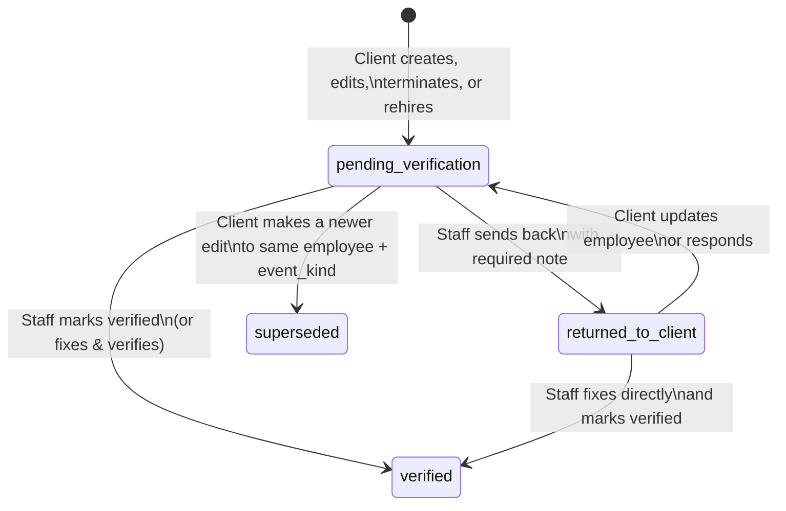

# Client-managed employee lifecycle: build plan

**Status:** Proposed build plan. No application code has changed.
**Date:** November 28, 2026.
**Codebase baseline:** `Shimizu-Technology/cornerstone-payroll` `origin/main` at `0332c430c`.
**Builds on:** [Product architecture decision](PRODUCT_ARCHITECTURE_DECISION_2026-11-19.md) (§6 milestones and go-live rule), [Milestone 4 build plan](MILESTONE_4_EMPLOYEE_APP_BUILD_PLAN_2026-11-24.md) (employee identity, contact changes, address requests, and RLS standards).

> All person, company, and employee names used in examples below (such as Harborview Bistro, Pacific Trade Works, Maya Santos, and Devon Cruz) are fictional.

---

## Summary

Today, Cornerstone Payroll uses an **approve-first** model for client employee changes: when a client manager adds a new hire or changes pay, W-4 withholding, SSN, or contractor tax details, the change waits in an `EmployeeChangeRequest` queue until Cornerstone staff approve it. New hires stay inactive (`portal_pending_approval: true`) until approved, and clients cannot terminate or rehire workers at all.

This plan adds an opt-in, per-company mode — **"Client manages, Cornerstone verifies"** (`client_managed`) — modeled on Gusto and ADP:

1. **Client managers run the employee lifecycle directly.** Client managers (client portal users who are not `client_viewer`) add new hires, edit pay rates, W-4s, payment methods, addresses, and titles, and terminate or rehire workers. Hard-deleting employees remains forbidden for everyone.
2. **New hires get a "Ready to pay" checklist.** A new hire can be saved while still incomplete, but until every required item is filled in, they stay **Incomplete** and are automatically left out of pay runs with a clear reason (for example, *"Can't be paid yet: W-4 missing"*). Once every item is complete, they are paid in the next payroll with no approval step.
3. **Cornerstone verifies after the fact.** Every new hire, termination, rehire, and pay-affecting change lands on a staff **"To verify"** queue with a `PortalNotifications` alert. Staff mark each item verified, fix it and verify, or send it back to the client with a note (which notifies client managers).
4. **Fail-closed pay-run safety net.** Any open pay run surfaces *"Changed since last payroll, not verified"* items for workers on that run. This never blocks the client; it blocks staff **commit** until staff either verify each item or explicitly acknowledge every unverified item by snapshot ID.
5. **Org-admin / super-admin override.** Only a Cornerstone `org_admin` or `super_admin` can let an Incomplete employee be paid anyway, with step-up authentication, a written reason, and an audit trail. If the employee is missing a W-4, withholding defaults to **Single with no adjustments** per IRS Publication 15-T and the Guam Territorial Income Tax mirror code.
6. **Existing employees keep getting paid.** Pre-rollout employees (including imported rosters) may be missing checklist items. They are never blocked retroactively; they display a non-blocking **"Missing items"** badge for the client to clean up, while the hard pay block applies only to employees created (or rehired — see §12 Q2) after `client_managed` mode is turned on for that company.
7. **Switched off by default.** Every company defaults to today's **"Cornerstone approves first"** (`approval_first`) mode. Rollout follows the go-live rule in [PRODUCT_ARCHITECTURE_DECISION_2026-11-19.md](PRODUCT_ARCHITECTURE_DECISION_2026-11-19.md) §6: internal payroll-team acceptance testing, practice-lead sign-off, one pilot client for a full pay period, then broader rollout.

### What this feature deliberately does not change

- **Hard deletes remain blocked.** Neither clients nor staff can hard-delete employees (`api/app/controllers/api/v1/admin/employees_controller.rb:285-289`).
- **Employee-initiated home-address requests stay as they are.** Employees still submit address changes in the employee app for client-manager approval (with no self-approval) under Milestone 4's `EmployeeChangeRequest#profile_address?` flow.
- **W-2 ↔ 1099 classification changes stay staff-only.** Changing an employee's tax classification in place remains forbidden (`api/app/models/employee.rb:775-787`; `ClientEmployeeUpdateService#validate_tax_classification_change!`, `api/app/services/client_employee_update_service.rb:411-417`).
- **Bank routing/account capture is not added here.** Choosing `paper_check` vs. `direct_deposit` satisfies the payment-method checklist item; bank account collection and employee bank-change self-service remain deferred per Milestone 4 §0 D3.
- **`approval_first` companies behave identically to today.**

---

## 1. Where things stand today (codebase audit)

Every reference below was verified against `origin/main` (`0332c430c`).

### 1.1 Client employee creation and updates

- **`ClientEmployeeUpdateService`** (`api/app/services/client_employee_update_service.rb`):
  - `DIRECT_FIELDS` (`:14-30`): `first_name`, `middle_name`, `name_suffix`, `last_name`, `job_title`, `email`, `date_of_birth`, `hire_date`, `department_id`, `address_line1`, `address_line2`, `city`, `state`, `zip`, `phone` apply immediately.
  - `APPROVAL_FIELDS` (`:31-61`): `ssn_encrypted`, `employment_type`, `salary_type`, `pay_rate`, `pay_frequency`, W-4 fields (`filing_status` through `w4_election_received`), legacy retirement rates, contractor fields (`business_name`, `contractor_ein`, `contractor_type`, `contractor_pay_type`, `w9_on_file`), `default_custom_earnings`, `default_payroll_adjustments`, and `wage_rates` create a pending `EmployeeChangeRequest` instead of saving onto `Employee`.
  - `payment_delivery_method` is in neither list, is not permitted in `Client::EmployeesController#employee_params` (`api/app/controllers/api/v1/client/employees_controller.rb:154-219`), and is rendered `disabled={isClient}` in `web/src/pages/employees/EmployeeForm.tsx:1638`.
  - `create!` (`client_employee_update_service.rb:105-164`) creates the `Employee` with `pay_rate: 0`, `status: "inactive"`, `portal_pending_approval: true` (`:118-125`), seeds `EmployeeDocumentReadiness` (`:137`), and opens a `create` `EmployeeChangeRequest` proposing `status: "active"`, `portal_pending_approval: false`, and `approval_attrs` (`:139-145`).
  - `PortalNotifications.employee_change_submitted!` fires only inside `create_change_request!` (`:499`). Direct-only edits notify nobody, except when `employee_portal.features.profile_requests` is enabled and email/phone/address changes write `EmployeeContactChangeToConfirm` (`:221`, `:447-451`).
- **`Api::V1::Client::EmployeesController`** (`api/app/controllers/api/v1/client/employees_controller.rb`, routes at `api/config/routes.rb:121-123`): exposes `index`, `show`, `create`, and `update` only — no `terminate`, `rehire`, or `destroy`.
- **Client viewer protection:** `ClientPortalAccess` (`api/app/controllers/concerns/client_portal_access.rb:13-53`) blocks every non-GET/HEAD write from `User#client_viewer?` (`:41-46`, except two read-receipt endpoints), returning HTTP 403 (`code: "client_view_only"`). `revalidate_client_company_write_access!` (`:31-39`) re-verifies `!actor.client_viewer?` under the company row lock.

### 1.2 Termination, deactivation, and rehire

- **UI gating:** `web/src/pages/employees/EmployeeForm.tsx` gates the inactive/terminated banner and Reactivate button (`:1289-1317`), status history (`:1799`), and Terminate/Deactivate buttons (`:2443-2459`) behind `!isClient`.
- **Service rules:** `EmployeeStatusTransitionService` (`api/app/services/employee_status_transition_service.rb:41-149`):
  - `terminate!` (`:41-72`) requires `StaffRolePolicy.allowed?(@actor, :manage_client_configuration)`, forbids future dates, checks `effective_date >= hire_date` and not before the latest `EmployeeStatusEvent`, blocks if an `approved` regular pay run has `start_date >= effective_date` (`block_approved_runs!`, `:145-149`), sets `status: "terminated"` and `termination_date: effective_date`, appends an immutable `EmployeeStatusEvent` (`api/app/models/employee_status_event.rb:3-48`), and calls `EmployeeLinks::Retire.terminated!` (`:69`).
  - `reactivate!` (`:107-141`) requires `manage_employee_status` (plus `manage_client_configuration` for terminated workers), enforces `effective_date > termination_date` and after the latest status event, sets `status: "active"` and `termination_date: nil`, and appends a `reactivated` event.
  - **Check constraint to expand:** `employee_status_events` restricts `source` to `('operator', 'production_migration')` (`api/app/models/employee_status_event.rb:6`, `api/db/schema.rb`). Client-initiated transitions need `'client_portal'` added.
  - **Payroll date boundary:** `Employee.eligible_for_period` (`api/app/models/employee.rb:256-303`) already keeps a terminated worker eligible for periods where `termination_date >= period_start` (so final pay for days worked happens) and excludes them from periods starting strictly after `termination_date`.

### 1.3 Existing review queues, notifications, and staff roles

- **Change requests:** `EmployeeChangeRequest` (`api/app/models/employee_change_request.rb:3-423`) has statuses `pending | approved | rejected | cancelled | superseded` (`:68`) and a partial unique index `idx_employee_change_requests_one_pending` allowing only one pending request per employee (`api/db/schema.rb`). Staff approve/reject via `Admin::EmployeeChangeRequestsController` (`api/app/controllers/api/v1/admin/employee_change_requests_controller.rb`, `:manage_client_configuration`), surfaced in `web/src/pages/AdminEmployeeChangeRequestsPage.tsx` (Sidebar "Client Changes", `web/src/components/layout/Sidebar.tsx:141`) and aggregated across companies in `ClientInboxQuery` (`api/app/services/client_inbox_query.rb:105-106`).
- **Contact confirmations (M4-7):** `EmployeeContactChangeToConfirm` (`api/app/models/employee_contact_change_to_confirm.rb`) tracks contact, address, and delivery-consent changes when `employee_portal.features.profile_requests` or `delivery_consent` is enabled, rendered at `web/src/pages/EmployeeContactChangesToConfirm.tsx` and shown as a non-blocking count when creating a pay period (`api/app/controllers/api/v1/admin/pay_periods_controller.rb:174`).
- **Notifications:** `PortalNotifications` (`api/app/services/portal_notifications.rb:16-135`), `PortalNotifications::Recipients` (`api/app/services/portal_notifications/recipients.rb:11-324`), and `PortalNotifications::Email` (`api/app/services/portal_notifications/email.rb:8-479`) manage privacy-safe email alerts (company name, heading, scoped URL; no SSNs, wages, or employee names in email bodies).
  - Staff `employee_changes` (`default_mode: "digest"`) goes to company-listed `PortalNotificationRecipient` users with `:manage_client_configuration` (`recipients.rb:276`), plus extra emails.
  - Staff `contact_confirmations` (`default_mode: "digest"`) goes to company-listed recipients with `:payroll_operations` (`recipients.rb:273-274`).
  - Client `employee_change_decisions` goes only to `subject.requested_by_id` (`recipients.rb:245-247, 283`), whereas events flagged `client_managers_only: true` go to all active non-viewer client users assigned to the company (`recipients.rb:249-250, 281`).
- **Staff capabilities:** `StaffRolePolicy` (`api/app/policies/staff_role_policy.rb:7-46`) defines roles `super_admin`, `org_admin`, `admin`, `manager`, `accountant`, with per-company `client_management` delegation on `CompanyAssignment` for `DELEGATABLE_CAPABILITIES` (`:4`, `:299-311`). Sensitive org-level powers (`:manage_time_tracking_lock`, `:recover_clerk_invitation`, `:reveal_hidden_employee_notes`, `:manage_employee_app_switch`) are restricted strictly to `%w[super_admin org_admin]` (`:26, 33, 40, 44`).

### 1.4 Operating profiles and per-company settings

- **`OperatingProfileCatalog`** (`api/app/services/operating_profile_catalog.rb`), **`CompanyFeatures`** (`api/app/services/company_features.rb`), and **`ClientOperatingProfiles::UpdateService`** (`api/app/services/client_operating_profiles/update_service.rb`) store effective-dated, versioned, audited per-company settings.
- Five legacy booleans (`client_portal.review_first.{profile,contact,address,pay,termination}`) plus `ALWAYS_REVIEWED_GROUPS = %w[bank w4 identity]` exist in the catalog (`operating_profile_catalog.rb:60-61, 224-292`), and `CompanyFeatures#review_first?` (`company_features.rb:91-99`) has no callers in the codebase. This plan introduces one explicit two-mode setting (`client_portal.employee_lifecycle_mode`) that supersedes those unused booleans for employee lifecycle routing.

### 1.5 Pay runs, exclusions, W-4s, and document readiness

- **Roster & exclusions:**
  - `PayPeriodDefaultRoster` (`api/app/services/pay_period_default_roster.rb:12-29`) builds the default draft roster from `Employee.eligible_for_period` minus `pay_period_excluded_employees` (`api/app/models/pay_period_excluded_employee.rb`, manual per-period exclusions managed by `Admin::PayPeriodExcludedEmployeesController`).
  - `Admin::PayPeriodsController#run_payroll` (`api/app/controllers/api/v1/admin/pay_periods_controller.rb:371-411`) filters selected employees through `Employee.eligible_for_payroll_run` (`api/app/models/employee.rb:247-255`).
- **Approve, client review, and commit:**
  - `PayPeriodLifecycleService#approve!` (`api/app/services/pay_period_lifecycle_service.rb:34-63`) runs eligibility, expected-entry, variable-pay, `EmployeeDocumentReadiness`, FICA, and payment-delivery validations, then publishes a `PayrollReviewPackage` (`PayrollReview::RevisionService#publish!`, `api/app/services/payroll_review/revision_service.rb:63-85`) when `client_payroll_approval_required?` is true.
  - `PayPeriodLifecycleService#commit!` (`:92-161`) re-runs those validations, enforces `validate_client_approval!` (`:115`), and validates **snapshot acknowledgements** (`validate_file_request_snapshot!`, `:119-120, 167-177`; `validate_check_number_snapshot!`, `:121, 179-188`), raising `CommitConflict` (HTTP 409) if the acknowledged set changed between dialog open and confirm. `web/src/components/payroll/PayrollCommitDialog.tsx:61-114, 143-159` handles that exact reload-and-reconfirm loop on the frontend.
- **W-4 elections and calculator:**
  - `EmployeeW4Election` (`api/app/models/employee_w4_election.rb:3-88`) is append-only with `DEFAULT_PROFILE_ATTRIBUTES` (`filing_status: "single"`, all adjustments `0`, `w4_step2_multiple_jobs: false`, `w4_form_version: 2020`) and `SOURCES` check constraint (`default_withholding`, `staff`, `client_approved`, `employee_creation`, `legacy_profile`, `quickbooks_history`).
  - `PayrollCalculator#w4_profile_for_calculation` (`api/app/services/payroll_calculator.rb:952-956`) falls back to `EmployeeW4Election::DEFAULT_PROFILE_ATTRIBUTES` when no election covers `pay_period.pay_date`. `GuamTaxCalculatorV2#calculate_pub_15_t_withholding` (`api/app/services/guam_tax_calculator_v2.rb:192-202`) applies IRS Pub 15-T (2026) Worksheet 1A (`AnnualTaxConfig::OFFICIAL_2026_WITHHOLDING`, `api/app/models/annual_tax_config.rb:13-32`).
- **Important conflict found — `EmployeeDocumentReadiness` and `Employee#required_filing_fields`:**
  1. Today, `Employee#required_filing_fields` (`api/app/models/employee.rb:808-833`) refuses to save a new `Employee` without SSN/EIN, hire date, and full address unless `portal_pending_approval?` is true or a temporary 24-hour company-wide `EmployeeIntakePolicy` exception is open (`api/app/services/employee_intake_policy.rb:3-44`). Under `client_managed` mode, client managers must be able to save an **Incomplete** new hire at any time without asking staff to open a 24-hour intake window.
  2. Today, `EmployeeDocumentReadiness.seed_new_hire!` (`api/app/services/employee_document_readiness.rb:21-39`) sets `document_readiness_required: true`, which causes `PayPeriodLifecycleService#approve!` and `#commit!` to **block payroll** until Cornerstone staff mark uploaded I-9 / W-4 / W-9 documents `verified` or `waived` (`employee_document_readiness.rb:68-84`). Under `client_managed` mode, leaving `required_for_payroll: true` on seeded document rows would contradict the core rule that a Ready new hire gets paid with no pre-approval step. Section 4 resolves both cleanly.
- **Employee app former-employee rules:** `EmployeeLinks::Retire.terminated!` (`api/app/services/employee_links/retire.rb:18-26`) moves active links to `former` with `former_access_until = termination_date + former_access_years` (default 2 years, `operating_profile_catalog.rb:439`) and revokes unused invites. `EmployeeLinks::Invite` (`api/app/services/employee_links/invite.rb:38, 77-89`) allows client managers to send email invites (`employee_links.rb:59-63`) for active employees and reuses a rehired worker's prior login without creating a duplicate identity.
- **Row-level security:** `api/lib/rls_tables.rb` classifies every table (`RLS_PROTECTED_TABLES`, `RLS_PARENT_PROTECTED_TABLES`, `RLS_EXEMPT_TABLES`, `RLS_GLOBAL_TABLES`), enforced in CI by `api/spec/security/company_rls_isolation_spec.rb`. Recent migrations (see `api/db/migrate/20261128020000_create_delivery_preferences.rb:31-55`) add `company_id NOT NULL`, composite tenant FKs `(employee_id, company_id)` referencing `employees(id, company_id)` (unique index `idx_employees_document_readiness_tenant_key`), install the company policy via `db/rls_policies.sql`, and run `ENABLE ROW LEVEL SECURITY` + `FORCE ROW LEVEL SECURITY` when RLS enforcement is active.

---

## 2. User journeys (desktop and mobile)

### 2.1 Client manager

Client managers are active `client` users with `!client_viewer?` assigned to the company. Client viewers see the same screens read-only (badges, checklists, verification status) with all mutation controls hidden and blocked server-side.

#### A. Add a new hire (desktop & phone)
1. Client manager opens **Employees → Add employee** (single-column stacked form on mobile with 44px touch targets; two-column card sections on desktop).
2. Chooses worker type (**W-2 Employee** — hourly, fixed salary, or variable salary — or **1099 Contractor** — individual or business, hourly or flat fee).
3. Enters whatever they have now (even just first name, last name, and worker type) and clicks **Save employee**.
   - **If all checklist items are complete:** employee is saved as `active` and **Ready to pay**. A confirmation banner states *"Maya Santos is ready for payroll. Cornerstone will verify their details."* A `new_hire` item is queued for Cornerstone verification.
   - **If any checklist item is missing:** employee is saved as `active` with `readiness_gate_enforced: true` and computed status **Incomplete**. No `EmployeeChangeRequest` is created, and no Cornerstone approval is required.
4. On the employee overview (`ClientEmployeeOverview`) and employee list (`EmployeeList`), an Incomplete worker shows:
   - An amber **Incomplete — can't be paid yet** badge and a checklist card listing each item with green checkmarks for completed items and plain-English missing prompts (e.g., *"W-4 withholding details missing"*, *"Payment method not chosen"*).
   - A direct **Complete setup** button that scrolls straight to the first missing section in `EmployeeForm` (works smoothly on mobile without horizontal scrolling).
5. When the manager fills in the remaining items and saves, the checklist turns **Ready to pay** immediately. They appear in the next payroll run automatically, and the `new_hire` verification item updates with the completed details for Cornerstone to verify.

#### B. Edit an active employee (pay rate, W-4, payment method, address, title)
1. Manager edits any supported field on `EmployeeForm` or `EmployeeContactDetails` and clicks **Save**.
2. Changes take effect directly on the employee record:
   - **Pay rate / wage rates / pay frequency:** defaults effective date to the start of the next uncommitted/unapproved pay period (`EmployeeCompensationChangeService.next_uncommitted_period_start`), with a clear note showing which pay period the change starts on. Managers can also pick a future effective date (e.g., next month's raise).
   - **W-4:** requires signed date or source reference and effective date (`>= w4_signed_on`). Appends a new `EmployeeW4Election` (`source: "client_direct"`).
   - **Payment method (`paper_check` / `direct_deposit`):** updates future runs via `EmployeePaymentDefaultService`; existing open runs keep their reviewed method.
   - **Address, phone, email, title, department, SSN/TIN:** apply immediately (except a dual-role client manager editing their **own** home address, which still routes through the Milestone 4 no-self-approval address request — §6.2).
3. Banner confirms *"Saved. Cornerstone has been notified to verify this change."* Pay-affecting, identity, and tax changes create an `employee_verification_item` in Cornerstone's **To verify** queue.

#### C. Terminate and rehire
1. **Terminate:** on an active (or incomplete) employee's overview/edit page, manager clicks **Terminate** (opens a responsive modal; full-screen sheet feel on mobile).
   - Enters **Last day worked**, **Termination date** (defaults to last day worked; must be `>= last_worked_on`, `>= hire_date`, and not in the future), **Reason** (from `EmployeeStatusEvent::TERMINATION_REASONS`), and optional note.
   - Preview block explains in plain English: *"Maya Santos will stay eligible for final pay covering work through [termination date], will be left out of pay runs starting after that date, and their employee app access will become read-only for [2] years."*
   - On confirm, the employee becomes `terminated`, `EmployeeLinks::Retire.terminated!` updates their app access, and a `termination` verification item lands in Cornerstone's **To verify** queue.
2. **Rehire:** on a terminated employee's page, manager clicks **Rehire**.
   - Enters **Rehire date** (`> termination_date`, not in the future) and optional note.
   - Modal previews the **Ready to pay** checklist so the manager immediately sees whether any items are missing (e.g., if a pre-rollout worker lacked DOB or W-4, or if payment method was blank).
   - On confirm, the employee returns to `active` (`termination_date` cleared), checklist status is recomputed (**Ready** or **Incomplete**), and a `rehire` verification item lands in Cornerstone's **To verify** queue. No employee app invite is sent automatically; the manager can send one once Ready.

#### D. Respond to a "Sent back" item from Cornerstone
1. Client managers receive a `PortalNotifications` email (*"Action needed on employee details — Harborview Bistro"*) and see a **"Needs attention"** count in their portal navigation / employee list filter.
2. Opening the employee shows a highlighted callout with Cornerstone's note (e.g., *"W-4 signed date is 2026-11-15 but effective date was entered as 2026-11-01 — please confirm"*).
3. Manager edits the record and clicks **Save** (or clicks **Reply / confirm no change needed** with a note if the data is already right). Saving automatically moves the item back to `pending_verification` in Cornerstone's queue.

### 2.2 Cornerstone staff (accountant, manager, admin)

#### A. Work the "To verify" queue (desktop & mobile)
1. Staff open **To verify** from the company sidebar (alongside **Client Changes**, and surfaced in the cross-company **Client Inbox** with a waiting count).
2. Desktop uses the proven split-pane layout (`AdminEmployeeChangeRequestsPage.tsx`): filterable table on the left (filters: status `Pending verification` / `Sent back to client` / `Verified`, event kind `New hire` / `Pay & tax` / `Termination` / `Rehire`, search by employee), detail panel on the right. Mobile uses stacked tappable cards that jump to the detail view with a Back link.
3. Each item shows: employee name & link to employee record, event type, who made the change and when, before/after comparison (`ChangeComparison`, with SSN/EIN masked to last 4), checklist state, and any prior send-back notes.
4. Staff choose one of three actions:
   - **Mark verified** (optional internal note) → moves to `verified`, clears the item from pay-run commit warnings.
   - **Fix & verify** → opens the employee record in an edit view (carrying `?verify_item_id=123`) so staff can correct the underlying field using normal staff controls; on save, prompts to mark the item `verified` with `fixed_by_staff: true` and an audit link to what staff changed.
   - **Send back to client** → requires a note (5–1,000 chars) explaining what the client needs to fix. Moves item to `returned_to_client` and sends `employee_verification_returned` to the company's client managers. Note: a `returned_to_client` item is **still unverified**, so it still appears in the pay-run commit safety net until resolved and verified!

#### B. Run payroll with the safety net
1. **Worksheet / draft:**
   - Eligible **Ready** employees (plus grandfathered pre-rollout employees, who show a small info tag *"Missing items"* if incomplete) appear on the payroll roster as normal.
   - **Incomplete** new hires (`readiness_gate_enforced: true`, missing checklist items, no active override) are automatically kept off the payable roster and listed in a collapsible **"Not included — incomplete setup"** panel right under the roster, showing each worker's exact reason (e.g., *"Devon Cruz — Can't be paid yet: W-4 missing, payment method not set"*) and links to open their profile (plus an **Override** button visible only to `org_admin` / `super_admin`).
   - Existing manual exclusions (`pay_period_excluded_employees`) remain in their own **"Excluded from this run"** panel so staff never confuse a manual skip with an incomplete new hire.
2. **Calculate & Approve:**
   - Unverified client changes **do not block** Calculate, Approve, or publishing a `PayrollReviewPackage` to the client for payroll approval. The client is never blocked by Cornerstone's internal verification backlog.
   - Throughout the pay-run workspace, a prominent warning banner lists **"Changed since last payroll, not verified (N)"** with quick links to verify each item before commit.
3. **Commit (fail-closed gate):**
   - `PayrollCommitDialog` loads fresh pay-period state (`payPeriodsApi.get`), including `unverified_employee_changes`: every `employee_verification_item` with `status IN ('pending_verification', 'returned_to_client')` and `affects_pay: true` for any employee who either (a) has a reportable `payroll_item` in this pay run, OR (b) was terminated/rehired/added with an effective date overlapping or before `pay_period.end_date` since the last committed regular run.
   - Each unverified item appears as an explicit row in the Commit dialog (employee name, change summary, status, link to open) with a per-item checkbox (or individual checkboxes when <= 10 items, and explicit checklist review) that staff must tick before **Confirm commit** enables.
   - Client sends `acknowledged_verification_items: [{ id, updated_at }]` to `POST /api/v1/admin/pay_periods/:id/commit`.
   - Server locks the company and pay period, recomputes the exact list of required unverified items, and **fails closed** (HTTP 409 `code: "unverified_changes_changed"`) if any item was added, edited, or changed after the dialog loaded. The dialog reloads the updated list, clears checkboxes, focuses the conflict alert, and requires re-confirmation — identical to the existing `outstanding_file_requests_changed` and `check_number_changed` flow (`PayrollCommitDialog.tsx:83-107`).
   - Acknowledging an item to commit **does not** mark it `verified`; it records an immutable `pay_period_verification_acknowledgement` row and leaves the item in the **To verify** queue.

### 2.3 Cornerstone org admin / super admin

1. **Enable or switch mode per company:** on **Company settings → Operating profile**, an org admin / super admin selects `client_portal.employee_lifecycle_mode` (`Cornerstone approves first` vs. `Client manages, Cornerstone verifies`), enters an effective date and reason, and reviews the preflight summary (which blocks switching into `client_managed` if non-address `EmployeeChangeRequest` rows are still pending; §5).
2. **Grant an Incomplete-employee pay override:**
   - Available only to `org_admin` and `super_admin` (non-delegatable capability `:override_employee_readiness`), never while using View-as (`Current.view_as_grant`), and gated by fresh step-up verification (`RecentVerification`, `MfaPolicy.recently_verified_second_factor?` / `require_direct_recent_verification!`).
   - On an Incomplete employee's record (or from the pay run's "Not included — incomplete setup" panel), clicks **Allow in payroll (Admin override)**.
   - Modal shows the exact missing checklist items, requires:
     - Scope: specific draft/open **Pay period** (recommended default) or an expiry date up to 30 days out;
     - Written **Reason** (10–1,000 characters);
     - If W-4 is missing (W-2 employee): mandatory checkbox *"I acknowledge that federal/Guam income tax will be withheld at Single with no adjustments (IRS Pub 15-T default) until a signed Form W-4 is recorded."*
   - On confirm: creates `employee_readiness_override` + `admin_override` + `audit_log`, records a `default_withholding` `EmployeeW4Election` if W-4 is missing, and sends `PortalNotifications.admin_override!` (mandatory alert to `super_admins` + account team).
   - The employee immediately becomes eligible for that pay run with an **"Override active"** badge. The override can be revoked at any time before the run is committed.

---

## 3. Exact "Ready to pay" checklist rules & IRS Pub 15-T withholding

### 3.1 Checklist matrix by worker type and pay basis

One shared service, **`EmployeeReadinessEvaluator`**, evaluates every item from live database columns and associations. Nothing stores a duplicate status string that could drift out of sync.

| Checklist item | Key | W-2 Hourly (single or multi-rate) | W-2 Fixed Salary (`annual` / `per_period`) | W-2 Variable Salary (`variable`) | 1099 Individual Contractor (`hourly` / `flat_fee`) | 1099 Business Contractor (`hourly` / `flat_fee`) | Plain-English missing label |
|---|---|---|---|---|---|---|---|
| **Legal name** | `legal_name` | `first_name` & `last_name` present | `first_name` & `last_name` present | `first_name` & `last_name` present | `first_name` & `last_name` present | `first_name`, `last_name`, & `business_name` present | `"legal name missing"` (or `"business name missing"`) |
| **Tax ID (SSN / TIN)** | `tax_id` | 9-digit SSN (`valid_filing_ssn?`) | 9-digit SSN (`valid_filing_ssn?`) | 9-digit SSN (`valid_filing_ssn?`) | 9-digit SSN or 9-digit EIN (`form_1099_tin.present?`) | 9-digit `contractor_ein` (`form_1099_tin[:type] == "EIN"`) | `"SSN missing"` (W-2) / `"TIN (SSN or EIN) missing"` (1099 individual) / `"business EIN missing"` (1099 business) |
| **Date of birth** | `date_of_birth` | `date_of_birth` present (valid past date, year >= 1900) | Same | Same | Optional (see §12 Q4) | Not applicable | `"date of birth missing"` |
| **Hire / start date** | `hire_date` | `hire_date` present (plausible date) | Same | Same | `hire_date` present (start date) | `hire_date` present (start date) | `"hire date missing"` (W-2) / `"start date missing"` (1099) |
| **Home / mailing address** | `home_address` | `address_line1`, `city`, `state`, `zip` all present | Same | Same | Same | Same (business/mailing address for 1099-NEC) | `"home address missing"` (W-2) / `"mailing address missing"` (1099) |
| **Pay type, rate & frequency** | `pay_setup` | `pay_frequency` present AND (`pay_rate > 0` OR active `employee_wage_rate` with `rate > 0`) | `salary_type` in `annual`/`per_period`, `pay_frequency` present, AND `pay_rate > 0` | `salary_type == "variable"` AND `pay_frequency` present (`pay_rate` may be `0`; period pay is entered per run via `salary_override`) | `contractor_pay_type` & `pay_frequency` present; if `hourly`: `pay_rate > 0` OR active `employee_wage_rate > 0`; if `flat_fee`: `pay_rate >= 0` (`ContractorPayrollCalculator` accepts per-period `salary_override`, `:41-55`) | Same as individual contractor | `"pay rate missing"` / `"pay setup incomplete"` |
| **Tax form (W-4 or W-9)** | `tax_form` | `w4_effective_on` present AND at least one `employee_w4_elections` row with `source != "default_withholding"` and `w4_form_version >= 2020` | Same | Same | `w9_on_file == true` (paired with valid TIN above) | `w9_on_file == true` (paired with valid EIN above) | `"W-4 missing"` (W-2) / `"W-9 not marked on file"` (1099) |
| **Payment method** | `payment_method` | `payment_delivery_method` in `%w[paper_check direct_deposit]` (not `NULL`) | Same | Same | Same | Same | `"payment method not set"` |

**Reason formatting:** `EmployeeReadinessEvaluator.reason_for(employee)` joins missing labels cleanly into a single message shown on the employee record and pay run, e.g.:
- 1 item: `"Can't be paid yet: W-4 missing."`
- 2 items: `"Can't be paid yet: SSN missing and payment method not set."`
- 3+ items: `"Can't be paid yet: W-4 missing, date of birth missing, and 2 more items."` (with full list in tooltip/detail).

**Important nuances verified against the code:**
- **Multi-rate hourly workers:** Many hourly employees use `employee_wage_rates` rows (`Employee#default_payroll_rate`, `api/app/models/employee.rb:335-337`) rather than a nonzero `employees.pay_rate`. The `pay_setup` check inspects both `pay_rate > 0` and `employee_wage_rates.active.where("rate > 0").exists?` (on `as_of` date via `wage_rates_on`).
- **Variable salary & flat-fee contractors:** `variable` salary employees legitimately have `pay_rate = 0` (`PayPeriodLifecycleService#validate_variable_period_pay!`, `api/app/services/pay_period_lifecycle_service.rb:281-289`), and `flat_fee` contractors can be paid per invoice via `salary_override` (`api/app/services/contractor_payroll_calculator.rb:41-55`). Requiring `pay_rate > 0` for them would falsely block valid workers.
- **Default withholding never completes W-4:** An `EmployeeW4Election` with `source == "default_withholding"` created by an org-admin override lets the calculator run, but `tax_form` stays **missing** until a real W-4 election (`source != "default_withholding"`) is recorded.
- **No silent clearing of completed fields:** Once a client manager has filled in SSN, EIN, DOB, hire date, address, or W-4 on a `readiness_gate_enforced` employee, client updates cannot blank them back out to `nil`/`""` (consistent with `Employee#valid_supplied_intake_dates` at `api/app/models/employee.rb:839-841`). Corrections replace the value with a valid new value.

### 3.2 Existing (grandfathered) employees vs. new hires

Existing employees across live companies — especially QuickBooks-imported rosters — may lack `date_of_birth`, `payment_delivery_method`, `address_line1`, `w9_on_file`, or a non-legacy `EmployeeW4Election`. Blocking them when a company turns on `client_managed` mode would break payroll on day one.

**Exact grandfathering rule:**
- Add `employees.readiness_gate_enforced` (`boolean, null: false, default: false`).
- All existing rows stay `readiness_gate_enforced = false`.
- Whenever an employee is **created** while `CompanyFeatures.for(company).client_managed_employee_lifecycle?` is true, stamp `readiness_gate_enforced = true`.
- Whenever a terminated employee is **rehired** while `client_managed_employee_lifecycle?` is true, stamp `readiness_gate_enforced = true` (re-checking the checklist; see §12 Q2 for the alternative of keeping legacy rehires soft-warned).
- **Behavior:**
  - `readiness_gate_enforced == true` and missing items > 0 and no active `employee_readiness_override`: **Hard block** — status displays **Incomplete**, excluded from pay runs with exact reason.
  - `readiness_gate_enforced == false` and missing items > 0: **Soft warning** — employee stays eligible for every pay run; displays **"Missing items (N)"** badge on the client and staff employee lists and a non-blocking checklist card on the employee page so the client can finish filling them in.
- **Why an explicit column instead of `employees.created_at >= profile.effective_on`:** Companies can pilot `client_managed`, toggle back to `approval_first`, amend effective dates, or run historical imports. An explicit column on `employees` is immune to profile-date churn, trivial to index in SQL for `eligible_for_period`, and never retroactively breaks an already-paid worker.

### 3.3 Missing W-4 default withholding — IRS Pub 15-T and Guam verification

- **Legal citation:**
  - **IRS Publication 15-T (2026), *Federal Income Tax Withholding Methods*** ("Introduction — Employees who fail to furnish a Form W-4", alongside IRS Publication 15 and **26 CFR § 31.3402(f)(2)-1**): when an employee first paid wages in 2020 or later fails to furnish a valid Form W-4, the employer must withhold federal income tax as if the employee checked **"Single or Married filing separately"** in Step 1(c) and made **no entries in Steps 2, 3, or 4** (standard withholding rate schedule, Single standard deduction/Worksheet 1A adjustment, `$0` dependent credit, `$0` other income, `$0` extra deductions, `$0` extra withholding).
  - **Guam Territorial Income Tax (GTIT) mirror code:** Under **48 U.S.C. § 1421i** (Organic Act of Guam § 31), the Internal Revenue Code and IRS withholding tables apply in Guam as the Guam Territorial Income Tax, with withheld income taxes remitted to the Guam Department of Revenue and Taxation (Form 500 / 941-GU). Social Security (6.2% up to the annual wage base) and Medicare (1.45%, plus 0.9% Additional Medicare over $200,000) apply independently of Form W-4.
- **How the codebase applies it today (verified):**
  1. `EmployeeW4Election::DEFAULT_PROFILE_ATTRIBUTES` (`api/app/models/employee_w4_election.rb:22-27`) defines:
     - `filing_status: "single"`
     - `allowances: 0`
     - `additional_withholding: 0`
     - `w4_dependent_credit: 0`
     - `w4_step2_multiple_jobs: false`
     - `w4_step4a_other_income: 0`
     - `w4_step4b_deductions: 0`
     - `w4_form_version: 2020`
  2. `PayrollCalculator#w4_profile_for_calculation` (`api/app/services/payroll_calculator.rb:952-956`) returns `w4_election_for_calculation&.profile_attributes || EmployeeW4Election::DEFAULT_PROFILE_ATTRIBUTES`.
  3. `GuamTaxCalculatorV2#calculate_pub_15_t_withholding` (`api/app/services/guam_tax_calculator_v2.rb:192-202`) uses `AnnualTaxConfig::OFFICIAL_2026_WITHHOLDING["single"]` (`api/app/models/annual_tax_config.rb:13-32`, citing IRS Pub 15-T (2026)): annualizes gross pay (`gross_pay * periods_per_year`), adds `$0` Step 4a, subtracts the Single Worksheet 1A adjustment (`$8,600` for 2026) and `$0` Step 4b, applies the Single standard progressive brackets, divides by `periods_per_year`, and subtracts `$0` Step 3 credit.
- **How the org-admin override wires into it:**
  - When an org admin or super admin grants an `employee_readiness_override` for a W-2 employee with no W-4 election covering the target pay date, the override service requires `default_w4_acknowledged: true` and writes an explicit append-only `EmployeeW4Election` row with `source: "default_withholding"`, `effective_on: target_pay_date` (or `hire_date` if earlier), `w4_source_reference: "Admin readiness override ##{override.id} — IRS Pub 15-T default (Single, no adjustments)"`, and `DEFAULT_PROFILE_ATTRIBUTES` — matching the proven pattern in `EmployeeIntakeExceptionReviewService` (`api/app/services/employee_intake_exception_review_service.rb:26-36`).
  - Writing that explicit election row ensures the paycheck's `tax_rule_snapshot["w4"]` captures a concrete `election_id` and `source: "default_withholding"`, and guarantees that when the real signed Form W-4 arrives later, `EmployeeW4ElectionChangeService#validate_default_replacement!` (`api/app/services/employee_w4_election_change_service.rb:75-89`) enforces signed-date/source evidence before replacing it.

---

## 4. Data model, migrations (RLS), state machines, and API

### 4.1 Per-company mode setting

Add one option entry to `OperatingProfileCatalog::ENTRIES` (`api/app/services/operating_profile_catalog.rb`):

- **ID:** `client_portal.employee_lifecycle_mode`
- **Section:** `client_portal`
- **Storage:** `:option` (stored inside `client_operating_profiles.options`)
- **Type:** `"enum"`
- **Allowed:** `%w[approval_first client_managed]`
- **Default:** `"approval_first"` (UI label: **"Cornerstone approves first"**; `client_managed` label: **"Client manages, Cornerstone verifies"**)
- **Requires:** `[ "client_portal_enabled" ]`
- **Capability:** `:manage_organization` (`super_admin`, `org_admin`, `admin`) — or `:manage_client_administration` if managers should also toggle it; recommending `:manage_organization` keeps rollout under org-admin control during the pilot.
- **`CompanyFeatures` helper** (`api/app/services/company_features.rb`):
  ```ruby
  def employee_lifecycle_mode
    return "approval_first" unless client_portal_enabled?

    option("client_portal.employee_lifecycle_mode") || "approval_first"
  end

  def client_managed_employee_lifecycle?
    employee_lifecycle_mode == "client_managed"
  end
  ```
- **Relation to unused `client_portal.review_first.*` options:** Leave those existing JSON keys accepted in `OperatingProfileCatalog` so existing saved `client_operating_profiles` rows remain valid; mark them deprecated in catalog metadata and hide them from the UI when `employee_lifecycle_mode` is rendered.

### 4.2 Schema changes and RLS migrations

Every new tenant-scoped table follows the repo's exact RLS pattern (`api/db/migrate/20261128020000_create_delivery_preferences.rb:12-55`): `SET LOCAL lock_timeout = '5s'`, `company_id NOT NULL` FK (`on_delete: :restrict`), composite tenant FK `(employee_id, company_id) REFERENCES employees(id, company_id)`, policy installation via `db/rls_policies.sql` (`pg_temp.install_company_policy`), `ENABLE ROW LEVEL SECURITY` + `FORCE ROW LEVEL SECURITY` (matching live database enforcement state), registration in `RlsTables::RLS_PROTECTED_TABLES` (`api/lib/rls_tables.rb`), and cross-company isolation specs under RLS `raise` (`api/spec/security/company_rls_isolation_spec.rb`).

#### Migration 1: `employees` column + source CHECK constraints
- Add `employees.readiness_gate_enforced` (`boolean, null: false, default: false`) + partial index `(company_id, id) WHERE readiness_gate_enforced = true`.
- Update `employee_status_events` check constraint `employee_status_events_source_check`: allow `('operator', 'production_migration', 'client_portal')`. Update `EmployeeStatusEvent::SOURCES`.
- Update `employee_w4_elections` check constraint `employee_w4_elections_source_check`: allow `('staff', 'client_approved', 'client_direct', 'employee_creation', 'legacy_profile', 'quickbooks_history', 'default_withholding')`. Update `EmployeeW4Election::SOURCES` and include `'client_direct'` in `EmployeeW4Election#effective_before_signature?` (`api/app/models/employee_w4_election.rb:59-62`).

#### Migration 2: `employee_verification_items` (RLS-protected)
Tracks every client-managed lifecycle action Cornerstone must verify after the fact.

| Column | Type / Constraints | Purpose |
|---|---|---|
| `id` | `bigint` PK | |
| `company_id` | `bigint, null: false`, FK `companies` (`on_delete: :restrict`) | Tenant key for RLS |
| `employee_id` | `bigint, null: false`, composite FK `(employee_id, company_id)` → `employees(id, company_id)` | Subject employee |
| `event_kind` | `string, null: false`, CHECK in `%w[new_hire compensation_change w4_change payment_method_change identity_tax_change contractor_tax_change termination rehire profile_change]` | Categorizes the queue row |
| `status` | `string, null: false, default: 'pending_verification'`, CHECK in `%w[pending_verification returned_to_client verified superseded]` | Verification workflow state |
| `affects_pay` | `boolean, null: false, default: true` | `true` for all pay-affecting kinds (`new_hire`, `compensation_change`, `w4_change`, `payment_method_change`, `identity_tax_change`, `contractor_tax_change`, `termination`, `rehire`); `false` for non-pay profile edits (e.g., job title/department only) |
| `effective_on` | `date` | Effective date of compensation/W-4/termination/rehire (or hire date) — used to match against pay periods |
| `source_actor_id` | `bigint`, FK `users` (`on_delete: :nullify`) | Client manager who made the change |
| `source_record_type` / `source_record_id` | `string` / `bigint` | Optional link to `EmployeeStatusEvent`, `EmployeeCompensationChange`, or `EmployeeW4Election` |
| `changed_fields` | `jsonb, null: false, default: []` | Array of changed field names |
| `before_values` | `jsonb, null: false, default: {}` | Masked display values before edit (SSN/EIN always masked `***-**-1234` / `Ending in 1234`) |
| `after_values` | `jsonb, null: false, default: {}` | Masked display values after edit |
| `verified_by_id` | `bigint`, FK `users` | Staff member who marked verified |
| `verified_at` | `datetime` | Timestamp of verification |
| `verification_note` | `text` | Optional internal staff note |
| `fixed_by_staff` | `boolean, null: false, default: false` | Set `true` when staff corrected the employee record before verifying |
| `returned_by_id` | `bigint`, FK `users` | Staff member who sent item back |
| `returned_at` | `datetime` | Timestamp sent back |
| `return_note` | `text` | Required note visible to client managers |
| `resubmitted_at` | `datetime` | Set when client manager edits/resubmits after a send-back |
| `superseded_by_id` | `bigint`, FK `employee_verification_items` | Newer item that replaced this open item for the same `(employee_id, event_kind)` |
| `created_at` / `updated_at` | `datetime, null: false` | `updated_at` also serves as optimistic revision token for commit acknowledgement |

Indexes:
- `(id, company_id)` unique (tenant composite target for acknowledgements).
- `(company_id, status, created_at)` for the staff **To verify** queue and Client Inbox.
- `(company_id, employee_id, status)` for employee overview and pay-run safety net lookups.
- `(company_id, employee_id, event_kind) WHERE status IN ('pending_verification', 'returned_to_client')` (partial index for fast coalescing/supersession).

#### Migration 3: `pay_period_verification_acknowledgements` (RLS-protected)
Immutable record of every unverified item staff explicitly acknowledged when committing a pay period.

| Column | Type / Constraints | Purpose |
|---|---|---|
| `id` | `bigint` PK | |
| `company_id` | `bigint, null: false`, FK `companies` | Tenant key for RLS |
| `pay_period_id` | `bigint, null: false`, FK `pay_periods` (`on_delete: :restrict`) | Committed pay run |
| `employee_verification_item_id` | `bigint, null: false`, composite FK `(employee_verification_item_id, company_id)` → `employee_verification_items(id, company_id)` | Acknowledged verification item |
| `employee_id` | `bigint, null: false`, composite FK `(employee_id, company_id)` → `employees(id, company_id)` | Subject employee |
| `acknowledged_by_id` | `bigint, null: false`, FK `users` | Staff user who committed |
| `acknowledged_at` | `datetime, null: false` | Commit timestamp |
| `item_status_snapshot` | `string, null: false` | `pending_verification` or `returned_to_client` at commit time |
| `item_updated_at_snapshot` | `datetime, null: false` | Exact `updated_at` of the item staff reviewed |
| `created_at` / `updated_at` | `datetime, null: false` | |

Indexes: unique on `(pay_period_id, employee_verification_item_id)`. Immutable (`before_update` / `before_destroy` abort, like `EmployeeStatusEvent`).

#### Migration 4: `employee_readiness_overrides` (RLS-protected)
Tracks org-admin / super-admin overrides letting an Incomplete employee be paid.

| Column | Type / Constraints | Purpose |
|---|---|---|
| `id` | `bigint` PK | |
| `company_id` | `bigint, null: false`, FK `companies` | Tenant key for RLS |
| `employee_id` | `bigint, null: false`, composite FK `(employee_id, company_id)` → `employees(id, company_id)` | Incomplete employee |
| `pay_period_id` | `bigint`, FK `pay_periods` (`on_delete: :restrict`) | Optional: pins override to one specific pay period |
| `expires_on` | `date` | Optional: date bound (max 30 days from grant). CHECK: `pay_period_id IS NOT NULL OR expires_on IS NOT NULL` |
| `missing_items_snapshot` | `jsonb, null: false, default: []` | Checklist keys missing at grant time; override only covers these keys (fails closed if a *new* item becomes missing) |
| `default_w4_acknowledged` | `boolean, null: false, default: false` | Required `true` when `tax_form` is missing on a W-2 employee |
| `default_w4_election_id` | `bigint`, FK `employee_w4_elections` | Link to the `default_withholding` election row written on grant |
| `reason` | `text, null: false` | 10–1,000 characters |
| `granted_by_id` | `bigint, null: false`, FK `users` | Org admin or super admin |
| `granted_at` | `datetime, null: false` | |
| `revoked_by_id` | `bigint`, FK `users` | Optional early revocation |
| `revoked_at` | `datetime` | |
| `revoke_reason` | `text` | |
| `admin_override_id` | `bigint, null: false`, FK `admin_overrides` | Links directly to the `AdminOverrideService` ledger |
| `created_at` / `updated_at` | `datetime, null: false` | |

Indexes:
- `(company_id, employee_id) WHERE revoked_at IS NULL`
- Unique `(employee_id, pay_period_id) WHERE revoked_at IS NULL AND pay_period_id IS NOT NULL`

#### Why `EmployeeDocumentReadiness` must not block `client_managed` runs
In `client_managed` mode:
- `EmployeeDocumentReadiness.seed_new_hire!` still creates `EmployeeDocumentRequirement` rows for record-keeping/uploads, but sets `required_for_payroll: false` (and `employee.document_readiness_required = false` unless staff explicitly opt in).
- `EmployeeDocumentReadiness.require_payroll_ready!` (`api/app/services/employee_document_readiness.rb:41-84`) skips the document-upload gate for companies where `CompanyFeatures.for(pay_period.company).client_managed_employee_lifecycle?` is true, and instead the Ready-to-pay checklist (`EmployeeReadinessEvaluator`) + unverified-change commit safety net enforce readiness.
- In `approval_first` mode, `EmployeeDocumentReadiness` works unchanged.

#### Relaxing `Employee#required_filing_fields` safely
`Employee#filing_data_validation_required?` (`api/app/models/employee.rb:828-833`) currently blocks blank SSN/EIN, hire date, and address on new records. Add a clean branch:
- When `readiness_gate_enforced?` is true:
  - Blank SSN, EIN, DOB, hire date, address, W-4, and `payment_delivery_method` are **permitted to save** (so the client manager can save an Incomplete hire and return later),
  - Format validations (`filing_ssn_format`, `business_ein_format`, `plausible_hire_date`, `valid_supplied_intake_dates`) **still run** whenever a value IS provided,
  - Clearing a previously saved SSN, EIN, DOB, hire date, address, or W-4 back to blank is **refused** for client users.

### 4.3 State machines

#### Employee pay-readiness state (computed by `EmployeeReadinessEvaluator`)

```mermaid
stateDiagram-v2
    [*] --> Incomplete : Client creates hire\n(readiness_gate_enforced=true,\nchecklist missing items)
    [*] --> Ready : Client creates hire\n(all checklist items complete)
    [*] --> LegacyPayable : Pre-rollout employee\n(readiness_gate_enforced=false;\nshows "Missing items" if incomplete)

    Incomplete --> Ready : Client or staff completes\nall checklist items
    Incomplete --> IncompleteOverridden : Org/Super admin grants\nreadiness override\n(Pub 15-T default if W-4 missing)
    IncompleteOverridden --> Incomplete : Override expires, revoked,\nor new item missing
    IncompleteOverridden --> Ready : Missing checklist items\ncompleted (incl. real W-4)

    Ready --> Terminated : Client manager or staff\nterminates (last day + reason)
    Incomplete --> Terminated : Client manager or staff\nterminates
    LegacyPayable --> Terminated : Client manager or staff\nterminates

    Terminated --> Ready : Client manager or staff\nrehires (checklist complete)
    Terminated --> Incomplete : Client manager or staff\nrehires (checklist missing items)
```

#### Verification item state (`employee_verification_items.status`)



> **Commit acknowledgement is orthogonal:** Both `pending_verification` and `returned_to_client` items with `affects_pay: true` appear in the pay-run commit gate. Acknowledging them during commit writes a `pay_period_verification_acknowledgements` row and allows that run to commit, without moving the item to `verified`.

### 4.4 API endpoints and permissions

#### New / updated client endpoints (`/api/v1/client/...`)

| Method & Path | Mode | Who | Behavior |
|---|---|---|---|
| `POST /api/v1/client/employees` | `approval_first` | Client manager | Unchanged (creates inactive `portal_pending_approval` + `EmployeeChangeRequest`). |
| `POST /api/v1/client/employees` | `client_managed` | Client manager | Saves `active` employee directly with `readiness_gate_enforced: true`; accepts `payment_delivery_method`; permits partial fields; creates `new_hire` `EmployeeVerificationItem`; returns `readiness` summary. |
| `PATCH /api/v1/client/employees/:id` | `approval_first` | Client manager | Unchanged. |
| `PATCH /api/v1/client/employees/:id` | `client_managed` | Client manager | Applies `DIRECT_FIELDS` + compensation (`EmployeeCompensationChangeService`), W-4 (`EmployeeW4ElectionChangeService`, `source: "client_direct"`), payment method (`EmployeePaymentDefaultService`), SSN/EIN/contractor fields directly (own-record home address still routes to `EmployeeChangeRequest#profile_address?` for no-self-approval). Queues `EmployeeVerificationItem` for pay-affecting/identity/tax changes; re-queues any `returned_to_client` item on the touched fields. |
| `POST /api/v1/client/employees/:id/terminate` | `client_managed` only (403/404 in `approval_first`) | Client manager | Validates `last_worked_on`, `effective_date`, `reason_category`, optional `notes`. Calls `EmployeeStatusTransitionService.terminate!` (`source: "client_portal"`), retires employee-app links, creates `termination` verification item. |
| `POST /api/v1/client/employees/:id/rehire` | `client_managed` only | Client manager | Validates `effective_date` (`> termination_date`), optional `notes`. Calls `EmployeeStatusTransitionService.reactivate!` (`source: "client_portal"`), sets `readiness_gate_enforced = true`, recomputes checklist, creates `rehire` verification item. |
| `GET /api/v1/client/verification_items` | `client_managed` | Client manager & viewer | Lists company's verification items (filterable by `status=returned_to_client`, `employee_id`); returns `return_note`, status, masked before/after. |
| `POST /api/v1/client/verification_items/:id/respond` | `client_managed` | Client manager | Lets a manager respond with a note to a `returned_to_client` item when no field edit is needed (moves back to `pending_verification`). |
| `DELETE /api/v1/client/employees/:id` | Never exists | Nobody | Hard delete is never exposed. |

#### New / updated staff endpoints (`/api/v1/admin/...`)

| Method & Path | Capability (`StaffRolePolicy`) | Behavior |
|---|---|---|
| `GET /api/v1/admin/employee_verification_items` | `:payroll_operations` | Company-scoped queue (filters: `status`, `event_kind`, `employee_id`, `affects_pay`, `search`, paginated). |
| `GET /api/v1/admin/employee_verification_items/:id` | `:payroll_operations` | Full detail with masked before/after, checklist state, audit references, and commit acknowledgements. |
| `POST /api/v1/admin/employee_verification_items/:id/verify` | `:payroll_operations` | Marks `verified` (`verification_note`, `fixed_by_staff` flag), audits, refreshes Client Inbox counts. |
| `POST /api/v1/admin/employee_verification_items/:id/return_to_client` | `:payroll_operations` | Requires `return_note` (5–1,000 chars); sets `returned_to_client`; fires `employee_verification_returned` notification to client managers. |
| `POST /api/v1/admin/employees/:id/readiness_override` | `:override_employee_readiness` (**`super_admin`, `org_admin` only**, non-delegatable) | Requires fresh step-up verification (`require_direct_recent_verification!`), non-impersonated session, `reason` (10–1,000 chars), `pay_period_id` or `expires_on` (<= 30 days), and `default_w4_acknowledged: true` when W-4 is missing. Runs via `AdminOverrideService.perform!`. |
| `DELETE /api/v1/admin/employees/:id/readiness_override/:override_id` | `:override_employee_readiness` | Revokes an active override (requires `reason`); refuses if the override's pinned pay period is already committed. |
| `GET /api/v1/admin/pay_periods/:id` | `:payroll_operations` | Adds `readiness_excluded_employees` (Incomplete hires with exact missing items & reason) and `unverified_employee_changes` (items requiring commit acknowledgement, with `id`, `updated_at`, `employee_id`, `employee_name`, `event_kind`, `status`, `summary`). |
| `POST /api/v1/admin/pay_periods/:id/commit` | `:payroll_operations` | Accepts `acknowledged_verification_items: [{ id, updated_at }]`. Fails closed with HTTP 409 `code: "unverified_changes_changed"` if the set or any `updated_at` differs from the locked database state. |
| `GET /api/v1/admin/companies/:company_id/operating_profile` | `:payroll_operations` | Includes `pending_non_address_change_requests_count` so staff see immediately if open requests must be cleared before switching to `client_managed`. |

#### Role & permission matrix

| Action | Client Viewer | Client Manager | Accountant | Accountant + `client_management` | Manager | Admin | Org Admin | Super Admin |
|---|:---:|:---:|:---:|:---:|:---:|:---:|:---:|:---:|
| View employee checklist & verification status | Yes | Yes | Yes | Yes | Yes | Yes | Yes | Yes |
| Create / edit / terminate / rehire (in `client_managed`) | No (403) | Yes | — *(uses admin)* | — | — | — | — | — |
| Hard-delete employee | No | No | No | No | No | No | No | No |
| Verify / Fix & verify / Send back verification items | No | No | Yes | Yes | Yes | Yes | Yes | Yes |
| Acknowledge unverified changes on pay-run commit | No | No | Yes | Yes | Yes | Yes | Yes | Yes |
| Grant / revoke Incomplete-employee readiness override | No | No | No (403) | No (403) | No (403) | No (403) | **Yes** (step-up) | **Yes** (step-up) |
| Switch company `employee_lifecycle_mode` | No | No | No | No | No | Yes | Yes | Yes |

*(Note: If Cornerstone prefers restricting the mode switch itself strictly to `org_admin` and `super_admin` like `manage_employee_app_switch`, swap `:manage_organization` for `:manage_employee_app_switch` or a dedicated `:manage_employee_lifecycle_mode` capability.)*

---

## 5. Switching modes and pending `EmployeeChangeRequests`

### 5.1 Switching `approval_first` → `client_managed`

- **Pending non-address `EmployeeChangeRequest` rows (`!profile_address?`, `status: :pending`):**
  - **Refuse the mode switch until they are cleared** (`ClientOperatingProfiles::UpdateService` returns HTTP 422 with the count and IDs, e.g., *"Approve or reject 2 pending employee change requests before switching to Client manages, Cornerstone verifies."*).
  - **Why:** Auto-applying unreviewed requests could push stale or invalid SSNs/rates straight into payroll, while auto-cancelling them would lose client-entered data and strand `portal_pending_approval: true` inactive employees. Requiring staff to finish the handful of open requests for that single company takes two minutes and guarantees a clean cutover.
- **Pending employee-initiated `profile_address?` requests:**
  - **Untouched.** They stay open and continue through the normal Milestone 4 client-approval workflow.
- **Existing employees:** Keep `readiness_gate_enforced = false` so none are blocked retroactively.

### 5.2 Switching `client_managed` → `approval_first` (rollback)

- Always allowed immediately (never blocked by open verification items), following the go-live rollback rule in [PRODUCT_ARCHITECTURE_DECISION_2026-11-19.md](PRODUCT_ARCHITECTURE_DECISION_2026-11-19.md) §6.
- **Nothing is hidden or deleted:**
  - Open `employee_verification_items` stay visible in Cornerstone's **To verify** queue and still trigger the pay-run commit safety net until verified.
  - Existing `employee_readiness_overrides`, `pay_period_verification_acknowledgements`, and audit logs stay readable.
  - Employees already created with `readiness_gate_enforced = true` keep their checklist status; any further client edits route through `EmployeeChangeRequest` (`approval_first`), and client Terminate/Rehire controls hide immediately.

---

## 6. Interactions with existing features

### 6.1 Existing `approval_first` mode
Zero behavioral change when `client_portal.employee_lifecycle_mode == "approval_first"`. `ClientEmployeeUpdateService`, `Client::EmployeesController`, `EmployeeDocumentReadiness`, and `EmployeeForm` run their existing code paths untouched.

### 6.2 Employee-initiated home-address requests (Milestone 4)
- Employees continue to request home-address changes via `POST /api/v1/employee/address_requests` (`EmployeeChangeRequest#profile_address?`), approved by a client manager (with no self-approval) and logged in `EmployeeContactChangeToConfirm`.
- When a client manager directly updates another employee's home address in `client_managed` mode, `EmployeeChangeRequest.supersede_pending_address!` (`api/app/models/employee_change_request.rb:92-106`) still supersedes any pending employee address request so stale address requests cannot be approved later.
- When a dual-role client manager (who is also an employee) edits their **own** home address, `ClientEmployeeUpdateService#extract_own_address!` (`api/app/services/client_employee_update_service.rb:432-445`) still routes it to an `own_record` address request for another manager or Cornerstone to approve.

### 6.3 Pay periods already calculated or approved when a change lands

| Pay period status | Client action | Exact behavior |
|---|---|---|
| **Draft** | New hire (Ready), pay-rate/W-4 edit, termination, rehire | Next `run_payroll` picks up current values and eligibility automatically. Incomplete new hires stay out in `readiness_excluded_employees`. Unverified changes appear on the run's "Changed since last payroll, not verified" list. |
| **Calculated** (not yet approved) | Pay-rate, W-4, or payment-method edit | `EmployeeCompensationChangeService` allows `effective_on <= period.end_date` on `calculated` runs (only `approved` and `committed` lock rates, `employee_compensation_change_service.rb:32`). The pay period banner warns *"Employee details changed after calculation — refresh setup or recalculate if this run should use them"*, and the unverified item appears in the commit safety net. |
| **Calculated** | Termination with `effective_date < period.start_date` | `PayrollRunEligibility` (`api/app/services/payroll_run_eligibility.rb:13-36`) flags the employee and blocks `approve!` until staff remove them from the run. |
| **Calculated** | Termination with `start_date <= effective_date <= end_date` | Employee remains eligible for final pay for days worked; the `termination` verification item surfaces on the pay run and commit dialog so staff verify final hours/proration before commit. |
| **Approved** (including awaiting client payroll approval) | Pay-rate / pay-frequency / wage-rate edit | `EmployeeCompensationChangeService` locks `approved` runs (`LOCKING_STATUSES = %w[approved committed]`). Client edits default `effective_on` to `next_uncommitted_period_start` (`approved_period.end_date + 1`), so the raise applies cleanly to the **next** period without invalidating the approved run or the client's `PayrollReviewPackage` checksum (`PayrollReview::RevisionService#verify_current_checksum!`). |
| **Approved** | Payment-method edit | `EmployeePaymentDefaultService` (`api/app/services/employee_payment_default_service.rb:23-35`) preserves the approved run's payment method and applies the new method only to future runs. |
| **Approved** | W-4 edit | If `w4_effective_on > approved_period.pay_date`, applies only to future runs. If `w4_effective_on <= approved_period.pay_date`, does not auto-mutate the approved paycheck; surfaces in the commit dialog (*"W-4 changed after calculation — unapprove and recalculate to apply on this run, or acknowledge to keep calculated withholding"*). |
| **Approved** | Termination with `effective_date <= approved_period.start_date` | `EmployeeStatusTransitionService#block_approved_runs!` (`:145-149`) blocks removing a worker from an approved run without unapproving it. Client API returns HTTP 422 with a clear message: *"This employee is on an approved pay run for [dates]. Ask Cornerstone to unapprove that run before terminating effective [date]."* Terminating with `effective_date` *within* the approved period (final pay) succeeds and surfaces in the commit dialog. |

### 6.4 Corrective paychecks
`IssueCorrectivePaycheckService` (`api/app/services/issue_corrective_paycheck_service.rb:695-706`) recomputes strictly against the original committed payroll item's frozen `calculation_context_snapshot` and `tax_rule_snapshot` (never current employee readiness or current pay rates).
- **Rule:** Corrective paychecks for a **terminated** or **incomplete** employee (e.g., correcting a paycheck that was paid before termination or under a prior override) are **never blocked** by the Ready-to-pay checklist or open `employee_verification_items`. Specs in PR 4 explicitly verify this.

### 6.5 Year-end W-2GUs, 1099-NECs, and terminated employees
- `W2GuAggregator` (`api/app/services/w2_gu_aggregator.rb:47-48, 108-110`) includes every W-2 employee with reportable committed pay in the tax year, regardless of whether they were later terminated by a client manager.
- Terminated employees keep read-only employee app access until `former_access_until = termination_date + former_access_years` (default 2 years, `operating_profile_catalog.rb:439`), so they can still download their W-2GU and final pay stubs.
- If an employee was paid via an org-admin readiness override and is still missing SSN or home address at year-end, `FilingEmployeeCompleteness.for(employees)` (`w2_gu_aggregator.rb:83`) flags them and blocks W-2GU/1099-NEC filing readiness until resolved.

### 6.6 Employee app invites for new hires
- Today `EmployeeLinks::Invite#call` (`api/app/services/employee_links/invite.rb:38`) allows invites for any `active` employee with a valid personal email, and sign-up activation checks DOB + SSN last 4.
- Under `client_managed` mode, an **Incomplete** new hire might not have DOB or SSN yet, which would produce a broken invite.
- **Rule:** `EmployeeLinks::Invite` refuses to invite an employee whose `readiness_gate_enforced == true` and readiness state is `incomplete`, returning a clear message: *"Finish this employee's Ready to pay checklist before inviting them to the employee app."* Once Ready, client managers can send an email invite immediately. On termination, `EmployeeLinks::Retire.terminated!` revokes any unused invite and transitions active links to `former`. On rehire, no automatic invite fires; once Ready again, inviting reuses the worker's prior login (`EmployeeLinks::Invite#historical_login`, `:77-89`).

### 6.7 Demo companies and practice copies
- **Demo companies (`Company#demo?`):** Can turn on `client_managed` mode just like a live client so Cornerstone can test and demonstrate the full lifecycle safely. All existing demo guardrails remain enforced: `DemoOutbound` email allow-list (`portal_notifications.rb:346`), `[Demo]` email subject prefix (`portal_notifications/email.rb:218-221`), ABA checksum rejection on bank routing numbers (`employee.rb:724-728`), and exclusion from live Client Inbox counter totals (`client_inbox_query.rb:28`).
- **Practice copies (`Company#practice_copy?`):** Closed/expired practice copies refuse client writes (`client/employees_controller.rb:141-145`), practice copies never send notifications (`portal_notifications.rb:272`), and `AdminOverrideService` refuses overrides on practice copies (`admin_override_service.rb:144-146`).

---

## 7. Notifications

All alerts flow through the existing `PortalNotifications` catalog (`api/app/services/portal_notifications.rb`, `recipients.rb`, `email.rb`), respecting `PORTAL_EMAIL_NOTIFICATIONS_ENABLED`, per-user preferences, `DemoOutbound`, and the privacy rule (**no SSNs, wages, or employee names in email bodies — company name, event type, and scoped link behind sign-in only**).

| Event type | Category | Audience | Recipients (`PortalNotifications::Recipients`) | Default mode | Email subject / heading / body | Scoped link | `subject_available?` guard |
|---|---|---|---|---|---|---|---|
| `employee_verification_queued` | `employee_verifications` (new) | `staff` | Company's listed `PortalNotificationRecipient` users with `:payroll_operations` + extra addresses (excluding actor) | `immediate` (2-min `BATCH_WINDOW` collapses bursts into 1 email; staff can switch to `digest` or `off`) | **Subject:** `Employee updates to verify — {Company}`<br>**Heading:** `Employee updates to verify`<br>**Body:** `A client manager added or updated employee details. Review and verify them before committing payroll. Sign in to view.` | `/companies/:id/verifications` | Subject is `EmployeeVerificationItem` with `status == "pending_verification"` and same `company_id` |
| `employee_verification_returned` | `employee_verification_followups` (new) | `client` (`client_managers_only: true`) | All active non-viewer client users assigned to the company (excluding actor) | `immediate` (2-min `BATCH_WINDOW`) | **Subject:** `Action needed on employee details — {Company}`<br>**Heading:** `Cornerstone asked you to review an employee update`<br>**Body:** `Cornerstone sent back an employee update with a note. Sign in to review and update the record.` | `/companies/:id/employees?filter=needs_attention` | Subject is `EmployeeVerificationItem` with `status == "returned_to_client"` and same `company_id` |
| `admin_override` (existing) | `admin_override_staff` + `payroll_super_admin` (mandatory) | `staff` | Existing `account_team` + `super_admins` scopes (`portal_notifications.rb:231-238`; `client_managers: false` — internal Cornerstone override) | `immediate` (mandatory for `super_admins`) | Existing `CATALOG_COPY["admin_override"]`: `Administrative change recorded — {Company}` | `/companies/:id/employees/:employee_id` (or `/companies/:id/pay-runs`) | Existing `Company` check |

**Dedupe keys:**
- `employee_verification_queued:#{item.id}:#{item.updated_at.utc.iso8601(6)}` (fires once on creation and once on resubmission after send-back; coalesced inside the 2-minute `BATCH_WINDOW` when a manager edits 5 fields or hires 3 workers in a row).
- `employee_verification_returned:#{item.id}:#{item.returned_at.utc.iso8601(6)}`.
- `admin_override:#{entry.id}:#{scope}` (existing).

---

## 8. Audit and history

Every mutation writes its domain rows, verification/acknowledgement rows, and `AuditLog` row in **one database transaction** — if the audit write fails, the mutation rolls back (`Client::EmployeesController#with_employee_audit`, `api/app/controllers/api/v1/client/employees_controller.rb:494-517`).

| Action | Audit action string | Domain history table(s) |
|---|---|---|
| Client creates employee (`client_managed`) | `client_employees#create` | `employees`, `employee_compensation_changes`, `employee_w4_elections` (`source: "client_direct"` if W-4 supplied), `employee_verification_items` (`new_hire`) |
| Client edits employee (`client_managed`) | `client_employees#update` | `employees`, `employee_compensation_changes` / `employee_wage_rate_versions`, `employee_w4_elections` (`client_direct`), `employee_verification_items` |
| Client terminates employee | `client_employees#terminate` | `employee_status_events` (`event_type: "terminated"`, `source: "client_portal"`), `employee_account_links` (`former` / `revoked`), `employee_verification_items` (`termination`) |
| Client rehires employee | `client_employees#rehire` | `employee_status_events` (`event_type: "reactivated"`, `source: "client_portal"`), `employee_verification_items` (`rehire`) |
| Staff verifies item | `employee_verification_items#verify` | `employee_verification_items` (`verified_by_id`, `verified_at`, `fixed_by_staff`, `verification_note`) |
| Staff sends item back | `employee_verification_items#return_to_client` | `employee_verification_items` (`returned_by_id`, `returned_at`, `return_note`) |
| Client responds to sent-back item | `employee_verification_items#respond` | `employee_verification_items` (`resubmitted_at`, back to `pending_verification`) |
| Org/Super admin grants override | `employee_readiness_override#grant` | `admin_overrides` + `employee_readiness_overrides` + (if W-4 missing) `employee_w4_elections` (`source: "default_withholding"`) |
| Org/Super admin revokes override | `employee_readiness_override#revoke` | `admin_overrides` + `employee_readiness_overrides` (`revoked_by_id`, `revoked_at`, `revoke_reason`) |
| Staff commits pay run with unverified items | `pay_periods#commit` (metadata includes `acknowledged_verification_item_ids`) | `pay_period_verification_acknowledgements` (immutable) |
| Mode switch on operating profile | `client_operating_profile.update` (existing) | `client_operating_profiles` (effective-dated version history) |

**PII hygiene:** `ssn_encrypted` and `contractor_ein` are always masked (`***-**-1234`, `Ending in 1234`) before writing to `audit_logs.metadata`, `employee_verification_items.before_values/after_values`, or `admin_overrides` snapshots.

---

## 9. PR slicing plan

Five vertical PRs that can be built, reviewed, and merged independently in order. Every PR merges with `client_portal.employee_lifecycle_mode` defaulting to `"approval_first"` (switched off).

```text
PR 1 (Schema, RLS, mode switch, readiness evaluator)
  ├──► PR 2 (Client lifecycle API: create, update, terminate, rehire, checklist)
  │      └──► PR 3 (Staff "To verify" API, org-admin override, notifications)
  │             └──► PR 4 (Pay-run exclusion & fail-closed commit safety net — API + UI)
  │                    └──► PR 5 (Client portal & staff verification UI + E2E QA)
```

### PR 1 — Foundations: mode setting, schema, RLS, and `EmployeeReadinessEvaluator`
- **Scope:**
  - Add `client_portal.employee_lifecycle_mode` to `OperatingProfileCatalog` and `CompanyFeatures#client_managed_employee_lifecycle?`.
  - Migrations: `employees.readiness_gate_enforced`, expanded CHECK constraints on `employee_status_events` (`client_portal`) and `employee_w4_elections` (`client_direct`), new RLS-protected tables `employee_verification_items`, `pay_period_verification_acknowledgements`, and `employee_readiness_overrides`, registered in `api/lib/rls_tables.rb`.
  - Build `EmployeeReadinessEvaluator` (checklist matrix for all worker types & pay bases, human-readable reasons, SQL scope `Employee.readiness_incomplete` with Ruby/SQL parity spec).
  - Update `Employee#filing_data_validation_required?` so `readiness_gate_enforced` employees can save incomplete fields while keeping format validations and preventing blanking of saved fields.
- **Depends on / Blockers:** None.
- **Acceptance tests:**
  - `company_rls_isolation_spec.rb` passes under RLS `raise` for all three new tables (cross-company reads/writes rejected).
  - Unit specs for `EmployeeReadinessEvaluator` covering every cell of the §3.1 matrix (W-2 hourly single-rate, W-2 hourly multi-rate, W-2 annual/per-period salary, W-2 variable salary, 1099 individual hourly/flat-fee, 1099 business hourly/flat-fee, `default_withholding` W-4 still counted as missing, grandfathered `readiness_gate_enforced: false` never hard-blocked).
  - Parity spec asserting `Employee.readiness_incomplete` SQL scope matches `EmployeeReadinessEvaluator.incomplete?` across all combinations.
  - Operating-profile spec verifying default is `"approval_first"`, requires `client_portal_enabled`, and audits switches.

### PR 2 — Client-managed employee lifecycle API
- **Scope:**
  - Branch `ClientEmployeeUpdateService` and `Client::EmployeesController` on `client_managed_employee_lifecycle?`: direct create/update, `payment_delivery_method` via `EmployeePaymentDefaultService`, effective-dated compensation via `EmployeeCompensationChangeService`, W-4 via `EmployeeW4ElectionChangeService` (`source: "client_direct"`), `EmployeeVerificationItem` creation & coalescing/supersession.
  - Add `POST /api/v1/client/employees/:id/terminate`, `POST /api/v1/client/employees/:id/rehire`, `GET /api/v1/client/verification_items`, and `POST /api/v1/client/verification_items/:id/respond`.
  - Extend `EmployeeStatusTransitionService` to allow `client_managed` client-manager calls (`source: "client_portal"`) with friendly approved-run error messaging.
  - Update `EmployeeDocumentReadiness` (`seed_new_hire!` and `require_payroll_ready!`) for `client_managed` mode, and `EmployeeLinks::Invite` to block inviting Incomplete new hires.
  - Add mode-switch preflight guard in `ClientOperatingProfiles::UpdateService` blocking `approval_first` → `client_managed` when non-address pending `EmployeeChangeRequest` rows exist.
- **Depends on / Blockers:** PR 1.
- **Acceptance tests:**
  - Request specs proving client manager can create an Incomplete hire, complete items to become Ready, edit pay/W-4/payment method directly, terminate (retires employee-app link to `former`), and rehire (re-checks checklist).
  - Security specs proving `client_viewer` gets HTTP 403 (`client_view_only`) on create, update, terminate, rehire, and respond; cross-company access returns 404; `DELETE` returns 404/405.
  - Spec proving `approval_first` companies are 100% unchanged and cannot call client `terminate`/`rehire`.
  - Spec proving employee-initiated `profile_address?` requests and dual-role manager own-address requests still require non-self approval.
  - Spec proving mode switch blocks when a pending non-address `EmployeeChangeRequest` exists, allows switch when only a pending `profile_address?` request exists, and rolls back cleanly without hiding records.

### PR 3 — Staff "To verify" queue API, org-admin override, and notifications
- **Scope:**
  - Add `Admin::EmployeeVerificationItemsController` (`index`, `show`, `verify`, `return_to_client`), wire into `ClientInboxQuery` (waiting counts + cross-company inbox rows, live-only summary counters excluding demo companies).
  - Add `:override_employee_readiness` capability (`super_admin`, `org_admin` only) to `StaffRolePolicy` and `Admin::EmployeeReadinessOverridesController` (`create`, `destroy`) backed by `AdminOverrideService.perform!` + `RecentVerification` + automatic IRS Pub 15-T `default_withholding` `EmployeeW4Election` creation when W-4 is missing.
  - Wire `employee_verification_queued` and `employee_verification_returned` into `PortalNotifications`, `Recipients`, and `Email` (with privacy-safe copy and `[Demo]` prefix).
- **Depends on / Blockers:** PR 2.
- **Acceptance tests:**
  - Request specs for staff verify, fix-and-verify, and return-to-client (requiring note, re-queuing on client edit).
  - Capability & security specs proving `accountant`, `accountant + client_management`, `manager`, `admin`, and `client` all receive HTTP 403 on readiness override; `org_admin` and `super_admin` succeed only with fresh step-up verification and no active `ViewAsGrant`.
  - Calculator spec proving an overridden W-2 employee with no W-4 calculates exact IRS Pub 15-T (2026) Single / no-adjustments withholding via `GuamTaxCalculatorV2`, snapshots `source: "default_withholding"`, and requires signed/source evidence when replaced later.
  - `PortalNotifications` catalog specs verifying recipients, `client_managers_only` exclusion of viewers, `subject_available?` suppression after verification, no PII/names in email bodies, and `DemoOutbound` containment.

### PR 4 — Pay-run readiness exclusion & fail-closed commit safety net (API + UI)
- **Scope:**
  - Update `Employee.eligible_for_period` / `eligible_for_payroll_run`, `PayPeriodDefaultRoster`, and `Admin::PayPeriodsController` (`show`, `run_payroll`, `commit`) so Incomplete (`readiness_gate_enforced: true`, no covering override) employees are excluded with exact reasons in `readiness_excluded_employees`, while grandfathered (`readiness_gate_enforced: false`) employees remain eligible.
  - Surface `unverified_employee_changes` on `GET /api/v1/admin/pay_periods/:id` and enforce fail-closed acknowledgement (`acknowledged_verification_items: [{ id, updated_at }]`) in `PayPeriodLifecycleService#commit!` with HTTP 409 `code: "unverified_changes_changed"` on any concurrent addition/edit/status change, writing immutable `pay_period_verification_acknowledgements`.
  - Frontend: update pay-run worksheet/results ("Not included — incomplete setup" panel, "Changed since last payroll, not verified" banner) and `PayrollCommitDialog.tsx` (per-item checkboxes + 409 reload-and-reconfirm conflict handling).
- **Depends on / Blockers:** PR 3.
- **Acceptance tests:**
  - Request & service specs: Incomplete new hire omitted from default roster and rejected if explicitly posted to `run_payroll`; becomes eligible immediately when checklist completes or org-admin override covers the run; grandfathered employee missing items stays payable.
  - Commit safety-net specs: unverified item does NOT block `run_payroll`, `approve!`, or client `PayrollReviewPackage` approval; `commit!` fails closed when omitted, partial, or stale (`updated_at` changed → 409); succeeds when all current IDs + timestamps are acknowledged and leaves items unverified in the queue.
  - Regression specs: `IssueCorrectivePaycheckService` still succeeds on terminated and incomplete employees; `W2GuAggregator` still includes terminated and overridden employees paid in the tax year.
  - Frontend Vitest tests for `PayrollCommitDialog` (checkbox gating, 409 conflict recovery) and pay-run banners.

### PR 5 — Client portal & staff verification UI (desktop + mobile) and rollout settings
- **Scope:**
  - Client portal UI (`web/src/pages/employees/`):
    - "Ready to pay" checklist card on `ClientEmployeeOverview` and `EmployeeForm`; "Missing items" non-blocking badge for grandfathered workers; "Needs attention" banner and filter for `returned_to_client` items.
    - Partial-save new-hire flow and direct edits (enabling `payment_delivery_method`, effective-dated pay rate, and W-4 fields when company is in `client_managed` mode).
    - Terminate & Rehire modals (client managers only; hidden for `client_viewer`).
  - Staff UI:
    - **"To verify"** page (split-pane desktop + stacked cards mobile, Mark verified / Fix & verify / Send back with note) + Sidebar link & Client Inbox integration.
    - Org-admin **Readiness override** modal on `EmployeeWorkspace` / pay-run panel (with step-up prompt and Pub 15-T acknowledgement checkbox).
    - Operating-profile UI (`ClientOperatingProfile.tsx`): mode selector with pending-request preflight notice.
  - Playwright E2E specs (desktop Chrome + mobile viewport) covering the full lifecycle loop.
- **Depends on / Blockers:** PR 4.
- **Acceptance tests:**
  - Vitest component tests for checklist states, Terminate/Rehire dialogs, `client_viewer` read-only mode, staff "To verify" actions, and override modal.
  - Playwright desktop + mobile E2E tests covering client create (incomplete → ready), edit, terminate, rehire, staff verify/send-back, commit acknowledgement, and org-admin override.
  - Zero-console-error check and advisory `impeccable` UI check on touched frontend paths.

---

## 10. Rollout plan and read-only production impact query

### 10.1 Read-only production impact query (counts only, no PII)

Run this **read-only** SQL query against production before enabling `client_managed` mode for any pilot client. It returns aggregate counts grouped by opaque `company_id` only — **no company names, no employee names, no emails, and no tax IDs**.

```sql
-- Read-only impact check: counts of active employees missing "Ready to pay"
-- checklist items, plus pending non-address EmployeeChangeRequests that must
-- be resolved before switching a company into client_managed mode.
-- Outputs counts by company_id only (no names, emails, or identifiers).
WITH active_employees AS (
  SELECT
    e.id,
    e.company_id,
    e.employment_type,
    e.salary_type,
    e.contractor_type,
    e.contractor_pay_type,
    e.pay_frequency,
    e.pay_rate,
    e.first_name,
    e.last_name,
    e.business_name,
    e.ssn_encrypted,
    e.contractor_ein,
    e.date_of_birth,
    e.hire_date,
    e.address_line1,
    e.city,
    e.state,
    e.zip,
    e.w4_effective_on,
    e.w9_on_file,
    e.payment_delivery_method,
    EXISTS (
      SELECT 1
      FROM employee_wage_rates r
      WHERE r.employee_id = e.id AND r.active = TRUE AND r.rate > 0
    ) AS has_positive_wage_rate,
    EXISTS (
      SELECT 1
      FROM employee_w4_elections w
      WHERE w.employee_id = e.id
        AND w.source <> 'default_withholding'
        AND w.w4_form_version >= 2020
    ) AS has_real_w4
  FROM employees e
  JOIN companies c ON c.id = e.company_id
  WHERE c.active = TRUE
    AND c.payroll_environment = 'live'
    AND c.demo = FALSE
    AND e.status = 'active'
),
evaluated AS (
  SELECT
    company_id,
    employment_type,
    (COALESCE(BTRIM(first_name), '') = '' OR COALESCE(BTRIM(last_name), '') = ''
      OR (employment_type = 'contractor' AND contractor_type = 'business' AND COALESCE(BTRIM(business_name), '') = '')) AS missing_name,
    CASE
      WHEN employment_type = 'contractor' AND contractor_type = 'business'
        THEN COALESCE(BTRIM(contractor_ein), '') = ''
      WHEN employment_type = 'contractor'
        THEN COALESCE(BTRIM(ssn_encrypted), '') = '' AND COALESCE(BTRIM(contractor_ein), '') = ''
      ELSE COALESCE(BTRIM(ssn_encrypted), '') = ''
    END AS missing_tax_id,
    (employment_type <> 'contractor' AND date_of_birth IS NULL) AS missing_dob,
    (hire_date IS NULL) AS missing_hire_date,
    (COALESCE(BTRIM(address_line1), '') = '' OR COALESCE(BTRIM(city), '') = ''
      OR COALESCE(BTRIM(state), '') = '' OR COALESCE(BTRIM(zip), '') = '') AS missing_address,
    CASE
      WHEN COALESCE(BTRIM(pay_frequency), '') = '' THEN TRUE
      WHEN employment_type = 'hourly' THEN (pay_rate <= 0 AND NOT has_positive_wage_rate)
      WHEN employment_type = 'salary' AND salary_type <> 'variable' THEN (pay_rate <= 0)
      WHEN employment_type = 'contractor' AND contractor_pay_type = 'hourly' THEN (pay_rate <= 0 AND NOT has_positive_wage_rate)
      ELSE FALSE
    END AS missing_pay_setup,
    CASE
      WHEN employment_type = 'contractor' THEN NOT w9_on_file
      ELSE (w4_effective_on IS NULL OR NOT has_real_w4)
    END AS missing_tax_form,
    (payment_delivery_method IS NULL OR payment_delivery_method NOT IN ('paper_check', 'direct_deposit')) AS missing_payment_method
  FROM active_employees
),
pending_requests AS (
  SELECT
    ecr.company_id,
    COUNT(*) FILTER (
      WHERE NOT ((ecr.own_record OR ecr.requested_by_link_id IS NOT NULL)
        AND ecr.request_kind = 'update'
        AND ecr.sensitive_payload_encrypted IS NULL
        AND ecr.proposed_changes - ARRAY['address_line1','address_line2','city','state','zip']::text[] = '{}'::jsonb)
    ) AS pending_non_address_requests,
    COUNT(*) FILTER (
      WHERE (ecr.own_record OR ecr.requested_by_link_id IS NOT NULL)
        AND ecr.request_kind = 'update'
        AND ecr.sensitive_payload_encrypted IS NULL
        AND ecr.proposed_changes - ARRAY['address_line1','address_line2','city','state','zip']::text[] = '{}'::jsonb
    ) AS pending_address_requests
  FROM employee_change_requests ecr
  WHERE ecr.status = 0
  GROUP BY ecr.company_id
)
SELECT
  ev.company_id,
  COUNT(*) AS active_workers,
  COUNT(*) FILTER (WHERE ev.employment_type <> 'contractor') AS active_w2,
  COUNT(*) FILTER (WHERE ev.employment_type = 'contractor') AS active_1099,
  COUNT(*) FILTER (WHERE ev.missing_name) AS missing_name,
  COUNT(*) FILTER (WHERE ev.missing_tax_id) AS missing_tax_id,
  COUNT(*) FILTER (WHERE ev.missing_dob) AS missing_dob,
  COUNT(*) FILTER (WHERE ev.missing_hire_date) AS missing_hire_date,
  COUNT(*) FILTER (WHERE ev.missing_address) AS missing_address,
  COUNT(*) FILTER (WHERE ev.missing_pay_setup) AS missing_pay_setup,
  COUNT(*) FILTER (WHERE ev.missing_tax_form) AS missing_tax_form,
  COUNT(*) FILTER (WHERE ev.missing_payment_method) AS missing_payment_method,
  COUNT(*) FILTER (
    WHERE ev.missing_name OR ev.missing_tax_id OR ev.missing_dob OR ev.missing_hire_date
       OR ev.missing_address OR ev.missing_pay_setup OR ev.missing_tax_form OR ev.missing_payment_method
  ) AS active_workers_showing_missing_items_badge,
  COALESCE(pr.pending_non_address_requests, 0) AS pending_non_address_requests_to_clear,
  COALESCE(pr.pending_address_requests, 0) AS pending_address_requests_unaffected
FROM evaluated ev
LEFT JOIN pending_requests pr ON pr.company_id = ev.company_id
GROUP BY ev.company_id, pr.pending_non_address_requests, pr.pending_address_requests
ORDER BY ev.company_id;
```

*(Note: Because `ssn_encrypted` and `contractor_ein` are encrypted strings in Postgres, the read-only SQL checks presence; a lightweight read-only Rails console aggregate using `Employee#valid_filing_ssn?` can optionally count malformed 9-digit values without printing any identifiers.)*

### 10.2 Phased go-live sequence ([PRODUCT_ARCHITECTURE_DECISION_2026-11-19.md](PRODUCT_ARCHITECTURE_DECISION_2026-11-19.md) §6)

1. **Merge switched off:** All 5 PRs merge to `main` with `client_portal.employee_lifecycle_mode` defaulting to `"approval_first"`.
2. **Baseline measurement:** Run the §10.1 read-only query in production to verify counts of grandfathered workers who will display `"Missing items"` and any pending non-address requests on the pilot company.
3. **Agent verification:** Run full backend RSpec (including RLS isolation specs), frontend Vitest, and Playwright desktop + mobile QA on local builds / CI / demo company.
4. **Deploy to production (switched off):** Verify migrations, RLS policies (`ENABLE` + `FORCE`), and zero regressions for existing `approval_first` companies.
5. **Internal payroll-team acceptance:** Two payroll specialists execute the written acceptance script (§11) end to end on a demo company (or test workspace) covering client manager, client viewer, staff verification, pay-run commit safety net, and org-admin override.
6. **Practice-lead sign-off:** Practice lead reviews acceptance evidence and signs off before enabling for any live client.
7. **One pilot client for one full pay period:** Clear any pending non-address `EmployeeChangeRequest` rows on the pilot company, switch its operating profile to `client_managed`, and run one complete pay cycle. Verify:
   - Existing grandfathered employees pay cleanly without disruption;
   - Any new hire, edit, termination, or rehire lands in **To verify** and notifies staff;
   - Commit safety net catches unverified items and never blocks the client;
   - Zero cross-company leaks in audit logs.
8. **Rollback plan:** If anything goes wrong during the pilot, switch the pilot company back to `approval_first` in its operating profile. Nobody else is affected, and all verification records, overrides, and audit logs remain intact.
9. **Broader rollout:** Enable `client_managed` one client at a time for remaining client-portal companies after pilot sign-off.

---

## 11. Application-QA scenario list

Run on both **desktop (1280×800)** and **mobile (390×844)** viewports before pilot go-live.

1. **Incomplete new hire blocked from pay run, then unlocked without approval:**
   - As client manager (Harborview Bistro), create W-2 hourly hire "Maya Santos" with only name and hire date. Confirm saved as **Incomplete**, checklist lists missing SSN, DOB, address, pay rate, W-4, and payment method.
   - As staff, open a draft pay run: confirm Maya Santos appears in **"Not included — incomplete setup"** with the exact missing-item reason and is absent from payable rows.
   - As client manager, fill in SSN, DOB, address, hourly rate, W-4 (signed & effective dates), and `paper_check`. Confirm badge flips immediately to **Ready to pay** with no approval wait.
   - As staff, recalculate the draft pay run: confirm Maya Santos is now payable without any approval step.
2. **Contractor checklist variants (individual & business, hourly & flat fee):**
   - Create an individual flat-fee contractor with `pay_rate = 0`, SSN, address, start date, `w9_on_file = true`, `direct_deposit` → confirm **Ready**.
   - Create a business hourly contractor missing `business_name` and `w9_on_file` → confirm **Incomplete** with exact reasons; complete both + 9-digit EIN + hourly rate → confirm **Ready**.
3. **Variable salary employee:**
   - Create a W-2 variable-salary employee (`salary_type = "variable"`, `pay_rate = 0`) with SSN, DOB, hire date, address, W-4, `paper_check` → confirm **Ready** (not blocked for `pay_rate = 0`).
4. **Direct pay-affecting edits & staff "To verify" workflow:**
   - As client manager, give an active employee a raise, update W-4, and change payment method to `direct_deposit`. Confirm changes save immediately and land in Cornerstone's **To verify** queue + Client Inbox waiting count + staff notification ledger.
   - As staff: (a) **Mark verified** on one item; (b) **Fix & verify** on another (edit field, save, verify); (c) **Send back** a third with a note → confirm client manager receives notification and sees **"Needs attention"** callout; client manager fixes and saves → item re-appears in staff **To verify**.
5. **Client viewer read-only enforcement:**
   - Sign in as a `client_viewer` on Harborview Bistro: confirm checklists and verification status are visible, Add/Edit/Terminate/Rehire buttons are absent, and direct API `POST`/`PATCH` calls return HTTP 403 (`client_view_only`).
6. **Terminate and rehire (including final pay and employee app):**
   - As client manager, terminate an active employee with last day worked inside the current open pay period and a reason. Confirm: (a) final pay for that period still calculates; (b) the next pay period starting after termination excludes them; (c) their active employee-app link transitions to `former` with `former_access_until = termination_date + former_access_years`; (d) a `termination` item lands in **To verify**.
   - Rehire the employee with a rehire date after termination: confirm checklist re-evaluates, `rehire` item lands in **To verify**, and no duplicate employee-app invite is auto-sent.
7. **Pay-run commit safety net (fail closed & concurrent conflict):**
   - With an unverified rate change on a worker in an open run, confirm staff can Calculate, Approve, and let the client approve the `PayrollReviewPackage` without blocking the client.
   - Open the Commit dialog: confirm **Confirm commit** is disabled until the unverified item checkbox is ticked.
   - While the dialog is open, have the client manager make another pay-affecting edit in a second session; click **Confirm commit** in the first session → confirm HTTP 409 (`unverified_changes_changed`), dialog reloads updated items, clears checkboxes, and succeeds only after re-acknowledgement.
   - Confirm the acknowledged item remains `pending_verification` in **To verify** and `pay_period_verification_acknowledgements` stores the immutable record.
8. **Org-admin readiness override + IRS Pub 15-T default withholding:**
   - As an `accountant` and as a `manager`, confirm the Readiness Override button is hidden and the API returns HTTP 403.
   - As an `org_admin`, grant an override for an Incomplete W-2 hire missing a W-4 (confirm step-up verification, reason >= 10 chars, and default-withholding checkbox are all enforced).
   - Calculate the pay run: confirm the employee is included, withholding matches IRS Pub 15-T (2026) Single with no adjustments, `tax_rule_snapshot["w4"]["source"] == "default_withholding"`, `admin_overrides` + `audit_logs` are written, super admins are notified, and the employee's W-4 checklist item remains missing until a real W-4 is recorded.
9. **Grandfathered pre-rollout employee:**
   - Confirm an active employee created before `client_managed` mode (`readiness_gate_enforced = false`) who is missing `date_of_birth` and `payment_delivery_method` displays a non-blocking **"Missing items"** badge and calculates/commits cleanly on payroll without an override.
10. **Interactions & regressions:**
    - Mode switch `approval_first` → `client_managed` blocked while a non-address `EmployeeChangeRequest` is pending; allowed once decided; rollback `client_managed` → `approval_first` preserves all verification items and history.
    - Employee-initiated home-address request (and dual-role manager own-address edit) still requires non-self approval.
    - Client pay-rate edit while a pay run is `approved` defaults to the next period start without breaking the approved run's checksum.
    - Corrective paycheck succeeds on a terminated employee and on an employee previously paid under an override.
    - W-2GU report includes terminated employees paid in the year and flags overridden workers still missing SSN/address.
    - Incomplete new hire cannot be invited to the employee app until Ready.
    - Cross-company isolation test confirms Company A cannot read or mutate Company B's verification items, overrides, or commit acknowledgements under RLS `raise`.

---

## 12. Open questions for the product owner

1. **Readiness override scope (single pay run vs. date window):**
   - *Question:* Should an org-admin override default to covering **one specific pay run** or a **bounded date window** (up to 30 days)?
   - *Recommended default:* **One specific pay run** by default, with an optional date-bounded expiry (capped at 30 days) for cases where a worker awaits an SSN card across two biweekly cycles. Single-run default prevents an override from quietly carrying across months without re-approval.
2. **Rehiring a pre-rollout (grandfathered) employee with missing checklist items:**
   - *Question:* When a client manager rehires an employee who was originally created *before* `client_managed` mode (`readiness_gate_enforced = false`) and is missing checklist items, should the rehire turn on the hard block (`readiness_gate_enforced = true`) or keep them soft-warned?
   - *Recommended default:* **Turn on the hard block (`readiness_gate_enforced = true`)**, with the rehire dialog previewing any missing items before confirmation (and org-admin override available if urgent). That matches "rehire re-checks the checklist" and ensures returning workers have clean tax/address data.
3. **Employee app invites for Incomplete new hires:**
   - *Question:* Should client managers be allowed to invite a new hire to the employee app as soon as DOB, SSN, and email exist, or only once the entire Ready-to-pay checklist is complete?
   - *Recommended default:* **Wait until Ready.** It keeps one simple mental model for managers and avoids inviting a worker whose pay/tax setup isn't finished.
4. **Date of birth for 1099 individual contractors:**
   - *Question:* Should `date_of_birth` be required on the Ready-to-pay checklist for 1099 individual contractors, or only for W-2 employees?
   - *Recommended default:* **W-2 employees only** (optional for individual contractors, N/A for business contractors). Form 1099-NEC does not collect DOB, and contractors do not use the Milestone 4 employee app.
5. **Default delivery timing for staff "To verify" notifications (`employee_verifications`):**
   - *Question:* Should staff alerts for new verification items default to **immediate** (batched with the existing 2-minute `BATCH_WINDOW`) or **daily 7:00 AM digest** (like `employee_changes` today)?
   - *Recommended default:* **Immediate with the 2-minute batch window**, so same-day terminations and pay-day-week hires reach the assigned payroll specialist before payroll locks, while bursting multiple edits into a single email. Individual staff can switch to daily digest in Notification settings.
