# 1099 payees, "Mark 1099s ready" and official 1099-NEC copies

Status: implemented on branch `feature/1099-copies` (milestone 1, E1), rebased on the Pub 1220 e-file and 1096 (E2, PR #503). Not yet checked on paper with a real printer.

Each client that pays a contractor $2,000 or more in 2026 gives that contractor a 1099-NEC by February 1, 2027, and files the 1099-NECs with Guam DRT. This change adds what the 1099s were missing in the year-end checklist: a way to give one-off payees a TIN and address, a sign-off bound to what prints, and the official copies.

## 1. One-off payees

A one-off contractor check (Checks & Payments, type "contractor") has a payee name but no TIN or address. Each such payee that reaches the threshold blocks the client's 1099s until staff choose one of three things in the **Employees and payees** step:

| Choice | What happens |
| --- | --- |
| **Link to a contractor** | The checks are linked to an existing contractor record (`non_employee_checks.payee_employee_id`). Their amounts join that contractor's single 1099 with any payroll pay. A contractor whose name matches the payee exactly is suggested first; nothing is ever linked by name automatically. |
| **Add as a new contractor** | Staff enter the W-9: a person (SSN) or a business (EIN, business name and a contact name), and the address. The app creates a contractor record and links the checks to it. The record is **inactive**, so it never joins a payroll run; it exists to hold the TIN and address. Its hire date is the first check's date and its pay rate is 0. |
| **No 1099 is due** | The existing audited acknowledgement, now meaning "this payee gets no 1099" (for example a corporation, or goods rather than services). The payee is left off the copies and the sign-off. |

Every link, new contractor and undo is written to the audit log (`year_end_one_off_payees#linked`, `#contractor_created`, `#unlinked`) with the checks, the amounts and the TIN's type and last four digits only, and each linked check gets an edit-history row. A link made by mistake is undone from the "One-off checks linked to contractors" list, and the checks return to the one-off list. The undo names the contractor the reviewer saw; if any of the checks is no longer linked to that contractor (undone already, or relinked to someone else from another tab), it is refused with 409 and nothing changes.

**Renaming a linked check.** Changing who a linked check is payable to (in Checks & Payments, or any other save) removes the link in the same save: the check goes back to the one-off payees to decide again. The check gets an edit-history row naming the old and new payee, and the audit log an `#unlinked` entry with the reason `payee_renamed`.

**Design choices and reasons**

- *Reuse the contractor record.* The TIN lives in the existing encrypted `Employee` fields (`ssn_encrypted`, `contractor_ein`), so there is one identity store and one 1099 per contractor record. A separate payee table would have needed its own encryption, edit screens and duplicate checks.
- *Link each check, not each name.* The link is a column on the check, set under the company lock and bound to the digest of the checks the reviewer saw. A later check to the same name appears as a new one-off payee rather than being merged silently. A composite foreign key keeps a check from being linked to another client's contractor, and a linked contractor can't be deleted.
- *One 1099 per payee.* Linked checks fold into the contractor's row in `Form1099NecAggregator`, so a payee paid by payroll and by check gets one form. Adding a contractor whose TIN another contractor of the client already has is refused ("…already has this TIN. Link the checks to … instead"). Two existing records that share a TIN raise a new 1099-only item, `PAYEE_DUPLICATE_TIN`, that blocks the sign-off.
- *Older acknowledgements ask again.* Before this change an acknowledgement only said who the payee was. Its meaning is now "no 1099 due", so the one-off digest carries a marker and acknowledgements recorded before it show "Resolve again".

### Smaller one-off checks

The threshold applies to each payee's total **after** linking, so a check below it can still belong on a 1099. The rule:

1. An unlinked one-off payee at or above the threshold must be resolved (link, add as a contractor, or no 1099 due). It blocks the 1099 sign-off until it is.
2. An unlinked one-off payee below the threshold never blocks anything by itself. It is listed under **Smaller one-off checks (link them if they're to a contractor you already pay)**, with a "Link to a contractor" button. (The API accepts a link or a new contractor for any unlinked payee, whatever its amount; "No 1099 is due" is offered only at or above the threshold, where a decision is needed.)
3. A smaller payee is flagged **Could reach the 1099 threshold with a contractor** when its total plus the year total (payroll plus linked checks) of a contractor still under the threshold reaches it: linking would make a 1099 due that otherwise isn't. A check that would only add to a contractor's existing 1099 is listed but not flagged. The Mark 1099s ready step names how many are flagged, without blocking.
4. Every unlinked one-off contractor check of the year, below the threshold too, is part of the 1099 fingerprint. A new, changed, linked or unlinked check therefore makes an existing sign-off stale, and staff decide again (link it, or mark ready again with it unlinked).

Example: $1,500 of contractor payroll to Ana Cruz and a $1,000 one-off check to "Ana Cruz". Neither reaches $2,000, so nothing blocks; the check is listed and flagged. Linking it gives Ana one 1099 for $2,500, and the sign-off is then needed. Example 2: a signed-off $3,000 contractor later gets a $1,000 unlinked check. The sign-off goes stale at once; linking the check puts $4,000 on the 1099 for the next sign-off.

### W-9 on file

Every payee who gets a 1099 needs a W-9 on file. A reportable contractor whose record does not have "W-9 on file" ticked raises `PAYEE_W9_MISSING` ("W-9 not on file") in the People step, with a link to the contractor's record where staff tick it. It blocks Mark 1099s ready, never the W-2 sign-off, and the clients list counts it the same way. Whether the W-9 is on file is part of the fingerprint, so unticking it after the sign-off makes the sign-off stale. Filing evidence for 2026 relies on the sign-off and has no W-9 check of its own.

The People step's 1099 items link straight to their fix: each unresolved payee's issue carries its `payee_key`, and the sign-off step lists every open item with a link to the payee's row or the contractor's record.

## 2. Mark 1099s ready

A new checklist step, **Mark 1099s ready**, sits after Employees and payees. It appears only when Cornerstone files the client's 1099s, and the W-2 steps below it move down one number.

- **What it binds.** `Form1099InputsFingerprint` (rule v4) hashes the payer's name, EIN, address, phone and email; each payee's full TIN, name and address, and whether their W-9 is on file; each Box 1a amount and Box 4 withholding and why the payee is reportable (threshold or withholding); the account number, TIN type, name lines and name control the e-file prints; which one-off checks are linked to whom, with their amounts; every unlinked one-off payee, below the threshold too, with its checks and amounts, and the "no 1099 due" decisions; the threshold; and the filing decision. Any change makes the sign-off stale and the step asks for it again. The fingerprint is sent to the browser next to each TIN's last four digits, so the TIN goes in as a keyed digest (`TaxIdDigest`: HMAC-SHA256 with a key derived from `secret_key_base` under its own salt, the same across restarts). A reader of the checklist can't test candidate TINs against it, and a changed TIN still changes it. The W-2 fingerprint (`W2FilingInputsFingerprint`, rule v2) treats the SSN the same way.
- **What the reviewer sees.** Each 1099 to be issued (name, TIN type and last four, Box 1a, and how many one-off checks it includes), the total, and how many payees are marked no 1099 due. The request carries the fingerprint of that view; if the inputs changed since, it is refused with 409 and a "Refresh checklist" button.
- **Blocks.** The 1099 decision, the employer details a 1099 prints (EIN, address, phone, and email for the 1096), and every 1099 payee item. Mark ready also refuses copies that would not print (an overlong or unprintable name or address), and anything the e-file would refuse about the payer or a payee (`Form1099Pub1220Generator#client_problems`), for example a street and suite that fit the form's two boxes but are over 40 characters joined with a space, as the e-file writes them. Every signed-off client can then make its final e-file.
- **Access.** `manage_client_administration`, the same as the W-2 sign-off. Blocked in test and practice workspaces.
- **Concurrency.** Under the company lock, which payee resolution and the 1099 downloads also take, with an uncached fingerprint recheck before saving. A change that skips the lock while the checks run returns 409 and saves nothing.
- **Audit.** `year_end#form_1099_mark_ready` with the fingerprint, the previous one, the payee count and the total. Each sign-off is appended to `attestation_history`.
- **One rule for "final".** `Form1099FilingReadiness.final?(company:, year:, readiness:, fingerprint:)`: the sign-off matches these exact inputs, Cornerstone files the client's 1099s, and the client is not a test or practice workspace. `Form1099NecFilingState.call(company:, year:)` reads the report, fingerprint, sign-off and decision together and returns `final`. The copies, the checklist, filing evidence and E2's seam `Form1099Readiness.final?(company:, year:)` (read uncached, for the final e-file and the final 1096) all use it, so every final 1099 output shares one sign-off.

**Status semantics.** The 1099 items (`FORM_1099_ONLY_CODES`, now including `PAYEE_W9_MISSING`, `PAYEE_DUPLICATE_TIN` and `FORM_1099_NOT_MARKED_READY`) never hold up the W-2 sign-off, and nothing W-2-only (the contact name, EFW2 format items, reconciliation, warnings, overlap, the W-2 sign-off) holds up the 1099 sign-off. The client is Ready only when both are done.

The sign-off is needed while some payee gets a 1099 or a one-off payee at or above the threshold is still unresolved. With neither, the step is done and says there are no 1099s (and how many smaller payees could reach the threshold with a contractor, if any). The "could reach" flag compares a smaller payee only with contractors who don't already get a 1099: a contractor paid $500 with $50 withheld already does, so a $1,600 check to link would only add to that form.

**One set of payee rows.** `Form1099NecFilingState.payee_rows` (contractor records, with their linked checks) is what the sign-off covers, and the e-file and 1096 are built from the same rows, so their record counts and control totals match it. A one-off payee decided "no 1099 due" stays in the aggregator's report but is left out of every 1099 output. One still undecided is named as a problem rather than left out silently.

**No 1099s.** When Cornerstone files the 1099s but no payee gets one and none could (no undecided one-off payee, no smaller payee flagged), Print and file says "No 1099 filings are needed for {year}: no payee gets a 1099." and the copies, e-file and 1096 rows are unavailable with that reason.

**Clients list.** The list adds "Mark 1099s ready" with the same rule, so status and issue count match the checklist. It computes the live fingerprint only for clients that have a sign-off on record. A checklist run whose only open items are 1099 items still records the W-2 ready check, because the list checks 1099 items live.

**Filing evidence.** From 2026, recording a 1099-NEC submission requires the 1099s to be final on the current inputs. In a year with no 1099 payee there is nothing to file: the checklist's filing-evidence panel keeps its 1099 actions closed with "No 1099s to file for {year}", and the recorder refuses with the same message.

## 3. Official copies

The template is the IRS Form 1099-NEC (Rev. December 2026), `api/lib/assets/irs_form_1099nec_2026.pdf`, downloaded from <https://www.irs.gov/pub/irs-pdf/f1099nec.pdf> on November 20, 2026 (SHA-256 `68a8f000…7ff49`). It is a continuous-use revision with a "For calendar year" box, which the copies fill with the tax year. Only tax year 2026 is enabled.

The page map, confirmed in the file: 1 notice, 2 Copy A (red; never produced), 3 Copy 1 (state tax department), 4 Copy B (recipient), 5 Instructions for Recipient, 6 Copy 2. **There is no Copy C** in this revision. Each page holds one form in its top half.

| File (Print and file step) | Endpoint | Layout | TIN |
| --- | --- | --- | --- |
| 1099-NEC for each contractor (Copy B) | `GET /api/v1/admin/reports/form_1099_nec_recipient_copies?year=2026` | One sheet per contractor, sorted by the name on the form: Copy B on the front, the Instructions for Recipient on the back. Print double-sided. A gray line under the form names the contractor ("contractor 2 of 5"). | Payee TIN truncated: `***-**-1234` (SSN) or `**-***1234` (EIN). Payer EIN in full. |
| 1099-NEC payer record | `GET /api/v1/admin/reports/form_1099_nec_payer_record?year=2026` | One form a page on the IRS **Copy 1** page, with the line "Payer's record (the IRS Copy 1 page). Keep with your filing records; not mailed when you e-file with Guam DRT." | Full |

**Payer's record.** With no Copy C, Copy 1 serves as the payer's record. It is the copy for the tax department, and in Guam the tax department is DRT, which the e-file goes to; the printed copy is kept with the filing records.

**Truncation.** The IRS General Instructions for Certain Information Returns (2025, section J, "Truncating payee's TIN on payee statements") allow a truncated payee TIN on Copy B ("replace the first five digits … with asterisks (*) or Xs") and say "A filer's TIN may not be truncated on any form." The form's own Instructions for Recipient say the same.

**Boxes.**

- **Payer block:** name, street and room or suite (a suite that won't fit its narrow box joins the street line), city, phone, state, ZIP and EIN.
- **Recipient block:** an individual's full name, with any business (DBA) name on the second line; a business contractor's business name; address as for the payer.
- **Box 1a:** nonemployee compensation, which is contractor payroll plus linked one-off checks.
- **Box 4:** federal income tax withheld from contractor pay, printed when there is any. A contractor with withholding is reported at any amount (the aggregator's `filing_reason` is "tax withheld"), matching the e-file.
- **Account number:** `Form1099Pub1220Generator.account_number`, a `C` and the contractor record's id (`C000123`), the same value the e-file writes in B 21–40, so paper and e-file match.
- **Left blank:** boxes 1b–1d, 2 and 3, which the app does not track for contractors; and boxes 5–7, because Guam has no separate state boxes.

**Gating**, as for the W-2GU copies:

- **Draft or final.** A DRAFT watermark on every page and `_DRAFT` in the filename until the 1099s are marked ready on the current fingerprint, and again whenever it goes stale.
- **Filing responsibility.** No copies unless Cornerstone files the client's 1099s.
- **Access.** The payer record needs `manage_client_administration`, checked again under the company lock after the PDF is drawn (as the e-file and 1096 do), so access revoked meanwhile sends nothing. Recipient copies have the 1099 report's access.
- **Test and practice workspaces.** The payer record is blocked there; recipient copies are always drafts marked "a practice copy".
- **Audit.** Each download is written to the audit log (`document_access`) before the file is sent, with the document, draft or final, the fingerprints and the payee count, never a TIN. If the entry can't be written, no file is sent (503).
- **Caching.** Responses are `Cache-Control: private, no-store`.
- **Changes during the download.** The PDF is drawn outside the company lock. The lock is then taken again, the state is reread uncached, and a change to the data or the sign-off returns 409 with nothing sent.

**Nothing prints partly.** An overlong payer or recipient name, street or city, or a name with characters the form can't print, refuses the download with one line per problem, for example "Ana Cruz: the street address is too long to fit the recipient's address box — shorten it on the contractor's record."

### Samples (synthetic data)

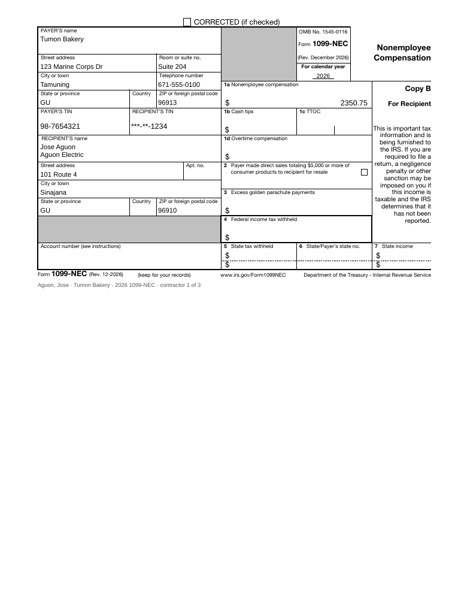
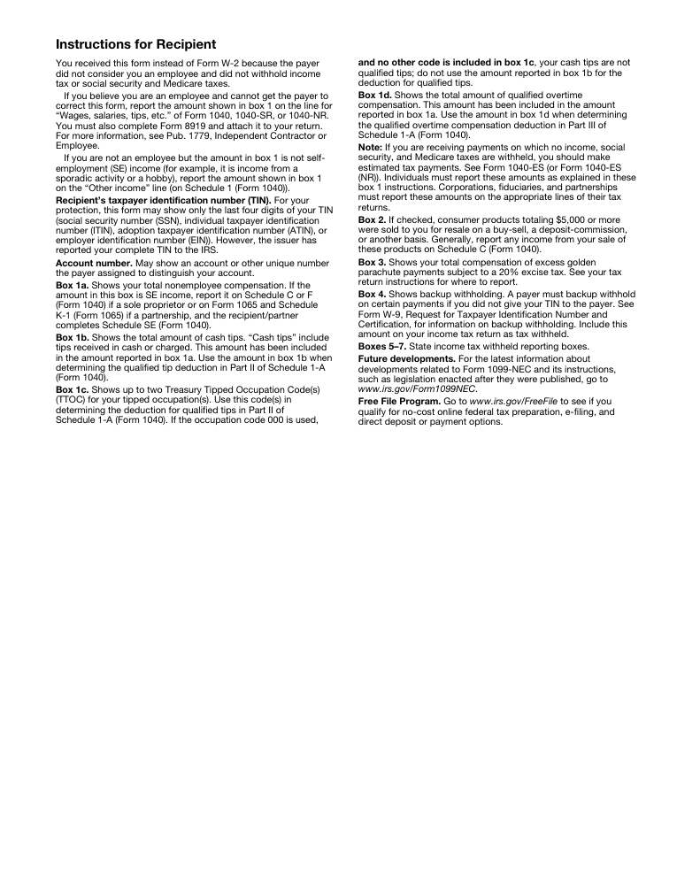
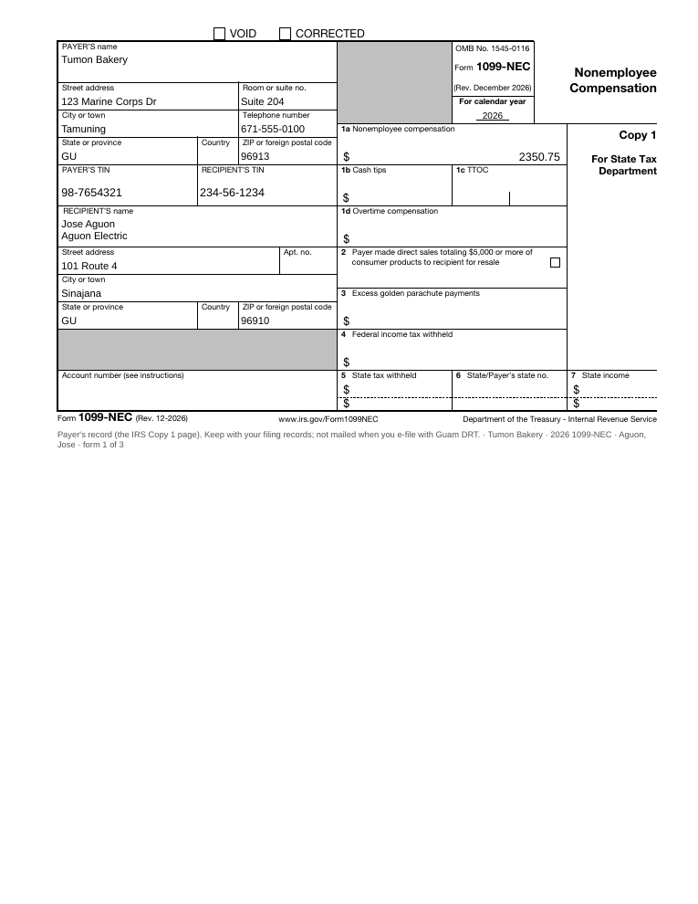
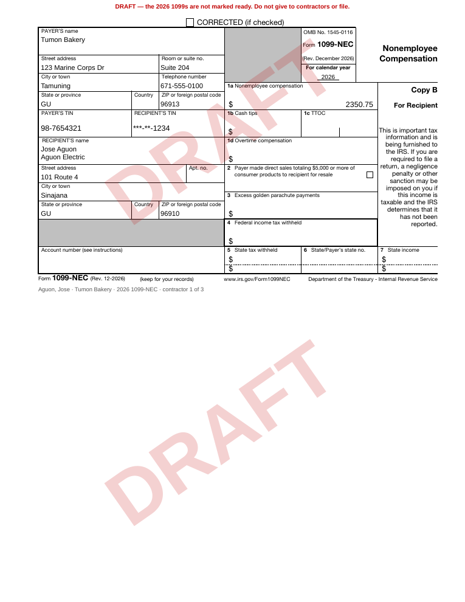

### Checklist screens

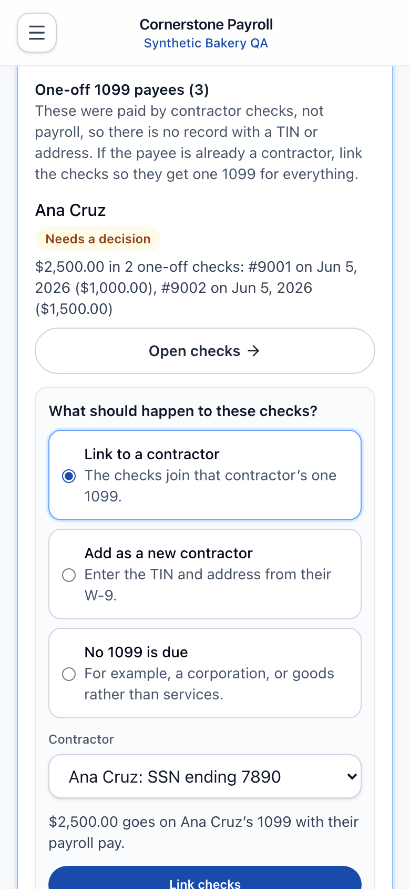
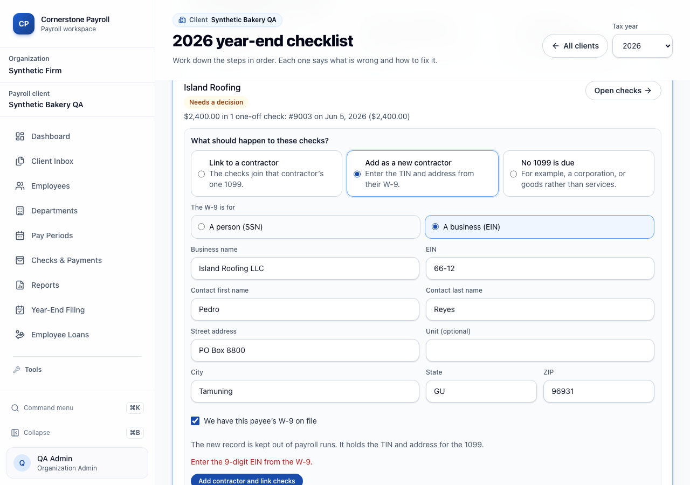
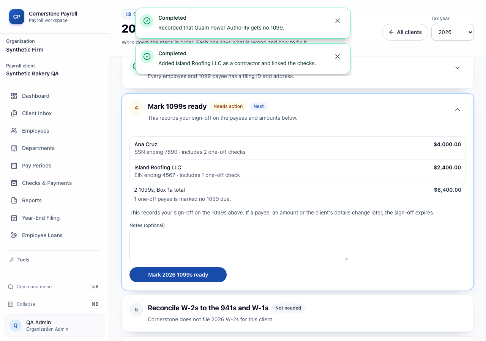
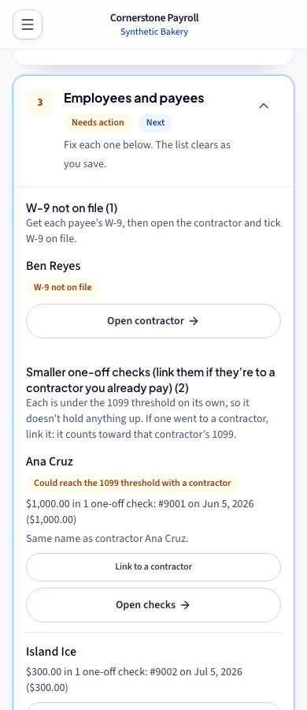
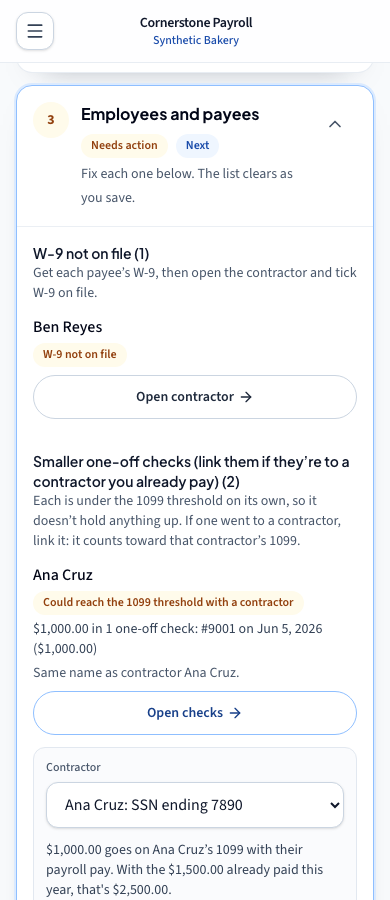
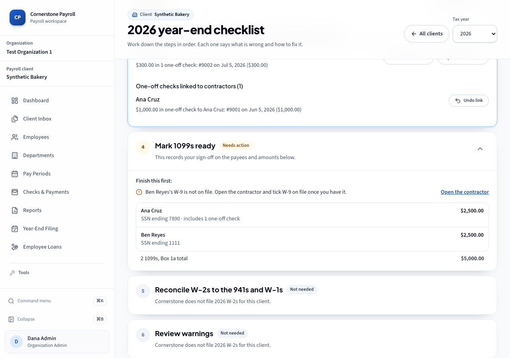
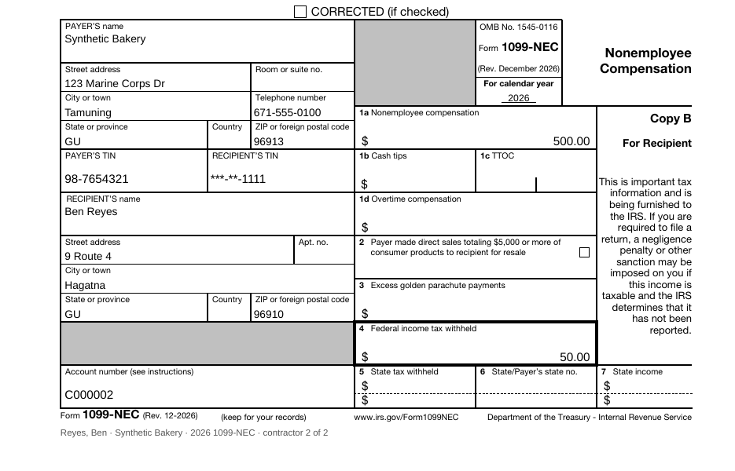
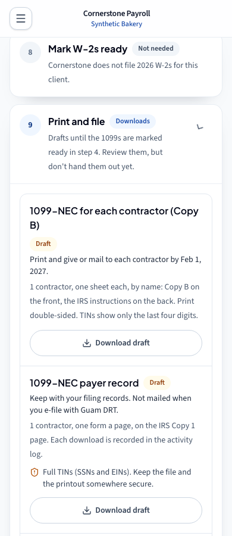
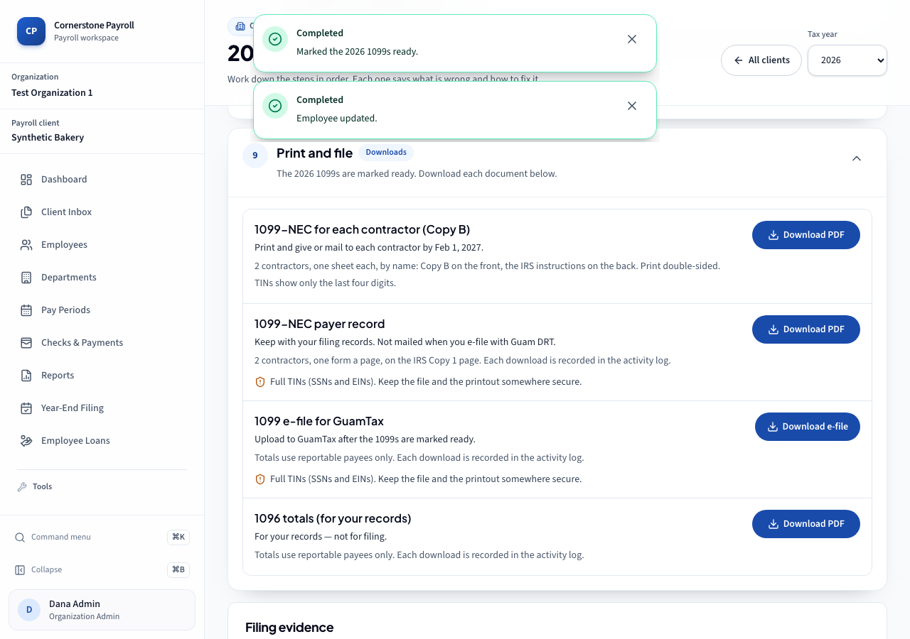
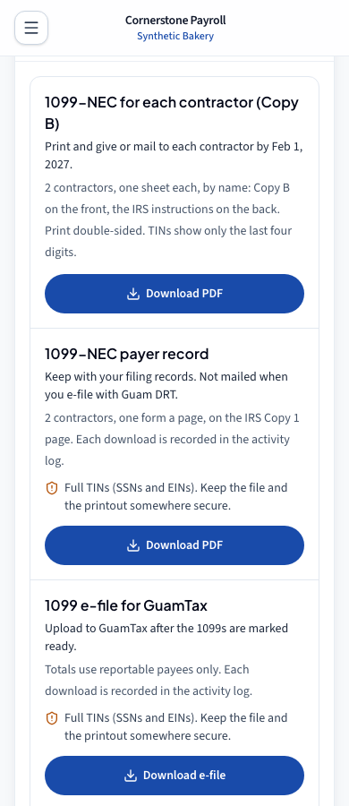
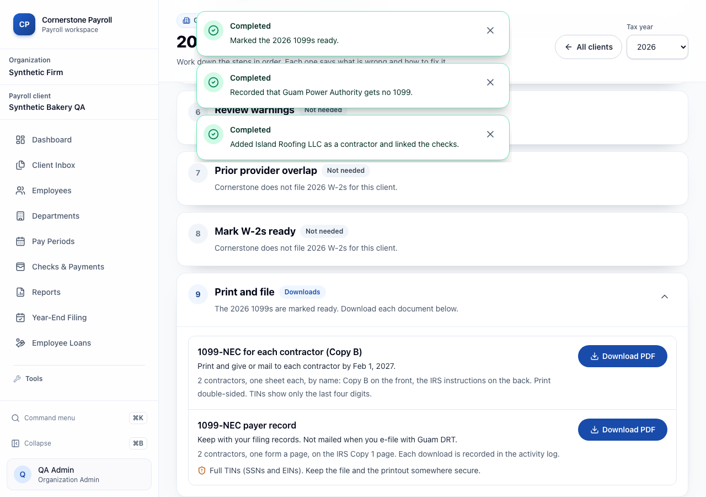
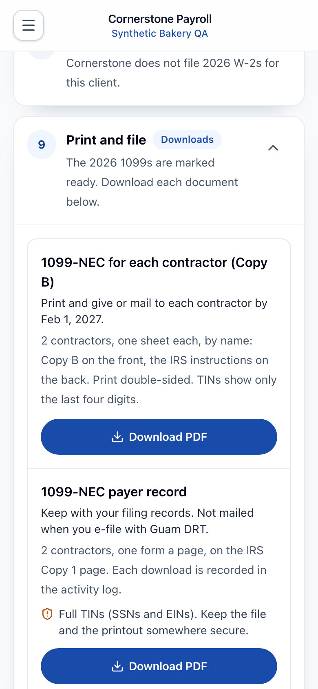

## Open questions for Guam DRT

1. Does DRT accept a truncated payee TIN on the copy given to the contractor (Copy B), as the IRS does?
2. What does Copy 1 ("For State Tax Department") mean for a Guam payer that e-files with DRT? We treat it as the payer's record and do not mail it.
3. Is Copy 2 ("to be filed with recipient's state income tax return") needed by Guam contractors? The recipient file has Copy B only.

## Limits

- Tax year 2026 only.
- Boxes 1b–1d (cash tips, TTOC, overtime) are not tracked for contractors.
- A one-off payee is linked one check at a time; a later check to the same name must be linked again.
- The clients list computes the live 1099 fingerprint for each client with a 1099 sign-off on record (one 1099-NEC report per such client).
- The "won't print" checks run at mark ready and at download, not as checklist items, so the list can't show them.
