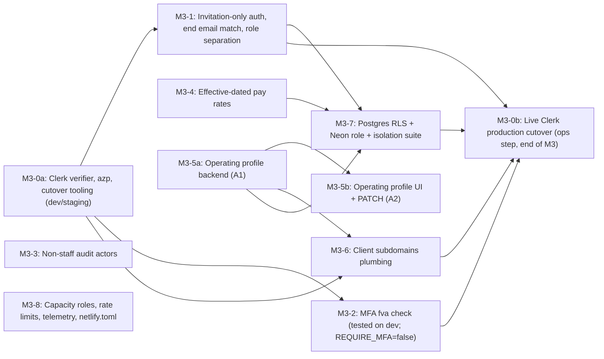

# Milestone 3 ("Foundations") build plan

**Status:** Decisions recorded (Leon, November 22, 2026 — §9). No application code has changed.
**Date:** November 22, 2026.
**Codebase baseline:** `Shimizu-Technology/cornerstone-payroll` `origin/main` at `68d28cda`, plus Leon's November 22, 2026 decisions on branch `docs/milestone3-decisions` (PR #520) and PR #521 review.
**Builds on:** [Product architecture decision](PRODUCT_ARCHITECTURE_DECISION_2026-11-19.md) (§0, §4, §6, §8), [Platform offerings implementation spec](PLATFORM_OFFERINGS_IMPLEMENTATION_SPEC_2026-11-17.md), [Full build plan](WORKFORCE_PLATFORM_FULL_BUILD_PLAN_2026-11-18.md) (R1), [HR module study and plan](HR_MODULE_ADP_STUDY_AND_PLAN_2026-11-18.md), [Guam legal compliance research](GUAM_PAYROLL_HR_LEGAL_COMPLIANCE_RESEARCH_2026-11-19.md), [Gate 0 trust and release plan](GATE_0_TRUST_AND_RELEASE_PLAN_2026-08-23.md), [Employee portal plan](EMPLOYEE_PORTAL_AND_PLATFORM_PLAN_2026-11-17.md), and [Production identity cutover runbook](PRODUCTION_IDENTITY_CUTOVER_RUNBOOK.md).

## Summary

Milestone 3 puts the safety, isolation, and configuration plumbing under Cornerstone Payroll before any client employee ever signs in. It builds and tests the hardened Clerk verifier and cutover tooling (`M3-0a`), ends email-based auto-provisioning, separates login identity from area-specific roles, adds Postgres row-level security (RLS) on employee-facing and sensitive tables with an automated cross-company isolation suite, builds and tests MFA session verification (`fva`) against the Clerk development instance behind `REQUIRE_MFA=false`, introduces effective-dated pay-rate history, extends audit logging to non-staff actors, adds per-client feature switches (`client_operating_profiles`) and `<client>.shimizu-technology.com` subdomain plumbing, and prepares rate limits and process isolation so employee traffic cannot slow payroll runs. Near the end of Milestone 3 — after staging rehearsal and just before the Milestone 4 gate — Payroll cuts over live from Clerk development (`pk_test_`) to a Clerk production instance on the free plan (`M3-0b`), using `shimizu-technology.com` as its root domain. Milestone 3 adds **$0/month** in hosting costs today; the Milestone 4 gate adds **$32/month** (Clerk Pro $25 + Render Starter employee web $7; $27/month if Clerk Pro is billed annually). Legal review and WISP work are deferred out of Milestone 3 and remain a Milestone 4 go-live prerequisite (§5).

### What milestone 3 deliberately does not do

- **No employee-facing UI or invites.** Pay stubs, W-2 downloads, profile edits, bank changes, and employee onboarding are Milestone 4. The `employee/*` namespace ships scaffolded and switched off.
- **No production MFA enforcement yet.** MFA verification is built and tested against Clerk's development instance (free), then deployed with `REQUIRE_MFA=false`. Clerk Pro ($25/month) and production MFA enforcement turn on at the Milestone 4 gate or once the platform earns revenue, whichever comes first (Leon, Nov 22, 2026).
- **No SMS provider.** Sign-in and MFA codes come from Clerk. ClickSend or Twilio is chosen only when text notifications are built (Leon, Nov 22, 2026).
- **No extra paid Render instances running idle, and no separate employee worker until Milestone 6.** Separate employee web/worker process roles, DB pool caps, and rate limits are coded in Milestone 3. The Render Starter employee web service ($7/month) spins up at the Milestone 4 gate; employee background jobs stay capped on the existing Payroll worker until Milestone 6 (Leon, Nov 22, 2026).
- **No virus scanner in Milestone 3 or the pilot.** Uploads continue with the existing `ClientDocumentFileValidator` byte/type/size checks and `ClientDocumentScanner::Noop`, trusting pilot companies; scanning is revisited before wider rollout (Leon, Nov 22, 2026 — §1.11).
- **No legal review or WISP work in Milestone 3.** Deferred by Leon (Nov 22, 2026); both remain a **Milestone 4 go-live prerequisite** per §6 of the architecture decision (§5).
- **No changes to AIRE's production app or My Pay contract.** Existing AIRE routes, audit action strings, and payloads remain byte-for-byte compatible.
- **No Year-End (Milestone 1) or Tax profitability (Milestone 2) work.** Year-end filing (February 1, 2027 deadline) keeps priority whenever schedules compete.

---

## 1. Current state per item

Every code claim below was verified against `origin/main` (`68d28cda`) on November 22, 2026.

### 1.1 Clerk production instance

- **Live status:** Production Payroll still uses Clerk development keys (`pk_test_` / `sk_test_`). The September 14 readiness run passed 26 of 29 controls, failing only production Clerk keys, MFA attestation, and instance-bound Clerk API match (`docs/PRODUCTION_READINESS_EVIDENCE_2026-09-14.md:19-22`). Under Leon's November 22 decision, the Clerk development instance remains in use for local and staging work (including all MFA testing), and the live production cutover (`M3-0b`) happens near the end of Milestone 3, right before the Milestone 4 gate.
- **Staged instance:** An unused Clerk production instance was created earlier for `payroll.shimizu-technology.com` in invite-only mode (`docs/PRODUCTION_IDENTITY_CUTOVER_RUNBOOK.md:14-18`). A public DNS lookup on November 22, 2026 showed `payroll.shimizu-technology.com` CNAMEd to `cornerstone-payroll.netlify.app`, with **no** CNAME records yet on `clerk.shimizu-technology.com`, `accounts.shimizu-technology.com`, `clerk.payroll.shimizu-technology.com`, or `accounts.payroll.shimizu-technology.com`.
- **How Payroll stores and depends on Clerk user IDs:**
  - `users.clerk_id` is a nullable unique string (`api/db/schema.rb:4569,4587`), alongside `users.clerk_invitation_id` (`api/db/schema.rb:4570`).
  - **Every domain table references `users.id` (bigint FK), never `clerk_id`.** Across `api/app` and `api/lib`, `clerk_id` is touched only in:
    - `api/app/controllers/concerns/clerk_authenticatable.rb:28-29,31,51,160,176,187,220` (JWT lookup and provisioning),
    - `api/app/channels/application_cable/connection.rb:26` (staging tester check; normal Cable tickets store `user_id`),
    - `api/app/services/staging_tester_identity.rb:11` and `api/app/services/staging_clone_containment.rb:75-77`,
    - placeholder creation (`"pending_#{SecureRandom.uuid}"`) in `api/app/controllers/api/v1/admin/users_controller.rb:44` and `api/app/controllers/api/v1/admin/organizations_controller.rb:189`.
  - `clerk_invitation_id` is referenced only in `users_controller.rb:173-175,208-210,308-310,466`, `organizations_controller.rb:212`, `clerk_invitation_service.rb:46`, `test_workspace/portal_access.rb:29,34,61`, `expire_practice_portal_access_job.rb:7`, and `staging_outbound_policy.rb:276`.
  - **Consequence:** Re-linking `users.clerk_id` to new production Clerk user IDs preserves every audit log, approval, payroll run, document upload, and company assignment intact. Only active browser sessions (`users.last_session_id_digest`) and pending Clerk invitations reset.
- **Latent production JWT bugs in current code:**
  - `clerk_authenticatable.rb:138-146` and `clerk_token_verifier.rb:68-74` duplicate JWT verification logic. Both derive `clerk_instance_id` by splitting the decoded publishable key on `.clerk.accounts.dev` and fall back to `https://<id>.clerk.accounts.dev`. That fallback breaks on a `pk_live_` key (which encodes `clerk.shimizu-technology.com$`).
  - Neither verifier checks the `azp` (authorized party) claim or `nbf` (not-before) explicitly beyond `JWT.decode` defaults.

### 1.2 Invitation-only logins and role separation

- **Auto-provisioning by email still runs:** When `User.find_by(clerk_id: clerk_id)` misses (`api/app/controllers/concerns/clerk_authenticatable.rb:29,41-44`), `provision_user_from_clerk` (`lines 148-192`) fetches the Clerk user, checks `verified_primary_email` (`lines 194-204`), and:
  1. matches **any** existing `User` by `LOWER(email)` (`line 158`) and silently overwrites `clerk_id` (`lines 160-164`);
  2. otherwise creates a `User` from `UserInvitation.active` by email (`lines 168-183`);
  3. otherwise runs first-admin bootstrap if `User` is empty (`lines 169,206-243`).
- **Single-role `User` model:** `api/app/models/user.rb:38` has one enum (`admin`, `manager`, `employee`, `accountant`, `client`, `super_admin`, `org_admin`) and one home `company_id` (`api/db/schema.rb:4571`). `StaffRolePolicy` (`api/app/policies/staff_role_policy.rb:7-285`) gates `Api::V1::Admin::BaseController` (`api/app/controllers/api/v1/admin/base_controller.rb:22-28`), and `ClientPortalAccess` (`api/app/controllers/concerns/client_portal_access.rb:11-15`) gates `Api::V1::Client::BaseController` (`api/app/controllers/api/v1/client/base_controller.rb:11-12`).
- **Gaps:**
  - The unused `employee: 2` role on `User` falls into `User#accessible_company_ids` (`user.rb:158`) and would return `[company_id] + assigned_ids` (whole-company scope), with no foreign key to `employees`.
  - One person cannot cleanly hold both a `client` role (e.g., Emma at MoSa's) and an `employee` role under the one-login model decided on November 19.
  - `ApplicationController` (`api/app/controllers/application_controller.rb:65-85`) has a dev bypass that falls back to an admin user when `AUTH_ENABLED != "true"`. Any employee base controller must not inherit that fallback.

### 1.3 Database-level company separation (RLS)

- **Controller-only scoping today:** Isolation relies on `ExplicitCompanyAccess` (`api/app/controllers/concerns/explicit_company_access.rb:14-25`), `Admin::BaseController#enforce_company_access!` (`admin/base_controller.rb:179-185`), `Client::BaseController#enforce_company_access!` (`client/base_controller.rb:16-22`), and `where(company_id: current_company_id)` in controllers and services. There are zero Postgres RLS policies in `api/db/schema.rb`.
- **Table inventory:** `api/db/schema.rb` has **194 tables**: **111** carry `company_id` and **83** do not. Ten employee-facing or pay-sensitive child tables lack `company_id`: `employee_wage_rates`, `employee_deductions`, `employee_payroll_fields`, `employee_tipped_occupations`, `employee_ytd_totals`, `loan_transactions`, `payroll_item_earnings`, `payroll_item_deductions`, `payroll_item_field_entries`, and `direct_deposit_payment_confirmations` (plus `check_events`).
- **Schema dump format:** `api/config/application.rb` uses Rails' default `:ruby` schema format (`db/schema.rb`), which **silently omits Postgres RLS policies, `ENABLE/FORCE ROW LEVEL SECURITY`, and `EXCLUDE USING gist` constraints** when loading a fresh test database via `db:schema:load`.
- **Neon runtime specifics:**
  - Production Rails runs over Neon's PgBouncer connection pooler in **transaction mode** (already documented in `api/app/services/dedicated_advisory_lock.rb:7-20` and `api/lib/database_predeploy.rb:38,85`).
  - Neon's default `neondb_owner` role (and any role created through the Neon Console or API) inherits `neon_superuser`, which holds **`BYPASSRLS`** on all projects created after August 15, 2023 ([Neon roles docs](https://neon.com/docs/manage/roles), checked 2026-11-22). Per [PostgreSQL 16 RLS documentation](https://www.postgresql.org/docs/16/ddl-rowsecurity.html) (checked 2026-11-22), `BYPASSRLS` overrides even `FORCE ROW LEVEL SECURITY`. Connecting Rails as `neondb_owner` would make every RLS policy a silent no-op.

### 1.4 MFA check (`REQUIRE_MFA`)

- **Attestation only, no runtime enforcement:** `api/config/deploy.yml:65` sets `REQUIRE_MFA: false`. `api/app/services/production_readiness.rb:118,205-217,288-293` checks only that `REQUIRE_MFA == "true"`, `CLERK_MFA_ATTESTED_INSTANCE_ID` matches `GET https://api.clerk.com/v1/instance`, and `CLERK_MFA_EVIDENCE_REF` is present.
- **No JWT claim check:** Neither `ClerkAuthenticatable` nor `ClerkTokenVerifier` inspects Clerk's `fva` (factor verification age) claim, and `CableTicketService` issues WebSocket tickets without checking MFA.

### 1.5 Effective-dated pay rates

- **Overwritten in place today:**
  - `employees.pay_rate` (`api/app/models/employee.rb:148-150,290-292`) is overwritten in place by `Api::V1::Admin::EmployeesController#update` (`api/app/controllers/api/v1/admin/employees_controller.rb:102-126`) and `EmployeeChangeRequest#apply_proposed_changes!` (`api/app/models/employee_change_request.rb:150`).
  - `employee_wage_rates` (`api/db/schema.rb:1166-1176`, `api/app/models/employee_wage_rate.rb:1-82`) has `(employee_id, label, rate, is_primary, active)` with no `effective_on` or `ends_on`. `EmployeeWageRatesController#update` (`api/app/controllers/api/v1/admin/employee_wage_rates_controller.rb:41-52`) updates in place, and `EmployeeWageRateSyncService#sync_under_employee_lock!` (`api/app/services/employee_wage_rate_sync_service.rb:26-46`) overwrites or destroys rows (`line 33`).
- **Existing effective-dated models to follow:** `employee_w4_elections` (`api/db/schema.rb:1138-1154`), `employee_work_profiles` (`api/db/schema.rb:1178-1204`, `effective_on`/`ends_on` with unique `WHERE ends_on IS NULL`), and `employee_retirement_elections` (`employee.rb:268-276`) already implement effective dating in this codebase.
- **Payroll calculation & import readers:**
  - Committed runs snapshot `payroll_items.pay_rate` and `payroll_items.wage_rate_hours`, and `HourlyPayrollCalculator` (`api/app/services/hourly_payroll_calculator.rb:63,108`), `SalaryPayrollCalculator` (`api/app/services/salary_payroll_calculator.rb:57,60`), and `IssueCorrectivePaycheckService` (`api/app/services/issue_corrective_paycheck_service.rb:646,916`) read the item snapshot — so past committed paychecks are already protected from retroactive calculation drift, though historical profile lookup is lost.
  - Open/draft calculation and imports read live `employee.pay_rate` / `employee.default_payroll_rate` / `employee.active_wage_rates` directly: `PayPeriodsController#run_payroll` and `#sync_pay_rate_from_employee` (`api/app/controllers/api/v1/admin/pay_periods_controller.rb:425-428,1735-1758`), `PayrollItemsController` (`api/app/controllers/api/v1/admin/payroll_items_controller.rb:613,621`), `PayrollIntake::ApplyService` (`api/app/services/payroll_intake/apply_service.rb:332`), `PayrollImport::ImportService` (`api/app/services/payroll_import/import_service.rb:205,504,539,567`), `PayrollImport::WageRateChoice` (`api/app/services/payroll_import/wage_rate_choice.rb:18,24`), `TimeTracking::ApplyImportService` (`api/app/services/time_tracking/apply_import_service.rb:145,333`), `TimeTracking::ImportPreviewService:228`, `BatchImportPreviewService:201`, `HistoryApproval:387,414`, `LateHoursRunService:149`, and `TestWorkspace::SetupCloner:90`.

### 1.6 Audit logging and actor model

- **Schema:** `audit_logs` (`api/db/schema.rb:279-304`) has nullable `user_id`, plus `actor_name`, `actor_email`, `actor_role`, `event_category`, `metadata`, `company_id`, `organization_id`, `ip_address`, `user_agent`, and `request_id`. There is no `actor_type` or non-user `actor_id` column.
- **Gaps:**
  - `Auditable#write_audit_log` (`api/app/controllers/concerns/auditable.rb:48`) exits immediately with `return unless current_user`. Any employee, kiosk, or non-`User` endpoint logs nothing.
  - `AuditLog.record!` (`api/app/models/audit_log.rb:18-53`) fills `actor_name`, `actor_email`, and `actor_role` solely from `user` (`lines 47-49`). When `user: nil` — as in `Api::V1::Integrations::Aire::WorkerStatementsController#record_access!` (`api/app/controllers/api/v1/integrations/aire/worker_statements_controller.rb:193-213`) — all three actor fields stay `NULL`, `AuditLogPresenter#actor_name` (`api/app/services/audit_log_presenter.rb:191-193`) displays `"System"`, and `PayRunActivityPhrase::WORKER_STATEMENT_HEADLINES` (`api/app/services/pay_run_activity_phrase.rb:60-68`) hardcodes `"in the AIRE app"`.
  - Background jobs have no `Current` actor context.

### 1.7 Reserved capacity, rate limiting, and deployment topology

- **Render services:** Production runs two Render services from `api/`: a web service (`cornerstone-payroll-api.onrender.com`, Puma single-process per `api/config/puma.rb:28-47`, `SOLID_QUEUE_IN_PUMA=false`) and a dedicated Solid Queue worker (`docs/PRODUCTION_READINESS_EVIDENCE_2026-09-14.md:9-10`, `api/config/queue.yml:9-16` with `default`/`solid_queue_recurring` at 3 threads and `ocr` at 1 thread). Both share `DATABASE_URL` with `pool: RAILS_MAX_THREADS || 5` (`api/config/database.yml:18,91-106`). There is no `render.yaml` in the repo (`api/config/deploy.yml` is an unused Kamal template).
- **Netlify:** `web/` deploys to `cornerstone-payroll.netlify.app` (`payroll.shimizu-technology.com`) with SPA routing in `web/public/_redirects`. There is **no `netlify.toml`** in the repo, so docs-only and API-only merges are not protected by a committed build-ignore rule (deploy previews were disabled org-wide after the November 20 credit exhaustion incident).
- **Rate limiting:** `api/config/initializers/rack_attack.rb:1-51` defines four throttles (`api/ip` 300/min, `auth/ip` 20/min, `worker_statements/worker` 60/min, `worker_statements/pdf` 20/min) backed by `RequestPathCache.store` (Solid Cache in production). There are no throttles for employee endpoints, invitation/activation attempts, or kiosk punches.

### 1.8 Per-client settings / operating profile

- **Scattered today:** Settings live across ad hoc columns on `companies` (`api/db/schema.rb:582-660`, `api/app/models/company.rb:12-13,293-305`): `pay_frequency`, `historical_payroll_enabled`, `client_payroll_approval_required`, `simple_payroll_register_enabled`, `payroll_intake_source_types`, and `payroll_intake_settings`. The last two are not permitted in `Api::V1::Admin::CompaniesController#company_params` (`api/app/controllers/api/v1/admin/companies_controller.rb:312-324`) and can only be edited from Rails console with no audit trail.
- **No feature-flag catalog:** There is no `client_operating_profiles` table, no client-portal or employee-portal on/off switch, and no per-client subdomain or branding config. Old PR #139 was closed (`PRODUCT_ARCHITECTURE_DECISION_2026-11-19.md:32`).

### 1.9 Client subdomains (`<client>.shimizu-technology.com`)

- **Not built:** `companies` has no slug/subdomain column. `api/config/initializers/cors.rb:18-19` reads a static comma-separated `CORS_ORIGINS` list (currently `https://payroll.shimizu-technology.com` in `api/config/deploy.yml:62`), and `api/app/services/production_readiness.rb:182-185` checks that `CORS_ORIGINS` is a static list of HTTPS origins.
- **Clerk subdomain vs. satellite-domain verification (verified against Clerk docs, 2026-11-22):**
  - Per [Clerk's production deployment guide](https://clerk.com/docs/guides/development/deployment/production), when a production instance is configured on a **root domain** (`shimizu-technology.com`, creating `clerk.shimizu-technology.com`), authentication and sessions work across **all subdomains of that root domain** (`payroll.shimizu-technology.com`, `mosas.shimizu-technology.com`, `aire.shimizu-technology.com`) by default at **$0**.
  - Per [Clerk's satellite domains guide](https://clerk.com/docs/guides/dashboard/dns-domains/satellite-domains) and [Clerk pricing](https://clerk.com/pricing), **satellite domains ($10/month each, Pro plan required)** are needed only across *different* root domains (for example, if a client later wants `hr.mosasguam.com`).
  - **Decided (Leon, Nov 22, 2026):** Cornerstone Payroll's production Clerk root domain is **`shimizu-technology.com`** (the Shimizu Technology marketing site does not use auth; neither Cornerstone Tax on `cornerstone-accounting.tax` nor AIRE on `aireservicesguam.com` uses `shimizu-technology.com`, and `dig` on 2026-11-22 confirmed `clerk.shimizu-technology.com` is unused). Reconfigure or replace the unused September 14 secondary-application instance (`payroll.shimizu-technology.com`, `PRODUCTION_IDENTITY_CUTOVER_RUNBOOK.md:14,81`) with root domain `shimizu-technology.com` before `M3-0b`.
  - **Architectural limit to record:** Because Clerk ties one production Frontend API (`clerk.shimizu-technology.com`) to the root domain, **no other Shimizu app can run its own separate Clerk production instance on `shimizu-technology.com`** (any future separate app must use its own domain or a secondary-application subdomain).
  - **Two security requirements on the root domain:** (1) Enable Clerk's [Allowed subdomains](https://clerk.com/docs/guides/dashboard/dns-domains/subdomain-allowlist) in the Clerk Dashboard so only explicitly listed subdomains (`payroll.shimizu-technology.com`, `mosas.shimizu-technology.com`, etc.) can call Clerk's Frontend API, blocking every other `*.shimizu-technology.com` subdomain; and (2) validate the JWT `azp` claim (`authorizedParties`) in Rails (`ClerkTokenVerifier`) against the same explicit origin list to prevent subdomain cookie-leaking attacks.
  - **Passkeys caveat:** Clerk's production guide notes that due to WebAuthn RP ID rules, passkeys do not share across two sibling subdomains (`payroll.shimizu-technology.com` and `mosas.shimizu-technology.com`). That does not affect password, email code, Google sign-in, or TOTP authenticator apps in Milestones 3–4, and is noted before passkeys are considered later.

### 1.10 Outside the code: legal review and WISP (deferred to Milestone 4 go-live)

- **Legal research brief exists:** `docs/GUAM_PAYROLL_HR_LEGAL_COMPLIANCE_RESEARCH_2026-11-19.md` lists 12 "Needed before launch" questions for a Guam law firm (Part 3, `lines 737-750`) plus agency questions for Guam DRT, Guam DOL Wage & Hour, and the AG's Child Support Enforcement Division (Part 4, `lines 770-796`).
- **WISP status unknown:** Dafne attended IRS WISP training in March 2026; whether Cornerstone finished its WISP is unconfirmed (`PRODUCT_ARCHITECTURE_DECISION_2026-11-19.md:283`). Shimizu Technology has no platform security addendum or service-provider DPA yet.
- **Decided (Leon, Nov 22, 2026):** Not part of Milestone 3 work or acceptance. Both stay in this document (§5) as a **Milestone 4 go-live prerequisite** per §6 of [Product architecture decision](PRODUCT_ARCHITECTURE_DECISION_2026-11-19.md) ("the lawyer review must be finished before it goes live").

### 1.11 File scanning (decided: no virus scanner for Milestone 3 and pilot)

- **What exists today:**
  - `ClientDocumentUploadService` (`api/app/services/client_document_upload_service.rb:44-50,78`) uploads bytes synchronously to Cloudflare R2 (`api/app/services/r2_storage_service.rb`) after running `ClientDocumentFileValidator` (`api/app/services/client_document_file_validator.rb:1-263`).
  - `ClientDocumentFileValidator` already enforces a 25 MB per-file / 50 MB per-request cap, magic-byte validation (`Marcel`), OOXML central-directory/entry-count (1,000) and expanded-size (100 MB) zip-bomb caps, blocks VBA/Excel 4 macros, ActiveX, embedded executables (MZ/ELF/Mach-O/shebangs), and external OOXML links, and inspects legacy OLE/BIFF containers.
  - `ClientDocumentScanner` (`api/app/services/client_document_scanner.rb:5-47`) is wired into `ClientDocument`, `ScanClientDocumentJob`, `ClientDocumentScanRecoveryJob`, and all four download/preview/attachment/intake gates, with `ClientDocumentScanner::Noop` as the default adapter (leaving `scan_status = "not_scanned"`).
- **Decided (Leon, Nov 22, 2026):** Allow uploads now using the existing `ClientDocumentFileValidator` type, byte, container, and size checks with **no virus scanner** (`ClientDocumentScanner::Noop`, **$0/month**). Trust the pilot companies; keep the `ClientDocumentScanner` adapter seam intact; **revisit adding a malware scanner before wider rollout beyond the pilot**.
- **Future reference when revisiting before wider rollout (prices verified 2026-11-22):**
  - *Managed API (Cloudmersive Basic):* **$19.99/month** for 10,000 calls/month, 1 GB max file size ([Cloudmersive Small Business Pricing](https://cloudmersive.com/pricing-small-business); Free tier is capped at 3.5 MB, below our 25 MB limit; AttachmentScanner starts at $249/mo — [AttachmentScanner](https://www.attachmentscanner.com/plans-and-pricing)). Requires adding the vendor as a sub-processor in the DPA, privacy notice, and WISP (and checking IRC § 7216).
  - *Self-hosted ClamAV (`clamd`) on Render:* **$25/month** on Render Standard (2 GB RAM — tight on signature reloads) or **$85/month** on Render Pro (4 GB RAM — matches [ClamAV's 3–4 GiB recommendation](https://docs.clamav.net/Introduction.html)), plus persistent disk ([Render Pricing](https://render.com/pricing)). Files never leave Shimizu's Render network.

---

## 2. Technical designs for the hard parts

### 2.1 Postgres RLS safely with Rails + Neon's transaction pooler

Neon's pooled endpoint (`-pooler`) runs PgBouncer in **transaction mode** ([Neon connection pooling docs](https://neon.com/docs/connect/connection-pooling), checked 2026-11-22). Session-level `SET` leaks across clients or disappears on the next transaction. Neon's default `neondb_owner` role also has `BYPASSRLS` ([Neon roles docs](https://neon.com/docs/manage/roles), checked 2026-11-22).

**Recommended architecture:**

1. **Separate DB roles (already fits `DATABASE_URL` vs. `MIGRATION_DATABASE_URL`):**
   - `MIGRATION_DATABASE_URL` (direct, non-pooled, already enforced by `api/lib/database_predeploy.rb:38,85`) stays on `neondb_owner` (owns tables, runs migrations, creates policies).
   - Create a dedicated runtime role via SQL (not the Neon Console, so it does **not** inherit `neon_superuser`):
     ```sql
     CREATE ROLE payroll_app LOGIN PASSWORD '...' NOSUPERUSER NOCREATEDB NOCREATEROLE NOBYPASSRLS;
     GRANT USAGE ON SCHEMA public TO payroll_app;
     GRANT SELECT, INSERT, UPDATE, DELETE ON ALL TABLES IN SCHEMA public TO payroll_app;
     GRANT USAGE, SELECT ON ALL SEQUENCES IN SCHEMA public TO payroll_app;
     ALTER DEFAULT PRIVILEGES FOR ROLE neondb_owner IN SCHEMA public
       GRANT SELECT, INSERT, UPDATE, DELETE ON TABLES TO payroll_app;
     ALTER DEFAULT PRIVILEGES FOR ROLE neondb_owner IN SCHEMA public
       GRANT USAGE, SELECT ON SEQUENCES TO payroll_app;
     ```
   - Runtime `DATABASE_URL` (pooled) connects as `payroll_app`. Add a boot/readiness check (and CI test) asserting `SELECT NOT rolbypassrls AND NOT rolsuper FROM pg_roles WHERE rolname = current_user` is `true`.

2. **Transaction-local tenant context (`set_config(..., true)`):**
   - Introduce `TenantScope.with_company(company_id)` which opens an Active Record transaction and runs:
     ```sql
     SELECT set_config('app.current_company_id', $1, true);
     ```
     (`is_local = true` is identical to `SET LOCAL` and works with parameterized binding.) When the transaction commits or rolls back, Postgres clears `app.current_company_id` before PgBouncer returns the backend connection to the pool.
   - **Critical rule — never hold a DB transaction open across external HTTP calls:** Do **not** blindly wrap every controller action in `around_action :transaction`. Actions that talk to Cloudflare R2 (`ClientDocumentUploadService`), Clerk (`UsersController`), Resend, or AIRE (`TimeTracking::Client`) would pin a PgBouncer backend during network I/O and delay `after_commit` callbacks (`ScanClientDocumentJob`, `RevocationDispatcher`). Instead:
     - Provide a controller concern `CompanyRlsScoped` that wraps pure-DB `Admin`, `Client`, and `Employee` actions in `TenantScope.with_company(current_company_id)`.
     - Controllers/actions that perform external I/O explicitly declare `skip_rls_request_transaction only: [...]` and call `TenantScope.with_company(current_company_id) { ... }` around each DB read/write block (with the R2/Clerk/HTTP call outside the transaction).
     - Background jobs call `TenantScope.with_company(company_id)` inside `perform`.
     - Cross-company system operations (e.g., `super_admin` company listing, login lookup on `users`, Solid Queue polling, `EncryptedDataReadiness`) either query non-company-RLS tables (`users`, `organizations`, `companies`, `company_assignments`, `solid_queue_*`, `tax_tables`) or call an audited `TenantScope.as_system(reason:) { ... }` helper that sets `set_config('app.rls_mode', 'system', true)` inside a narrow transaction.

3. **Fail-closed policy definition & child-table coverage:**
   - Denormalize `company_id` (not null, indexed, backfilled from parent `employee.company_id` / `payroll_item.company_id`) onto the 10 employee-facing/sensitive child tables that lack it (`employee_wage_rates`, `employee_deductions`, `employee_payroll_fields`, `employee_tipped_occupations`, `employee_ytd_totals`, `loan_transactions`, `payroll_item_earnings`, `payroll_item_deductions`, `payroll_item_field_entries`, `direct_deposit_payment_confirmations`). That keeps every RLS policy an indexed equality check with zero parent-table subqueries:
     ```sql
     ALTER TABLE employees ENABLE ROW LEVEL SECURITY;
     ALTER TABLE employees FORCE ROW LEVEL SECURITY;
     CREATE POLICY employees_company_isolation ON employees
       USING (
         current_setting('app.rls_mode', true) = 'system'
         OR company_id = NULLIF(current_setting('app.current_company_id', true), '')::bigint
       )
       WITH CHECK (
         current_setting('app.rls_mode', true) = 'system'
         OR company_id = NULLIF(current_setting('app.current_company_id', true), '')::bigint
       );
     ```
   - **Fail-closed behavior:** Any query on an RLS-protected table executed outside `TenantScope.with_company` (or with the wrong `company_id`) sees `NULL` for `app.current_company_id`, returns **0 rows** on `SELECT`/`UPDATE`/`DELETE`, and raises `PG::InsufficientPrivilege` on `INSERT`.
   - **Initial protected table set (Milestone 3):** All employee-facing and sensitive company tables (~35 tables): `employees`, `employee_compensation_changes`, `employee_wage_rates`, `employee_w4_elections`, `employee_work_profiles`, `employee_status_events`, `employee_deductions`, `employee_payroll_fields`, `employee_tipped_occupations`, `employee_loans`, `loan_transactions`, `employee_ytd_totals`, `employee_retirement_elections`, `employee_retirement_year_inputs`, `employee_change_requests`, `employee_document_requirements`, `employee_document_requirement_events`, `employee_account_links`, `pay_periods`, `payroll_items`, `payroll_item_earnings`, `payroll_item_deductions`, `payroll_item_field_entries`, `direct_deposit_payment_confirmations`, `client_documents`, `client_portal_threads`, `client_portal_messages`, `portal_file_requests`, `portal_message_attachments`, `payroll_submissions`, `payroll_submission_documents`, `payroll_submission_drafts`, `payroll_submission_periods`, `client_operating_profiles`, `time_tracking_employee_mappings`, `daily_time_records`, `payroll_time_allocations`. Remaining company-scoped historical/admin tables can be added incrementally once the pattern is proven.

4. **Schema loading (`structure.sql` vs. `schema.rb`):**
   - **Recommended:** Keep `db/schema.rb` (avoids noisy `pg_dump` diffs across 194 tables and developer Postgres versions) and add a versioned, idempotent `api/db/rls_policies.sql` applied by migration AND hooked into `db:schema:load` / `db:test:prepare`, plus a spec that asserts every table in `RLS_PROTECTED_TABLES` has `relrowsecurity = true AND relforcerowsecurity = true` in `pg_class`. *(Alternative: switch `config.active_record.schema_format = :sql` to `db/structure.sql`, which also captures `EXCLUDE USING gist` natively; decide in PR M3-7 if the team prefers standard `structure.sql`.)*

5. **Complexity cost:**
   - One extra `SELECT set_config(...)` round-trip (~0.5–1 ms) per transaction (can be pipelined or combined).
   - Every new controller action with external I/O must opt out of request-level transactions and scope DB blocks explicitly.
   - Staging clone containment (`api/lib/staging_database_policy.rb` and `api/app/services/staging_clone_containment.rb`) must support the `payroll_app` runtime role alongside `neondb_owner` migrations.
   - All existing RSpec tests run against `payroll_app` (or a dedicated RLS spec group runs under a `NOBYPASSRLS` role) so RLS is actually exercised in CI.

### 2.2 MFA verification against Clerk's `fva` claim

Per [Clerk's session tokens documentation](https://clerk.com/docs/guides/sessions/session-tokens) (checked 2026-11-22), every Clerk session JWT includes `fva` (factor verification age), a 2-element integer array `[first_factor_age_minutes, second_factor_age_minutes]`:
- `[7, -1]` → first factor verified 7 minutes ago; **no second factor verified** (`-1`).
- `[12, 3]` → first factor verified 12 minutes ago; **second factor (TOTP, backup code, or SMS) verified 3 minutes ago**.

**Payroll verification contract:**
1. `ClerkTokenVerifier#verify` returns the verified payload including `sub`, `sid`, `azp`, and `fva`.
2. `MfaPolicy.verified_second_factor?(payload)` returns `true` only when `payload["fva"].is_a?(Array) && payload["fva"].length == 2 && payload["fva"][1].is_a?(Integer) && payload["fva"][1] >= 0`.
3. `MfaPolicy.recently_verified?(payload, max_age_minutes: 10)` checks `0 <= fva[1] <= max_age_minutes` (matching Clerk's 10-minute default reverification window in [Clerk reverification docs](https://clerk.com/docs/guides/secure/reverification), ready for Milestone 4 step-up actions).
4. In `ClerkAuthenticatable` (and `CableTicketService.issue!`):
   - Parse `ENV.fetch("REQUIRE_MFA", "false")` with explicit truthy check (`%w[1 true t yes y on]`).
   - When `REQUIRE_MFA` is `true` and the caller is accessing `/api/v1/admin/*`, `/api/v1/client/*`, or `/api/v1/auth/me` with a staff or client role (not an employee-only account), require `MfaPolicy.verified_second_factor?(@clerk_token_payload)`.
   - On failure, return HTTP `403` with `{ error: "Multi-factor authentication is required before accessing payroll.", code: "mfa_required" }` and record a `security` `AuditLog` event (`authentication#mfa_required_denied`).
   - When `REQUIRE_MFA` is `false` (production during Milestone 3), log nothing noisy and allow the request, while keeping `ProductionReadiness#mfa_attestation_recorded?` failing as designed until the Milestone 4 gate so production readiness never silently turns green without MFA.
5. **Testing in Milestone 3 (free):** Clerk's [sign-up/sign-in options docs](https://clerk.com/docs/guides/configure/auth-strategies/sign-up-sign-in-options) confirm all Pro features — including MFA (TOTP authenticator apps and backup codes) — are **free in Clerk development instances**. Because the Clerk development instance stays active for local and staging work throughout Milestone 3, we verify live `fva` JWT claims against Clerk dev, plus deterministic RSpec tests with locally signed RS256 JWTs covering `fva: [5, 0]`, `fva: [5, 15]`, `fva: [5, -1]`, missing `fva`, malformed `fva`, and `REQUIRE_MFA` on vs. off.

### 2.3 One login, separate roles (`users` + `employee_account_links`)

Leon's November 19 & 22 decisions specify **one Clerk app for everyone**, invitation-only accounts, login separate from roles, and each area checking its own role.
- `users` remains the single login identity table (`clerk_id`, `email`, `name`, `active`, `last_session_id_digest`). Existing `users.role` + `company_assignments` continue governing staff and client portal access without disrupting `StaffRolePolicy` or existing foreign keys.
- **No more `User.role = :employee` company access:** Deprecate `employee: 2` on `User` from accessing `admin/*` or `client/*` and remove its fallback in `User#accessible_company_ids`. Add a new `login_only` / `portal_employee` posture where a `User` created for an employee has **no** staff or client capability unless explicitly granted one.
- Add **`employee_account_links`**:
  - Columns: `user_id` (nullable while invited, FK to `users`), `company_id` (FK), `employee_id` (composite FK to `employees(id, company_id)`), `status` (`invited`, `active`, `former`, `revoked`), `invite_token_digest` (unique SHA-256), `invite_expires_at`, `invited_by_id`, `activated_at`, `former_at`, `former_access_until`, `revoked_at`, `revoked_by_id`, `revoked_reason`.
  - Constraints: partial unique index on `(employee_id)` where `status IN ('invited', 'active')`; check constraint/validation forbidding links to any company where `payroll_environment != 'live'` (blocks test workspaces and practice copies).
- **Area-specific base controllers:**
  - `Api::V1::Admin::BaseController`: requires `StaffRolePolicy.allowed?(current_user, :staff_workspace)` (unchanged).
  - `Api::V1::Client::BaseController`: requires `current_user.client?` (unchanged, later extended to client role memberships).
  - `Api::V1::Employee::BaseController` (new, scaffolded behind feature flag): inherits from `ActionController::API` directly (no `ApplicationController` dev bypass, no `X-Company-Id`), verifies the Clerk JWT via `ClerkTokenVerifier`, resolves the caller strictly via `EmployeeAccountLink.where(user_id: current_user.id, status: %w[active former])` and `X-Employee-Link-Id` header, and checks `CompanyFeatures.for(link.company).employee_portal_enabled?` (which returns `false` → `404` for all clients in Milestone 3).
- **Role switcher readiness:** `GET /api/v1/auth/me` returns `roles: { staff: bool, client: bool, employee_links_count: int }` (only counting links whose company has `employee_portal_enabled?`) so Milestone 4 can render the role switcher cleanly.

---

## 3. Ordered PR breakdown

`M3-0a` (verifier, `azp`, cutover tooling — no live change) lands early so `M3-1`, `M3-2`, and `M3-6` build on one verifier against the Clerk development instance and staging. The live Clerk production cutover (`M3-0b`) runs near the **end of Milestone 3, after staging rehearsal and just before the Milestone 4 gate**. PRs marked **Parallel** can be built and reviewed concurrently on separate worktrees once their code dependency merges.



| Order | Slice | Type | Parallelizable? | Depends on | Ships switched off? |
|---|---|---|---|---|---|
| 1 | **M3-0a:** Clerk JWT verifier consolidation, `azp` check, cutover/re-link tooling | Code PR | First auth PR (parallel with M3-3, M3-4, M3-5a, M3-8) | None | Dev keys unchanged; zero live impact |
| 2 | **M3-1:** Invitation-only login, remove email auto-linking, `employee_account_links`, `Employee::BaseController` scaffold | Code PR | Parallel after M3-0a | M3-0a (code); M3-0b (live prod verification) | `employee/*` routes gated off; works on existing dev `clerk_id`s immediately |
| 3 | **M3-2:** MFA `fva` verification + step-up helper | Code PR | Parallel after M3-0a | M3-0a (code); M4 gate (prod enforcement) | `REQUIRE_MFA=false` in prod; tested on Clerk dev |
| 4 | **M3-3:** Non-staff audit actors (`actor_type`, `AuditActor`, job auditing) | Code PR | Parallel from day 1 | None | Additive (no user-facing change) |
| 5 | **M3-4:** Effective-dated pay rates & wage-rate history | Code PR | Parallel from day 1 | None | Additive backfill; UI shows effective date cleanly |
| 6 | **M3-5a:** Client operating profile backend (Spec A1: table, catalog, `CompanyFeatures`, backfill, read API) | Code PR | Parallel from day 1 | None | Dual-read; all M4–M6 flags default `false` |
| 7 | **M3-5b:** Operating profile PATCH + "How this client runs" admin settings page (Spec A2) | Code PR | Parallel after M3-5a | M3-5a | Admin settings only; all M4–M6 switches default `false` |
| 8 | **M3-6:** Client subdomains (`subdomain_slug`, dynamic CORS/`azp`, public branding endpoint) | Code PR | Parallel after M3-0a + M3-5a | M3-0a, M3-5a (code); M3-0b (live prod subdomain verification) | `subdomain_enabled=false` for all clients → 404 |
| 9 | **M3-7:** Postgres RLS (`payroll_app` role, `TenantScope`, `rls_policies.sql`, cross-company isolation suite) | Code PR | After schema-adding PRs | M3-1, M3-4, M3-5a | Staged rollout: app code + role first, then `ENABLE/FORCE RLS` migration |
| 10 | **M3-8:** Reserved capacity (`APP_PROCESS_ROLE`, queue/pool limits, employee/kiosk `Rack::Attack`, telemetry, `netlify.toml`) | Code PR | Parallel from day 1 | None | `APP_PROCESS_ROLE=all` (existing Render topology unchanged) |
| 11 | **M3-0b:** Live Clerk production cutover on `shimizu-technology.com` (free plan) | Ops step | End of M3, before M4 gate | M3-0a, M3-1, M3-2, M3-6, M3-7 + staging rehearsal | N/A (live cutover; `REQUIRE_MFA` stays `false`) |

---

### PR M3-0a: Clerk verifier hardening, `azp` check, and cutover re-linking tooling

- **Purpose:** Fix `pk_live_` issuer derivation, remove duplicated JWT verification, add `azp` (`authorizedParties`) validation, and add controlled one-time cutover rake tasks (`clerk:cutover:inventory`, `clerk:cutover:dry_run`, `clerk:cutover:apply`, `clerk:cutover:rollback`) that re-link `users.clerk_id` strictly from an operator-reviewed manifest (`user_id` + verified `new_clerk_id`). Built and tested against the Clerk development instance and staging; **makes no live production key change**.
- **Main files:**
  - `api/app/services/clerk_token_verifier.rb` (single verifier, custom-domain `pk_live_` parser, `azp` allowlist via `CLERK_AUTHORIZED_PARTIES` / `CORS_ORIGINS`, JWKS cache keyed by issuer, `nbf` check)
  - `api/app/controllers/concerns/clerk_authenticatable.rb` (delegate JWT verification to `ClerkTokenVerifier`)
  - `api/lib/tasks/clerk_cutover.rake` and `api/app/services/clerk_cutover/relink_service.rb` (validates exact-one mapping, refuses duplicate/unknown/inactive mismatches, clears `last_session_id_digest` and stale `clerk_invitation_id`, writes `AuditLog` security events, prints counts only — never secrets or PII to stdout logs)
  - `api/app/services/production_readiness.rb` (ensure `production_clerk_keys?` and `clerk_ready?` behave cleanly when `REQUIRE_MFA=false` on a real production instance — report live keys as passing after `M3-0b` while keeping MFA control explicitly failing until M4)
- **Migration:** None.
- **Dependencies:** None (first auth PR; parallel with M3-3, M3-4, M3-5a, M3-8).
- **Acceptance tests:**
  - *Automated (RSpec):* `clerk_token_verifier_spec.rb` (RS256 `pk_live_` custom domain issuer and `pk_test_` dev issuer, valid/invalid `azp`, expired/future `nbf`, JWKS rotation miss), `clerk_cutover_relink_service_spec.rb` (exact-one relink, rejects email-only fuzzy match, rejects duplicate target `clerk_id`, idempotent re-run, transactional rollback on any single row error, clean rollback task), `production_readiness_spec.rb`.
  - *Manual / browser QA:* Test dev-instance sign-in on local and staging; run `clerk:cutover:inventory` and `clerk:cutover:dry_run` on staging to prove zero regressions against the existing Clerk dev instance.
- **Ships switched off:** Backward-compatible with existing dev keys in production until `M3-0b`.

### PR M3-1: Invitation-only logins and login/role separation

- **Purpose:** End passive email auto-provisioning forever. Authenticate strictly by `clerk_id`, require explicit single-use invitation token redemption to bind a new Clerk user to a `User` or `EmployeeAccountLink`, deprecate `User.role = :employee` company-wide access, and scaffold `Api::V1::Employee::BaseController`.
- **Main files:**
  - `api/app/controllers/concerns/clerk_authenticatable.rb` (delete email-matching block at lines 158–166 and passive `UserInvitation` match at lines 168–183; keep only `User.find_by(clerk_id:)` + controlled bootstrap guard when `User.none?`)
  - `api/app/controllers/api/v1/invitations_controller.rb` (new `POST /api/v1/invitations/accept` verifying Clerk JWT + SHA-256 invite token digest, checking verified primary email matches invited email, binding `clerk_id`, marking accepted, writing `security` audit log)
  - `api/app/models/user_invitation.rb` (store `token_digest` instead of raw token for new invites; enforce expiry & single-use)
  - `api/app/models/user.rb` (remove whole-company access for legacy `:employee` role; add `has_many :employee_account_links`)
  - `api/app/models/employee_account_link.rb` (new model with composite FK to `employees(id, company_id)` and non-test-workspace validation)
  - `api/app/controllers/api/v1/employee/base_controller.rb` (new isolated base controller inheriting from `ActionController::API`, never reading `X-Company-Id`, checking `employee_portal_enabled?`)
  - `api/app/controllers/api/v1/auth_controller.rb` (expose `roles` summary; return structured 401/403 when uninvited)
  - `web/src/pages/Invite.tsx` and `web/src/contexts/AuthContext.tsx` (explicit invite-token redemption flow; clear uninvited message without looping)
- **Migration:**
  - Create `employee_account_links` table with composite FK `(employee_id, company_id) REFERENCES employees(id, company_id)` (adding unique index on `employees(id, company_id)` if absent) and partial unique index on `employee_id WHERE status IN ('invited', 'active')`.
  - Add `token_digest` to `user_invitations` (backfill from existing `token`, then null out raw `token` for consumed/expired rows).
- **Dependencies:** `M3-0a` for code. Works safely on production **before** `M3-0b` because every active production user already has their current dev `clerk_id` stored on `users`, and any pending/new invites redeem via explicit token. When `M3-0b` later runs `clerk:cutover:apply`, it updates `users.clerk_id` directly from the sealed manifest, so email matching is never needed during or after cutover. Final production-instance verification runs as part of `M3-0b`.
- **Acceptance tests:**
  - *Automated (RSpec + Vitest):* Uninvited Clerk user with an email matching an existing staff `User` receives `401` and does **not** overwrite `clerk_id`; valid invite token binds once and rejects replay; expired/revoked invite rejected; `employee_account_link` to a test workspace fails DB + model validation; an employee-only user calling `/api/v1/admin/*` or `/api/v1/client/*` gets `403`; a staff-only user calling `/api/v1/employee/*` gets `403`/`404`; Vitest for `Invite.tsx` & `AuthContext`.
  - *Manual / browser QA:* Create a test client user invite on staging → accept via invite link → verify sign-in; attempt sign-in with an uninvited Clerk account whose email matches a seeded user → verify denial and no `clerk_id` change; re-verify on production Clerk after `M3-0b`.
- **Ships switched off:** `Api::V1::Employee::BaseController` returns `404` while `employee_portal_enabled` is `false`. Staff and client invite flows work identically for real invite links.

### PR M3-2: MFA `fva` verification (built and tested on dev, shipped off)

- **Purpose:** Enforce Clerk's `fva` second-factor claim on staff and client API/Cable requests whenever `REQUIRE_MFA=true`, plus provide a step-up freshness helper for Milestone 4.
- **Main files:**
  - `api/app/services/mfa_policy.rb` (new: `required_for?(user:, env:)`, `verified_second_factor?(payload)`, `recently_verified?(payload, max_age_minutes:)`, explicit boolean parsing of `REQUIRE_MFA`)
  - `api/app/controllers/concerns/clerk_authenticatable.rb` (call `enforce_mfa!` after loading `@current_user`)
  - `api/app/services/cable_ticket_service.rb` (check `MfaPolicy` when issuing tickets)
  - `api/app/controllers/api/v1/auth_controller.rb` (include `mfa_verified: bool` and `mfa_required: bool` in `/auth/me`)
  - `web/src/contexts/AuthContext.tsx` and `web/src/pages/Login.tsx` (handle `403 code: "mfa_required"` cleanly by guiding user to enroll/complete MFA in Clerk rather than signing out in a loop)
- **Migration:** None.
- **Dependencies:** `M3-0a` for code. (Can run in parallel with M3-1, M3-3, M3-4, M3-5a, M3-8.) Tested end-to-end against the Clerk development instance (free MFA); production enforcement turns on only at the Milestone 4 gate (after `M3-0b` + Clerk Pro).
- **Acceptance tests:**
  - *Automated (RSpec + Vitest):* Signed RS256 JWT fixtures testing `fva: [5, 2]` (pass), `fva: [5, 0]` (pass), `fva: [5, -1]` (403 `mfa_required` + security audit event), missing/malformed `fva` (403), `REQUIRE_MFA=false` (pass regardless of `fva`), `REQUIRE_MFA=true` on `admin`/`accountant`/`client` (enforced) vs. employee-only account (exempt from global gate; tested with `require_recent_mfa!`), Cable ticket denied when `REQUIRE_MFA=true` and `fva[1] == -1`. Vitest for `mfa_required` UI state.
  - *Manual / browser QA (against Clerk dev instance where MFA is free):* Enable TOTP + backup codes in Clerk dev, set `REQUIRE_MFA=true` on local/staging, confirm non-MFA session gets `403 mfa_required`, enroll authenticator app, verify full payroll navigation succeeds, confirm backup-code login sets `fva[1] >= 0`.
- **Ships switched off:** Production `REQUIRE_MFA` stays `false` until Milestone 4 gate / first revenue.

### PR M3-3: Non-staff audit actors

- **Purpose:** Make `AuditLog` and `Auditable` first-class for employees, kiosks, connected time-source workers, and background system jobs without breaking any existing AIRE or staff audit action strings.
- **Main files:**
  - `api/app/models/audit_actor.rb` (new value object: `staff_user`, `client_user`, `employee`, `source_worker`, `kiosk`, `system_job`)
  - `api/app/models/current.rb` (add `:actor` attribute)
  - `api/app/models/audit_log.rb` (accept `actor:` in `AuditLog.record!`; validate `actor_type` inclusion; auto-derive from `user:` for full backward compatibility)
  - `api/app/controllers/concerns/auditable.rb` (change `return unless current_user` at line 48 to `return unless current_audit_actor`)
  - `api/app/jobs/application_job.rb` (wrap `perform` with `Current.actor = AuditActor.system_job(self)` and reset in `ensure`)
  - `api/app/controllers/api/v1/integrations/aire/worker_statements_controller.rb` (pass `actor: AuditActor.source_worker(source: @source, employee: @employee, source_user_uuid: source_user_uuid)` while keeping action strings `worker_statements#listed`, `worker_statement#viewed`, `worker_statement#pdf_downloaded` unchanged)
  - `api/app/services/audit_log_serializer.rb`, `api/app/services/audit_log_presenter.rb`, `api/app/services/pay_run_activity_phrase.rb` (expose `actor_type` / `actor_id`; render source name from metadata instead of hardcoding `"in the AIRE app"` when source name is present, falling back to `"the AIRE app"` for legacy rows)
- **Migration:** Add `actor_type` (string, default `"system_job"` then backfilled accurately) and `actor_id` (string, nullable) to `audit_logs`, with check constraint on allowed `actor_type` values and index `(company_id, actor_type, created_at)`. Backfill in batches without locking `audit_logs` long (table is append-only).
- **Dependencies:** None. (Can run in parallel from day 1.)
- **Acceptance tests:**
  - *Automated (RSpec):* `audit_log_spec.rb`, `auditable_spec.rb` (employee/kiosk/system-job controller & job actions write non-null `actor_type`, `actor_name`, `actor_id`), `integrations/aire/worker_statements_spec.rb` (unchanged responses and action strings; `actor_type == "source_worker"`), `pay_run_activity_spec.rb`, `audit_log_presenter_spec.rb`.
  - *Manual / browser QA:* Open Audit Logs and a Pay Period's Activity feed in staging; verify existing staff/client/AIRE entries render identically and a test system job entry renders with job name and `"System job"` badge.
- **Ships switched off:** Purely additive schema + backward-compatible API fields; zero behavior change for staff or clients.

### PR M3-4: Effective-dated pay rates and wage-rate history

- **Purpose:** Stop overwriting `employees.pay_rate` and `employee_wage_rates.rate` in place. Record every base pay rate and job wage-rate change with an `effective_on` date so payroll calculation, imports, and history always know what a worker earned on any date, while approved and committed pay runs never shift.
- **Main files:**
  - `api/app/models/employee_compensation_change.rb` (new: `company_id`, `employee_id`, `pay_rate`, `employment_type`, `salary_type`, `pay_frequency`, `effective_on`, `ends_on`, `reason`, `source`, `created_by_id`)
  - `api/app/models/employee_wage_rate_version.rb` (new: `company_id`, `employee_id`, `employee_wage_rate_id`, `label`, `rate`, `is_primary`, `active`, `effective_on`, `ends_on`, `reason`, `source`, `created_by_id`)
  - `api/app/services/employee_compensation_change_service.rb` (locks company → employee, validates `effective_on` does not retroactively alter any approved/committed pay period unless explicitly marked as historical correction, closes prior `ends_on = effective_on - 1`, inserts new version, syncs current active value onto `employees.pay_rate` / `employee_wage_rates` cache columns when `effective_on <= Date.current`, and writes a readable before/after `AuditLog`)
  - `api/app/models/employee.rb` (add `payroll_rate_on(date)` and `wage_rates_on(date)`, falling back cleanly to current columns only if no version predates `date`)
  - `api/app/controllers/api/v1/admin/employees_controller.rb`, `employee_wage_rates_controller.rb`, `api/app/services/employee_wage_rate_sync_service.rb`, `api/app/models/employee_change_request.rb` (route pay/wage-rate writes through `EmployeeCompensationChangeService` with `effective_on` and `reason`)
  - Calculation & import readers: `pay_periods_controller.rb:425-428,1735-1758`, `payroll_items_controller.rb:613,621`, `payroll_intake/apply_service.rb:332`, `payroll_import/import_service.rb:205,504,539,567`, `payroll_import/wage_rate_choice.rb:18,24`, `time_tracking/apply_import_service.rb:145,333`, `time_tracking/import_preview_service.rb:228`, `time_tracking/batch_import_preview_service.rb:201`, `test_workspace/setup_cloner.rb:90`
  - `web/src/pages/Employees.tsx` (or employee compensation editor: add optional `Effective date` defaulting to next uncommitted pay period start / today, `Reason` field, and read-only Pay Rate History drawer/table)
- **Migration:**
  - Create `employee_compensation_changes` and `employee_wage_rate_versions` with `ends_on IS NULL OR ends_on >= effective_on` check constraints and partial unique indexes for one current row (`WHERE ends_on IS NULL`).
  - Backfill one initial baseline row per existing employee and wage rate dated at `LEAST(employee.hire_date, earliest_pay_period_start, employee.created_at::date)` so every historical date resolves without gaps.
- **Dependencies:** None. (Can run in parallel from day 1.)
- **Acceptance tests:**
  - *Automated (RSpec + Vitest):*
    - Changing a pay rate with a future `effective_on` leaves the current open pay period at the old rate and applies the new rate to the next period.
    - Attempt to backdate a rate change onto an approved or committed pay period is rejected with `422`.
    - Committed `payroll_items` and corrective paychecks (`IssueCorrectivePaycheckService`) remain unchanged after a rate raise.
    - MoSa Revel import, Spike intake apply, and AIRE batch import all resolve `wage_rates_on(pay_period.end_date)` and pass existing golden/connector specs untouched.
    - Mid-period effective date on an open hourly run surfaces a clear validation warning/block (no silent wrong rate).
    - `TestWorkspace::SetupCloner` copies compensation history into test workspaces.
  - *Manual / browser QA:* Edit an employee's pay rate on staging with an effective date for the next pay period → confirm Pay Rate History shows old and new rows → recalculate current open period (old rate stays) → create next period (new rate applies) → verify committed prior period stub is unchanged.
- **Ships switched off:** Existing staff edits without an explicit `effective_on` default cleanly to the start of the next uncommitted pay period (or today if none exist) so day-to-day payroll entry keeps working with zero friction while recording history automatically.

### PR M3-5a: Client operating profile backend (Spec A1)

- **Purpose:** Build the effective-dated `client_operating_profiles` table, typed `OperatingProfileCatalog`, `CompanyFeatures.for(company, on:)` read boundary, backfill from current `companies` + `time_tracking_sources`, dual-read parity spec, and read-only API — fresh from `main`.
- **Main files:**
  - `api/app/models/client_operating_profile.rb` (effective-dated versions, `offering`, `hours_source`, `intake_adapter`, `client_portal_enabled`, `employee_portal_enabled`, `options` jsonb validated against catalog; rejects unknown keys)
  - `api/app/services/operating_profile_catalog.rb` (typed catalog with `id`, `label`, `section`, `type`, `default`, `allowed`, `capability`, `what`, `example`, `effect`, `requires`; includes M4–M6 toggles all defaulting to `false`: `employee_portal_enabled`, `employee_portal.features.*`, `subdomain_enabled`, `time_module_enabled`)
  - `api/app/services/company_features.rb` (`CompanyFeatures.for(company, on: Date.current)`)
  - `api/app/controllers/api/v1/admin/client_operating_profiles_controller.rb` (`GET /api/v1/admin/companies/:company_id/operating_profile?on=`)
  - `api/app/controllers/api/v1/auth_controller.rb` (add compact `features` summary to `/auth/me`)
  - `api/app/services/test_workspace/setup_cloner.rb` (copy operating profile versions)
- **Migration:** Create `client_operating_profiles` (`company_id`, `effective_on`, `ends_on`, `version`, `lock_version`, `offering`, `hours_source`, `intake_adapter`, `client_portal_enabled`, `employee_portal_enabled`, `options`, `changed_by_id`, `reason`, `confirmed_at`), check constraints, non-overlapping date enforcement, and backfill one row per existing company (`aire_services` → `workforce_suite`/`connected_app`; `mosa_revel` → `payroll_portals`/`intake_adapter`; `spike_email` → `payroll_service`/`intake_adapter`; others → `payroll_service`/`manual`; copy `payroll_intake_settings` into `options`).
- **Dependencies:** None. (Can run in parallel from day 1.)
- **Acceptance tests:**
  - *Automated (RSpec):* Catalog completeness spec (fails if any option key lacks metadata), backfill & dual-read agreement spec proving `CompanyFeatures.for(company)` agrees with legacy `companies` columns for every company shape (AIRE, MoSa's, Spike, manual, test workspace), unknown-key rejection, overlapping-version rejection, capability checks on `GET`.
  - *Manual / browser QA:* Read `GET /api/v1/admin/companies/:id/operating_profile` for MoSa's, Spike, AIRE, and Cornerstone on staging; confirm `employee_portal_enabled` is `false` for all.
- **Ships switched off:** Read-only backend; all new milestone flags default `false`.

### PR M3-5b: Client operating profile editor and PATCH API (Spec A2)

- **Purpose:** Add `PATCH /api/v1/admin/companies/:company_id/operating_profile` (insert new effective-dated version with `AuditLog` before/after diff, per-group `StaffRolePolicy` capability checks, and uncommitted-period `effective_on` guard) plus the "How this client runs" admin settings page.
- **Main files:**
  - `api/app/services/client_operating_profiles/update_service.rb`
  - `api/app/controllers/api/v1/admin/client_operating_profiles_controller.rb` (`update`)
  - `api/app/policies/staff_role_policy.rb` (wire catalog group capabilities: `manage_client_administration`, `manage_organization`, `manage_client_configuration`, `manage_filing_review`)
  - `web/src/pages/ClientOperatingProfile.tsx` (or section inside Company Settings: grouped by catalog section, `(i)` help popovers, offering preset picker, readiness warnings, desktop + 390px mobile responsive)
- **Migration:** None.
- **Dependencies:** M3-5a.
- **Acceptance tests:**
  - *Automated (RSpec + Vitest):* Capability matrix spec (manager cannot change `hours_source`; accountant cannot toggle portals; org_admin can change all), mid-period / committed-period `effective_on` rejected with `422`, `AuditLog` diff recorded, `requires` dependency validation (cannot enable a feature whose prerequisite is off). Vitest for settings form and preset picker.
  - *Manual / browser QA:* Desktop (1280×900) and mobile (390×844) QA of "How this client runs" page on staging; verify toggling a non-destructive setting creates version 2 with audit entry and cannot backdate over a committed run.
- **Ships switched off:** Admin settings screen only; all M4–M6 switches stay `false` in production.

### PR M3-6: Client subdomains plumbing (`<client>.shimizu-technology.com`)

- **Purpose:** Prepare per-client branded subdomain resolution, dynamic CORS/`azp` allowlisting, and public tenant branding lookup so Milestone 4 can turn on `mosas.shimizu-technology.com` by flipping one profile switch and adding one CNAME + Netlify alias.
- **Main files:**
  - `api/app/models/company.rb` (add `subdomain_slug` validation: lowercase `[a-z0-9-]`, 3–40 chars, unique among live companies, blocklist of reserved slugs: `payroll`, `api`, `clerk`, `accounts`, `www`, `staging`, `mail`, `admin`, `app`, `my`, `status`, `docs`, `support`, `tax`, `aire-api`, `shimizu`)
  - `api/app/services/tenant_subdomain_registry.rb` (cached lookup of active enabled client origins `https://<slug>.shimizu-technology.com` for both `Rack::Cors` and `ClerkTokenVerifier`'s `azp` allowlist; invalidated on profile/slug update)
  - `api/config/initializers/cors.rb` (allow explicit `CORS_ORIGINS` plus active enabled client subdomains via `TenantSubdomainRegistry` — never a blind `*.shimizu-technology.com` wildcard)
  - `api/app/controllers/api/v1/public/tenant_branding_controller.rb` (unauthenticated, rate-limited `GET /api/v1/public/tenant_branding?host=` returning `{ name, logo_url, primary_color, accent_color }` **only** when `subdomain_enabled` is `true` and `payroll_environment == 'live'`; returns uniform `404` otherwise)
  - `api/app/services/operating_profile_catalog.rb` (add `subdomain_enabled` switch, default `false`, `capability: :manage_organization`)
- **Migration:** Add `subdomain_slug` (string, nullable, partial unique index on `lower(subdomain_slug) WHERE payroll_environment = 'live'`) and `branding` (jsonb, default `{}`) to `companies`.
- **Dependencies:** `M3-0a` (`azp` verifier) and `M3-5a` (`CompanyFeatures`) for code and staging QA; live production subdomain verification happens after `M3-0b` brings up Clerk on `shimizu-technology.com`.
- **Acceptance tests:**
  - *Automated (RSpec):* Reserved slugs rejected, duplicate live slugs rejected, test workspace cannot claim a live slug, `GET /api/v1/public/tenant_branding` returns `404` when `subdomain_enabled` is `false` (no tenant enumeration), CORS preflight allows enabled client subdomain and rejects disabled or arbitrary `evil.shimizu-technology.com`, `ClerkTokenVerifier` rejects `azp` from disabled subdomain.
  - *Manual / browser QA:* On staging, set a test slug on a non-live/staging company, verify `404` while disabled, flip `subdomain_enabled=true` in staging, verify branding JSON and CORS headers, flip back off.
- **Ships switched off:** All companies start with `subdomain_slug = nil` and `subdomain_enabled = false`.

### PR M3-7: Postgres row-level security (RLS) + cross-company isolation suite

- **Purpose:** Enforce company separation inside PostgreSQL behind controller checks, safely over Neon's PgBouncer transaction pooler, with a permanent CI isolation suite that fails if any query leaks across companies or runs unscoped.
- **Main files:**
  - `api/app/services/tenant_scope.rb` (`with_company(company_id)` using `SELECT set_config('app.current_company_id', $1, true)` inside transaction; `as_system(reason:)` audited escape hatch; nested-scope mismatch guard)
  - `api/app/controllers/concerns/company_rls_scoped.rb` (included in `Admin::BaseController`, `Client::BaseController`, `Employee::BaseController`; opts out explicit external-I/O actions and wraps their DB phases in `TenantScope.with_company`)
  - `api/db/rls_policies.sql` + `api/lib/tasks/rls.rake` (idempotent `ENABLE` + `FORCE ROW LEVEL SECURITY` and fail-closed policies on the ~35 sensitive/employee-facing tables; hooked into `db:schema:load` and `db:test:prepare`)
  - `api/app/services/production_readiness.rb` (add check verifying runtime DB role has `NOT rolbypassrls AND NOT rolsuper` and all protected tables have `relrowsecurity AND relforcerowsecurity`)
  - `api/spec/security/company_rls_isolation_spec.rb` (permanent cross-company isolation suite: tests direct `ActiveRecord` queries without `TenantScope` return 0 rows, `TenantScope.with_company(company_a.id)` cannot read/update/delete `company_b` rows even via `unscoped` or raw SQL, `INSERT` with mismatched `company_id` raises `PG::InsufficientPrivilege`, simulates connection reuse across transactions to prove `SET LOCAL` never leaks from Company A to Company B, and exercises every `Admin` / `Client` / `Employee` endpoint with cross-company IDs)
- **Migration:**
  1. Add `company_id` (indexed, backfilled, not null, FK) to the 10 employee/payroll child tables lacking it (`employee_wage_rates`, `employee_deductions`, `employee_payroll_fields`, `employee_tipped_occupations`, `employee_ytd_totals`, `loan_transactions`, `payroll_item_earnings`, `payroll_item_deductions`, `payroll_item_field_entries`, `direct_deposit_payment_confirmations`) and set `company_id` in their models/services.
  2. Apply `api/db/rls_policies.sql` (two-step deploy: first deploy `payroll_app` role + `TenantScope` code and verify zero failures on staging; then run the `ENABLE/FORCE ROW LEVEL SECURITY` migration).
- **Dependencies:** M3-1, M3-4, M3-5a (so `employee_account_links`, `employee_compensation_changes`, `employee_wage_rate_versions`, and `client_operating_profiles` are protected from day one).
- **Acceptance tests:**
  - *Automated (RSpec):* Full `company_rls_isolation_spec.rb` running under a `NOBYPASSRLS` Postgres test role in CI; existing 6,600+ RSpec suite passes with RLS active; `db:schema:load` + `rls:verify` proves every protected table has `FORCE ROW LEVEL SECURITY`; transaction-pooler connection-reuse leak spec passes.
  - *Manual / browser QA:* Run a full staging payroll (calculate, client upload, approve, commit, print, AIRE My Pay) under `payroll_app` (`NOBYPASSRLS`) and verify zero `PG::InsufficientPrivilege` or unexpected empty-set regressions; verify `production:readiness` passes the new role/RLS check.
- **Ships switched off:** No user-facing feature change. Rollout is two-step (code + `TenantScope` first, then switch `DATABASE_URL` to `payroll_app` and enable RLS after staging proof).

### PR M3-8: Reserved capacity plumbing, rate limits, monitoring, and Netlify build-ignore

- **Purpose:** Make the Rails codebase split-ready for separate employee web processes (and later worker processes in Milestone 6) with independent DB connection caps, cap employee background jobs on the existing Payroll worker so they cannot starve payroll jobs, add employee/kiosk rate limits and latency/pool monitoring, and add a tested `netlify.toml` ignore rule to protect Netlify credits.
- **Main files:**
  - `api/config/routes.rb` and `api/lib/process_role.rb` (new `APP_PROCESS_ROLE`: `all` default today; `payroll_web` mounts `/api/v1/admin/*`, `/api/v1/client/*`, `/api/v1/auth/*`, `/api/v1/integrations/*`, `/up`; `employee_web` mounts only `/api/v1/employee/*`, `/api/v1/kiosk/*`, `/api/v1/public/tenant_branding`, `/api/v1/auth/*`, `/up`)
  - `api/config/queue.yml` (cap `employee` queue to 1 thread on the existing Payroll worker through Milestone 4–5 so `default`/`solid_queue_recurring` payroll jobs always stay prioritized; also allow `SOLID_QUEUE_QUEUES` env override so Milestone 6 can split off a dedicated `employee_worker`)
  - `api/config/database.yml` (support explicit `DB_POOL_MAX` separate from `RAILS_MAX_THREADS`, bounded so employee processes cannot starve Neon connections)
  - `api/config/initializers/rack_attack.rb` (add throttles: `employee/ip` 120/min, `employee/activation_ip` 10/15min, `employee/activation_token` 5/15min, `employee/pdf` 15/min, `kiosk/ip` 60/min; emit structured log + metric on every 429)
  - `api/config/initializers/telemetry.rb` (structured JSON logs for request duration, DB pool checkout wait time, slow-query warnings > 1s, and 429 counters — keeping `/up` boot-only and DB-free per `PRODUCTION_RUNTIME_AND_COST_GUIDE.md`)
  - `netlify.toml` (root-level Netlify config with `base = "web"` and tested `ignore` command watching `web/` + lockfiles so docs-only and `api/`-only merges skip Netlify builds)
  - `web/vite.config.ts` and `web/src/App.tsx` (add `VITE_APP_SURFACE=staff|employee` scaffold so Milestone 4 can deploy the employee site to its own Netlify site from the same `web/` codebase without bundling staff/admin pages)
- **Migration:** None.
- **Dependencies:** None. (Can run in parallel from day 1.)
- **Acceptance tests:**
  - *Automated (RSpec + Vitest + shell):* `process_role_spec.rb` (proves `employee_web` returns 404 for `/api/v1/admin/*` and `payroll_web` returns 404 for `/api/v1/employee/*`), `rack_attack_spec.rb` (proves all new employee/activation/PDF/kiosk throttles return 429 with `Retry-After` and never throttle normal payroll traffic), shell test of `netlify.toml` ignore command proving docs-only / `api/`-only diff exits `0` (skip) and `web/` diff exits `1` (build).
  - *Manual / browser QA:* Boot local API with `APP_PROCESS_ROLE=employee_web` and verify `/up` returns 200 without DB query while `/api/v1/admin/companies` returns 404; verify normal `APP_PROCESS_ROLE=all` leaves production behavior unchanged.
- **Ships switched off:** `APP_PROCESS_ROLE=all` and `VITE_APP_SURFACE=staff` keep today's Render and Netlify topology untouched until Milestone 4 spins up the $7/month employee web service and employee Netlify site.

### Step M3-0b: Live Clerk production cutover (ops step, end of Milestone 3)

- **Purpose:** Move live Cornerstone Payroll off Clerk development (`pk_test_`) onto the Clerk production instance on `shimizu-technology.com` (Hobby Free plan), re-linking all existing users from an operator-reviewed manifest (`clerk:cutover:apply`) with zero email auto-matching. Runs near the **end of Milestone 3, after all M3 code PRs merge and the staging rehearsal passes, and just before the Milestone 4 gate**.
- **Dependencies:** `M3-0a`, `M3-1`, `M3-2`, `M3-6`, `M3-7` merged and deployed; staging rehearsal (§4.3) passed; maintenance window chosen.
- **Acceptance tests:** Full verification matrix in §4.5 on `payroll.shimizu-technology.com` (including `M3-1` no-email-match denial, `M3-6` `azp`/CORS check, and `production:readiness` passing production Clerk keys while `REQUIRE_MFA` stays `false`), followed by Cornerstone's normal live payroll acceptance run (§8).

---

## 4. Clerk production migration runbook (Step M3-0b — Payroll only)

This runbook updates [PRODUCTION_IDENTITY_CUTOVER_RUNBOOK.md](PRODUCTION_IDENTITY_CUTOVER_RUNBOOK.md) for Leon's November 22, 2026 decisions: **Payroll only** (AIRE stays untouched), executed near the **end of Milestone 3, just before the Milestone 4 gate**, on **Clerk Hobby (Free) plan** (up to 50,000 MRU, custom domain included — [Clerk pricing](https://clerk.com/pricing)), **`shimizu-technology.com` root domain**, **`REQUIRE_MFA=false`** until the Milestone 4 gate, **one-time controlled user re-linking** (never matching by email at login), and **everyone signs in again**.

### 4.1 Preconditions (no-go if any box is unchecked)

- [ ] `M3-0a`, `M3-1`, `M3-2`, `M3-6`, and `M3-7` are merged and deployed to both staging and production.
- [ ] Staging rehearsal (§4.3) has passed on a fresh production clone and its SHA/result are recorded.
- [ ] Clerk production instance is configured on root domain **`shimizu-technology.com`** (`clerk.shimizu-technology.com`) with **Allowed Subdomains** enabled (`payroll.shimizu-technology.com` only for Milestone 3) and DNS/TLS verified.
- [ ] All three approved sign-in methods are configured and tested: **email + password** (with compromised-password rejection and strong minimum policy), **verified email codes**, and **Google sign-in** (using a Shimizu-owned production Google OAuth web client — never dev `clerk.shared.lcl.dev` callbacks).
- [ ] Recovery administrators **Leon (`platform-admin@example.com`)** and **Dafne (`cpa-admin@example.com`)** are available during the chosen ChST maintenance window (scheduled closer to the date, outside Cornerstone, MoSa's, and KPI payroll windows) with a fixed rollback deadline.
- [ ] Current dev keys (`VITE_CLERK_PUBLISHABLE_KEY`, `CLERK_PUBLISHABLE_KEY`, `CLERK_SECRET_KEY`, `CLERK_ISSUER`, `CLERK_API_BASE`) are backed up in Shimizu's secret manager (never in Git or chat).

### 4.2 Provider & DNS setup (zero user impact; do days before cutover)

1. **Create / configure the Clerk production instance (Free / Hobby plan):**
   - In Clerk Dashboard → select Cornerstone Payroll → switch/create **Production** instance on the **Hobby ($0)** plan with root domain **`shimizu-technology.com`**. *(Reconfigure or replace the unused September 14 production instance that was scoped as a secondary app on `payroll.shimizu-technology.com` before adding any users.)*
   - Set **Access mode → Invite-only** ([Clerk restricting access docs](https://clerk.com/docs/guides/secure/restricting-access), checked 2026-11-22).
   - Keep **Clerk Organizations** disabled (tenancy stays in Postgres).
   - Keep **MFA** off in the production instance for now (Pro is not purchased until the M4 gate).
   - Enable **email + password** (compromised-password rejection on), **verified email codes**, and **Google sign-in**.
2. **Add DNS records on `shimizu-technology.com`:**
   - Copy the exact records from Clerk Dashboard → **Configure → Domains** (typically five CNAME records: Frontend API `clerk.shimizu-technology.com`, Account Portal `accounts.shimizu-technology.com`, plus three email/DKIM CNAMEs `clkmail`, `clk._domainkey`, `clk2._domainkey`).
   - If DNS is on Cloudflare, set every Clerk CNAME to **DNS only (grey cloud)** — proxying causes Clerk DNS/TLS checks to fail ([Clerk production deployment docs](https://clerk.com/docs/guides/development/deployment/production)).
   - Check CAA records on `shimizu-technology.com` do not block Let's Encrypt or Google Trust Services.
   - Wait for Clerk Dashboard to show **DNS verified** and **SSL certificate issued** (up to 48 hours; usually minutes).
3. **Lock down Allowed Subdomains:**
   - In Clerk Dashboard → **Domains → Allowed subdomains**, toggle **Enable allowed subdomains** ON and add **only** `payroll.shimizu-technology.com` for Milestone 3 ([Clerk subdomain allowlist docs](https://clerk.com/docs/guides/dashboard/dns-domains/subdomain-allowlist)). Later milestones add `mosas.shimizu-technology.com`, etc. here as each client enables its subdomain.
4. **Configure production Google OAuth:**
   - Create a production Google OAuth web client owned by Shimizu Technology with the exact authorized JavaScript origin and redirect URI shown in Clerk production (`https://clerk.shimizu-technology.com/v1/oauth_callback`). Store the client secret only in Google and Clerk.

### 4.3 Staging rehearsal (mandatory before production)

1. Clone production DB into staging via the standard `staging:clone:quarantine` → `db:safe_prepare` → `staging:clone:configure` flow (`docs/STAGING_ENVIRONMENT.md:82-91`).
2. Run `bundle exec rails clerk:cutover:inventory` on staging to verify the manifest generator produces exact-one user rows with counts only.
3. Run `bundle exec rails clerk:cutover:dry_run MANIFEST=/secure/path/staging_manifest.json` and confirm zero errors.
4. Run `APPLY=true bundle exec rails clerk:cutover:apply MANIFEST=/secure/path/staging_manifest.json`, switch staging to test keys for the second instance, verify both recovery testers can sign in, old session fails safely, and `clerk:cutover:rollback` restores the prior binding cleanly.
5. Record the staging rehearsal SHA, timestamp, and pass result.

### 4.4 User inventory & controlled one-time re-linking (never match by email)

Per [Clerk's instance migration docs](https://clerk.com/docs/guides/development/migrating/clerk-to-clerk) (checked 2026-11-22), a new production instance starts with **zero users**, and Clerk's API never exports passwords or TOTP secrets, so every user signs in fresh (via email code, Google sign-in, or setting a new password).

1. **Freeze user admin changes** in Cornerstone Payroll at the start of the maintenance window.
2. **Export and reconcile inventory (private/local, never committed):**
   - Run `bundle exec rails clerk:cutover:inventory` on production (outputs `user_id`, `email`, `role`, `active`, `invitation_status`, current dev `clerk_id` to an operator-only file).
   - Export active users from the Clerk **development** instance.
   - Assign every local `users` row one explicit disposition: `migrate`, `re-invite` (if still pending), `deactivate`, or `skip_inactive`. Require an independent reviewer check on every `super_admin`, `org_admin`, `admin`, and cross-company account.
3. **Create production Clerk accounts in controlled batches:**
   - **Batch 0 (Recovery admins first):** Create **Leon (`platform-admin@example.com`)** and **Dafne (`cpa-admin@example.com`)** in Clerk production (via Clerk Backend API / CLI `POST /v1/users` with verified email — no bulk email blast yet). Record each pair `{ user_id, old_clerk_id, new_clerk_id }` in the sealed cutover manifest.
   - **Batch 1 (Remaining active Cornerstone staff + active MoSa's/KPI client users):** Create each user in Clerk production with their verified email address, recording exact `{ user_id, new_clerk_id }` in the sealed manifest. For any `invitation_pending` user, revoke the old dev invite and queue a fresh production invite after cutover.
4. **Dry-run and apply re-link inside a single DB transaction:**
   - Run `bundle exec rails clerk:cutover:dry_run MANIFEST=/secure/path/prod_manifest.json` (verifies every `user_id` exists, every `new_clerk_id` exists in Clerk production via `GET /v1/users/:id` with matching verified primary email, no duplicate `new_clerk_id`, and no active user is unaccounted for).
   - Keep `REQUIRE_MFA=false`.

### 4.5 Coordinated cutover window (Render + Netlify + DB re-link)

Perform as one maintenance window (~15–30 minutes):

1. Put payroll operations on pause (announced in advance; see §4.6).
2. Run `APPLY=true bundle exec rails clerk:cutover:apply MANIFEST=/secure/path/prod_manifest.json` (updates `users.clerk_id`, clears `last_session_id_digest` and stale `clerk_invitation_id`, logs `users#clerk_production_relinked` audit events — atomic transaction).
3. Update **Render web and worker** env vars together:
   - `CLERK_PUBLISHABLE_KEY=pk_live_...`
   - `CLERK_SECRET_KEY=sk_live_...`
   - `CLERK_ISSUER=https://clerk.shimizu-technology.com`
   - `CLERK_API_BASE=https://clerk.shimizu-technology.com`
   - `CLERK_AUTHORIZED_PARTIES=https://payroll.shimizu-technology.com`
   - Keep `REQUIRE_MFA=false`.
   - Deploy both Render web and worker from the same revision.
4. Update **Netlify** (`payroll.shimizu-technology.com`) env var:
   - `VITE_CLERK_PUBLISHABLE_KEY=pk_live_...`
   - Trigger a clean production build and publish.
5. **Live verification matrix (must pass before rollback deadline):**
   - [ ] Signed-out `https://payroll.shimizu-technology.com/app` redirects to sign-in.
   - [ ] Recovery admins **Leon (`platform-admin@example.com`)** and **Dafne (`cpa-admin@example.com`)** sign in fresh, verifying email code, Google sign-in, and password sign-in, and load `/api/v1/auth/me` with exact expected roles and companies.
   - [ ] An existing browser holding an old `pk_test_` session fails cleanly (401 → signed out → prompted to sign in again; no redirect loop).
   - [ ] An uninvited email cannot sign up (`Invite-only` enforced by Clerk) and an unlinked Clerk account matching an existing user's email is rejected (`401`) without altering `users.clerk_id` (`M3-1`).
   - [ ] Inactive local user is rejected even with a valid Clerk session.
   - [ ] Client user cannot reach `/api/v1/admin/*` or another company's `X-Company-Id`.
   - [ ] ActionCable connects cleanly on a live page.
   - [ ] `/up` returns `200` with HSTS; `bin/rails production:readiness` passes **production Clerk keys**, runtime `NOBYPASSRLS` role, and `FORCE ROW LEVEL SECURITY` (expected remaining failures: MFA attestation + MFA-bound instance check only, intentionally deferred to Milestone 4).
6. Send the "cutover complete, please sign in again" notice (§4.6) and re-send any pending invitations from the new Clerk production instance.

### 4.6 User communications

- **48 hours before cutover (to Cornerstone staff — Dafne, Mark, Benjo, Chels — and active client portal users at MoSa's and KPI):**
  - Plain notice: maintenance window date/time (ChST), ~30 minutes of downtime, everyone will be signed out and will sign back in using their existing email address (via emailed one-time code, Google sign-in, or setting a new password), and no payroll data or history changes. Include Leon's direct contact if anyone has trouble signing in.
- **At completion:** Short confirmation that `payroll.shimizu-technology.com` is back up and ready for fresh sign-in.

### 4.7 Rollback plan

**Trigger rollback immediately** if either Leon or Dafne cannot sign in, any user resolves to the wrong local account, cross-company or inactive access succeeds, or frontend/backend issuers disagree past the rollback deadline:

1. Freeze user edits and stop sending invitations.
2. Restore the saved dev `VITE_CLERK_PUBLISHABLE_KEY` in Netlify and republish the prior production deploy.
3. Restore the saved dev `CLERK_PUBLISHABLE_KEY`, `CLERK_SECRET_KEY`, `CLERK_ISSUER`, `CLERK_API_BASE` on Render web and worker and redeploy.
4. Run `APPLY=true bundle exec rails clerk:cutover:rollback MANIFEST=/secure/path/prod_manifest.json` (restores `old_clerk_id` per `user_id` from the sealed manifest inside a single transaction).
5. Verify both Leon and Dafne can sign in again and `/api/v1/auth/me` responds normally.
6. Leave the Clerk production instance intact for post-mortem; do not delete it.

---

## 5. Milestone 4 go-live prerequisites (deferred from Milestone 3)

**Deferred by Leon (November 22, 2026):** Legal review and WISP work are **not** part of Milestone 3 work or Milestone 3 acceptance. They stay documented here because §6 of [Product architecture decision](PRODUCT_ARCHITECTURE_DECISION_2026-11-19.md) (`line 262`) requires **the lawyer review to be finished before Milestone 4 goes live**.

### 5.1 Guam law-firm review packet (complete before Milestone 4 goes live)

Prepare and send one bundled brief containing:
1. `docs/GUAM_PAYROLL_HR_LEGAL_COMPLIANCE_RESEARCH_2026-11-19.md` — specifically the **12 "Needed before launch" questions** (Part 3, `lines 737-750`):
   - Direct deposit under 22 GCA § 3212(b) ("cash or check") + review of MoSa's Dec 2024 memo,
   - Electronic pay stubs under Guam UETA (18 GCA ch. 91) and indefinite paper fallback,
   - Meal waivers (§ 3107(c)) and 5:00 vs. >5:00 trigger,
   - 6-year retention regulatory basis vs. 3-year § 3212 stub copy rule,
   - FTC Safeguards Rule applicability to Shimizu Technology vs. Cornerstone's payroll work,
   - IRC § 7216 (and Guam mirror) applicability to payroll/W-2GU data,
   - Breach-notice "owner or licensee" split under 9 GCA § 48.30,
   - Client service agreement liability/penalty allocation + Guam Board of Accountancy rules,
   - TCPA FCC 26-67 (effective Nov 25, 2026) informational texts & caller identity,
   - Biometric/geolocation exposure for Milestone 6 clocks,
   - FUTA non-applicability exceptions in Guam.
2. **Documents to commission from counsel:**
   - Client Service Agreement + Data Processing Addendum (mapped to 16 CFR 314.4 and AICPA ET § 1.700.040 confidentiality between Cornerstone and Shimizu),
   - Employee App Terms of Service and Privacy Notice (listing sub-processors: Render, Neon, Cloudflare R2, Netlify, Clerk, Resend),
   - Electronic Pay Stub consent (Guam UETA) and Electronic W-2GU consent disclosure text (26 CFR 31.6051-1(j)).
3. **Parallel agency inquiries (through Dafne):** Written confirmation requests to Guam DRT (Part 4B), Guam DOL Wage & Hour (Part 4D), and AG Child Support Enforcement Division (Part 4C) so counsel can rely on agency answers.

### 5.2 Written Information Security Plan (WISP) (complete before Milestone 4 goes live)

Per IRS Pub 5708 / Pub 4557 and FTC Safeguards Rule (16 CFR 314.4, `GUAM_PAYROLL_HR_LEGAL_COMPLIANCE_RESEARCH_2026-11-19.md:467-498`):
1. Confirm with Dafne whether Cornerstone's March 2026 WISP is complete and add Cornerstone Payroll as a covered system.
2. Draft the **Shimizu Technology Platform Security Addendum** covering:
   - Designated Qualified Individual (16 CFR 314.4(a)) for Cornerstone and for Shimizu,
   - Data & sub-processor inventory (Neon Postgres, Render API/Worker, Cloudflare R2, Netlify, Clerk, Resend) — explicitly documenting field-level encryption (Active Record Encryption for SSNs, EINs, bank routing/account numbers, sensitive change-request payloads) and that the platform never stores client bank or EFTPS passwords,
   - Written risk assessment (16 CFR 314.4(b)) and access-control / quarterly access review procedure (`StaffRolePolicy`, `AuditLog`, RLS, MFA cutover schedule),
   - Secure development & change management (PR review, CI gates, staging containment, Brakeman/bundler-audit/npm audit),
   - Retention (6-year wage default) and disposal schedule (2-year disposal rule under 16 CFR 314.4(c)(6) unless retention applies),
   - Vulnerability scanning cadence (every 6 months) and pre-general-release penetration test plan (before onboarding clients outside Cornerstone's current book),
   - Written Incident Response & Breach Notification Plan meeting Guam's "as soon as practicable" processor notice to Cornerstone/employer (9 GCA § 48.30(c)) and the 30-day FTC notice threshold for 500+ consumers (16 CFR 314.4(j)).

---

## 6. Risks and mitigations

| Risk | Concrete mechanism | Mitigation |
|---|---|---|
| **RLS silently bypassed on Neon** | `neondb_owner` inherits `neon_superuser` (`BYPASSRLS`), which overrides even `FORCE ROW LEVEL SECURITY`. | Runtime `DATABASE_URL` connects as SQL-created `payroll_app` (`NOSUPERUSER NOBYPASSRLS`); `production:readiness` and CI fail if `rolbypassrls` is true. |
| **DB transactions pinned across external HTTP I/O** | Wrapping entire controller actions in a transaction for `SET LOCAL` would hold PgBouncer backends open during R2, Clerk, Resend, and AIRE calls and delay `after_commit` jobs. | `CompanyRlsScoped` opts out external-I/O actions; those actions wrap only DB read/write blocks in `TenantScope.with_company`. |
| **Test DB loads without RLS** | Rails `db/schema.rb` strips Postgres RLS policies on `db:schema:load`. | Commit `api/db/rls_policies.sql` hooked into `db:schema:load` / `db:test:prepare` (or switch to `structure.sql`) plus a CI assertion checking `pg_class.relrowsecurity` and `relforcerowsecurity` on every protected table. |
| **Lockout during Clerk production cutover (`M3-0b`)** | Swapping keys with a wrong `clerk_id` mapping or broken `pk_live_` issuer parser locks staff out of payroll. | Fix `pk_live_` parser in `M3-0a` early, rehearse full cutover on staging, re-link Leon and Dafne first from a reviewed manifest at `M3-0b`, keep dev keys + `clerk:cutover:rollback` ready inside the maintenance window. |
| **Single Clerk instance on `shimizu-technology.com` & subdomain cookie leaking** | Root domain `shimizu-technology.com` can host only one Clerk production instance (`clerk.shimizu-technology.com`), and accepts cross-origin FAPI calls from all subdomains by default. | Record the root-domain limit for future Shimizu apps; enable Clerk **Allowed subdomains** (explicit list only); enforce `azp` allowlist in `ClerkTokenVerifier`; keep `Rack::Cors` restricted to explicitly enabled client subdomains. |
| **Effective-dated pay rates shift a live/committed payroll** | Backdated edit or import bug changes an approved/committed run or breaks MoSa/AIRE import parity. | Committed `payroll_items` keep immutable snapshots; reject backdating onto approved/committed periods; run existing MoSa/Spike/AIRE regression suites + staging parity check before prod deploy. |
| **Netlify credit exhaustion (`usage_exceeded`)** | Adding a second frontend build or triggering deploys on docs/API commits burns 15 credits/deploy (caused Nov 20 outage). | Ship tested `netlify.toml` ignore rule in `M3-8`; keep deploy previews off (`skip_prs`); don't create the employee Netlify site until M4 is ready to deploy UI. |
| **Unscanned uploads once moving beyond pilot** | `ClientDocumentFileValidator` blocks macros, executables, and container mismatches, but does not run AV signatures on PDFs/images. | Accepted for trusted pilot companies (Leon, Nov 22); keep `ClientDocumentScanner` adapter boundary intact and revisit before wider rollout. |
| **AIRE My Pay breaks silently** | Changing worker-statement audit action strings or payload shapes breaks AIRE's strict presenter allowlist. | Keep `worker_statement#*` action strings and JSON/PDF shapes unchanged; run `integrations/aire/worker_statements_spec.rb` and `pay_run_activity_spec.rb` on every PR. |
| **Year-end filing delayed** | Milestone 1 has a fixed legal deadline (Jan 29 / Feb 1, 2027). | Milestone 1 keeps priority; M3 PRs merge incrementally switched off and never block year-end releases. |

---

## 7. Costs: monthly, now vs. Milestone 4 gate

All vendor prices verified directly from official pricing pages on **November 22, 2026** (see §10).

| Component | Milestone 3 (now, pre-revenue) | At Milestone 4 gate (MoSa's employee pilot) | At Milestone 6 (kiosk & time traffic) | Notes |
|---|---|---|---|---|
| **Clerk** (one app for staff, clients, employees on `shimizu-technology.com`) | **$0/mo** (Hobby Free: up to 50,000 MRU, custom domain + subdomains) | **+$25/mo** ($20/mo billed annually) — **Pro plan** for MFA enforcement, custom session lifetime, branding removal | Same ($25/mo) | Subdomains of `shimizu-technology.com` cost **$0** (no satellite domains needed). Only a client's own custom root domain later adds $10/mo each. |
| **Render — Employee Web Service** | **$0/mo** (code split-ready via `APP_PROCESS_ROLE`; not provisioned yet) | **+$7/mo** (Starter: 0.5 CPU, 512 MB RAM, single Puma process, `DB_POOL_MAX=3`) | Same ($7/mo; upgrade to Standard $25/mo only if metrics justify) | Isolates employee HTTP traffic from payroll runs. Render Free spins down and is unsuitable for production. |
| **Render — Employee Background Worker** | **$0/mo** (existing Payroll worker stays as-is) | **$0/mo** (decided: employee jobs capped at 1 thread on existing Payroll worker through M4–M5) | **+$7/mo** (Starter dedicated `employee_worker` for kiosk/timecard jobs) | Render Background Workers have no free tier; Starter is $7/mo. |
| **Netlify — Separate Employee Site** | **$0/mo** (add `netlify.toml` ignore rule; don't create second site yet) | **$0/mo base** (shares existing team credit pool: 15 credits/prod deploy, 20 credits/GB, 2 credits/10k requests; domain aliases free up to ~50/site) | Same ($0/mo base unless traffic pushes past plan credits → Personal $9/mo = 1,000 credits or Pro $20/mo = 3,000 credits) | Keep deploy previews off and `netlify.toml` ignore rule active. |
| **Neon Postgres** | **$0/mo incremental** (`payroll_app` role and RLS are built-in Postgres features) | **$0/mo incremental** (adds 3 pooled connections from employee web; well within Neon's pooler limits) | Monitor compute hours when kiosk punches run continuously | Preserve scale-to-zero rules from `PRODUCTION_RUNTIME_AND_COST_GUIDE.md`. |
| **SMS provider** | **$0/mo** (deferred per Nov 22 decision) | **$0/mo** (Clerk handles auth/MFA; TOTP + backup codes primary) | Usage-based only when text notices are built | ClickSend/Twilio chosen later. |
| **File scanner** | **$0/mo** (decided: `ClientDocumentFileValidator` + `Noop` for M3 and pilot) | **$0/mo** (pilot trusts pilot companies) | Revisit before wider rollout ($19.99/mo Cloudmersive Basic or $25–$85/mo Render ClamAV) | Adapter seam stays in place (§1.11). |
| **Total incremental hosting** | **$0/mo** | **$32/mo** (**$27/mo** if Clerk Pro billed annually) | **$39/mo** (+$7/mo dedicated worker) | Excludes one-time Guam law-firm fee at M4 go-live. |

---

## 8. Milestone 3 acceptance test

Milestone 3's acceptance rule (`PRODUCT_ARCHITECTURE_DECISION_2026-11-19.md:261`): **"Cornerstone and the client offices run a normal payroll on it and nothing breaks."**

Milestone 3 is operationally closed only when every checkbox below passes on production:

### Automated gates (CI green on final `main` head)
- [ ] Full RSpec backend suite passes with RLS enabled under a `NOBYPASSRLS` Postgres role, including `api/spec/security/company_rls_isolation_spec.rb` (cross-company read/write denial + PgBouncer connection-reuse leak test).
- [ ] Full Vitest frontend suite, TypeScript typecheck, ESLint, RuboCop, Brakeman, `bundler-audit`, and `npm audit` pass.
- [ ] Deterministic Playwright release lane (`test:e2e:release`) passes with zero skips.
- [ ] `netlify.toml` ignore rule verified on both a docs/API-only diff (skipped) and a `web/` diff (built).

### Identity, RLS & switch-off proof (after staging rehearsal and Step M3-0b cutover)
- [ ] Step `M3-0b` Clerk production cutover verification matrix (§4.5) passed on `payroll.shimizu-technology.com` (root domain `shimizu-technology.com` with Allowed Subdomains enabled; Leon and Dafne signed in fresh verifying email + password, email code, and Google sign-in); `production:readiness` passes production Clerk keys, runtime `NOBYPASSRLS` DB role, and `FORCE ROW LEVEL SECURITY` checks (only MFA attestation/enforcement intentionally remains off until M4).
- [ ] Uninvited Clerk account with an email matching an existing user is rejected (`401`) without modifying `users.clerk_id`.
- [ ] MFA `fva` enforcement verified in staging/dev against the Clerk development instance with `REQUIRE_MFA=true` (non-MFA session gets `403 mfa_required`; TOTP + backup code sessions pass), while production confirms `REQUIRE_MFA=false`.
- [ ] Every M4–M6 feature (`employee_portal_enabled`, `subdomain_enabled`, `time_module_enabled`) is `false` on all live companies; `/api/v1/employee/*` and `/api/v1/public/tenant_branding` return `404`.

### Live normal payroll run (Mark, Benjo, and a client office; signed off by Dafne)
- [ ] Cornerstone staff and at least one client office (MoSa's or KPI) sign in fresh on Clerk production and complete one full regular pay period: client upload/submission → staff import/calculation → client preview & approval → commit → check/stub generation → standard payroll reports.
- [ ] Staff records one effective-dated pay-rate change (for a future pay period) and confirms: (a) the Pay Rate History displays both versions, (b) the just-committed pay period's pay rate and stub did not change, and (c) the `AuditLog` shows the readable before/after diff.
- [ ] Audit log and pay-run Activity feed display staff, client, system-job, and AIRE source-worker entries with non-null `actor_type`.
- [ ] AIRE production smoke test passes: an AIRE worker opens My Pay list, statement detail, and PDF download with zero errors and unchanged formatting.

*(Legal review and WISP are Milestone 4 go-live prerequisites per §5, not Milestone 3 acceptance items.)*

---

## 9. Decisions (Leon, Nov 22)

These decisions from PR #520 and PR #521 review govern Milestone 3:

| Area | Decision |
|---|---|
| **Clerk production cutover timing** | Keep the Clerk *development* instance for local and staging work, including all MFA testing. Split `M3-0` into `M3-0a` (verifier, `azp`, cutover/re-link tooling — early, no live change) and `M3-0b` (live production cutover — near the end of Milestone 3, after staging rehearsal and just before the Milestone 4 gate). Never match by email. |
| **File scanning** | Allow uploads now with the existing `ClientDocumentFileValidator` type/byte/size checks and no virus scanner (`ClientDocumentScanner::Noop`, $0/mo). Trust pilot companies; revisit adding a scanner before wider rollout. No `M3-9` PR. |
| **Clerk production domain** | Root domain **`shimizu-technology.com`** (`clerk.shimizu-technology.com`, Allowed Subdomains enabled). Covers `payroll.shimizu-technology.com` and `<client>.shimizu-technology.com` at **$0** (no satellite domains). Limit: no other Shimizu app can run its own Clerk production instance on `shimizu-technology.com` (the marketing site uses no auth). |
| **Sign-in methods** | Offer all three: **email + password**, **verified email codes**, and **Google sign-in** (requires configuring a Shimizu production Google OAuth client). |
| **Recovery administrators** | **Leon (`platform-admin@example.com`)** and **Dafne (`cpa-admin@example.com`)**. |
| **Background worker & M4 cost** | Keep the existing Payroll worker with employee jobs capped on it (`threads: 1` for `employee` queue). No separate employee worker until Milestone 6. Milestone 4 gate cost is **$32/mo** (Clerk Pro $25 + Render Starter employee web $7; $27/mo with annual Clerk). |
| **Legal review & WISP** | Deferred out of Milestone 3. Kept as a **Milestone 4 go-live prerequisite** (§5) per §6 of the architecture decision. |

### Remaining open item

1. **Cutover window (ChST):** Choose the 30-minute maintenance window and rollback deadline for Step `M3-0b` closer to the end of Milestone 3, outside Cornerstone, MoSa's, and KPI payroll windows.

---

## 10. Estimate and external sources

### Rough estimate

- **Size:** **10 code PRs** (`M3-0a`, `M3-1`, `M3-2`, `M3-3`, `M3-4`, `M3-5a`, `M3-5b`, `M3-6`, `M3-7`, `M3-8`) plus **1 live cutover ops step** (`M3-0b`, near the end of Milestone 3 before the Milestone 4 gate).
- **Calendar duration:** **4–6 weeks** (roughly 2.5–3.5 weeks of code PRs using parallel worktrees after `M3-0a`, followed by 1–2 weeks for staging rehearsal, the `M3-0b` Clerk production cutover window, and Cornerstone's live-payroll acceptance cycle).
- **Sequencing with Milestone 1:** Year-end filing (February 1, 2027 deadline) stays first priority. Independent M3 PRs (`M3-0a`, `M3-3`, `M3-4`, `M3-5a`, `M3-8`) can merge alongside year-end work where capacity allows, with the RLS rollout (`M3-7`) and Clerk cutover (`M3-0b`) scheduled outside active filing/payday windows.

### External sources (all opened and verified as of November 22, 2026)

| Claim | Source URL | As-of date |
|---|---|---|
| Clerk Hobby ($0, 50K MRU, custom domain), Pro ($25/mo or $20/mo annual, MFA), Satellite domains ($10/mo each on Pro) | https://clerk.com/pricing | 2026-11-22 |
| Clerk `fva` (`[first_factor_age, second_factor_age]`, `-1` if unverified) and `azp` session token claims | https://clerk.com/docs/guides/sessions/session-tokens | 2026-11-22 |
| Clerk manual JWT verification (`exp`, `nbf`, `azp` / `authorizedParties`) | https://clerk.com/docs/guides/sessions/manual-jwt-verification | 2026-11-22 |
| Clerk production deployment, DNS CNAMEs (Cloudflare DNS-only), root-domain subdomain sharing, WebAuthn passkey caveat, `authorizedParties` | https://clerk.com/docs/guides/development/deployment/production | 2026-11-22 |
| Clerk Allowed Subdomains allowlist (restricting FAPI cross-origin requests on root domain) | https://clerk.com/docs/guides/dashboard/dns-domains/subdomain-allowlist | 2026-11-22 |
| Clerk Satellite Domains (required only across different root domains; paid plan required) | https://clerk.com/docs/guides/dashboard/dns-domains/satellite-domains | 2026-11-22 |
| Clerk Invite-only (`restricted`) access mode | https://clerk.com/docs/guides/secure/restricting-access | 2026-11-22 |
| Clerk MFA free in development mode; paid plan in production | https://clerk.com/docs/guides/configure/auth-strategies/sign-up-sign-in-options | 2026-11-22 |
| Clerk reverification 10-minute default window | https://clerk.com/docs/guides/secure/reverification | 2026-11-22 |
| Clerk instance-to-instance migration (users start empty; passwords/TOTP secrets not exported via API) | https://clerk.com/docs/guides/development/migrating/clerk-to-clerk | 2026-11-22 |
| Neon PgBouncer transaction mode (`SET`/`RESET` unsupported across transactions; up to 10,000 pooled client connections) | https://neon.com/docs/connect/connection-pooling | 2026-11-22 |
| Neon roles: `neondb_owner` and Console/API roles inherit `neon_superuser` with `BYPASSRLS` (projects after Aug 15, 2023); SQL-created roles do not | https://neon.com/docs/manage/roles | 2026-11-22 |
| PostgreSQL 16 RLS: `BYPASSRLS` bypasses RLS even with `FORCE ROW LEVEL SECURITY`; table owners bypass unless `FORCE` is set | https://www.postgresql.org/docs/16/ddl-rowsecurity.html | 2026-11-22 |
| Render pricing: Hobby ($0 + compute), Pro ($25/mo + compute); Starter $7/mo (0.5 CPU, 512 MB), Standard $25/mo (1 CPU, 2 GB), Pro $85/mo (2 CPU, 4 GB); SSD $0.25/GB/mo | https://render.com/pricing | 2026-11-22 |
| Render Free tier limitations (no Free Background Workers; Free web services unsuitable for production) | https://render.com/docs/free | 2026-11-22 |
| Netlify credit-based pricing: Free ($0, 300 credits), Personal ($9/mo, 1,000 credits), Pro ($20/mo, 3,000+ credits); 15 credits/prod deploy, 20 credits/GB, 2 credits/10k requests | https://www.netlify.com/pricing/ | 2026-11-22 |
| Netlify domain aliases (multiple custom domains per site; recommended max 50 aliases/site) | https://docs.netlify.com/manage/domains/configure-domains/add-a-domain-alias/ | 2026-11-22 |
| ClamAV minimum recommended RAM (3–4 GiB for `clamd` with standard Cisco signature DB) | https://docs.clamav.net/Introduction.html | 2026-11-22 |
| Cloudmersive Virus Scan API Small Business pricing: Free ($0, 600 calls/mo, 3.5 MB max), Basic ($19.99/mo, 10,000 calls/mo, 1 GB max) | https://cloudmersive.com/pricing-small-business | 2026-11-22 |
| AttachmentScanner pricing: Professional $249/mo (10,000 scans) | https://www.attachmentscanner.com/plans-and-pricing | 2026-11-22 |
