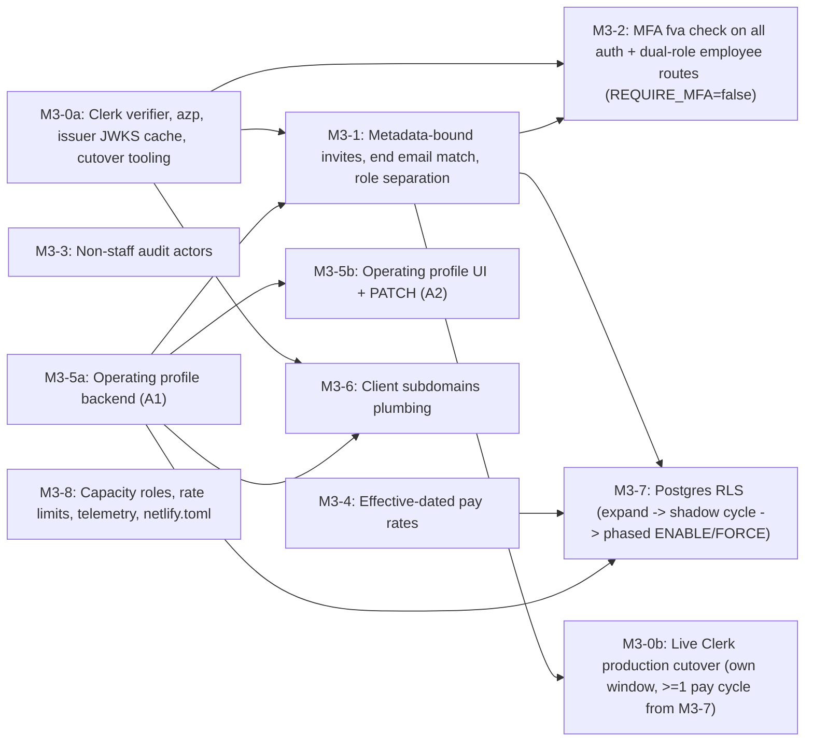

# Milestone 3 ("Foundations") build plan

**Status:** Revised after independent technical review (PR #521) and Leon's November 22, 2026 decisions (§9). No application code has changed.
**Date:** November 22, 2026.
**Codebase baseline:** `Shimizu-Technology/cornerstone-payroll` `origin/main` at `be960a50` (includes PR #520 `docs/milestone3-decisions`).
**Builds on:** [Product architecture decision](PRODUCT_ARCHITECTURE_DECISION_2026-11-19.md) (§0, §4, §6, §8), [Platform offerings implementation spec](PLATFORM_OFFERINGS_IMPLEMENTATION_SPEC_2026-11-17.md), [Full build plan](WORKFORCE_PLATFORM_FULL_BUILD_PLAN_2026-11-18.md) (R1), [HR module study and plan](HR_MODULE_ADP_STUDY_AND_PLAN_2026-11-18.md), [Guam legal compliance research](GUAM_PAYROLL_HR_LEGAL_COMPLIANCE_RESEARCH_2026-11-19.md), [Gate 0 trust and release plan](GATE_0_TRUST_AND_RELEASE_PLAN_2026-08-23.md), [Employee portal plan](EMPLOYEE_PORTAL_AND_PLATFORM_PLAN_2026-11-17.md), and [Production identity cutover runbook](PRODUCTION_IDENTITY_CUTOVER_RUNBOOK.md).

## Summary

Milestone 3 puts the safety, isolation, and configuration plumbing under Cornerstone Payroll before any client employee signs in. It consolidates and hardens the Clerk JWT verifier with `azp` validation and issuer-scoped JWKS caching (`M3-0a`), ends email-based invitation binding and separates login identity from area-specific roles (`M3-1`), builds and tests MFA session verification (`fva`) on a **separate** Clerk development instance across all Clerk-authenticated endpoints behind `REQUIRE_MFA=false` (`M3-2`), extends audit logging to non-staff actors (`M3-3`), introduces effective-dated pay-rate history across every writer and reader (`M3-4`), adds per-client feature switches (`client_operating_profiles`, `M3-5a`/`M3-5b`) and `<client>.shimizu-technology.com` subdomain plumbing (`M3-6`), enforces fail-loud Postgres row-level security (RLS) across all 194 classified tables (102 `company_id` tables, 26 expand-and-contract child tables, 10 parent-protected child tables, and 4 new Milestone 3 tables) after a full-pay-cycle shadow phase (`M3-7`), and prepares process-role splits, rate limits, telemetry, and a root `netlify.toml` (`M3-8`).

Near the end of Milestone 3 — after `M3-0a` and `M3-1` land, and **at least one full pay cycle separate from RLS enforcement (`M3-7`)** — Payroll cuts over live from Clerk development (`pk_test_`) to a Clerk production instance on the free plan (`M3-0b`), using `shimizu-technology.com` as its root domain. Milestone 3 adds **$0/month** in hosting costs today (assuming Cornerstone Tax's shared login defers to Milestone 6; see open decision §9.2); the Milestone 4 gate adds **$32/month** (Clerk Pro $25 + Render Starter employee web $7; $27/month if Clerk Pro is billed annually). Legal review and WISP work are deferred out of Milestone 3 and remain a Milestone 4 go-live prerequisite (§5).

### What milestone 3 deliberately does not do

- **No employee-facing UI or invites.** Pay stubs, W-2 downloads, profile edits, bank changes, and employee onboarding are Milestone 4. The `employee/*` namespace ships scaffolded and switched off.
- **No production MFA enforcement yet.** MFA verification is built and tested against a **separate** Clerk development instance (free, 100-user cap — never the dev instance serving live production), then deployed with `REQUIRE_MFA=false`. Clerk Pro ($25/month) and production MFA enforcement turn on at the Milestone 4 gate or once the platform earns revenue, whichever comes first (Leon, Nov 22, 2026).
- **No SMS provider.** Sign-in and MFA codes come from Clerk. ClickSend or Twilio is chosen only when text notifications are built (Leon, Nov 22, 2026).
- **No extra paid Render instances running idle, and no separate employee worker until Milestone 6.** Separate employee web/worker process roles, DB pool caps, and rate limits are coded in Milestone 3. The Render Starter employee web service ($7/month) spins up at the Milestone 4 gate; employee background jobs stay capped on the existing Payroll worker until Milestone 6 (Leon, Nov 22, 2026).
- **No virus scanner in Milestone 3 or the pilot.** Uploads continue with the existing `ClientDocumentFileValidator` byte/type/size checks and `ClientDocumentScanner::Noop`, trusting pilot companies; **add malware scanning before wider rollout** beyond the pilot (Leon, Nov 22, 2026 — §1.11).
- **No legal review or WISP work in Milestone 3.** Deferred by Leon (Nov 22, 2026); both remain a **Milestone 4 go-live prerequisite** per §6 of the architecture decision (§5).
- **No changes to AIRE's production app or My Pay contract.** Existing AIRE routes, audit action strings, and payloads remain byte-for-byte compatible.
- **No Year-End (Milestone 1) or Tax profitability (Milestone 2) work.** Year-end filing (February 1, 2027 deadline) keeps priority whenever schedules compete.

---

## 1. Current state per item

Every code claim below was verified against `origin/main` (`be960a50`) on November 22, 2026.

### 1.1 Clerk production instance

- **Live status:** Production Payroll still uses Clerk development keys (`pk_test_` / `sk_test_`; Clerk development instances cap at **100 users**). The September 14 readiness run passed 26 of 29 controls, failing only production Clerk keys, MFA attestation, and instance-bound Clerk API match (`docs/PRODUCTION_READINESS_EVIDENCE_2026-09-14.md:19-22`). Under Leon's November 22 decision, the live production cutover (`M3-0b`) happens near the end of Milestone 3 in its own window separate from RLS enforcement. **All MFA testing MUST happen on a separate Clerk development instance, never on the Clerk development instance currently serving live production** (and note that staging can share production's Clerk instance via `STAGING_SHARES_PRODUCTION_CLERK=true` per `docs/STAGING_ENVIRONMENT.md:58`, so never enable MFA or test MFA on staging while shared with production's instance).
- **Staged instance:** An unused Clerk production instance was created earlier for `payroll.shimizu-technology.com` in invite-only mode (`docs/PRODUCTION_IDENTITY_CUTOVER_RUNBOOK.md:14-18`). A public DNS lookup on November 22, 2026 showed `payroll.shimizu-technology.com` CNAMEd to `cornerstone-payroll.netlify.app`, with **no** CNAME records yet on `clerk.shimizu-technology.com`, `accounts.shimizu-technology.com`, `clerk.payroll.shimizu-technology.com`, or `accounts.payroll.shimizu-technology.com`.
- **How Payroll stores and depends on Clerk user IDs:**
  - `users.clerk_id` is a nullable unique string (`api/db/schema.rb:4569,4587`), alongside `users.clerk_invitation_id` (`api/db/schema.rb:4570`). `User::PRIMARY_PLATFORM_OWNER_EMAIL` is `shimizutechnology@gmail.com` (`api/app/models/user.rb:7`).
  - **Every domain table references `users.id` (bigint FK), never `clerk_id`.** Across `api/app` and `api/lib`, `clerk_id` is touched only in:
    - `api/app/controllers/concerns/clerk_authenticatable.rb:28-29,31,51,160,176,187,220` (JWT lookup and provisioning),
    - `api/app/channels/application_cable/connection.rb:26` (staging tester check; normal Cable tickets store `user_id`),
    - `api/app/services/staging_tester_identity.rb:11` and `api/app/services/staging_clone_containment.rb:75-78` (lines 76–77 currently bind staging testers by `lower(email)`; replaced in `M3-1` with the explicit `STAGING_TESTER_BINDINGS` `user_id`/`email`/`clerk_subject` triple documented in `docs/STAGING_ENVIRONMENT.md:67`),
    - placeholder creation (`"pending_#{SecureRandom.uuid}"`) in `api/app/controllers/api/v1/admin/users_controller.rb:44` and `api/app/controllers/api/v1/admin/organizations_controller.rb:189`.
  - `clerk_invitation_id` is referenced only in `users_controller.rb:173-175,208-210,308-310,466`, `organizations_controller.rb:212`, `clerk_invitation_service.rb:46`, `test_workspace/portal_access.rb:29,34,61`, `expire_practice_portal_access_job.rb:7`, and `staging_outbound_policy.rb:276`.
  - **Consequence:** Re-linking `users.clerk_id` to new production Clerk user IDs preserves every audit log, approval, payroll run, document upload, and company assignment intact. Only active browser sessions (`users.last_session_id_digest`) and pending Clerk invitations reset.
- **Latent production JWT bugs in current code:**
  - `api/app/services/clerk_token_verifier.rb` is currently **dead code** (referenced only in `api/spec/services/clerk_token_verifier_spec.rb:5`); `api/app/controllers/concerns/clerk_authenticatable.rb` duplicates JWT verification directly.
  - Both files derive `clerk_instance_id` by splitting the decoded publishable key on `.clerk.accounts.dev` (`clerk_authenticatable.rb:138-146`, `clerk_token_verifier.rb:68-74`) and fall back to `https://<id>.clerk.accounts.dev`. That fallback breaks on a `pk_live_` key (which encodes `clerk.shimizu-technology.com$`) **whenever `CLERK_ISSUER` and `CLERK_API_BASE` are unset**.
  - Both files cache JWKS under the **fixed cache key `"clerk_jwks"`** (`clerk_authenticatable.rb:105`, `clerk_token_verifier.rb:37`) for 1 hour rather than keying by issuer — risking stale JWKS across an issuer switch or rollback.
  - Neither verifier validates the `azp` (authorized party) claim.

### 1.2 Invitation-only logins and role separation

- **How live staff and client invites actually work today (critical):**
  - Live staff and client invites do **not** go through `user_invitations` (which is only used by the separate `UserInvitationsController` / `UserInvitationMailer`).
  - `Api::V1::Admin::UsersController#create` (`api/app/controllers/api/v1/admin/users_controller.rb:44`) creates the `User` row with `clerk_id = "pending_#{SecureRandom.uuid}"` and `invitation_status = "pending"`. (`Api::V1::Admin::OrganizationsController#build_org_admin!` at `api/app/controllers/api/v1/admin/organizations_controller.rb:189` does the same for `org_admin`.)
  - `UsersController#send_clerk_invitation` (`users_controller.rb:457-481`) calls `ClerkInvitationService#create_invitation` with `public_metadata: { role: user.role }` only (and `organizations_controller.rb:204-213` passes `{ role: user.role, organization_id: user.organization_id }`), then saves `clerk_invitation_id`.
  - When that invited person signs in for the first time, `ClerkAuthenticatable#provision_user_from_clerk` (`api/app/controllers/concerns/clerk_authenticatable.rb:158-165`) finds the pending `User` **solely by `LOWER(email)`** and overwrites `clerk_id`.
  - Worse, the same `LOWER(email)` match runs against **any** existing `User` (even already-bound active users), the passive `UserInvitation.active` fallback (`lines 168-183`) matches by email, and the `ActiveRecord::RecordNotUnique` rescue branch (`lines 184-188`) **also** matches by `LOWER(email)` and overwrites `clerk_id`.
  - Deleting email matching without replacing how `pending_` invites bind would break every new staff and client invite, including fresh invites sent after `M3-0b`.
- **Single-role `User` model:** `api/app/models/user.rb:38` has one enum (`admin`, `manager`, `employee`, `accountant`, `client`, `super_admin`, `org_admin`) and one home `company_id` (`api/db/schema.rb:4571`). `StaffRolePolicy` (`api/app/policies/staff_role_policy.rb:7-285`) gates `Api::V1::Admin::BaseController` (`api/app/controllers/api/v1/admin/base_controller.rb:22-28`), and `ClientPortalAccess` (`api/app/controllers/concerns/client_portal_access.rb:11-15`) gates `Api::V1::Client::BaseController` (`api/app/controllers/api/v1/client/base_controller.rb:11-12`).
- **Gaps:**
  - The unused `employee: 2` role on `User` falls into `User#accessible_company_ids` (`user.rb:158`) and would return `[company_id] + assigned_ids` (whole-company scope), with no foreign key to `employees`.
  - One person cannot cleanly hold both a `client` role (e.g., Emma at MoSa's) and an `employee` role under the one-login model decided on November 19.
  - `ApplicationController` (`api/app/controllers/application_controller.rb:65-85`) has a dev bypass that falls back to an admin user when `AUTH_ENABLED != "true"`. Any employee base controller must not inherit that fallback.

### 1.3 Database-level company separation (RLS)

- **Controller-only scoping today:** Isolation relies on `ExplicitCompanyAccess` (`api/app/controllers/concerns/explicit_company_access.rb:14-25`), `Admin::BaseController#enforce_company_access!` (`admin/base_controller.rb:179-185`), `Client::BaseController#enforce_company_access!` (`client/base_controller.rb:16-22`), and `where(company_id: current_company_id)` in controllers and services. There are zero Postgres RLS policies in `api/db/schema.rb`.
- **Complete table inventory (`api/db/schema.rb`, 194 tables total):**
  - **111 tables** carry `company_id` (102 company-scoped tables protected under RLS + 9 reviewed exempt tables; full classification in §2.1).
  - **83 tables** do not carry `company_id`: **26** sensitive employee/payroll/check/intake/time child tables receiving denormalized `company_id` via expand-and-contract, **10** secondary company-scoped child tables protected via parent-FK RLS policy, **28** reviewed exempt org/identity/finance/profitability/user-preference tables, and **19** global tax-reference & Solid Queue infrastructure tables (full 194-table classification in §2.1).
- **Callers outside `Admin::BaseController`, `Client::BaseController`, and `Employee::BaseController`:**
  - AIRE integration controllers (`api/app/controllers/api/v1/integrations/aire/worker_statements_controller.rb:10-15`, `events_controller.rb`, `cutoff_changes_controller.rb`),
  - Top-level controllers (`api/app/controllers/api/v1/companies_controller.rb:94`, `api/app/controllers/api/v1/form_500s_controller.rb:93`, `api/app/controllers/api/v1/finance/access_controller.rb:10-25`, `api/app/controllers/api/v1/cable_tickets_controller.rb`, `api/app/controllers/api/v1/notification_settings_controller.rb`),
  - ActionCable (`api/app/channels/client_portal_thread_channel.rb:1-45`),
  - Every cross-company recurring job in `api/config/recurring.yml:12-79` (`ExpirePracticePortalAccessJob`, `PortalUploadCleanupJob`, `SendPayrollRemindersJob`, `TaxWorkHoursNightlyRefreshJob`, `InvoiceRecurrenceDispatchJob`, `InvoiceSendDispatchJob`, `AirePayrollAcknowledgementDispatchJob`, `AirePayrollCalendarDispatchJob`, `HistoricalClientBootstrapDispatchJob`, `CheckPrintGenerationRecoveryJob`, `ClientDocumentScanRecoveryJob`, `PortalNotificationDispatchJob`),
  - Cross-company / year-end readers (`api/app/services/year_end/input_revision.rb:18-35`, `api/app/services/year_end/clients_overview.rb:18-42`, `api/app/services/audit_log_presenter.rb:113`),
  - Staging containment (`api/app/services/staging_clone_containment.rb:65-80`).
- **Schema dump format:** `api/config/application.rb` uses Rails' default `:ruby` schema format (`db/schema.rb`), which **silently omits Postgres RLS policies, `ENABLE/FORCE ROW LEVEL SECURITY`, triggers, and `EXCLUDE USING gist` constraints** when loading a fresh test database via `db:schema:load`.
- **Neon runtime specifics:**
  - Production Rails is assumed to run over Neon's PgBouncer connection pooler in **transaction mode** (documented in `api/app/services/dedicated_advisory_lock.rb:7-20` and `api/lib/database_predeploy.rb:38,85`; live Render host must be verified in Preflight §1.12).
  - Existing pooler specs (`api/spec/services/payment_transition_lock_transaction_pooler_spec.rb:19-20`) are currently skipped in CI because CI has no PgBouncer container.
  - Neon's default `neondb_owner` role (and any role created through the Neon Console or API) inherits `neon_superuser`, which holds **`BYPASSRLS`** on projects created after August 15, 2023 ([Neon roles docs](https://neon.com/docs/manage/roles), checked 2026-11-22; actual production `rolbypassrls` must be verified in Preflight §1.12). Per [PostgreSQL 16 RLS documentation](https://www.postgresql.org/docs/16/ddl-rowsecurity.html) (checked 2026-11-22), `BYPASSRLS` overrides even `FORCE ROW LEVEL SECURITY`.

### 1.4 MFA check (`REQUIRE_MFA`)

- **Attestation only, no runtime enforcement:** `api/app/services/production_readiness.rb:118,205-217,288-293` checks only that `REQUIRE_MFA == "true"`, `CLERK_MFA_ATTESTED_INSTANCE_ID` matches `GET https://api.clerk.com/v1/instance`, and `CLERK_MFA_EVIDENCE_REF` is present. *(Note: `api/config/deploy.yml` is an unused Kamal template, not evidence of live Render env vars; live Render `REQUIRE_MFA` is verified in Preflight §1.12.)*
- **No JWT claim check:** `ClerkAuthenticatable` does not inspect Clerk's `fva` (factor verification age) claim, and `CableTicketService` issues WebSocket tickets without checking MFA.
- **Routes outside `/admin` and `/client`:** `api/config/routes.rb` mounts Clerk-authenticated endpoints outside `/admin` and `/client`, including `companies_controller`, `form_500s_controller`, `cable_tickets_controller`, and `notification_settings_controller` (while `finance/*` uses book-scoped service tokens rather than Clerk). MFA enforcement must therefore bind to authentication itself, not URL prefixes.

### 1.5 Effective-dated pay rates

- **Overwritten in place across many writers:**
  - `employees.pay_rate` (`api/app/models/employee.rb:148-150,290-292`) and `employee_wage_rates` (`api/db/schema.rb:1166-1176`, `api/app/models/employee_wage_rate.rb:1-82`) have no `effective_on` or `ends_on`.
  - **All verified write paths (13 files):**
    1. `api/app/controllers/api/v1/admin/employees_controller.rb:62,102-126` (`create` and `update`),
    2. `api/app/controllers/api/v1/admin/employee_wage_rates_controller.rb:41-52`,
    3. `api/app/services/employee_wage_rate_sync_service.rb:26-46` (overwrites or destroys rows at line 33),
    4. `api/app/models/employee_change_request.rb:150`,
    5. `api/app/services/client_employee_update_service.rb:26,146-147,246`,
    6. `api/app/services/employee_classification_transition_service.rb:117,192`,
    7. `api/app/services/migration_promotion/setup_synchronizer.rb:88`,
    8. `api/app/services/quickbooks_history/client_bootstrap_apply_service.rb:78`,
    9. `api/app/services/employee_bulk_import/import_service.rb:88`,
    10. `api/app/services/payroll_go_live_setup_transfer_service.rb:6,21-25`,
    11. `api/app/services/year_end/one_off_payee_resolver.rb:163`,
    12. `api/lib/tasks/mosa_data_config.rake:93`,
    13. `api/app/services/test_workspace/setup_cloner.rb:90` (clones setup into test workspaces).
- **Existing effective-dated models to follow:** `employee_w4_elections` (`api/db/schema.rb:1138-1154`), `employee_work_profiles` (`api/db/schema.rb:1178-1204`, `effective_on`/`ends_on` with unique `WHERE ends_on IS NULL`), and `employee_retirement_elections` (`employee.rb:268-276`).
- **All verified calculation, import, report, and default readers:**
  - Committed runs snapshot `payroll_items.pay_rate` and `payroll_items.wage_rate_hours`, and `HourlyPayrollCalculator` (`api/app/services/hourly_payroll_calculator.rb:63,108`), `SalaryPayrollCalculator` (`api/app/services/salary_payroll_calculator.rb:57,60`), and `IssueCorrectivePaycheckService` (`api/app/services/issue_corrective_paycheck_service.rb:646,916`) read the item snapshot.
  - Open/draft calculation, imports, previews, defaults, fingerprints, reconciliation, client display, and reports read live `employee.pay_rate` / `default_payroll_rate` / `active_wage_rates` directly across **24 files**:
    - `api/app/controllers/api/v1/admin/pay_periods_controller.rb:425-428,1735-1758`,
    - `api/app/controllers/api/v1/admin/payroll_items_controller.rb:613,621`,
    - `api/app/controllers/api/v1/admin/reports_controller.rb:2730`,
    - `api/app/controllers/api/v1/admin/payroll_standing_changes_controller.rb:53-56`,
    - `api/app/controllers/api/v1/admin/timecards_controller.rb:183,288`,
    - `api/app/controllers/api/v1/admin/timecard_imports_controller.rb:69`,
    - `api/app/controllers/api/v1/client/employees_controller.rb:252`,
    - `api/app/services/payroll_calculation_context.rb:70`,
    - `api/app/services/payroll_expected_entries.rb:14-21,57,76`,
    - `api/app/services/payroll_wage_rate_input.rb:43`,
    - `api/app/services/payroll_intake/apply_service.rb:332`,
    - `api/app/services/payroll_intake/employee_matcher.rb:9`,
    - `api/app/services/payroll_import/import_service.rb:205,504,539,567`,
    - `api/app/services/payroll_import/wage_rate_choice.rb:18,24`,
    - `api/app/services/payroll_submissions/import_changes.rb:22,312,339`,
    - `api/app/services/payroll_submissions/change_rows.rb:137-141`,
    - `api/app/services/time_tracking/apply_import_service.rb:145,333`,
    - `api/app/services/time_tracking/import_preview_service.rb:228`,
    - `api/app/services/time_tracking/batch_import_preview_service.rb:201`,
    - `api/app/services/time_tracking/exact_line_correction_service.rb:168,201,242`,
    - `api/app/services/time_tracking/aire_category_setup.rb:14-15`,
    - `api/app/services/time_tracking/history_approval.rb:178,387,414,426`,
    - `api/app/services/time_tracking/historical_classification_reconciliation_service.rb:221`,
    - `api/app/services/time_tracking/late_hours_run_service.rb:149`.

### 1.6 Audit logging and actor model

- **Schema:** `audit_logs` (`api/db/schema.rb:279-304`) has nullable `user_id`, plus `actor_name`, `actor_email`, `actor_role`, `event_category`, `metadata`, `company_id` (nullable), `organization_id` (nullable), `ip_address`, `user_agent`, and `request_id`. There is no `actor_type` or non-user `actor_id` column.
- **Non-user and nullable-actor callers already exist today:**
  - `api/app/services/aire_payroll_calendar/lock_rollout.rb:39,49` calls `AuditLog.create!` directly with `actor_name: @actor, actor_role: "operator"` (`user: nil`).
  - Three `AuditLog.record!(user: nil, ...)` sites run outside jobs: `api/app/controllers/api/v1/integrations/aire/worker_statements_controller.rb:194`, `api/app/services/aire_payroll_events/receiver.rb:170`, and `api/app/services/test_workspace/portal_access.rb:20` (called both from `ExpirePracticePortalAccessJob` and directly from services/controllers).
  - Across `api/app` and `api/lib`, there are **78** `AuditLog.record!(user: <var>, ...)` sites using a variable other than `current_user` (mostly `user: actor` / `user: @actor` across services, models, and jobs) where the passed actor can be `nil` in background or automated contexts — so fail-loud `actor_type` validation requires `Current.actor` to be set across auth concerns, jobs, and rake tasks.
- **Gaps & readers depending on `actor_name`:**
  - `Auditable#write_audit_log` (`api/app/controllers/concerns/auditable.rb:48`) exits immediately with `return unless current_user`.
  - `AuditLog.record!` (`api/app/models/audit_log.rb:18-53`) fills `actor_name`, `actor_email`, and `actor_role` solely from `user` (`lines 47-49`), leaving them `NULL` for non-user callers.
  - Existing readers depend on `actor_name` or `user&.name`: `api/app/controllers/api/v1/admin/audit_logs_controller.rb:171-174` (CSV export), `api/app/controllers/api/v1/admin/pay_periods_controller.rb:1953` (`log.user&.name` — misses non-user `actor_name` today), `api/app/controllers/api/v1/admin/payroll_filing_records_controller.rb:22` (`log.actor_name`), `api/app/services/audit_log_presenter.rb:191-193`, and `api/app/services/pay_run_activity_phrase.rb:60-68`.
  - Background jobs have no `Current` actor context.

### 1.7 Reserved capacity, rate limiting, and deployment topology

- **Render services:** Production runs two Render services from `api/`: a web service (`cornerstone-payroll-api.onrender.com`, Puma single-process with `RAILS_MAX_THREADS` defaulting to 3 in `api/config/puma.rb:28-47`, `SOLID_QUEUE_IN_PUMA=false`) and a dedicated Solid Queue worker (`docs/PRODUCTION_READINESS_EVIDENCE_2026-09-14.md:9-10`). `api/config/queue.yml:9-16` defines two worker entries — `["default", "solid_queue_recurring"]` (3 threads, 1 process) and `"ocr"` (1 thread, 1 process) — meaning each Solid Queue worker entry spawns its own Ruby OS process. `api/config/database.yml:18,91-106` configures **4 separate Active Record pools** (`primary`, `cache`, `queue`, `cable`) all inheriting `pool: ENV.fetch("RAILS_MAX_THREADS") { 5 }` and pointing to `DATABASE_URL` unless dedicated URLs are set. There is no `render.yaml` in the repo (`api/config/deploy.yml` is an unused Kamal template, not evidence of live Render configuration).
- **Netlify:** `web/` deploys to `cornerstone-payroll.netlify.app` (`payroll.shimizu-technology.com`) with SPA routing in `web/public/_redirects`. There is **no `netlify.toml`** in the repo, so docs-only and API-only merges are not protected by a committed build-ignore rule. Deploy previews were disabled org-wide after the November 20 credit exhaustion incident; adding a second Netlify site in Milestone 4 shares that same team credit pool.
- **Rate limiting:** `api/config/initializers/rack_attack.rb:1-51` defines four throttles (`api/ip` 300/min, `auth/ip` 20/min, `worker_statements/worker` 60/min, `worker_statements/pdf` 20/min) backed by `RequestPathCache.store` (Solid Cache in production). There are no throttles for employee endpoints, invitation/activation attempts, or kiosk punches.

### 1.8 Per-client settings / operating profile

- **Scattered today:** Settings live across ad hoc columns on `companies` (`api/db/schema.rb:582-660`, `api/app/models/company.rb:12-13,293-305`): `pay_frequency`, `historical_payroll_enabled`, `client_payroll_approval_required`, `simple_payroll_register_enabled`, `payroll_intake_source_types`, and `payroll_intake_settings`. The last two are not permitted in `Api::V1::Admin::CompaniesController#company_params` (`api/app/controllers/api/v1/admin/companies_controller.rb:312-324`) and can only be edited from Rails console with no audit trail.
- **No feature-flag catalog:** There is no `client_operating_profiles` table, no client-portal or employee-portal on/off switch, and no per-client subdomain or branding config. Old PR #139 was closed (`PRODUCT_ARCHITECTURE_DECISION_2026-11-19.md:32`).

### 1.9 Client subdomains (`<client>.shimizu-technology.com`)

- **Not built:** `companies` has no slug/subdomain column. `api/config/initializers/cors.rb:18-19` reads a static comma-separated `CORS_ORIGINS` list from the environment, and `api/app/services/production_readiness.rb:182-185` checks that `CORS_ORIGINS` is a static list of HTTPS origins.
- **Clerk subdomain vs. satellite-domain verification (verified against Clerk docs, 2026-11-22):**
  - Per [Clerk's production deployment guide](https://clerk.com/docs/guides/development/deployment/production), when a production instance is configured on a **root domain** (`shimizu-technology.com`, creating `clerk.shimizu-technology.com`), authentication and sessions work across **all subdomains of that root domain** (`payroll.shimizu-technology.com`, `mosas.shimizu-technology.com`, `aire.shimizu-technology.com`) by default at **$0**.
  - Per [Clerk's satellite domains guide](https://clerk.com/docs/guides/dashboard/dns-domains/satellite-domains) and [Clerk pricing](https://clerk.com/pricing), **satellite domains ($10/month each, Pro plan required)** are needed only across *different* root domains (for example, `cornerstone-accounting.tax` — see open decision §9.2 — or a client's own `hr.mosasguam.com` later).
  - **Decided (Leon, Nov 22, 2026):** Cornerstone Payroll's production Clerk root domain is **`shimizu-technology.com`** (the Shimizu Technology marketing site does not use auth, and `dig` on 2026-11-22 confirmed `clerk.shimizu-technology.com` is unused). Reconfigure or replace the unused September 14 secondary-application instance (`payroll.shimizu-technology.com`, `PRODUCTION_IDENTITY_CUTOVER_RUNBOOK.md:14,81`) with root domain `shimizu-technology.com` before `M3-0b`.
  - **Architectural limit to record:** Because Clerk ties one production Frontend API (`clerk.shimizu-technology.com`) to the root domain, **no other Shimizu app can run its own separate Clerk production instance on `shimizu-technology.com`** (any future separate app must use its own domain or a secondary-application subdomain).
  - **Two security requirements on the root domain:** (1) Enable Clerk's [Allowed subdomains](https://clerk.com/docs/guides/dashboard/dns-domains/subdomain-allowlist) in the Clerk Dashboard (confirming Free-plan availability in Preflight §1.12) so only explicitly listed subdomains (`payroll.shimizu-technology.com`, `mosas.shimizu-technology.com`, etc.) can call Clerk's Frontend API; and (2) validate the JWT `azp` claim (`authorizedParties`) in Rails (`ClerkTokenVerifier`) against the same explicit origin list to prevent subdomain cookie-leaking attacks.
  - **Passkeys caveat:** Clerk's production guide notes that due to WebAuthn RP ID rules, passkeys do not share across two sibling subdomains (`payroll.shimizu-technology.com` and `mosas.shimizu-technology.com`). That does not affect password, email code, Google sign-in, or TOTP authenticator apps in Milestones 3–4, and is noted before passkeys are considered later.

### 1.10 Outside the code: legal review and WISP (deferred to Milestone 4 go-live)

- **Legal research brief exists:** `docs/GUAM_PAYROLL_HR_LEGAL_COMPLIANCE_RESEARCH_2026-11-19.md` lists 12 "Needed before launch" questions for a Guam law firm (Part 3, `lines 737-750`) plus agency questions for Guam DRT, Guam DOL Wage & Hour, and the AG's Child Support Enforcement Division (Part 4, `lines 770-796`).
- **WISP status unknown:** Dafne attended IRS WISP training in March 2026; whether Cornerstone finished its WISP is unconfirmed (`PRODUCT_ARCHITECTURE_DECISION_2026-11-19.md:283`). Shimizu Technology has no platform security addendum or service-provider DPA yet.
- **Decided (Leon, Nov 22, 2026):** Not part of Milestone 3 work or acceptance. Both stay in this document (§5) as a **Milestone 4 go-live prerequisite** per §6 of [Product architecture decision](PRODUCT_ARCHITECTURE_DECISION_2026-11-19.md) ("the lawyer review and the written security plan (WISP) must be finished before it goes live").

### 1.11 File scanning (decided: no virus scanner for Milestone 3 and pilot)

- **What exists today:**
  - `ClientDocumentUploadService` (`api/app/services/client_document_upload_service.rb:44-50,78`) uploads bytes synchronously to Cloudflare R2 (`api/app/services/r2_storage_service.rb`) after running `ClientDocumentFileValidator` (`api/app/services/client_document_file_validator.rb:1-263`).
  - `ClientDocumentFileValidator` already enforces a 25 MB per-file / 50 MB per-request cap, magic-byte validation (`Marcel`), OOXML central-directory/entry-count (1,000) and expanded-size (100 MB) zip-bomb caps, blocks VBA/Excel 4 macros, ActiveX, embedded executables (MZ/ELF/Mach-O/shebangs), and external OOXML links, and inspects legacy OLE/BIFF containers.
  - `ClientDocumentScanner` (`api/app/services/client_document_scanner.rb:5-47`) is wired into `ClientDocument`, `ScanClientDocumentJob`, `ClientDocumentScanRecoveryJob`, and all four download/preview/attachment/intake gates, with `ClientDocumentScanner::Noop` as the default adapter (leaving `scan_status = "not_scanned"`).
- **Decided (Leon, Nov 22, 2026):** Allow uploads now using the existing `ClientDocumentFileValidator` type, byte, container, and size checks with **no virus scanner** (`ClientDocumentScanner::Noop`, **$0/month**). Trust the pilot companies; keep the `ClientDocumentScanner` adapter seam intact; **add malware scanning before wider rollout beyond the pilot**.
- **Reference options when adding scanning before wider rollout (prices verified 2026-11-22):**
  - *Managed API (Cloudmersive Basic):* **$19.99/month** for 10,000 calls/month, 1 GB max file size ([Cloudmersive Small Business Pricing](https://cloudmersive.com/pricing-small-business); Free tier is capped at 3.5 MB, below our 25 MB limit; AttachmentScanner starts at $249/mo — [AttachmentScanner](https://www.attachmentscanner.com/plans-and-pricing)). Requires adding the vendor as a sub-processor in the DPA, privacy notice, and WISP (and checking IRC § 7216).
  - *Self-hosted ClamAV (`clamd`) on Render:* **$25/month** on Render Standard (2 GB RAM — tight on signature reloads) or **$85/month** on Render Pro (4 GB RAM — matches [ClamAV's 3–4 GiB recommendation](https://docs.clamav.net/Introduction.html)), plus persistent disk ([Render Pricing](https://render.com/pricing)). Files never leave Shimizu's Render network.

### 1.12 Preflight checks (unverified live environment facts)

These seven facts cannot be verified from Git alone and **must** be checked directly against live infrastructure before starting `M3-7` enforcement, `M3-8`, and `M3-0b`:

- [ ] **Neon `neondb_owner` privileges & direct-connection cap:** Run `SELECT rolname, rolsuper, rolbypassrls FROM pg_roles WHERE rolname = current_user; SHOW max_connections;` directly on staging and production Neon databases to confirm `neondb_owner`'s actual `rolbypassrls` status and confirm Neon's direct-endpoint connection cap supports Option B (§2.1).
- [ ] **Render live environment:** Inspect both production Render services (web and worker) to confirm whether `DATABASE_URL` points to Neon's pooled (`-pooler`) or direct host, whether `CLERK_ISSUER`, `CLERK_API_BASE`, `CLERK_AUTHORIZED_PARTIES`, and `REQUIRE_MFA` are currently set, what `DB_PREPARED_STATEMENTS` and `RAILS_MAX_THREADS` are set to, and each service's current Render plan size and observed RSS memory usage.
- [ ] **Netlify current UI settings & credits:** Record `cornerstone-payroll.netlify.app`'s exact UI build settings (base directory, build command, publish directory, environment variables, redirects/headers) and current credit plan/usage **before** committing a root `netlify.toml` in `M3-8` (which overrides UI build settings).
- [ ] **Clerk Free-plan feature availability:** Verify directly in the Clerk Dashboard (not only marketing docs) that **Allowed subdomains** and **Invite-only (`restricted`)** access mode are both enabled on the **Free (Hobby)** plan for the production instance.
- [ ] **Clerk dev instance token version, user count & TOTP status:** Inspect the live Clerk development instance to confirm its JWT session token version (v2 including `fva`), current total user count against Clerk dev's 100-user cap, and **that no live production user has TOTP enrolled** (or plan to strip TOTP fields from the Dashboard export before `clerk migrate import`, because Clerk rejects TOTP users when TOTP is off on the target instance).
- [ ] **Recovery admin & platform-owner live user rows:** Query live production `users` to confirm (a) whether `User::PRIMARY_PLATFORM_OWNER_EMAIL` (`shimizutechnology@gmail.com`, `api/app/models/user.rb:7`) is an active `super_admin` row that must be in Batch 0, (b) whether Leon's `lmshimizu@gmail.com` row holds `super_admin`, and (c) that Dafne's actual live `users.email` matches `dmshimizucpa@gmail.com`.
- [ ] **Separate Clerk dev instance for MFA QA:** Confirm a dedicated non-production Clerk development instance exists for local/staging MFA testing (separate from the dev instance currently serving live production, and with `STAGING_SHARES_PRODUCTION_CLERK` unset on staging per `docs/STAGING_ENVIRONMENT.md:58`).

---

## 2. Technical designs for the hard parts

### 2.1 Postgres RLS safely with Rails + Neon

Neon's pooled endpoint (`-pooler`) runs PgBouncer in **transaction mode** ([Neon connection pooling docs](https://neon.com/docs/connect/connection-pooling), checked 2026-11-22), where session-level `SET` leaks across clients or disappears on the next transaction. Neon's default `neondb_owner` role also holds `BYPASSRLS` on projects created after August 15, 2023 ([Neon roles docs](https://neon.com/docs/manage/roles), checked 2026-11-22).

#### 1. Dedicated non-bypass DB role
- `MIGRATION_DATABASE_URL` (direct, non-pooled, already enforced by `api/lib/database_predeploy.rb:38,85`) stays on `neondb_owner` (owns tables, runs migrations, creates policies and kill-switch state).
- Create a dedicated runtime role via SQL (not the Neon Console, so it does **not** inherit `neon_superuser`):
  ```sql
  CREATE ROLE payroll_app LOGIN PASSWORD '...' NOSUPERUSER NOCREATEDB NOCREATEROLE NOBYPASSRLS;
  GRANT USAGE ON SCHEMA public TO payroll_app;
  GRANT SELECT, INSERT, UPDATE, DELETE ON ALL TABLES IN SCHEMA public TO payroll_app;
  GRANT USAGE, SELECT ON ALL SEQUENCES IN SCHEMA public TO payroll_app;
  ALTER DEFAULT PRIVILEGES FOR ROLE neondb_owner IN SCHEMA public
    GRANT SELECT, INSERT, UPDATE, DELETE ON TABLES TO payroll_app;
  ALTER DEFAULT PRIVILEGES FOR ROLE neondb_owner IN SCHEMA public
    GRANT USAGE, SELECT ON SEQUENCES TO payroll_app;
  ```
- **Keep `rls_kill_switch` strictly `SELECT`-only for `payroll_app`:** Because the `ALL TABLES` grant and `ALTER DEFAULT PRIVILEGES` in `public` would otherwise grant `INSERT`/`UPDATE`/`DELETE` on `rls_kill_switch` (whether created before or after those statements run), either place `rls_kill_switch` in a separate `rls_admin` schema (granting only `USAGE` on `rls_admin` and `SELECT` on `rls_admin.rls_kill_switch` to `payroll_app`, outside `public`'s default privileges) or run an explicit revoke immediately after creating `public.rls_kill_switch` **and** idempotently at the end of `api/db/rls_policies.sql`:
  ```sql
  REVOKE INSERT, UPDATE, DELETE, TRUNCATE ON TABLE public.rls_kill_switch FROM payroll_app;
  GRANT SELECT ON TABLE public.rls_kill_switch TO payroll_app;
  ```
- Runtime `DATABASE_URL` connects as `payroll_app`. Boot/readiness (`ProductionReadiness`) and CI's `before(:suite)` fail immediately if `SELECT NOT rolbypassrls AND NOT rolsuper FROM pg_roles WHERE rolname = current_user` is not `true`, or if `has_table_privilege('payroll_app', 'rls_kill_switch', 'SELECT')` is not `true`, or if any of `INSERT`/`UPDATE`/`DELETE`/`TRUNCATE` on `rls_kill_switch` returns `true` (`has_table_privilege('payroll_app', 'rls_kill_switch', 'UPDATE')` must be `false`).

#### 2. Scoping mechanism — Option B (Neon direct endpoint) is the practical choice

Wrapping every HTTP request in a single database transaction for `set_config(..., true)` introduces three regressions (`PayrollIntakeSession#mark_failed!` at `api/app/models/payroll_intake_session.rb:80-82` rolls back on rescued errors; `rescue_from` runs outside context; long locks stay pinned across commits, check printing, imports, and external HTTP calls).

**Why Option A (narrow transaction blocks over Neon's pooled endpoint) does not work with the permanent guard:**
- With the permanent query-level `RlsContextGuard` running in `raise` mode (§2.1 #3), narrow per-block `TenantScope.with_company { ... }` transactions break standard Rails lifecycle queries that execute outside explicit service blocks: `before_action` record lookups, lazy Active Record association loads during JSON rendering, `Auditable` writes after the action completes, and `rescue_from` handlers.
- That makes **Option B — session-scoped `set_config(..., false)` on Neon's direct (non-pooled) endpoint — the practical architecture**, subject to verifying Neon's direct `max_connections` cap in Preflight §1.12.

**Connection-budget math (`api/config/database.yml:18,91-106`, `api/config/puma.rb:28`):**
- `database.yml` defines **4 separate pools** (`primary`, `cache`, `queue`, `cable`) each inheriting `pool: ENV.fetch("RAILS_MAX_THREADS") { 5 }`.
- Puma defaults to **3 threads** (`puma.rb:28`). Tuning pool sizes explicitly per role (`primary: 3–5`, `cache: 2`, `cable: 2`, `queue: 2` on web; `primary: threads + 2` on worker) keeps total direct connections across Payroll web + worker + Milestone 4 Starter employee web to ~25–35 peak connections — well within Neon's direct limit (≥ 100 connections on 0.25–1 CU compute; confirmed in Preflight §1.12).
- **Session lifecycle under Option B:**
  - Connect `payroll_app` to Neon's **direct** endpoint.
  - Set `SELECT set_config('app.current_company_id', $1, false)` (or `app.rls_mode = 'system'`) at request/job/channel entry via `TenantScope`, saving and restoring the prior value on nested same-context calls and raising on conflicting nested context.
  - Unconditionally clear both GUCs (`SELECT set_config('app.current_company_id', '', false), set_config('app.rls_mode', '', false)`) in `ensure` **and** on Active Record connection checkin/checkout callbacks so no pooled Ruby connection ever retains a previous request's tenant context.
  - Preserves exact current transaction semantics for `before_action`, lazy render loads, `Auditable`, `rescue_from`, `mark_failed!`, `after_commit`, and long check-printing/import flows with zero lock-extension risk.
- *(Contingency if Preflight §1.12 shows direct connections are too tight: either upgrade Neon compute size or move `cache`/`queue`/`cable` pools onto Neon's `-pooler` endpoint while keeping only `primary` on Neon's direct endpoint, cutting direct connections by ~60%.)*

#### 3. Fail-loudly policies (never silently return 0 rows, zero per-row overhead)

A silent empty result when RLS context is missing causes subtle corruption in payroll: empty AIRE My Pay lists, reminders stopping silently, a zero year-end overview, deductions silently dropped from a paycheck, or `update!` changing 0 rows without error.

**Mandatory fail-loud behavior (two layers — permanent query-level guard + STABLE Postgres function):**
- **Layer 1 — Permanent query-level context guard (`RlsContextGuard`, stays on in production):** A per-row Postgres RLS predicate **never executes on an empty table or when an index lookup finds zero candidate rows**, meaning an unscoped query against an empty protected table or a missing primary key would still silently return 0 rows instead of raising. Therefore, install a **permanent** query-level guard (Active Record connection-adapter hook / `sql.active_record` guard) that checks every SQL statement referencing a protected table **before row evaluation**:
  - **During the initial one-pay-cycle shadow phase only (`RLS_CONTEXT_GUARD_MODE=log` in production):** logs every unscoped query (with controller/job/backtrace) to structured telemetry without raising until shadow logs hit zero for a full pay cycle (test and staging already run in `raise` mode).
  - **Permanently once RLS is enforced (`RLS_CONTEXT_GUARD_MODE=raise` in test, staging, AND production):** raises `TenantScope::MissingContextError` whenever any protected table is queried without an active company or `system` context — including on empty tables and missing-key lookups. This guard is **not** turned off after the shadow phase.
- **Layer 2 — Indexed RLS policy using a `STABLE` context function (no per-row plpgsql or kill-switch scan):**
  Define one `STABLE` function `app_current_company_id()` that PostgreSQL evaluates once per statement/plan (keeping `company_id = app_current_company_id()` an index scan) and raises when no company context is set:
  ```sql
  CREATE OR REPLACE FUNCTION app_current_company_id() RETURNS bigint
  LANGUAGE plpgsql STABLE AS $$
  DECLARE
    cid text := NULLIF(current_setting('app.current_company_id', true), '');
  BEGIN
    IF cid IS NULL THEN
      RAISE EXCEPTION 'RLS context missing: set app.current_company_id or app.rls_mode=system'
        USING ERRCODE = '42501';
    END IF;
    RETURN cid::bigint;
  END;
  $$;

  ALTER TABLE employees ENABLE ROW LEVEL SECURITY;
  ALTER TABLE employees FORCE ROW LEVEL SECURITY;
  CREATE POLICY employees_company_isolation ON employees
    USING (
      current_setting('app.rls_mode', true) = 'system'
      OR company_id = app_current_company_id()
    )
    WITH CHECK (
      current_setting('app.rls_mode', true) = 'system'
      OR company_id = app_current_company_id()
    );
  ```
  *(Because `current_setting('app.rls_mode', true) = 'system'` is a separate boolean branch evaluated first, system mode never calls `app_current_company_id()`, and company mode uses a plain indexed equality check against the cached `STABLE` value with zero per-row `plpgsql` calls and zero per-row kill-switch table lookups.)*
- **Required empty-table & missing-key tests:** `company_rls_isolation_spec.rb` explicitly tests missing-context queries against **(a) an empty protected table** and **(b) a populated protected table queried by a non-existent ID**, asserting both raise `TenantScope::MissingContextError` instead of silently returning `[]` or `nil`.
- **Threat-model honesty:** `app.rls_mode = 'system'` is settable inside a `payroll_app` session. It is a **defense-in-depth guard against developer query and scoping bugs**, **not** a defense against arbitrary SQL injection (an attacker with raw SQL execution could call `set_config('app.rls_mode', 'system', false)`). Parameterized Active Record queries, Brakeman, and controller authorization remain the SQL-injection boundary.

#### 4. Complete table classification (all 194 tables in `api/db/schema.rb` + 4 new M3 tables)

**Every single table in `api/db/schema.rb` (all 194 tables — both the 111 with `company_id` and the 83 without `company_id`)** is classified below. A CI schema-coverage test in `M3-7` iterates `ActiveRecord::Base.connection.tables` (excluding Rails metadata tables `ar_internal_metadata`, `schema_migrations`, and `rls_kill_switch`) and **fails if any table is not explicitly listed** in `RLS_PROTECTED_TABLES`, `RLS_PARENT_PROTECTED_TABLES`, `RLS_EXEMPT_TABLES`, or `RLS_GLOBAL_TABLES`.

**A. Tables with `company_id` (111 of 194):**
- **RLS-Protected `company_id` tables (102 of 111):**
  - *Employees & HR (15):* `employees`, `departments`, `employee_change_requests`, `employee_configuration_review_resolutions`, `employee_document_requirements`, `employee_document_requirement_events`, `employee_loans`, `employee_retirement_elections`, `employee_retirement_year_inputs`, `employee_status_events`, `employee_w4_elections`, `employee_work_profiles`, `employee_year_fica_source_reviews`, `company_pay_schedules`, `company_workweeks`.
  - *Payroll runs, checks, filings & liabilities (36):* `pay_periods`, `pay_period_correction_events`, `payroll_items`, `payroll_item_fica_basis_proofs`, `payroll_item_legacy_dispositions`, `deduction_types`, `payroll_field_definitions`, `pay_component_tax_rules`, `company_ytd_totals`, `check_print_generations`, `check_print_runs`, `check_reconciliation_events`, `check_signoff_sheets`, `check_supersession_rollout_approvals`, `non_employee_checks`, `non_employee_check_supersessions`, `form500_filings`, `form_1099_filing_readinesses`, `w2_filing_readinesses`, `year_end_acknowledgements`, `payroll_filing_events`, `payroll_filing_records`, `payroll_filing_responsibilities`, `payroll_go_live_reviews`, `payroll_liability_check_allocations`, `payroll_liability_entries`, `payroll_liability_obligation_due_dates`, `payroll_liability_postings`, `payroll_parallel_run_reviews`, `payroll_reminder_configs`, `payroll_reminder_logs`, `payroll_review_packages`, `quarterly_compliance_packets`, `general_transmittals`, `general_transmittal_artifacts`, `transmittals`.
  - *Intake, standing changes & client portal (17):* `payroll_intake_sessions`, `payroll_standing_changes`, `payroll_submissions`, `payroll_submission_documents`, `payroll_submission_drafts`, `payroll_submission_periods`, `payroll_submission_status_events`, `client_documents`, `client_portal_threads`, `client_portal_messages`, `portal_file_requests`, `portal_message_attachments`, `portal_notification_deliveries`, `portal_notification_events`, `portal_notification_recipients`, `portal_upload_cleanups`, `training_replay_benchmarks`.
  - *Historical & prior-provider imports (15):* `historical_client_bootstraps`, `historical_employee_ytd_balances`, `historical_import_batches`, `historical_import_cutover_reviews`, `historical_import_source_files`, `historical_pay_periods`, `historical_paycheck_adjustment_events`, `historical_paycheck_adjustments`, `historical_paycheck_fica_basis_proofs`, `historical_paychecks`, `historical_tax_wage_reports`, `historical_workers`, `historical_ytd_bridges`, `prior_provider_history_drafts`, `prior_provider_history_onboardings`.
  - *Time tracking & AIRE connector (18):* `timecards`, `daily_time_records`, `payroll_time_allocations`, `time_tracking_sources`, `time_tracking_category_mappings`, `time_tracking_classification_reconciliations`, `time_tracking_correction_dispositions`, `time_tracking_delegations`, `time_tracking_employee_mappings`, `time_tracking_entry_allocations`, `time_tracking_late_hours_runs`, `time_tracking_legacy_identity_bindings`, `time_tracking_manual_allocations`, `aire_history_operations`, `aire_history_reviews`, `aire_payroll_calendar_periods`, `aire_payroll_cutoff_overrides`, `aire_verified_history_rollout_receipts`.
  - *Audit trail (1):* `audit_logs` (`company_id` is nullable for org/auth-level events; company rows match `company_id = app_current_company_id()`, while `company_id IS NULL` org/auth rows are accessible only under explicit `TenantScope.as_system(reason:)`).
  *(Exact count: 15 + 36 + 17 + 15 + 18 + 1 = 102 protected; 102 + 9 exempt = all 111 `company_id` tables.)*
- **Reviewed Exempt `company_id` tables (9 of 111):**
  - *Pre-scope identity, authorization & WebSocket handshake (4):* `users`, `company_assignments`, `user_invitations`, `cable_connection_tickets` (queried before a request's company scope is established).
  - *Organization-level finance & profitability where `company_id` is nullable/optional (5):* `finance_books`, `invoices`, `invoice_recipients`, `invoice_chat_sessions`, `work_hour_client_links` (all carry `organization_id NOT NULL` with optional `company_id` for personal/org books, non-payroll recipients, and internal time links; isolated by `organization_id` and `Finance::AccessController` book-token scoping).

**B. Tables without `company_id` (all 83 of 194 — 12 original child tables + 71 remaining tables):**
- **Sensitive child tables promoted to expand-and-contract `company_id` + direct RLS (26 of 83):**
  - *Original employee, payroll-item, check & intake-row child tables (12):* `employee_wage_rates`, `employee_deductions`, `employee_payroll_fields`, `employee_tipped_occupations`, `employee_ytd_totals`, `loan_transactions`, `payroll_item_earnings`, `payroll_item_deductions`, `payroll_item_field_entries`, `direct_deposit_payment_confirmations`, `check_events`, `payroll_intake_rows`.
  - *Additional sensitive child tables carrying raw pay/OCR/time/check/transmittal data (14 of the 71):* `payroll_imports` (carries `raw_data`), `payroll_intake_documents` (carries `extracted_text`), `punch_entries` (`timecard_id`), `time_tracking_earning_choices` (`employee_id`), `pay_period_excluded_employees` (`pay_period_id`), `payroll_entry_resolutions` (`pay_period_id`), `non_employee_check_line_items` (`non_employee_check_id`), `non_employee_check_edits` (`non_employee_check_id`), `general_transmittal_items` (`general_transmittal_id`), `department_ytd_totals` (`department_id`), `aire_payroll_entry_acknowledgements` (`payroll_item_id`), `payroll_submission_imports` (`payroll_submission_id`), `time_tracking_imports` (`pay_period_id`), `time_tracking_financial_correction_links` (`payroll_item_id`).
- **Secondary company-scoped child tables protected via parent-FK RLS policy (10 of the 71):**
  `aire_payroll_acknowledgements` (via `time_tracking_imports`), `aire_payroll_calendar_publications` (via `aire_payroll_calendar_periods`), `aire_payroll_events` (via `time_tracking_sources`), `historical_client_bootstrap_dispatches` (via `historical_client_bootstraps`), `payroll_submission_period_read_receipts` (via `payroll_submission_periods`), `portal_document_read_receipts` (via `client_documents`), `portal_thread_read_receipts` (via `client_portal_threads`), `quarterly_compliance_tasks` (via `quarterly_compliance_packets`), `time_tracking_correction_receipts` (via `time_tracking_correction_dispositions`), `time_tracking_lock_rollout_selections` (via `time_tracking_sources`). *(Each enforces `EXISTS (SELECT 1 FROM <parent> WHERE <parent>.id = <fk> AND <parent>.company_id = app_current_company_id())` under RLS — or may join the expand-and-contract `company_id` pass if simpler.)*
- **Reviewed Exempt — Org / Identity / Finance / Profitability / User-preference tables (28 of the 71):**
  - *Root tenancy, sessions, preferences & printer profiles (6):* `organizations`, `companies` (root tenant lookup table queried before/across company scope), `user_sessions`, `portal_notification_preferences`, `printer_profiles`, `user_printer_profile_selections`.
  - *Organization-scoped finance, invoicing, expenses & tax-filing submitter tables (19):* `filing_submitters`, `finance_api_tokens`, `finance_api_requests`, `invoice_billing_profiles`, `invoice_number_sequences`, `invoice_line_items`, `invoice_artifacts`, `invoice_credit_notes`, `invoice_deliveries`, `invoice_events`, `invoice_payments`, `invoice_recurrences`, `invoice_send_schedules`, `invoice_chat_messages`, `expense_vendors`, `expenses`, `expense_artifacts`, `expense_payments`, `client_profitability_settings`.
  - *Organization-scoped Cornerstone Tax work-hours profitability tables (3):* `work_hour_imports`, `work_hour_rows`, `work_hour_staff_links`.
- **Global Reference & Framework Infrastructure tables (19 of the 71):**
  - *Global statutory tax & retirement reference tables (7):* `annual_retirement_limits`, `annual_tax_configs`, `filing_status_configs`, `information_return_thresholds`, `tax_brackets`, `tax_config_audit_logs`, `tax_tables`.
  - *Solid Queue & queue-health infrastructure (12):* `operational_queue_probes`, `solid_queue_blocked_executions`, `solid_queue_claimed_executions`, `solid_queue_failed_executions`, `solid_queue_jobs`, `solid_queue_pauses`, `solid_queue_processes`, `solid_queue_ready_executions`, `solid_queue_recurring_executions`, `solid_queue_recurring_tasks`, `solid_queue_scheduled_executions`, `solid_queue_semaphores`.
  *(Exact count: 26 + 10 + 28 + 19 = all 83 non-`company_id` tables; 111 + 83 = all 194 tables in `api/db/schema.rb`.)*

**C. New Milestone 3 tables (4 tables, RLS-protected from creation):**
`employee_account_links`, `employee_compensation_changes`, `employee_wage_rate_versions`, `client_operating_profiles`.

#### 5. Expand-and-contract rollout for child-table `company_id`
Old application code running mid-deploy inserts into child tables without `company_id` — notably `CheckEvent.insert_all!` (`api/app/controllers/api/v1/admin/checks_controller.rb:235`, `api/app/services/pay_period_lifecycle_service.rb:373`, `api/app/services/migration_promotion/prepare_payment_issuance.rb:143`) and calculator/import writes to `payroll_item_earnings`, `payroll_item_deductions`, `payroll_item_field_entries`, `payroll_imports`, `payroll_intake_documents`, and `punch_entries`. Adding `NOT NULL` immediately would break live payroll during deploy. Use expand-and-contract:
1. **Expand migration (ready to start independently of Neon preflight):** Add nullable `company_id` + index on all 26 promoted child tables, plus a Postgres `BEFORE INSERT` trigger on each table that fills `NEW.company_id` from its parent whenever `NEW.company_id IS NULL`.
2. **Batched backfill + composite FK:** Backfill `company_id` in batches (zero long locks), then add composite foreign keys `(parent_id, company_id) REFERENCES parent(id, company_id)` using `NOT VALID` → `VALIDATE CONSTRAINT` (adding unique `(id, company_id)` indexes on parent tables first).
3. **App code update:** Update models, calculators, importers, and every `insert_all!` site to populate `company_id` explicitly.
4. **Contract migration (later release, after all running instances write `company_id`):** Enforce `NOT NULL` via `CHECK (company_id IS NOT NULL) NOT VALID` → `VALIDATE` → `SET NOT NULL`, then drop the fallback trigger once confirmed unused.

#### 6. Phased RLS enforcement, schema loading, and rollback plan
- **Phased rollout:** After the mandatory full-pay-cycle log-only shadow phase produces zero unscoped warnings in staging and production, enable `ENABLE/FORCE ROW LEVEL SECURITY` **a few tables at a time** (e.g., Batch 1: new M3 + employee tables; Batch 2: payroll/check/intake tables; Batch 3: portal/filing/historical/AIRE/audit tables) — **in a window at least one full pay cycle separate from the `M3-0b` Clerk cutover**.
- **Rollback plan (zero per-row overhead, zero DDL lock stall):** Ship both:
  1. A prepared `bundle exec rails rls:disable` task executing over `MIGRATION_DATABASE_URL` with `SET lock_timeout = '3s'` and bounded retries for permanent DDL disable if needed; **and**
  2. A single-row `rls_kill_switch` table (`bypass_enabled boolean NOT NULL DEFAULT false, updated_at timestamptz, reason text`) owned by `neondb_owner` with write privileges explicitly revoked (`REVOKE INSERT, UPDATE, DELETE, TRUNCATE ... FROM payroll_app; GRANT SELECT ... TO payroll_app;` or placed in an isolated `rls_admin` schema outside `public`'s default privileges), verified via `has_table_privilege('payroll_app', 'rls_kill_switch', 'UPDATE') = false`. **How it works without per-row lookups:** `TenantScope` / `RlsContextGuard` reads `rls_kill_switch.bypass_enabled` once per request/job (cached in memory for 5 seconds). When an operator toggles `bypass_enabled = true` over `MIGRATION_DATABASE_URL`, Rails immediately enters `system` mode (`set_config('app.rls_mode', 'system', false)`) and drops `RlsContextGuard` to `log` mode with zero DDL locks and zero per-row policy lookups.
- **Schema loading (`schema.rb` + `rls_policies.sql` vs. `structure.sql`):** Keep `db/schema.rb` with a versioned, idempotent `api/db/rls_policies.sql` (containing `app_current_company_id()`, `rls_kill_switch` DDL/revokes, child triggers, and all `ENABLE/FORCE` policies) hooked into `db:schema:load` and `db:test:prepare`, verified by CI's table-coverage assertion against `pg_class` — or switch `config.active_record.schema_format = :sql` (`db/structure.sql`) in `M3-7` if preferred.
- **Test-suite strategy under RLS:**
  - Default legacy unit/model specs in `rails_helper.rb` to `TenantScope.as_system(reason: "rspec_default")` so the existing 6,600+ specs remain fast and clean during factory setup.
  - Run **all `:rls`-tagged specs, all request specs, and `api/spec/security/company_rls_isolation_spec.rb`** with RLS strictly enforced (no ambient system mode), with `use_transactional_tests = false` in the isolation suite.
  - Add a real **transaction-mode PgBouncer container** in CI so existing skipped pooler specs (`api/spec/services/payment_transition_lock_transaction_pooler_spec.rb:19-20`) run on every PR, alongside direct-connection session-reset leak tests for Option B.

### 2.2 MFA verification against Clerk's `fva` claim

Per [Clerk's session tokens documentation](https://clerk.com/docs/guides/sessions/session-tokens) (checked 2026-11-22), every Clerk session JWT (v2 — verify in Preflight §1.12) includes `fva` (factor verification age), a 2-element integer array `[first_factor_age_minutes, second_factor_age_minutes]`:
- `[7, -1]` → first factor verified 7 minutes ago; **no second factor verified** (`-1`).
- `[12, 3]` → first factor verified 12 minutes ago; **second factor (TOTP, backup code, or SMS) verified 3 minutes ago**.

**Payroll verification contract:**
1. `ClerkTokenVerifier#verify` returns the verified payload including `sub`, `sid`, `azp`, and `fva`.
2. `MfaPolicy.verified_second_factor?(payload)` returns `true` only when `payload["fva"].is_a?(Array) && payload["fva"].length == 2 && payload["fva"][1].is_a?(Integer) && payload["fva"][1] >= 0`.
3. `MfaPolicy.recently_verified?(payload, max_age_minutes: 10)` checks `0 <= fva[1] <= max_age_minutes` (matching Clerk's 10-minute default reverification window in [Clerk reverification docs](https://clerk.com/docs/guides/secure/reverification), ready for Milestone 4 step-up actions).
4. **Enforce on every Clerk-authenticated action — including employee routes for dual-role users (never by URL prefix):**
   - In `ClerkAuthenticatable` (which backs `ApplicationController`, covering `/api/v1/admin/*`, `/api/v1/client/*`, `/api/v1/companies`, `/api/v1/form_500s/*`, `/api/v1/cable_ticket`, `/api/v1/notification_settings`, and `/api/v1/auth/me`), **in `Api::V1::Employee::BaseController`** (which inherits from `ActionController::API` directly and therefore must call the same shared `MfaPolicy` check after loading `@current_user`), and in `CableTicketService.issue!`:
     - Parse `ENV.fetch("REQUIRE_MFA", "false")` with an explicit truthy check (`%w[1 true t yes y on]`).
     - Whenever `REQUIRE_MFA` is `true` and `@current_user` holds **any** staff or client role (i.e., is not a pure employee-only user — including dual-role users such as a client admin or Cornerstone staff member accessing `/api/v1/employee/*`), require `MfaPolicy.verified_second_factor?(@clerk_token_payload)`. Pure employee-only users (holding no staff or client role) pass the global MFA gate on `/api/v1/employee/*` (relying on step-up `recently_verified?` for sensitive Milestone 4 changes). Allow `GET /api/v1/auth/me` only to return `{ mfa_required: true, mfa_verified: false }` so the frontend can display the MFA enrollment prompt cleanly; reject every other authenticated endpoint with `403`.
     - On failure, return HTTP `403` with `{ error: "Multi-factor authentication is required before accessing payroll.", code: "mfa_required" }` and record a `security` `AuditLog` event (`authentication#mfa_required_denied`).
     - When `REQUIRE_MFA` is `false` (production during Milestone 3), allow requests without noisy logs while keeping `ProductionReadiness#mfa_attestation_recorded?` failing as designed until the Milestone 4 gate.
   - Add an automated **route-enumeration spec** iterating `Rails.application.routes.routes` and failing if any Clerk-authenticated route — **including `/api/v1/employee/*`** — omits the `enforce_mfa!` filter (exempting only unauthenticated `/up`, `/health/dependencies`, `/api/v1/public/tenant_branding`, and non-Clerk token-authenticated `/api/v1/finance/*` and `/api/v1/integrations/*`).
5. **Testing in Milestone 3 (free, separate dev instance only):** Clerk's [sign-up/sign-in options docs](https://clerk.com/docs/guides/configure/auth-strategies/sign-up-sign-in-options) confirm MFA (TOTP authenticator apps and backup codes) is **free in Clerk development instances**. **All MFA testing MUST run on a separate Clerk development instance — never on the Clerk development instance currently serving live production (`pk_test_`), and never on staging while `STAGING_SHARES_PRODUCTION_CLERK=true` (`docs/STAGING_ENVIRONMENT.md:58`).** Verify live `fva` JWT claims against that separate dev instance, plus deterministic RSpec tests with locally signed RS256 JWTs covering `fva: [5, 0]`, `fva: [5, 15]`, `fva: [5, -1]`, missing `fva`, malformed `fva`, `REQUIRE_MFA` on vs. off, and **both dual-role staff/client users (rejected without MFA) and pure employee-only users (allowed without global MFA) on `/api/v1/employee/*`**.

### 2.3 One login, separate roles (`users` + `employee_account_links`) and invitation binding

Leon's November 19 & 22 decisions specify **one Clerk app for everyone**, invitation-only accounts, **never matching by email**, login separate from roles, and each area checking its own role.
- **How staff/client invitation binding works without email matching (fixes B1 & N1):**
  - When `UsersController#create` (`users_controller.rb:44,457-481`) or `OrganizationsController#build_org_admin!` (`organizations_controller.rb:189,204-213`) creates a pending `User` (`clerk_id = "pending_#{SecureRandom.uuid}"`), it generates a cryptographically random `invite_nonce` (32 bytes hex), stores its SHA-256 digest in `users.invite_nonce_digest` (with expiry), and passes `public_metadata: { role: user.role, payroll_user_id: user.id, payroll_invite_nonce: invite_nonce }` to `ClerkInvitationService#create_invitation`.
  - Clerk's `public_metadata` is writable only from the backend (`sk_*`) and carries over from the Clerk invitation onto the newly created Clerk user when the person signs up through the invitation link.
  - **Resend rule (`users_controller.rb:213,312` uses `ignore_existing: true`):** Because Clerk copies invitation `public_metadata` **only** when creating a new user through the invitation link, rotating the nonce on resend after someone already accepted an earlier invite (or already has a Clerk user) would leave their Clerk user with the old nonce and lock them out with `401` forever. Therefore:
    1. On resend, check the existing `clerk_invitation_id` status via Clerk Backend API (`GET /v1/invitations/:id`).
    2. **Expire/rotate the nonce only when nobody has accepted the prior invitation** (`status == "pending"` or `"revoked"` or expired); **preserve the existing `invite_nonce_digest`** when the prior invitation was already `"accepted"`.
  - On first sign-in in `ClerkAuthenticatable`, when `User.find_by(clerk_id: sub)` misses:
    1. Fetch the Clerk user via Clerk Backend API. *(Note: Clerk's User object does **not** expose which invitation ID created it.)*
    2. Read `payroll_user_id` and `payroll_invite_nonce` from `clerk_user["public_metadata"]`.
    3. Load the `User` by `id: payroll_user_id` and bind `clerk_id = sub` **only if**: `user.clerk_id.start_with?("pending_")`, `user.invitation_pending?`, the nonce has not expired, and the constant-time SHA-256 digest of `payroll_invite_nonce` matches `user.invite_nonce_digest`. When `user.clerk_invitation_id` is present, checking `GET /v1/invitations/:id` is an optional extra status check (e.g., rejecting an explicitly revoked invite), not a match against a Clerk User field. Clear `invite_nonce_digest` on bind and record a `security` `AuditLog` event.
    4. Otherwise return `401`. **Delete** the `LOWER(email)` lookup (`clerk_authenticatable.rb:158-165`), the passive `UserInvitation.active` email lookup (`lines 168-183`), **and** the `ActiveRecord::RecordNotUnique` email rescue branch (`lines 184-188`).
  - **Audited recovery path:** Add an admin recovery endpoint (`POST /api/v1/admin/users/:id/bind_clerk_id`, restricted to `org_admin`/`super_admin`) that verifies the supplied `clerk_id` exists in Clerk via Backend API, binds a `pending_` local user explicitly by Clerk user ID (never email), clears the pending nonce, and records a `security` `AuditLog` event — handling any edge case where a person already held a Clerk user before being invited.
  - **Staging tester binding (`staging_clone_containment.rb:76-77`):** Replace the current `User.unscoped.where("lower(email) = ?", email)` update in `staging_clone_containment.rb:76-77` with the explicit `STAGING_TESTER_BINDINGS` triple (`user_id`, `email`, `clerk_subject` — already documented in `docs/STAGING_ENVIRONMENT.md:67`), binding strictly by `user_id` so staging containment matches Leon's "never match by email" rule too.
  - Before deploying `M3-1`, revoke and re-send any currently pending invitations that have not yet been accepted so they carry `payroll_user_id` + nonce.
- **No more `User.role = :employee` company access:** Deprecate `employee: 2` on `User` from accessing `admin/*` or `client/*` and remove its fallback in `User#accessible_company_ids`. Add a `portal_employee` posture where a `User` created solely for employee access has **no** staff or client capability unless explicitly granted one.
- **Add `employee_account_links`:**
  - Columns: `user_id` (nullable while invited, FK to `users`), `company_id` (FK), `employee_id` (composite FK to `employees(id, company_id)`), `status` (`invited`, `active`, `former`, `revoked`), `invite_token_digest` (unique SHA-256), `invite_expires_at`, `invited_by_id`, `activated_at`, `former_at`, `former_access_until`, `revoked_at`, `revoked_by_id`, `revoked_reason`.
  - Constraints: partial unique index on `(employee_id)` where `status IN ('invited', 'active')`; check constraint/validation forbidding links to any company where `payroll_environment != 'live'` (blocks test workspaces and practice copies).
- **Area-specific base controllers:**
  - `Api::V1::Admin::BaseController`: requires `StaffRolePolicy.allowed?(current_user, :staff_workspace)` (unchanged).
  - `Api::V1::Client::BaseController`: requires `current_user.client?` (unchanged).
  - `Api::V1::Employee::BaseController` (new, scaffolded behind feature flag): inherits from `ActionController::API` directly (no `ApplicationController` dev bypass, no `X-Company-Id`), verifies the Clerk JWT via `ClerkTokenVerifier`, runs `MfaPolicy` enforcement (wired in `M3-2`) so dual-role staff/client users must still satisfy MFA on employee routes, resolves the caller strictly via `EmployeeAccountLink.where(user_id: current_user.id, status: %w[active former])` and `X-Employee-Link-Id` header, and checks `CompanyFeatures.for(link.company).employee_portal_enabled?` from `M3-5a` (which returns `false` → `404` for all clients in Milestone 3).
- **Role switcher readiness:** `GET /api/v1/auth/me` returns `roles: { staff: bool, client: bool, employee_links_count: int }` (only counting links whose company has `CompanyFeatures.for(company).employee_portal_enabled?`) so Milestone 4 can render the role switcher cleanly.

---

## 3. Ordered PR breakdown

`M3-0a` (consolidated verifier, `azp`, issuer-scoped JWKS cache, cutover tooling — no live change) lands early so `M3-1`, `M3-2`, and `M3-6` build on one verifier against the Clerk development instance and staging.

### Implementation readiness
- **`M3-0a`:** **Ready** to build now.
- **`M3-1`:** **Ready** now that N1 (metadata-nonce resend preservation, audited bind-by-Clerk-ID recovery, Google sign-up QA, and `STAGING_TESTER_BINDINGS` triple) is incorporated below.
- **`M3-7`:** Its **expand migration** (nullable `company_id` + parent-fill triggers + batched backfill on child tables) can start now; **RLS enforcement** waits on the Neon preflight (§1.12: `rolbypassrls` + direct `max_connections`) and final review of the 71-table non-`company_id` classification (§2.1 #4).

**Critical operational separation (H5):** `M3-0b` (live Clerk production cutover) depends **only** on `M3-0a`, `M3-1`, and `CLERK_AUTHORIZED_PARTIES` — **not** on `M3-7` (RLS) or `M3-6` (subdomains), and **`M3-1` does not depend on `M3-0b`**. Live Clerk cutover (`M3-0b`) and live Postgres RLS enforcement (`M3-7` `ENABLE/FORCE`) run in **separate windows, at least one full pay cycle apart**, so two high-blast-radius changes are never stacked.



| Order | Slice | Type | Readiness | Parallelizable? | Depends on | Ships switched off? |
|---|---|---|---|---|---|---|
| 1 | **M3-0a:** Clerk JWT verifier consolidation, `azp` check, per-issuer JWKS key + clear task, cutover/re-link tooling | Code PR | **Ready** | First auth PR (parallel with M3-3, M3-4, M3-5a, M3-8) | None | Dev keys unchanged; zero live impact |
| 2 | **M3-5a:** Client operating profile backend (Spec A1: table, catalog, `CompanyFeatures`, backfill, read API) | Code PR | Ready | Parallel from day 1 | None | Dual-read; all M4–M6 flags default `false` |
| 3 | **M3-1:** Metadata-bound invites (N1 resend + recovery bind), delete all email auto-linking, `STAGING_TESTER_BINDINGS` triple, `employee_account_links`, `Employee::BaseController` scaffold | Code PR | **Ready (with N1)** | Parallel after M3-0a + M3-5a | M3-0a, M3-5a | `employee/*` routes gated off via `CompanyFeatures`; existing dev `clerk_id`s keep working |
| 4 | **M3-2:** MFA `fva` verification across all Clerk-authenticated routes (including dual-role users on `/api/v1/employee/*`) + step-up helper | Code PR | Ready (separate dev instance for QA) | Parallel after M3-0a + M3-1 | M3-0a, M3-1 | `REQUIRE_MFA=false` in prod; tested on a separate Clerk dev instance |
| 5 | **M3-3:** Non-staff audit actors (expand-and-contract `actor_type`, `AuditActor`, `Current.actor` in auth/jobs/rake, job & AIRE/operator auditing) | Code PR | Ready | Parallel from day 1 | None | Additive (no user-facing change) |
| 6 | **M3-4:** Effective-dated pay rates & wage-rate history across all 13 writers and 24 readers | Code PR | Ready | Parallel from day 1 | None | Additive backfill; UI requires explicit effective-date choice |
| 7 | **M3-5b:** Operating profile PATCH + "How this client runs" admin settings page (Spec A2) | Code PR | Ready after M3-5a | Parallel after M3-5a | M3-5a | Admin settings only; all M4–M6 switches default `false` |
| 8 | **M3-6:** Client subdomains (`subdomain_slug`, dynamic CORS/`azp`, public branding endpoint) | Code PR | Ready after M3-0a + M3-5a | Parallel after M3-0a + M3-5a | M3-0a, M3-5a | `subdomain_enabled=false` for all clients → 404 |
| 9 | **M3-7:** Postgres RLS (`payroll_app`, Option B direct endpoint, 26-table expand-and-contract, 194-table CI coverage, caller inventory, permanent query guard, shadow phase, phased `ENABLE/FORCE`) | Code PR(s) | **Expand ready; enforcement waits on Neon preflight + 71-table review** | Expand PR can start; enforcement after schema PRs | M3-1, M3-4, M3-5a + Preflight §1.12 | Phased: shadow logging 1 full pay cycle → batched `ENABLE/FORCE` |
| 10 | **M3-8:** Reserved capacity (`APP_PROCESS_ROLE`, queue/pool limits, employee/kiosk `Rack::Attack`, telemetry, `netlify.toml`) | Code PR | Waits on Render/Netlify preflight | Parallel from day 1 | Preflight §1.12 (Render RAM + Netlify UI settings) | `APP_PROCESS_ROLE=all` (existing Render topology unchanged) |
| 11 | **M3-0b:** Live Clerk production cutover on `shimizu-technology.com` (free plan) | Ops step | Waits on M3-0a, M3-1, Preflight | Own window, ≥ 1 pay cycle from M3-7 enforcement | M3-0a, M3-1, `CLERK_AUTHORIZED_PARTIES` + Preflight §1.12 | N/A (live cutover; `REQUIRE_MFA` stays `false`) |

---

### PR M3-0a: Clerk verifier hardening, `azp` check, issuer-scoped JWKS cache, and cutover tooling

- **Purpose:** Consolidate JWT verification into `ClerkTokenVerifier` (currently dead code), fix `pk_live_` issuer derivation when `CLERK_ISSUER`/`CLERK_API_BASE` are unset, replace the fixed `"clerk_jwks"` cache key with a per-issuer cache key + clear task before any cutover, enforce `azp` (`authorizedParties`), fail `ProductionReadiness` if `CLERK_AUTHORIZED_PARTIES` is unset, and ship controlled cutover rake tasks (`clerk:cutover:inventory`, `clerk:cutover:dry_run`, `clerk:cutover:apply`, `clerk:cutover:rollback`). Built and tested against Clerk dev and staging; **makes no live production key change**.
- **Missing-`azp` policy (decided for M3-0a):** Per Clerk's documentation, Clerk can omit the `azp` claim when a request arrives with an empty/null `Origin` header. We explicitly choose to **fail closed**: whenever `CLERK_AUTHORIZED_PARTIES` is configured (staging and production), reject any JWT whose `azp` claim is missing, blank, or not in the allowlist so a null-origin or stripped-header token can never bypass subdomain allowlisting. Spec both missing-`azp` and mismatched-`azp` rejections explicitly.
- **Main files:**
  - `api/app/services/clerk_token_verifier.rb` (active single verifier: custom-domain `pk_live_` parser when env vars are unset, fail-closed `azp` check against `CLERK_AUTHORIZED_PARTIES`, issuer-scoped JWKS cache key `"clerk_jwks:#{Digest::SHA256.hexdigest(clerk_issuer)}"`, explicit `nbf` check, JWKS cache clear helper)
  - `api/app/controllers/concerns/clerk_authenticatable.rb` (remove duplicated JWT/JWKS code at `lines 104-146` and delegate exclusively to `ClerkTokenVerifier`)
  - `api/lib/tasks/clerk_jwks.rake` (`clerk:jwks:clear` task purging both issuer-scoped and legacy `"clerk_jwks"` entries from `RequestPathCache.store`)
  - `api/lib/tasks/clerk_cutover.rake` and `api/app/services/clerk_cutover/relink_service.rb` (builds manifest from `user_id` + `old_clerk_id` → `new_clerk_id` using `external_id` mapping from `clerk migrate import` — zero email matching; refuses duplicate/unknown/inactive mismatches; clears `last_session_id_digest` and stale `clerk_invitation_id`; writes `AuditLog` security events; prints counts only)
  - `api/app/services/production_readiness.rb` (**fail** readiness when `CLERK_AUTHORIZED_PARTIES` is unset in production; report live production keys cleanly when `REQUIRE_MFA=false` after `M3-0b` while keeping MFA attestation failing until M4)
- **Migration:** None.
- **Dependencies:** None (first auth PR; parallel with M3-3, M3-4, M3-5a, M3-8).
- **Acceptance tests:**
  - *Automated (RSpec):* `clerk_token_verifier_spec.rb` (RS256 `pk_live_` custom-domain issuer with and without `CLERK_ISSUER`, `pk_test_` dev issuer, valid `azp`, **missing `azp` rejected**, **mismatched `azp` rejected**, expired/future `nbf`, distinct JWKS cache keys for two issuers, JWKS rotation miss, `clerk:jwks:clear`), `clerk_cutover_relink_service_spec.rb` (exact-one relink by `user_id`/`external_id`, rejects duplicate target `clerk_id`, idempotent re-run, atomic rollback on any single row error, clean rollback task), `production_readiness_spec.rb` (fails when `CLERK_AUTHORIZED_PARTIES` is unset).
  - *Manual / browser QA:* Test dev-instance sign-in on local and staging; run `clerk:cutover:inventory` and `clerk:cutover:dry_run` on staging to prove zero regressions against the existing Clerk dev instance.
- **Ships switched off:** Backward-compatible with existing dev keys in production until `M3-0b`.

### PR M3-1: Metadata-bound invitations, end email matching, and role separation

- **Purpose:** End all passive email auto-provisioning (including the `RecordNotUnique` rescue branch) without breaking live Clerk staff/client invites or resends, bind `pending_` users strictly by backend-set Clerk invitation `public_metadata` (`payroll_user_id` + nonce), add an audited staff recovery bind-by-Clerk-ID path, replace email-based staging tester binding with `STAGING_TESTER_BINDINGS`, deprecate `User.role = :employee` whole-company access, and scaffold `employee_account_links` + `Api::V1::Employee::BaseController`.
- **Main files:**
  - `api/app/controllers/api/v1/admin/users_controller.rb` (`lines 44,213,312,457-481`: generate `invite_nonce`, store `invite_nonce_digest` + expiry on `User`, pass `{ role: user.role, payroll_user_id: user.id, payroll_invite_nonce: invite_nonce }` in Clerk invitation `public_metadata`; on resend with `ignore_existing: true`, expire/rotate nonce **only** if prior invitation was not accepted and **keep** the existing nonce if accepted; add audited `POST /api/v1/admin/users/:id/bind_clerk_id` recovery action for `org_admin`/`super_admin`)
  - `api/app/controllers/api/v1/admin/organizations_controller.rb` (`lines 189,204-213`: same `payroll_user_id` + nonce binding for `org_admin` invites)
  - `api/app/controllers/concerns/clerk_authenticatable.rb` (delete `LOWER(email)` lookup at `lines 158-165`, passive `UserInvitation.active` email lookup at `lines 168-183`, and `ActiveRecord::RecordNotUnique` email rescue at `lines 184-188`; add `bind_pending_invited_user!` requiring `clerk_id.start_with?("pending_")`, `invitation_pending?`, unexpired matching `payroll_user_id` + constant-time `invite_nonce_digest` match, plus optional `GET /v1/invitations/:id` non-revoked status check — never assuming Clerk's User object exposes `clerk_invitation_id`; keep only controlled `User.none?` bootstrap guard)
  - `api/app/services/staging_clone_containment.rb` (`lines 75-78`: replace `User.unscoped.where("lower(email) = ?", email)` tester binding with the explicit `STAGING_TESTER_BINDINGS` `user_id`/`email`/`clerk_subject` triple matching `docs/STAGING_ENVIRONMENT.md:67`, updating strictly by `user_id`)
  - `api/app/models/user.rb` (add `invite_nonce_digest`/`invite_nonce_expires_at` helpers, remove whole-company access for legacy `:employee` role, add `has_many :employee_account_links`)
  - `api/app/models/employee_account_link.rb` (new model with composite FK to `employees(id, company_id)` and `payroll_environment == 'live'` validation)
  - `api/app/controllers/api/v1/employee/base_controller.rb` (new isolated base controller inheriting from `ActionController::API`, never reading `X-Company-Id`, checking `CompanyFeatures.for(link.company).employee_portal_enabled?`)
  - `api/app/controllers/api/v1/auth_controller.rb` (expose `roles` summary; return structured 401/403 when uninvited)
  - `web/src/contexts/AuthContext.tsx` (clear uninvited/unbound error state without redirect looping)
- **Migration:**
  - Add `invite_nonce_digest` (string, nullable) and `invite_nonce_expires_at` (datetime, nullable) to `users`.
  - Create `employee_account_links` with composite FK `(employee_id, company_id) REFERENCES employees(id, company_id)` (adding unique index on `employees(id, company_id)`) and partial unique index on `employee_id WHERE status IN ('invited', 'active')`.
- **Pre-deploy operational step:** Before deploying `M3-1`, list any `users` with `invitation_status = 'pending'`, revoke any unaccepted metadata-less Clerk invites, and re-send them immediately after deploy so every open invite carries `payroll_user_id` + nonce.
- **Dependencies:** `M3-0a` (verifier) and `M3-5a` (`CompanyFeatures.for(company).employee_portal_enabled?` used by `Api::V1::Employee::BaseController` and `AuthController#me`). Does **not** depend on `M3-0b` — works safely on production before `M3-0b` because every active production user already has their current dev `clerk_id` stored on `users`, and new/re-sent invites bind via `public_metadata` without email matching.
- **Acceptance tests:**
  - *Automated (RSpec + Vitest):*
    - Invited `pending_` user signing in with matching `payroll_user_id` and `payroll_invite_nonce` binds cleanly, clears `invite_nonce_digest`, and logs a security audit event;
    - Uninvited Clerk user with an email matching an existing active OR `pending_` `User` receives `401` and does **not** alter `users.clerk_id`;
    - Tampered/missing/expired `payroll_invite_nonce` or revoked Clerk invitation receives `401`;
    - Resending an unaccepted invite rotates the nonce; resending after a prior invite was already accepted preserves the existing nonce so the existing Clerk user still binds cleanly;
    - Audited staff `POST /api/v1/admin/users/:id/bind_clerk_id` recovery path binds a `pending_` user by verified Clerk user ID, rejects non-admin callers or non-existent Clerk IDs, and writes a `security` `AuditLog` event;
    - `ActiveRecord::RecordNotUnique` race does not fall back to email matching;
    - `staging_clone_containment_spec.rb` proves tester binding uses `STAGING_TESTER_BINDINGS` `user_id` rather than `lower(email)`;
    - `employee_account_link` to a test workspace fails DB + model validation;
    - Employee-only user calling `/api/v1/admin/*` or `/api/v1/client/*` gets `403`; staff-only user calling `/api/v1/employee/*` gets `403`/`404`.
  - *Manual / browser QA:* On a separate Clerk dev instance, create a test client user invite → accept via **email/password** AND via **Google sign-up through the invitation link** → verify `public_metadata` carries over through Google OAuth sign-up and binds the `pending_` user cleanly; attempt sign-in with an uninvited Clerk account whose email matches a seeded user → verify denial and unchanged `clerk_id`.
- **Ships switched off:** `Api::V1::Employee::BaseController` returns `404` while `employee_portal_enabled` is `false`.

### PR M3-2: MFA `fva` verification across all Clerk-authenticated routes (shipped off)

- **Purpose:** Enforce Clerk's `fva` second-factor claim on **every** Clerk-authenticated API action — including `/api/v1/employee/*` for dual-role users who also hold a staff or client role — and on Cable tickets whenever `REQUIRE_MFA=true`, plus provide a step-up freshness helper for Milestone 4.
- **Main files:**
  - `api/app/services/mfa_policy.rb` (new: `required_for?(user:, env:)`, `verified_second_factor?(payload)`, `recently_verified?(payload, max_age_minutes:)`, explicit boolean parsing of `REQUIRE_MFA`)
  - `api/app/controllers/concerns/mfa_enforceable.rb` (shared `enforce_mfa!` concern included in both `ClerkAuthenticatable` and `Api::V1::Employee::BaseController`)
  - `api/app/controllers/concerns/clerk_authenticatable.rb` (call `enforce_mfa!` on every authenticated request after loading `@current_user` — not gated by URL prefix, covering `admin/*`, `client/*`, `companies_controller`, `form_500s_controller`, `cable_tickets_controller`, and `notification_settings_controller`; allow `/api/v1/auth/me` to return MFA status so the UI can prompt enrollment)
  - `api/app/controllers/api/v1/employee/base_controller.rb` (include `MfaEnforceable` and run `enforce_mfa!` after authenticating the Clerk JWT and loading `@current_user`, so any dual-role staff/client user hitting `/api/v1/employee/*` must satisfy MFA while pure employee-only users pass the global gate)
  - `api/app/services/cable_ticket_service.rb` (check `MfaPolicy` when issuing tickets)
  - `api/app/controllers/api/v1/auth_controller.rb` (include `mfa_verified: bool` and `mfa_required: bool` in `/auth/me`)
  - `web/src/contexts/AuthContext.tsx` and `web/src/pages/Login.tsx` (handle `403 code: "mfa_required"` cleanly by guiding user to enroll/complete MFA in Clerk rather than looping)
- **Migration:** None.
- **Dependencies:** `M3-0a` (verifier) and `M3-1` (`Api::V1::Employee::BaseController` + `EmployeeAccountLink`). Tested end-to-end against a **separate** Clerk dev instance (never the dev instance serving live production); production enforcement turns on only at the Milestone 4 gate (after `M3-0b` + Clerk Pro).
- **Acceptance tests:**
  - *Automated (RSpec + Vitest):*
    - Signed RS256 JWT fixtures testing `fva: [5, 2]` (pass), `fva: [5, 0]` (pass), `fva: [5, -1]` (403 `mfa_required` + security audit event), missing/malformed `fva` (403), `REQUIRE_MFA=false` (pass regardless of `fva`), `REQUIRE_MFA=true` on `admin`/`accountant`/`client` (enforced), Cable ticket denied when `REQUIRE_MFA=true` and `fva[1] == -1`;
    - **Employee-route dual-role vs. employee-only specs:** (a) a dual-role user (staff or client role + active `EmployeeAccountLink`) calling `/api/v1/employee/*` with `REQUIRE_MFA=true` and `fva: [5, -1]` receives `403 code: "mfa_required"` (and passes MFA with `fva: [5, 1]`), while (b) a pure employee-only user (no staff/client role) calling `/api/v1/employee/*` with `REQUIRE_MFA=true` and `fva: [5, -1]` passes the global MFA gate (reaching the feature flag / step-up check);
    - **Route-enumeration spec** checking every route in `api/config/routes.rb` — verifying `companies`, `form_500s`, `cable_ticket`, `notification_settings`, `admin/*`, `client/*`, **and `employee/*`** all include `enforce_mfa!` (with only unauthenticated health/branding and non-Clerk token-authenticated `finance/*` & `integrations/*` exempted). Vitest for `mfa_required` UI state.
  - *Manual / browser QA (**separate** Clerk dev instance only — never the live production dev instance or shared-Clerk staging):* Enable TOTP + backup codes on the separate dev instance, set `REQUIRE_MFA=true` locally/on isolated staging, confirm non-MFA session gets `403 mfa_required` on `/api/v1/companies`, `/api/v1/admin/*`, and (for a dual-role test user) `/api/v1/employee/*`, enroll authenticator app, verify full payroll navigation succeeds, confirm backup-code login sets `fva[1] >= 0`.
- **Ships switched off:** Production `REQUIRE_MFA` stays `false` until Milestone 4 gate / first revenue.

### PR M3-3: Non-staff audit actors

- **Purpose:** Make `AuditLog` and `Auditable` first-class for employees, kiosks, operators, connected time-source systems/workers, and background system jobs without breaking any existing AIRE or staff audit action strings or readers.
- **Main files:**
  - `api/app/models/audit_actor.rb` (new value object covering all allowed `actor_type` values: `staff_user`, `client_user`, `employee`, `operator`, `source_system`, `source_worker`, `kiosk`, `system_job`)
  - `api/app/models/current.rb` (add `:actor` attribute)
  - `api/app/models/audit_log.rb`:
    - **No `"system_job"` DB default:** derive `actor_type` explicitly on write (in `AuditLog.record!` and a `before_validation` derivation for direct `AuditLog.create!` calls) and validate presence + inclusion so an unclassified write fails loudly instead of silently becoming `"system_job"`.
    - **Precedence rule:** an explicit `user:` argument **always wins** over `Current.actor`.
    - **Populate `actor_name` for every non-user actor** (e.g., `"AIRE System"`, `"AIRE Worker (<id>)"`, job class name, operator name) so existing readers never render blanks.
  - `api/app/controllers/concerns/clerk_authenticatable.rb` and `api/app/controllers/api/v1/employee/base_controller.rb` (set `Current.actor` after authenticating the caller, resetting automatically at request end)
  - `api/app/controllers/concerns/auditable.rb` (change `return unless current_user` at `line 48` to `return unless current_audit_actor`)
  - `api/app/jobs/application_job.rb` (wrap `perform` with `Current.actor = AuditActor.system_job(self)` and reset in `ensure`)
  - `api/lib/tasks/*.rake` (set `Current.actor = AuditActor.operator(...)` / `AuditActor.system_job(...)` in rake task helpers so CLI/operator tasks never write unscoped audit rows)
  - Non-user & nullable-actor audit writers:
    - `api/app/controllers/api/v1/integrations/aire/worker_statements_controller.rb:194` (pass `actor: AuditActor.source_worker(...)` keeping `worker_statements#listed`, `worker_statement#viewed`, `worker_statement#pdf_downloaded` unchanged)
    - `api/app/services/aire_payroll_events/receiver.rb:170` (pass `actor: AuditActor.source_system(source: ...)` with populated `actor_name`)
    - `api/app/services/test_workspace/portal_access.rb:20` (pass `actor: Current.actor || AuditActor.system_job("TestWorkspace::PortalAccess")` so direct non-job calls never fail loud validation)
    - `api/app/services/aire_payroll_calendar/lock_rollout.rb:39,49` (direct `AuditLog.create!` calls set `actor_type: "operator"`, `actor_name: @actor`, `actor_role: "operator"`)
    - Audit all **78** `AuditLog.record!(user: <var>, ...)` call sites across `api/app` and `api/lib` (including the ~68 `user: actor` / `user: @actor` sites in services/models/jobs where `actor` can be `nil`) so when `user:` is `nil`, `AuditLog.record!` resolves from `Current.actor` (set by auth concerns, jobs, and rake tasks) rather than raising.
  - Audit readers & presenters:
    - `api/app/controllers/api/v1/admin/audit_logs_controller.rb:171-174` (CSV export keeps `actor_name`/`actor_role` populated for non-user actors)
    - `api/app/controllers/api/v1/admin/pay_periods_controller.rb:1953` (update `actor_name: log.user&.name` → `log.actor_name.presence || log.user&.name`)
    - `api/app/controllers/api/v1/admin/payroll_filing_records_controller.rb:22` (reads `log.actor_name` cleanly)
    - `api/app/services/audit_log_serializer.rb`, `api/app/services/audit_log_presenter.rb`, `api/app/services/pay_run_activity_phrase.rb` (expose `actor_type` / `actor_id`; render source name from metadata when present, falling back to `"the AIRE app"` for legacy rows)
- **Migration (expand-and-contract across two deploys — prevents predeploy failures on old Render instances):**
  Because a Postgres `CHECK (...) NOT VALID` constraint still validates **every new insert immediately**, adding the constraint in the same deploy where old Render instances are still serving would break every `AuditLog` insert from old instances during Render's predeploy migration. Split cleanly:
  1. **Release 1 (Expand):** Add nullable `actor_type` (string, **no default**, no `CHECK` constraint yet) and `actor_id` (string, nullable) plus index `(company_id, actor_type, created_at)` to `audit_logs`; deploy application code deriving `actor_type` + `actor_name` on every write; backfill historical rows in batches from `user_id` / `actor_role` / `action` (staff/client from `users.role`, `operator` from `actor_role = 'operator'`, `source_worker` from `worker_statement*`, `source_system` from `aire_payroll_event#received`, remaining legacy nil-user rows as `system_job`).
  2. **Release 2 (Contract, after all live Render instances run Release 1):** Add `CHECK (actor_type IN (...)) NOT VALID` → `VALIDATE CONSTRAINT` and `SET NOT NULL`.
- **Dependencies:** None. (Can run in parallel from day 1.)
- **Acceptance tests:**
  - *Automated (RSpec):* `audit_log_spec.rb` (validates missing `actor_type` fails when neither `user:` nor `actor:` nor `Current.actor` is given; explicit `user:` overrides `Current.actor`; `actor_name` always populated for non-user actors), `auditable_spec.rb`, specs covering **every `AuditLog.create!` call site** (`aire_payroll_calendar/lock_rollout_spec.rb`), all 3 `user: nil` sites (`worker_statements_spec.rb`, `aire_payroll_events/receiver_spec.rb`, `test_workspace/portal_access_spec.rb`), nullable-`actor` service specs, `audit_logs_controller_spec.rb` (CSV export), `pay_periods_controller_spec.rb` (`lifecycle_event_from_log`), `payroll_filing_records_controller_spec.rb`, `pay_run_activity_spec.rb`.
  - *Manual / browser QA:* Open Audit Logs, CSV export, and a Pay Period's Activity feed in staging; verify existing staff/client/AIRE/operator entries render with populated `actor_name` and `actor_type`.
- **Ships switched off:** Purely additive schema + backward-compatible API fields; zero behavior change for staff or clients.

### PR M3-4: Effective-dated pay rates and wage-rate history

- **Purpose:** Stop overwriting `employees.pay_rate` and `employee_wage_rates.rate` in place across every writer in the codebase. Enforce a single write path, record an initial version row on every employee-creation path, resolve pay rates on one consistent date rule across all **24 readers**, and ensure future-dated raises activate automatically on `effective_on`.
- **Core design invariants:**
  1. **One enforced write path:** Model guard on `Employee` and `EmployeeWageRate` rejecting direct `pay_rate` / `rate` mutations outside `EmployeeCompensationChangeService` (raising `CompensationMutationError` unless inside the service's context flag), backed by a **CI static check** failing on raw `update_columns` / `update_all` / SQL mutations to `employees.pay_rate` or `employee_wage_rates.rate`.
  2. **End-date instead of destroy (`employee_wage_rate_sync_service.rb:33`):** `EmployeeWageRateSyncService#sync_under_employee_lock!` currently calls `destroy_all` on removed wage rates (`line 33`). Once `employee_wage_rate_versions` reference `employee_wage_rates`, it **must end-date removed rates (`active: false` and `ends_on = effective_on - 1`)** rather than destroying rows, preserving historical foreign keys and auditability.
  3. **Version row on every creation path:** Every employee-creation path writes the initial `employee_compensation_changes` (and `employee_wage_rate_versions` for hourly/contractor-hourly wage rates) row atomically inside the creation transaction.
  4. **Future-dated activation without stale caches:** Readers query `employee.payroll_rate_on(date)` and `employee.wage_rates_on(date)` **directly from `employee_compensation_changes` / `employee_wage_rate_versions`** as the source of truth, paired with a **daily recurring activation job** (`SyncEffectiveCompensationJob` in `api/config/recurring.yml`, running in RLS `system` mode at 00:05 ChST) that refreshes the `employees.pay_rate` / `employee_wage_rates.rate` display cache columns when `effective_on <= Date.current`.
  5. **One documented resolving-date rule:** Every open calculation, import, preview, standing-change default, and intake fingerprint resolves rates on **`pay_period.end_date`** (with an explicit validation warning/block if a rate version changes mid-period between `pay_period.start_date` and `pay_period.end_date` so an hourly period never silently uses the wrong rate; non-period profile views use `Date.current`).
  6. **Explicit UI choice for `effective_on`:** When staff edits a pay rate or wage rate in the UI without typing a date, the editor requires choosing an explicit radio/option — **"Start of next uncommitted pay period (`<date>`)"**, **"Today (`<date>`)"**, or **"Custom date"** — rather than silently guessing a date behind the scenes.
- **Main files:**
  - Models & services:
    - `api/app/models/employee_compensation_change.rb` (`company_id`, `employee_id`, `pay_rate`, `employment_type`, `salary_type`, `pay_frequency`, `effective_on`, `ends_on`, `reason`, `source`, `created_by_id`)
    - `api/app/models/employee_wage_rate_version.rb` (`company_id`, `employee_id`, `employee_wage_rate_id`, `label`, `rate`, `is_primary`, `active`, `effective_on`, `ends_on`, `reason`, `source`, `created_by_id`)
    - `api/app/services/employee_compensation_change_service.rb` (locks company → employee, rejects backdating over approved/committed pay periods unless explicit historical correction, closes prior `ends_on = effective_on - 1`, inserts new version, syncs cache columns when `effective_on <= Date.current`, records readable before/after `AuditLog`)
    - `api/app/jobs/sync_effective_compensation_job.rb` + `api/config/recurring.yml` (daily activation job syncing cache columns on `effective_on`)
    - `api/app/models/employee.rb` and `api/app/models/employee_wage_rate.rb` (write guard + `payroll_rate_on(date)` / `wage_rates_on(date)`)
  - **All 13 write & creation paths routed through `EmployeeCompensationChangeService`:**
    - `api/app/controllers/api/v1/admin/employees_controller.rb:62,102-126` (`create` and `update`),
    - `api/app/controllers/api/v1/admin/employee_wage_rates_controller.rb:41-52`,
    - `api/app/services/employee_wage_rate_sync_service.rb:26-46` (replace `destroy_all` at `line 33` with end-dating),
    - `api/app/models/employee_change_request.rb:150`,
    - `api/app/services/client_employee_update_service.rb:26,146-147,246`,
    - `api/app/services/employee_classification_transition_service.rb:117,192`,
    - `api/app/services/migration_promotion/setup_synchronizer.rb:88`,
    - `api/app/services/quickbooks_history/client_bootstrap_apply_service.rb:78`,
    - `api/app/services/employee_bulk_import/import_service.rb:88`,
    - `api/app/services/payroll_go_live_setup_transfer_service.rb:6,21-25`,
    - `api/app/services/year_end/one_off_payee_resolver.rb:163`,
    - `api/lib/tasks/mosa_data_config.rake:93`,
    - `api/app/services/test_workspace/setup_cloner.rb:90`.
  - **All 24 readers updated to resolve via `payroll_rate_on` / `wage_rates_on`:**
    - `api/app/controllers/api/v1/admin/pay_periods_controller.rb:425-428,1735-1758`,
    - `api/app/controllers/api/v1/admin/payroll_items_controller.rb:613,621`,
    - `api/app/controllers/api/v1/admin/reports_controller.rb:2730` (resolve rate as of report period end date or display history),
    - `api/app/controllers/api/v1/admin/payroll_standing_changes_controller.rb:53-56`,
    - `api/app/controllers/api/v1/admin/timecards_controller.rb:183,288`,
    - `api/app/controllers/api/v1/admin/timecard_imports_controller.rb:69`,
    - `api/app/controllers/api/v1/client/employees_controller.rb:252` (client portal wage-rate display),
    - `api/app/services/payroll_calculation_context.rb:70` (include effective-dated compensation versions in `intake_setup_fingerprint`),
    - `api/app/services/payroll_expected_entries.rb:14-21,57,76`,
    - `api/app/services/payroll_wage_rate_input.rb:43`,
    - `api/app/services/payroll_intake/apply_service.rb:332`,
    - `api/app/services/payroll_intake/employee_matcher.rb:9`,
    - `api/app/services/payroll_import/import_service.rb:205,504,539,567`,
    - `api/app/services/payroll_import/wage_rate_choice.rb:18,24`,
    - `api/app/services/payroll_submissions/import_changes.rb:22,312,339`,
    - `api/app/services/payroll_submissions/change_rows.rb:137-141`,
    - `api/app/services/time_tracking/apply_import_service.rb:145,333`,
    - `api/app/services/time_tracking/import_preview_service.rb:228`,
    - `api/app/services/time_tracking/batch_import_preview_service.rb:201`,
    - `api/app/services/time_tracking/exact_line_correction_service.rb:168,201,242`,
    - `api/app/services/time_tracking/aire_category_setup.rb:14-15`,
    - `api/app/services/time_tracking/history_approval.rb:178,387,414,426`,
    - `api/app/services/time_tracking/historical_classification_reconciliation_service.rb:221`,
    - `api/app/services/time_tracking/late_hours_run_service.rb:149`.
  - Frontend: `web/src/pages/Employees.tsx` (explicit effective-date selector + `Reason` field + read-only Pay Rate History table).
- **Migration:**
  - Create `employee_compensation_changes` and `employee_wage_rate_versions` with `ends_on IS NULL OR ends_on >= effective_on` check constraints and partial unique indexes for one current row (`WHERE ends_on IS NULL`).
  - Backfill one baseline row per existing employee and wage rate dated at `LEAST(employee.hire_date, earliest_pay_period_start, employee.created_at::date)`.
- **Dependencies:** None. (Can run in parallel from day 1.)
- **Acceptance tests:**
  - *Automated (RSpec + Vitest):*
    - Direct `employee.update!(pay_rate: ...)` or `wage_rate.update!(rate: ...)` outside `EmployeeCompensationChangeService` raises; CI static check rejects raw mutations;
    - Every employee-creation path creates an initial compensation version row;
    - Future-dated raise leaves the current open period at the old rate, applies to the next period, and `SyncEffectiveCompensationJob` updates display cache columns on `effective_on`;
    - Backdating onto an approved/committed pay period returns `422`; committed `payroll_items` and corrective paychecks stay unchanged;
    - MoSa Revel import, Spike intake, standing changes, timecard import, AIRE batch/history/late-hours services, and `reports_controller` all agree on the `pay_period.end_date` resolving rule and pass existing regression specs;
    - Mid-period effective date surfaces an explicit warning/block;
    - `TestWorkspace::SetupCloner` copies compensation history.
  - *Manual / browser QA:* Edit an employee's pay rate on staging using the explicit effective-date choice → confirm Pay Rate History shows both rows → verify current open period keeps old rate and next period uses new rate → verify committed prior stub is unchanged.
- **Ships switched off:** Additive history + explicit effective-date selector on compensation edits; zero shift to existing open or committed payroll runs.

### PR M3-5a: Client operating profile backend (Spec A1)

- **Purpose:** Build the effective-dated `client_operating_profiles` table, typed `OperatingProfileCatalog`, `CompanyFeatures.for(company, on:)` read boundary, backfill from current `companies` + `time_tracking_sources`, dual-read parity spec, and read-only API — fresh from `main`.
- **Main files:**
  - `api/app/models/client_operating_profile.rb` (effective-dated versions, `offering`, `hours_source`, `intake_adapter`, `client_portal_enabled`, `employee_portal_enabled`, `options` jsonb validated against catalog; rejects unknown keys)
  - `api/app/services/operating_profile_catalog.rb` (typed catalog with `id`, `label`, `section`, `type`, `default`, `allowed`, `capability`, `what`, `example`, `effect`, `requires`; includes M4–M6 toggles all defaulting to `false`: `employee_portal_enabled`, `employee_portal.features.*`, `subdomain_enabled`, `time_module_enabled`)
  - `api/app/services/company_features.rb` (`CompanyFeatures.for(company, on: Date.current)`)
  - `api/app/controllers/api/v1/admin/client_operating_profiles_controller.rb` (`GET /api/v1/admin/companies/:company_id/operating_profile?on=`)
  - `api/app/controllers/api/v1/auth_controller.rb` (add compact `features` summary to `/auth/me`)
  - `api/app/services/test_workspace/setup_cloner.rb` (copy operating profile versions)
- **Migration:** Create `client_operating_profiles` (`company_id`, `effective_on`, `ends_on`, `version`, `lock_version`, `offering`, `hours_source`, `intake_adapter`, `client_portal_enabled`, `employee_portal_enabled`, `options`, `changed_by_id`, `reason`, `confirmed_at`), check constraints, non-overlapping date enforcement, and backfill one row per existing company (`aire_services` → `workforce_suite`/`connected_app`; `mosa_revel` → `payroll_portals`/`intake_adapter`; `spike_email` → `payroll_service`/`intake_adapter`; others → `payroll_service`/`manual`; copy `payroll_intake_settings` into `options`).
- **Dependencies:** None. (Can run in parallel from day 1.)
- **Acceptance tests:**
  - *Automated (RSpec):* Catalog completeness spec (fails if any option key lacks metadata), backfill & dual-read agreement spec proving `CompanyFeatures.for(company)` agrees with legacy `companies` columns for every company shape (AIRE, MoSa's, Spike, manual, test workspace), unknown-key rejection, overlapping-version rejection, capability checks on `GET`.
  - *Manual / browser QA:* Read `GET /api/v1/admin/companies/:id/operating_profile` for MoSa's, Spike, AIRE, and Cornerstone on staging; confirm `employee_portal_enabled` is `false` for all.
- **Ships switched off:** Read-only backend; all new milestone flags default `false`.

### PR M3-5b: Client operating profile editor and PATCH API (Spec A2)

- **Purpose:** Add `PATCH /api/v1/admin/companies/:company_id/operating_profile` (insert new effective-dated version with `AuditLog` before/after diff, per-group `StaffRolePolicy` capability checks, and uncommitted-period `effective_on` guard) plus the "How this client runs" admin settings page.
- **Main files:**
  - `api/app/services/client_operating_profiles/update_service.rb`
  - `api/app/controllers/api/v1/admin/client_operating_profiles_controller.rb` (`update`)
  - `api/app/policies/staff_role_policy.rb` (wire catalog group capabilities: `manage_client_administration`, `manage_organization`, `manage_client_configuration`, `manage_filing_review`)
  - `web/src/pages/ClientOperatingProfile.tsx` (grouped by catalog section, `(i)` help popovers, offering preset picker, readiness warnings, desktop + 390px mobile responsive)
- **Migration:** None.
- **Dependencies:** M3-5a.
- **Acceptance tests:**
  - *Automated (RSpec + Vitest):* Capability matrix spec (manager cannot change `hours_source`; accountant cannot toggle portals; org_admin can change all), mid-period / committed-period `effective_on` rejected with `422`, `AuditLog` diff recorded, `requires` dependency validation. Vitest for settings form and preset picker.
  - *Manual / browser QA:* Desktop (1280×900) and mobile (390×844) QA of "How this client runs" page on staging; verify toggling a non-destructive setting creates version 2 with audit entry and cannot backdate over a committed run.
- **Ships switched off:** Admin settings screen only; all M4–M6 switches stay `false` in production.

### PR M3-6: Client subdomains plumbing (`<client>.shimizu-technology.com`)

- **Purpose:** Prepare per-client branded subdomain resolution, dynamic CORS/`azp` allowlisting, and public tenant branding lookup so Milestone 4 can turn on `mosas.shimizu-technology.com` by flipping one profile switch and adding one CNAME + Netlify alias.
- **Main files:**
  - `api/app/models/company.rb` (add `subdomain_slug` validation: lowercase `[a-z0-9-]`, 3–40 chars, unique among live companies, blocklist of reserved slugs: `payroll`, `api`, `clerk`, `accounts`, `www`, `staging`, `mail`, `admin`, `app`, `my`, `status`, `docs`, `support`, `tax`, `aire-api`, `shimizu`)
  - `api/app/services/tenant_subdomain_registry.rb` (cached lookup of active enabled client origins `https://<slug>.shimizu-technology.com` for both `Rack::Cors` and `ClerkTokenVerifier`'s `azp` allowlist; invalidated on profile/slug update)
  - `api/config/initializers/cors.rb` (allow explicit `CORS_ORIGINS` plus active enabled client subdomains via `TenantSubdomainRegistry` — never a blind `*.shimizu-technology.com` wildcard)
  - `api/app/controllers/api/v1/public/tenant_branding_controller.rb` (unauthenticated, rate-limited `GET /api/v1/public/tenant_branding?host=` returning `{ name, logo_url, primary_color, accent_color }` **only** when `subdomain_enabled` is `true` and `payroll_environment == 'live'`; returns uniform `404` otherwise)
  - `api/app/services/operating_profile_catalog.rb` (add `subdomain_enabled` switch, default `false`, `capability: :manage_organization`)
- **Migration:** Add `subdomain_slug` (string, nullable, partial unique index on `lower(subdomain_slug) WHERE payroll_environment = 'live'`) and `branding` (jsonb, default `{}`) to `companies`.
- **Dependencies:** `M3-0a` (`azp` verifier) and `M3-5a` (`CompanyFeatures`) for code and staging QA; live production subdomain verification happens after `M3-0b` brings up Clerk on `shimizu-technology.com`.
- **Acceptance tests:**
  - *Automated (RSpec):* Reserved slugs rejected, duplicate live slugs rejected, test workspace cannot claim a live slug, `GET /api/v1/public/tenant_branding` returns `404` when `subdomain_enabled` is `false` (no tenant enumeration), CORS preflight allows enabled client subdomain and rejects disabled or arbitrary `evil.shimizu-technology.com`, `ClerkTokenVerifier` rejects `azp` from disabled subdomain.
  - *Manual / browser QA:* On staging, set a test slug on a staging company, verify `404` while disabled, flip `subdomain_enabled=true` in staging, verify branding JSON and CORS headers, flip back off.
- **Ships switched off:** All companies start with `subdomain_slug = nil` and `subdomain_enabled = false`.

### PR M3-7: Postgres row-level security (RLS), complete caller coverage, shadow phase, and isolation suite

- **Purpose:** Enforce fail-loud company separation inside PostgreSQL across all 194 classified tables (102 `company_id` tables, 26 expand-and-contract child tables, 10 parent-protected child tables, and 4 new Milestone 3 tables) using Option B (Neon direct endpoint + session `set_config(..., false)`) and an indexed `STABLE` `app_current_company_id()` function, validated by a full-pay-cycle shadow phase and a permanent isolation suite.
- **Required acceptance artifact:** Commit `docs/RLS_CALLER_INVENTORY.md` enumerating **every** controller (namespaced, top-level, and integration — including `integrations/aire/*`, `companies_controller`, `form_500s_controller`, `finance/access_controller`, `cable_tickets_controller`, `notification_settings_controller`), ActionCable channel (`client_portal_thread_channel`), ActiveJob, recurring job (`api/config/recurring.yml`), cross-company reader (`year_end/input_revision.rb`, `YearEnd::ClientsOverview`, `audit_log_presenter.rb`), `staging_clone_containment.rb`, and rake task, each tagged with its RLS mode (`company`, `system`, or `exempt_tables_only`).
- **Main files:**
  - `api/app/services/tenant_scope.rb` (`with_company(company_id)` and `as_system(reason:)` using Option B session `set_config(..., false)` on Neon's direct endpoint, save/restore of prior setting, refusal on conflicting nested context, unconditional `ensure` + connection checkin/checkout reset, and brief 5s cached check of `rls_kill_switch.bypass_enabled`)
  - `api/app/services/rls_context_guard.rb` (**permanent** query-level `sql.active_record` / connection guard: runs in `log` mode in production only during the one-pay-cycle shadow phase, then stays **permanently enabled in `raise` mode** in test, staging, and production so missing-context queries on empty tables or missing keys fail loudly before row evaluation)
  - `api/app/controllers/concerns/company_rls_scoped.rb` (wired into `Admin::BaseController`, `Client::BaseController`, `Employee::BaseController`, plus explicit scoping on all non-base controllers listed in §1.3)
  - `api/db/rls_policies.sql` + `api/lib/tasks/rls.rake` (`STABLE` `app_current_company_id()` function, `rls_kill_switch` with explicit `REVOKE INSERT, UPDATE, DELETE, TRUNCATE ... FROM payroll_app` + `GRANT SELECT`, `rls:disable` rollback with `lock_timeout = '3s'`, batched `ENABLE/FORCE ROW LEVEL SECURITY` using `current_setting('app.rls_mode', true) = 'system' OR company_id = app_current_company_id()`, hooked into `db:schema:load` and `db:test:prepare`)
  - `api/app/services/production_readiness.rb` (assert runtime role has `NOT rolbypassrls AND NOT rolsuper`, `has_table_privilege('payroll_app', 'rls_kill_switch', 'SELECT')` is `true`, `has_table_privilege('payroll_app', 'rls_kill_switch', 'UPDATE')` — and `INSERT`/`DELETE`/`TRUNCATE` — are `false`, and all protected tables have `relrowsecurity AND relforcerowsecurity`)
  - `.github/workflows/*.yml` (add transaction-mode PgBouncer service container so `payment_transition_lock_transaction_pooler_spec.rb:19-20` actually runs in CI)
  - `api/spec/security/company_rls_isolation_spec.rb` (`use_transactional_tests = false`; `before(:suite)` asserts `NOBYPASSRLS` and `has_table_privilege('payroll_app', 'rls_kill_switch', 'UPDATE') = false`; direct ActiveRecord, raw SQL, and **service-level** wrong-context/no-context tests proving fail-loud raises — **including missing-context queries against an empty protected table and a missing primary key**; `INSERT` with mismatched `company_id` raises `PG::InsufficientPrivilege`; connection-reuse session-reset leak test; full **194-table** classification test asserting every table in `ActiveRecord::Base.connection.tables` is registered and every protected table has `relrowsecurity AND relforcerowsecurity`)
- **Migrations (multi-release expand-and-contract + phased enforcement):**
  1. **Expand PR (ready to start now):** Add nullable `company_id`, indexes, `BEFORE INSERT` parent-fill triggers, batched backfill, and composite FKs `(parent_id, company_id) REFERENCES parent(id, company_id)` on all **26** promoted sensitive child tables (§2.1 #4B), and update all models, calculators, importers, and `insert_all!` sites.
  2. **Shadow-phase deploy (after Neon preflight + 71-table review):** Deploy `TenantScope` (Option B direct endpoint), caller scoping across the full inventory, `payroll_app` role, and `RlsContextGuard` in **log-only mode** (`RLS_CONTEXT_GUARD_MODE=log`) on production for **one full pay cycle** (staging runs in `raise` mode) until zero unscoped warnings occur.
  3. **Contract + phased enforcement PR(s):** Enforce `NOT NULL` on the 26 child tables, switch production `RLS_CONTEXT_GUARD_MODE=raise` permanently, and apply `ENABLE/FORCE ROW LEVEL SECURITY` in small table batches — scheduled **at least one full pay cycle apart from `M3-0b`**.
- **Dependencies:** Expand PR has no Neon-preflight blocker; enforcement depends on M3-1, M3-4, M3-5a, Neon Preflight §1.12, and final review of the 71-table non-`company_id` classification.
- **Acceptance tests:**
  - *Automated (RSpec + PgBouncer CI):* `before(:suite)` asserts `NOBYPASSRLS` and `has_table_privilege('payroll_app', 'rls_kill_switch', 'UPDATE') = false` (plus `INSERT`/`DELETE`/`TRUNCATE` = `false`, `SELECT` = `true`); `company_rls_isolation_spec.rb` passes with `use_transactional_tests = false`, including **empty-table and missing-key** missing-context raise tests and connection-reuse session-reset leak tests; `payment_transition_lock_transaction_pooler_spec.rb` runs (not skipped) against real CI PgBouncer and passes; **all-194-table** schema-classification test passes; legacy specs pass in default system mode while all `:rls` and request specs pass strictly enforced; `rls:disable` / `rls_kill_switch` rollback tested on staging.
  - *Manual / browser QA:* Complete one full staging pay cycle under `payroll_app` (`NOBYPASSRLS`) with RLS enforced (calculate, client upload, approve, commit, check print, year-end overview, recurring jobs, AIRE My Pay) with zero errors; complete one full production pay cycle in log-only shadow mode before enabling enforcement.
- **Ships switched off:** No user-facing feature change; gated by full-pay-cycle shadow phase and instant rollback mechanism.

### PR M3-8: Reserved capacity plumbing, rate limits, monitoring, and Netlify build-ignore

- **Purpose:** Make the Rails codebase split-ready for separate employee web processes (and later worker processes in Milestone 6) with independent DB connection caps, cap employee background jobs on the existing Payroll worker without exceeding Render memory limits, add employee/kiosk rate limits and latency/pool monitoring, and add a tested `netlify.toml` ignore rule to protect Netlify credits.
- **Main files:**
  - `api/config/routes.rb` and `api/lib/process_role.rb` (new `APP_PROCESS_ROLE`: `all` default today; `payroll_web` mounts `/api/v1/admin/*`, `/api/v1/client/*`, `/api/v1/auth/*`, `/api/v1/companies`, `/api/v1/form_500s/*`, `/api/v1/cable_ticket`, `/api/v1/notification_settings`, `/api/v1/finance/*`, `/api/v1/integrations/*`, `/up`; `employee_web` mounts only `/api/v1/employee/*`, `/api/v1/kiosk/*`, `/api/v1/public/tenant_branding`, `/api/v1/auth/*`, `/up`)
  - `api/config/queue.yml` (`lines 9-16` currently spawn 2 Ruby worker processes: `default` + `ocr`): **measure Render worker RSS memory in Preflight §1.12 first.** Adding a third worker entry (`queues: "employee"`) spawns a third Ruby OS process (~150–250 MB RSS each). If the worker runs on Render Starter (512 MB), do **not** add a third process — instead append `"employee"` at lowest priority to the existing main worker entry (`queues: ["default", "solid_queue_recurring", "employee"]`) and support `SOLID_QUEUE_QUEUES` env override so Milestone 6's dedicated `employee_worker` can isolate it cleanly.
  - `api/config/database.yml` (support explicit `DB_POOL_MAX` per process role; enforce **pool ≥ `threads + 2`** on worker processes to cover Solid Queue supervisor/heartbeat connections while keeping total connections bounded)
  - `api/config/initializers/rack_attack.rb` (add throttles: `employee/ip` 120/min, `employee/activation_ip` 10/15min, `employee/activation_token` 5/15min, `employee/pdf` 15/min, `kiosk/ip` 60/min; emit structured log + metric on every 429)
  - `api/config/initializers/telemetry.rb` (structured JSON logs for request duration, DB pool checkout wait time, slow-query warnings > 1s, and 429 counters — keeping `/up` boot-only and DB-free per `Brain-Dump/starter-app/PRODUCTION_RUNTIME_AND_COST_GUIDE.md`, outside this repo)
  - `netlify.toml` (root-level Netlify config with `base = "web"` and tested `ignore` command watching `web/` + lockfiles so docs-only and `api/`-only merges skip Netlify builds). **Warning:** committing a root `netlify.toml` **overrides Netlify's UI build settings** — match every UI setting captured in Preflight §1.12, verify locally with a Netlify build dry-run before merging, and note that merging `netlify.toml` itself consumes one production deploy (15 credits).
  - `web/vite.config.ts` and `web/src/App.tsx` (add `VITE_APP_SURFACE=staff|employee` scaffold so Milestone 4 can deploy the employee site to its own Netlify site from `web/` without bundling staff/admin pages)
- **Migration:** None.
- **Dependencies:** Preflight §1.12 (Render worker RSS measurement + Netlify UI build settings). Otherwise parallel from day 1.
- **Acceptance tests:**
  - *Automated (RSpec + Vitest + shell):* `process_role_spec.rb` (proves `employee_web` returns 404 for `/api/v1/admin/*` and `payroll_web` returns 404 for `/api/v1/employee/*`), `rack_attack_spec.rb` (proves all new employee/activation/PDF/kiosk throttles return 429 with `Retry-After` and never throttle normal payroll traffic), DB pool config check (`pool >= threads + 2`), shell test of `netlify.toml` ignore command proving docs-only / `api/`-only diff exits `0` (skip) and `web/` diff exits `1` (build).
  - *Manual / browser QA:* Local build verification of `netlify.toml`; boot local API with `APP_PROCESS_ROLE=employee_web` and verify `/up` returns 200 without DB query while `/api/v1/admin/companies` returns 404.
- **Ships switched off:** `APP_PROCESS_ROLE=all` and `VITE_APP_SURFACE=staff` keep today's Render and Netlify topology untouched until Milestone 4.

### Step M3-0b: Live Clerk production cutover (ops step, own window)

- **Purpose:** Move live Cornerstone Payroll off Clerk development (`pk_test_`) onto the Clerk production instance on `shimizu-technology.com` (Hobby Free plan), migrating users with `clerk migrate import` (`external_id` = dev user ID + Clerk Dashboard password-digest export, stripping TOTP fields if any exist) and re-linking `users.clerk_id` from an email-free manifest (`clerk:cutover:apply`).
- **Dependencies (decoupled from M3-7 and M3-6):** `M3-0a`, `M3-1`, `CLERK_AUTHORIZED_PARTIES` configured, Preflight §1.12 passed, and read-only production inventory reviewed days ahead. **Must run in its own maintenance window, at least one full pay cycle separate from `M3-7` RLS enforcement.**
- **Acceptance tests:** Full verification matrix in §4.5 on `payroll.shimizu-technology.com` (including `M3-1` no-email-match denial, `azp` validation, and `production:readiness` passing production Clerk keys + `CLERK_AUTHORIZED_PARTIES` while `REQUIRE_MFA` stays `false`), followed by Cornerstone's normal live payroll acceptance run (§8).

---

## 4. Clerk production migration runbook (Step M3-0b — Payroll only)

This runbook updates [PRODUCTION_IDENTITY_CUTOVER_RUNBOOK.md](PRODUCTION_IDENTITY_CUTOVER_RUNBOOK.md) for Leon's November 22, 2026 decisions: **Payroll only** (AIRE stays untouched; Cornerstone Tax shared login is an open decision in §9.2), executed in **its own 60–90 minute maintenance window (at least one full pay cycle separate from `M3-7` RLS enforcement)**, on **Clerk Hobby (Free) plan** (up to 50,000 MRU, custom domain included — [Clerk pricing](https://clerk.com/pricing)), **`shimizu-technology.com` root domain**, **`REQUIRE_MFA=false`** until the Milestone 4 gate, **one-time controlled user re-linking via `external_id`** (never matching by email), and **everyone signs in again**.

### 4.1 Preconditions (no-go if any box is unchecked)

- [ ] `M3-0a` (including per-issuer JWKS cache key, `clerk:jwks:clear`, fail-closed `azp`, and `ProductionReadiness` failing when `CLERK_AUTHORIZED_PARTIES` is unset) and `M3-1` (metadata-bound invites, zero email matching, recovery bind) are merged and deployed to both staging and production.
- [ ] Preflight §1.12 confirmed Allowed Subdomains and Invite-only are available on Clerk Free, verified Clerk dev token version/user count, confirmed **no live user has TOTP enrolled** (or prepared TOTP stripping for the import script), verified Render env vars, and confirmed live `users` rows for `User::PRIMARY_PLATFORM_OWNER_EMAIL` (`shimizutechnology@gmail.com`, `api/app/models/user.rb:7`), Leon (`lmshimizu@gmail.com`), and Dafne (`dmshimizucpa@gmail.com`).
- [ ] Read-only production inventory (`clerk:cutover:inventory`) was run **days ahead** of the maintenance window and every user disposition (`migrate`, `re-invite`, `deactivate`, `skip_inactive`) was independently reviewed.
- [ ] Rehearsal (§4.3) and pre-switch production JWKS/Backend API self-test have passed and their SHA/results are recorded.
- [ ] Clerk production instance is configured on root domain **`shimizu-technology.com`** (`clerk.shimizu-technology.com`) with **Allowed Subdomains** enabled (`payroll.shimizu-technology.com` only for Milestone 3) and DNS/TLS verified.
- [ ] All three approved sign-in methods are configured and tested: **email + password** (with compromised-password rejection and strong minimum policy), **verified email codes**, and **Google sign-in** (using a Shimizu-owned production Google OAuth web client whose consent screen is published to **"In production"** status, using the exact redirect URI copied from the Clerk Dashboard).
- [ ] Recovery administrators **Leon (`lmshimizu@gmail.com`)**, **`shimizutechnology@gmail.com` (`platform_owner` `super_admin` if active)**, and **Dafne (`dmshimizucpa@gmail.com`, verified against live `users`)** are available during the chosen **60–90 minute** ChST maintenance window (scheduled closer to the date, outside Cornerstone, MoSa's, and KPI payroll windows, and ≥ 1 pay cycle away from `M3-7` RLS enforcement) with a fixed rollback deadline.
- [ ] Current dev keys (`VITE_CLERK_PUBLISHABLE_KEY`, `CLERK_PUBLISHABLE_KEY`, `CLERK_SECRET_KEY`, `CLERK_ISSUER`, `CLERK_API_BASE`) are backed up in Shimizu's secret manager (never in Git or chat).

### 4.2 Provider & DNS setup (zero user impact; do days before cutover)

1. **Create / configure the Clerk production instance (Free / Hobby plan):**
   - In Clerk Dashboard → select Cornerstone Payroll → switch/create **Production** instance on the **Hobby ($0)** plan with root domain **`shimizu-technology.com`**. *(Reconfigure or replace the unused September 14 production instance scoped as a secondary app on `payroll.shimizu-technology.com` before adding any users.)*
   - Set **Access mode → Invite-only** ([Clerk restricting access docs](https://clerk.com/docs/guides/secure/restricting-access), checked 2026-11-22).
   - Keep **Clerk Organizations** disabled (tenancy stays in Postgres).
   - Keep **MFA** off in the production instance for now (Pro is not purchased until the M4 gate).
   - Enable **email + password** (compromised-password rejection on), **verified email codes**, and **Google sign-in**.
2. **Add DNS records on `shimizu-technology.com`:**
   - Copy the exact records from Clerk Dashboard → **Configure → Domains** (typically five CNAME records: Frontend API `clerk.shimizu-technology.com`, Account Portal `accounts.shimizu-technology.com`, plus three email/DKIM CNAMEs `clkmail`, `clk._domainkey`, `clk2._domainkey`).
   - If DNS is on Cloudflare, set every Clerk CNAME to **DNS only (grey cloud)** — proxying causes Clerk DNS/TLS checks to fail ([Clerk production deployment docs](https://clerk.com/docs/guides/development/deployment/production)).
   - Check CAA records on `shimizu-technology.com` do not block Let's Encrypt or Google Trust Services.
   - Wait for Clerk Dashboard to show **DNS verified** and **SSL certificate issued** (up to 48 hours; usually minutes).
3. **Lock down Allowed Subdomains:**
   - In Clerk Dashboard → **Domains → Allowed subdomains**, toggle **Enable allowed subdomains** ON and add **only** `payroll.shimizu-technology.com` for Milestone 3 ([Clerk subdomain allowlist docs](https://clerk.com/docs/guides/dashboard/dns-domains/subdomain-allowlist)).
4. **Configure production Google OAuth:**
   - Create a production Google OAuth web client owned by Shimizu Technology, **publish the OAuth consent screen to "In production" status** (Testing mode caps at 100 users and expires tokens after 7 days), and copy the exact authorized JavaScript origin and redirect URI directly from the Clerk production Dashboard. Store the client secret only in Google and Clerk.

### 4.3 Rehearsal & realistic coverage limits (mandatory before production)

**What staging can and cannot prove (H6):**
- Staging cannot exercise the live `shimizu-technology.com` root-domain Clerk production instance or Allowed Subdomains.
- `StagingCloneContainment` clears every `users.clerk_id` except two named testers (`api/app/services/staging_clone_containment.rb:75-78`), and `ClerkAuthenticatable` rejects any unbound subject on staging (`api/app/controllers/concerns/clerk_authenticatable.rb:31-39`).

**Choose one of two explicit rehearsal paths before `M3-0b`:**
- **Path A (full production-like rehearsal):** Spin up a throwaway Clerk production instance on a disposable domain, restore a fresh isolated DB clone without stripping `clerk_id`s, run the full `clerk migrate import` + `clerk:cutover:apply` + `clerk:cutover:rollback` cycle with the real `pk_live_` key and Allowed Subdomains enabled, then tear down the disposable instance.
- **Path B (staging mechanics + pre-switch production self-test, $0):**
  1. Run `staging:clone:quarantine` → `db:safe_prepare` → `staging:clone:configure` (`docs/STAGING_ENVIRONMENT.md:82-91`) and verify `clerk:cutover:inventory`, `dry_run`, `apply`, and `rollback` mechanics against a separate Clerk dev instance.
  2. State plainly in the cutover record that the live `pk_live_` custom-domain path is proven by (a) deterministic RS256 `pk_live_` + `azp` specs in `M3-0a`, and (b) a **pre-switch production JWKS & Backend API self-test** executed against `https://clerk.shimizu-technology.com/.well-known/jwks.json` and `GET https://api.clerk.com/v1/instance` (using the new `sk_live_`) before modifying Render or Netlify env vars.
- Record the rehearsal path, SHA, timestamp, and pass result before opening the maintenance window.

### 4.4 User inventory & controlled one-time re-linking (never match by email)

Per [Clerk's instance migration docs](https://clerk.com/docs/guides/development/migrating/clerk-to-clerk) (checked 2026-11-22), a new production instance starts with **zero users**. While Clerk's Backend API (`clerk migrate export clerk`) never returns password digests, TOTP secrets, or backup codes, **exporting users from the Clerk Dashboard *does* include password digests and TOTP secrets**. Because MFA/TOTP stays disabled on the Free-plan production target until Milestone 4, **`clerk migrate import` will reject any user record containing TOTP fields** — so Preflight §1.12 must verify no live user has TOTP enrolled, and the import transform must strip any TOTP fields before running `clerk migrate import`. Active browser sessions still reset, so everyone signs in fresh (using their existing password, email code, or Google sign-in).

1. **Days before cutover — read-only production inventory:**
   - Run `bundle exec rails clerk:cutover:inventory` (read-only) on production to export `{ user_id, old_clerk_id, email, role, active, invitation_status }` to an operator-only encrypted local file.
   - Verify `User::PRIMARY_PLATFORM_OWNER_EMAIL` (`shimizutechnology@gmail.com`, `api/app/models/user.rb:7`), Leon's `lmshimizu@gmail.com` role, and Dafne's live `users.email` against `dmshimizucpa@gmail.com`.
   - Assign every local `users` row one explicit disposition: `migrate`, `re-invite` (if `pending_`), `deactivate`, or `skip_inactive`. Require an independent reviewer sign-off on every `super_admin`, `org_admin`, `admin`, and cross-company account.
2. **At window start — freeze user edits & export from Clerk Dashboard:**
   - Freeze user admin changes in Cornerstone Payroll and re-run `clerk:cutover:inventory` to confirm zero diff since the pre-window review.
   - Export users (including password digests) from the Clerk **development** Dashboard.
3. **Import into Clerk production via `clerk migrate import` (email-free manifest):**
   - Transform the Dashboard export to include only approved `migrate` users — **explicitly stripping any TOTP/backup-code fields** — starting with **Batch 0: `shimizutechnology@gmail.com` (`platform_owner` `super_admin`, unless Preflight confirms Leon's `lmshimizu@gmail.com` login already holds `super_admin` and `shimizutechnology@gmail.com` is inactive), Leon (`lmshimizu@gmail.com`), and Dafne (`dmshimizucpa@gmail.com`, verified live email)**, then **Batch 1: remaining active Cornerstone staff and MoSa's/KPI client users**, setting each imported user's **`external_id` = their dev `clerk_id`** (matching `users.clerk_id` in Payroll).
   - Run `clerk migrate import` into the Clerk production instance.
   - Build the sealed cutover manifest strictly by joining `new_user.external_id == payroll_user.old_clerk_id` → `{ user_id, old_clerk_id, new_clerk_id }` (**zero email matching** at any step).
   - For any `invitation_pending` user, revoke the old dev invite and queue a fresh production invite (carrying `payroll_user_id` + nonce per `M3-1`) after cutover.
4. **Dry-run and verify before switching traffic:**
   - Run `bundle exec rails clerk:cutover:dry_run MANIFEST=/secure/path/prod_manifest.json` (verifies every `user_id` matches `old_clerk_id`, every `new_clerk_id` exists in Clerk production with matching `external_id`, no duplicate `new_clerk_id`, and no active user is unaccounted for).
   - Run the pre-switch production JWKS & Backend API self-test against `https://clerk.shimizu-technology.com/.well-known/jwks.json`.
   - Keep `REQUIRE_MFA=false`.

### 4.5 Coordinated cutover window (Render + Netlify + DB re-link)

Plan a **60–90 minute** maintenance window (allowing for Netlify build/publish, Render web + worker deploy, JWKS cache purge, full verification matrix, and rollback headroom):

1. Put payroll operations on pause (announced 48 hours ahead; see §4.6).
2. Run `APPLY=true bundle exec rails clerk:cutover:apply MANIFEST=/secure/path/prod_manifest.json` (updates `users.clerk_id`, clears `last_session_id_digest` and stale `clerk_invitation_id`, logs `users#clerk_production_relinked` audit events inside one atomic transaction).
3. Update **Render web and worker** env vars together:
   - `CLERK_PUBLISHABLE_KEY=pk_live_...`
   - `CLERK_SECRET_KEY=sk_live_...`
   - `CLERK_ISSUER=https://clerk.shimizu-technology.com`
   - `CLERK_API_BASE=https://clerk.shimizu-technology.com`
   - `CLERK_AUTHORIZED_PARTIES=https://payroll.shimizu-technology.com`
   - Keep `REQUIRE_MFA=false`.
   - Deploy both Render web and worker from the same revision.
4. **Purge cached JWKS:** Run `bundle exec rails clerk:jwks:clear` on Render (clears any legacy `"clerk_jwks"` or old-issuer entries from Solid Cache immediately).
5. Update **Netlify** (`payroll.shimizu-technology.com`) env var:
   - `VITE_CLERK_PUBLISHABLE_KEY=pk_live_...`
   - Trigger a clean production build and publish.
6. **Live verification matrix (must pass before rollback deadline):**
   - [ ] Signed-out `https://payroll.shimizu-technology.com/app` redirects to sign-in.
   - [ ] Batch 0 recovery admins (**Leon `lmshimizu@gmail.com`**, **`shimizutechnology@gmail.com`** if active `platform_owner` `super_admin`, and **Dafne** at her verified live email) sign in fresh, verifying password sign-in (carried over via Dashboard export), email code, and Google sign-in, and load `/api/v1/auth/me` with exact expected roles and companies.
   - [ ] An existing browser holding an old `pk_test_` session fails cleanly (`401` → signed out → prompted to sign in again; no redirect loop).
   - [ ] An uninvited email cannot sign up (`Invite-only` enforced by Clerk) and an unlinked Clerk account matching an existing user's email is rejected (`401`) without altering `users.clerk_id` (`M3-1`).
   - [ ] A fresh test invite created after cutover binds cleanly via `public_metadata` (`payroll_user_id` + nonce).
   - [ ] Inactive local user is rejected even with a valid Clerk session.
   - [ ] Client user cannot reach `/api/v1/admin/*` or another company's `X-Company-Id`.
   - [ ] ActionCable connects cleanly on a live page.
   - [ ] `/up` returns `200` with HSTS; `bin/rails production:readiness` passes **production Clerk keys** (expected remaining failures: MFA attestation + MFA-bound instance check only, intentionally deferred to Milestone 4; plus RLS checks if `M3-7` runs in a later window).
7. Send the "cutover complete, please sign in again" notice (§4.6) and re-send any pending invitations from the new Clerk production instance.

### 4.6 User communications

- **48 hours before cutover (to Cornerstone staff — Dafne, Mark, Benjo, Chels — and active client portal users at MoSa's and KPI):**
  - Plain notice: maintenance window date/time (ChST), **60–90 minutes** of scheduled maintenance, everyone will be signed out and will sign back in using their existing email address (existing password, emailed one-time code, or Google sign-in), and no payroll data or history changes. Include Leon's direct contact if anyone has trouble signing in.
- **At completion:** Short confirmation that `payroll.shimizu-technology.com` is back up and ready for fresh sign-in.

### 4.7 Rollback plan

**Trigger rollback immediately** if either Leon or Dafne cannot sign in, any user resolves to the wrong local account, cross-company or inactive access succeeds, or frontend/backend issuers disagree past the rollback deadline:

1. Freeze user edits and stop sending invitations.
2. Restore the saved dev `VITE_CLERK_PUBLISHABLE_KEY` in Netlify and republish the prior production deploy.
3. Restore the saved dev `CLERK_PUBLISHABLE_KEY`, `CLERK_SECRET_KEY`, `CLERK_ISSUER`, `CLERK_API_BASE` on Render web and worker and redeploy.
4. **Purge cached JWKS:** Run `bundle exec rails clerk:jwks:clear` on Render so no production JWKS entry lingers in Solid Cache.
5. Run `APPLY=true bundle exec rails clerk:cutover:rollback MANIFEST=/secure/path/prod_manifest.json` (restores `old_clerk_id` per `user_id` from the sealed manifest inside a single transaction).
6. Verify both Leon and Dafne can sign in again and `/api/v1/auth/me` responds normally.
7. Leave the Clerk production instance intact for post-mortem; do not delete it.

---

## 5. Milestone 4 go-live prerequisites (deferred from Milestone 3)

**Deferred by Leon (November 22, 2026):** Legal review and WISP work are **not** part of Milestone 3 work or Milestone 3 acceptance. They stay documented here because §6 of [Product architecture decision](PRODUCT_ARCHITECTURE_DECISION_2026-11-19.md) (`line 262`) requires **the lawyer review and the written security plan (WISP) to be finished before Milestone 4 goes live**.

### 5.1 Guam law-firm review packet (complete before Milestone 4 goes live)

Prepare and send one bundled brief containing:
1. `docs/GUAM_PAYROLL_HR_LEGAL_COMPLIANCE_RESEARCH_2026-11-19.md` — specifically the **12 "Needed before launch" questions** (Part 3, `lines 737-750`):
   - Direct deposit under 22 GCA § 3212(b) ("cash or check") + review of MoSa's Dec 2024 memo,
   - Electronic pay stubs under Guam UETA (18 GCA ch. 91) and indefinite paper fallback,
   - Meal waivers (§ 3107(c)) and 5:00 vs. >5:00 trigger,
   - 6-year retention regulatory basis vs. 3-year § 3212 stub copy rule,
   - FTC Safeguards Rule applicability to Shimizu Technology vs. Cornerstone's payroll work,
   - IRC § 7216 (and Guam mirror) applicability to payroll/W-2GU data,
   - Breach-notice "owner or licensee" split under 9 GCA § 48.30,
   - Client service agreement liability/penalty allocation + Guam Board of Accountancy rules,
   - TCPA FCC 26-67 (effective Nov 25, 2026) informational texts & caller identity,
   - Biometric/geolocation exposure for Milestone 6 clocks,
   - FUTA non-applicability exceptions in Guam.
2. **Documents to commission from counsel:**
   - Client Service Agreement + Data Processing Addendum (mapped to 16 CFR 314.4 and AICPA ET § 1.700.040 confidentiality between Cornerstone and Shimizu),
   - Employee App Terms of Service and Privacy Notice (listing sub-processors: Render, Neon, Cloudflare R2, Netlify, Clerk, Resend),
   - Electronic Pay Stub consent (Guam UETA) and Electronic W-2GU consent disclosure text (26 CFR 31.6051-1(j)).
3. **Parallel agency inquiries (through Dafne):** Written confirmation requests to Guam DRT (Part 4B), Guam DOL Wage & Hour (Part 4D), and AG Child Support Enforcement Division (Part 4C) so counsel can rely on agency answers.

### 5.2 Written Information Security Plan (WISP) (complete before Milestone 4 goes live)

Per IRS Pub 5708 / Pub 4557 and FTC Safeguards Rule (16 CFR 314.4, `GUAM_PAYROLL_HR_LEGAL_COMPLIANCE_RESEARCH_2026-11-19.md:467-498`):
1. Confirm with Dafne whether Cornerstone's March 2026 WISP is complete and add Cornerstone Payroll as a covered system.
2. Draft the **Shimizu Technology Platform Security Addendum** covering:
   - Designated Qualified Individual (16 CFR 314.4(a)) for Cornerstone and for Shimizu,
   - Data & sub-processor inventory (Neon Postgres, Render API/Worker, Cloudflare R2, Netlify, Clerk, Resend) — explicitly documenting field-level encryption (Active Record Encryption for SSNs, EINs, bank routing/account numbers, sensitive change-request payloads) and that the platform never stores client bank or EFTPS passwords,
   - Written risk assessment (16 CFR 314.4(b)) and access-control / quarterly access review procedure (`StaffRolePolicy`, `AuditLog`, RLS, MFA cutover schedule),
   - Secure development & change management (PR review, CI gates, staging containment, Brakeman/bundler-audit/npm audit),
   - Retention (6-year wage default) and disposal schedule (2-year disposal rule under 16 CFR 314.4(c)(6) unless retention applies),
   - Vulnerability scanning cadence (every 6 months) and pre-general-release penetration test plan (before onboarding clients outside Cornerstone's current book),
   - Written Incident Response & Breach Notification Plan meeting Guam's "as soon as practicable" processor notice to Cornerstone/employer (9 GCA § 48.30(c)) and the 30-day FTC notice threshold for 500+ consumers (16 CFR 314.4(j)).

---

## 6. Risks and mitigations

| Risk | Concrete mechanism | Mitigation |
|---|---|---|
| **Silent empty sets or broken callers under RLS** | Missing RLS context returns 0 rows on `SELECT`/`UPDATE`/`DELETE` — and Postgres never invokes a per-row predicate on an empty table or a zero-hit index lookup — breaking AIRE My Pay, reminders, year-end overview, or deductions silently. | Permanent query-level `RlsContextGuard` (`raise` mode in test, staging, and production after the shadow phase) + `STABLE` `app_current_company_id()` (`42501`); empty-table and missing-key isolation tests; committed caller inventory; full-pay-cycle log-only shadow phase before batched `ENABLE/FORCE`; `rls:disable` (`lock_timeout='3s'`) + request-cached `SELECT`-only `rls_kill_switch` verified via `has_table_privilege`. |
| **RLS silently bypassed on Neon** | `neondb_owner` inherits `neon_superuser` (`BYPASSRLS`), which overrides even `FORCE ROW LEVEL SECURITY`. | Test `rolbypassrls` directly in Preflight §1.12; runtime `DATABASE_URL` connects as SQL-created `payroll_app` (`NOBYPASSRLS`); `production:readiness` and CI `before(:suite)` fail if `rolbypassrls` is true. |
| **Per-request transaction regressions or pooled-mode incompatibility** | Option A narrow transaction blocks break `before_action`, lazy render loads, `Auditable`, and `rescue_from` under the permanent guard; wrapping whole requests rolls back `mark_failed!` (`payroll_intake_session.rb:81`) and pins locks. | Use **Option B** (Neon direct endpoint with session `set_config(..., false)`, unconditional `ensure` + connection checkin/checkout reset, bounded per-role pool sizes verified against Neon `max_connections` in Preflight §1.12); run isolation suite with `use_transactional_tests = false`. |
| **Mid-deploy child-table insert failures** | Old code during deploy runs `CheckEvent.insert_all!` (`checks_controller.rb:235`, `pay_period_lifecycle_service.rb:373`) and calculator/import child inserts without `company_id`. | Expand-and-contract rollout across all 26 promoted child tables: nullable `company_id` + `BEFORE INSERT` parent-fill triggers + batched backfill + composite FKs first; enforce `NOT NULL` only in a subsequent release after all code writes `company_id`. |
| **Stacked blast radius (RLS + Clerk cutover together)** | Running live Clerk cutover and live RLS enforcement together makes diagnosing auth vs. DB isolation failures difficult. | Decouple `M3-0b` from `M3-7` (and `M3-6`); schedule them in separate windows **at least one full pay cycle apart**. |
| **Broken staff/client invites or resends after ending email matching** | Live invites create `pending_` users with `{ role }` only (`users_controller.rb:44,457-481`), bind by email (`clerk_authenticatable.rb:158-165,184-188`), and resend with `ignore_existing: true` (`:213,312`) would strand an existing Clerk user if the nonce rotated. | Put `payroll_user_id` + nonce in backend-only Clerk invitation `public_metadata`, preserve the nonce on resend if already accepted, add audited staff bind-by-Clerk-ID recovery, delete email match + `RecordNotUnique` rescue, QA Google sign-up through invite link, and replace `staging_clone_containment.rb:76-77` with `STAGING_TESTER_BINDINGS`. |
| **Lockout, TOTP import rejection, or stale JWKS during Clerk cutover (`M3-0b`)** | Fixed `"clerk_jwks"` cache key (`clerk_authenticatable.rb:105`), broken `pk_live_` fallback, TOTP users rejected by target with TOTP off, or missing `platform_owner` row locks staff out. | Ship per-issuer JWKS key + `clerk:jwks:clear` + `pk_live_` parser in `M3-0a`, test MFA only on a **separate** Clerk dev instance, strip TOTP fields before `clerk migrate import`, include `shimizutechnology@gmail.com` / Leon / verified Dafne in Batch 0, purge JWKS on cutover & rollback, plan 60–90 minutes, and keep `clerk:cutover:rollback` ready. |
| **Single Clerk instance on `shimizu-technology.com` & subdomain cookie leaking** | Root domain `shimizu-technology.com` hosts at most one Clerk production instance, and accepts cross-origin FAPI calls from all subdomains unless restricted. | Record root-domain limit; enable Clerk **Allowed subdomains** (verify Free-plan availability in Preflight §1.12); fail-closed `azp` check in `ClerkTokenVerifier` + `ProductionReadiness` failing when `CLERK_AUTHORIZED_PARTIES` is unset; restrict `Rack::Cors` to explicitly enabled client subdomains. |
| **Effective-dated pay rates bypassed or out of sync** | Secondary writers (bulk import, QuickBooks bootstrap, classification transition, client updates), `destroy_all` in `EmployeeWageRateSyncService:33`, or future-dated raises drift from `employees.pay_rate`. | Model guard + CI static check enforcing one write path (`EmployeeCompensationChangeService`), end-dating instead of `destroy_all`, initial version row on all creation paths, all 24 readers querying versions on one resolving-date rule (`pay_period.end_date`), daily activation job for display cache, explicit UI effective-date choice. |
| **Render worker OOM from extra Solid Queue process** | Adding a third worker entry in `queue.yml:9-16` spawns a third Ruby OS process (~150–250 MB RSS each). | Measure worker RSS in Preflight §1.12; if tight on Starter 512 MB, append `"employee"` at lowest priority to the existing worker queue list instead of adding a process, and set DB pool ≥ `threads + 2`. |
| **Netlify shared credit pool exhaustion & `netlify.toml` override** | Second employee site shares the team credit pool that exhausted Nov 20; committing root `netlify.toml` overrides Netlify UI settings and costs 1 deploy (15 credits). | Capture live UI build settings in Preflight §1.12, verify `netlify.toml` locally before merge, keep deploy previews off, and keep contingency plan (Netlify Personal $9/mo = 1,000 credits, Pro $20/mo = 3,000 credits, or Cloudflare Pages fallback). |
| **Unscanned uploads once moving beyond pilot** | `ClientDocumentFileValidator` blocks macros, executables, and container mismatches, but does not run AV signatures on PDFs/images. | Accepted for trusted pilot companies (Leon, Nov 22); keep `ClientDocumentScanner` adapter boundary intact and **add malware scanning before wider rollout**. |
| **AIRE My Pay breaks silently** | Changing worker-statement audit action strings or payload shapes breaks AIRE's strict presenter allowlist. | Keep `worker_statement#*` action strings and JSON/PDF shapes unchanged; run `integrations/aire/worker_statements_spec.rb` and `pay_run_activity_spec.rb` on every PR. |
| **Year-end filing delayed** | Milestone 1 has a fixed legal deadline (Jan 29 / Feb 1, 2027). | Milestone 1 keeps priority; M3 PRs merge incrementally switched off and never block year-end releases. |

---

## 7. Costs: monthly, now vs. Milestone 4 gate

All vendor prices verified directly from official pricing pages on **November 22, 2026** (see §10).

| Component | Milestone 3 (now, pre-revenue) | At Milestone 4 gate (MoSa's employee pilot) | At Milestone 6 (kiosk & time traffic) | Notes |
|---|---|---|---|---|
| **Clerk** (one app for staff, clients, employees on `shimizu-technology.com`) | **$0/mo** (Hobby Free: up to 50,000 MRU, custom domain + subdomains — *assuming Tax shared login defers per §9.2; +$35/mo if Tax satellite joins in M3*) | **+$25/mo** ($20/mo billed annually) — **Pro plan** for MFA enforcement, custom session lifetime, branding removal | Same ($25/mo; +$10/mo satellite if Tax on `cornerstone-accounting.tax` shares login) | Subdomains of `shimizu-technology.com` cost **$0**. Only a different root domain adds a $10/mo satellite (requires Pro). |
| **Render — Employee Web Service** | **$0/mo** (code split-ready via `APP_PROCESS_ROLE`; not provisioned yet) | **+$7/mo** (Starter: 0.5 CPU, 512 MB RAM, single Puma process, `DB_POOL_MAX=3`) | Same ($7/mo; upgrade to Standard $25/mo only if metrics justify) | Isolates employee HTTP traffic from payroll runs. Render Free spins down and is unsuitable for production. |
| **Render — Employee Background Worker** | **$0/mo** (existing Payroll worker stays as-is) | **$0/mo** (decided: employee jobs capped on existing Payroll worker through M4–M5, memory-checked in Preflight) | **+$7/mo** (Starter dedicated `employee_worker` for kiosk/timecard jobs) | Render Background Workers have no free tier; Starter is $7/mo. |
| **Netlify — Separate Employee Site** | **$0/mo** (add `netlify.toml` ignore rule; don't create second site yet) | **$0/mo base** (shares existing team credit pool: 15 credits/prod deploy, 20 credits/GB, 2 credits/10k requests; domain aliases free up to ~50/site) | Contingency: Personal **$9/mo** (1,000 credits), Pro **$20/mo** (3,000 credits), or Cloudflare Pages ($0 static hosting) if shared pool tightens | Keep deploy previews off and `netlify.toml` ignore rule active. |
| **Neon Postgres** | **$0/mo incremental** (`payroll_app` role and RLS are built-in Postgres features) | **$0/mo incremental** (adds bounded connections from employee web) | Monitor compute hours when kiosk punches run continuously | Preserve scale-to-zero rules from `Brain-Dump/starter-app/PRODUCTION_RUNTIME_AND_COST_GUIDE.md` (outside this repo). |
| **SMS provider** | **$0/mo** (deferred per Nov 22 decision) | **$0/mo** (Clerk handles auth/MFA; TOTP + backup codes primary) | Usage-based only when text notices are built | ClickSend/Twilio chosen later. |
| **File scanner** | **$0/mo** (decided: `ClientDocumentFileValidator` + `Noop` for M3 and pilot) | **$0/mo** (pilot trusts pilot companies) | Add before wider rollout ($19.99/mo Cloudmersive Basic or $25–$85/mo Render ClamAV) | Adapter seam stays in place (§1.11). |
| **Total incremental hosting** | **$0/mo** *(or $35/mo if §9.2 Option B)* | **$32/mo** (**$27/mo** if Clerk Pro billed annually; +$9/mo if Netlify Personal contingency needed) | **$39/mo** (+$7/mo dedicated worker; +$10/mo if Tax satellite added) | Excludes one-time Guam law-firm fee at M4 go-live. |

---

## 8. Milestone 3 acceptance test

Milestone 3's acceptance rule (`PRODUCT_ARCHITECTURE_DECISION_2026-11-19.md:261`): **"Cornerstone and the client offices run a normal payroll on it and nothing breaks."**

Milestone 3 is operationally closed only when every checkbox below passes on production:

### Automated gates (CI green on final `main` head)
- [ ] Full RSpec backend suite passes with RLS enabled under a `NOBYPASSRLS` Postgres role (`before(:suite)` asserts `NOT rolbypassrls` and `has_table_privilege('payroll_app', 'rls_kill_switch', 'UPDATE') = false`), including `api/spec/security/company_rls_isolation_spec.rb` (`use_transactional_tests = false`, permanent query-level guard empty-table & missing-key tests, direct/raw-SQL/service-level fail-loud tests, **all-194-table** classification + `pg_class` coverage) and real transaction-mode **PgBouncer CI** running `payment_transition_lock_transaction_pooler_spec.rb`.
- [ ] MFA route-enumeration spec passes across every Clerk-authenticated route in `api/config/routes.rb` (including dual-role staff/client enforcement and employee-only pass-through on `/api/v1/employee/*`); `ProductionReadiness` fails when `CLERK_AUTHORIZED_PARTIES` is unset; compensation single-write-path guard + CI static check pass; `AuditLog` writer/reader specs pass (including direct `create!` and all `user: nil` sites).
- [ ] Full Vitest frontend suite, TypeScript typecheck, ESLint, RuboCop, Brakeman, `bundler-audit`, and `npm audit` pass.
- [ ] Deterministic Playwright release lane (`test:e2e:release`) passes with zero skips.
- [ ] `netlify.toml` ignore rule verified on both a docs/API-only diff (skipped) and a `web/` diff (built), matching live Netlify UI settings.

### Identity, RLS & switch-off proof (two separate windows, ≥ 1 pay cycle apart)
- [ ] **Window A (`M3-0b` Clerk production cutover):** Verification matrix (§4.5) passed on `payroll.shimizu-technology.com` (root domain `shimizu-technology.com` with Allowed Subdomains enabled; Batch 0 recovery admins signed in fresh verifying password, email code, and Google sign-in; fresh post-cutover invite bound via `public_metadata`, including Google sign-up through invite link; uninvited same-email account rejected with `401` and unchanged `users.clerk_id`); `production:readiness` passes production Clerk keys + `CLERK_AUTHORIZED_PARTIES` while `REQUIRE_MFA` stays `false`.
- [ ] **Window B (`M3-7` Postgres RLS enforcement, ≥ 1 pay cycle after shadow phase and ≥ 1 pay cycle from `M3-0b`):** Full-pay-cycle production log-only shadow phase recorded zero unscoped warnings; committed `docs/RLS_CALLER_INVENTORY.md` accounts for every controller, channel, job, recurring job, and rake task; `RLS_CONTEXT_GUARD_MODE=raise` stays permanently active in production; phased `ENABLE/FORCE ROW LEVEL SECURITY` completed cleanly; `production:readiness` passes `NOBYPASSRLS`, `rls_kill_switch` read-only privilege, and `FORCE ROW LEVEL SECURITY` checks; rollback path verified on staging.
- [ ] MFA `fva` enforcement verified on a **separate** Clerk development instance (never production's dev instance) with `REQUIRE_MFA=true` across `/api/v1/companies`, `/api/v1/form_500s/*`, `/api/v1/admin/*`, `/api/v1/client/*`, `/api/v1/employee/*` (for dual-role staff/client users), and Cable tickets, while production confirms `REQUIRE_MFA=false`.
- [ ] Every M4–M6 feature (`employee_portal_enabled`, `subdomain_enabled`, `time_module_enabled`) is `false` on all live companies; `/api/v1/employee/*` and `/api/v1/public/tenant_branding` return `404`.

### Live normal payroll run (Mark, Benjo, and a client office; signed off by Dafne)
- [ ] Cornerstone staff and at least one client office (MoSa's or KPI) sign in fresh on Clerk production and complete one full regular pay period under enforced RLS: client upload/submission → staff import/calculation → client preview & approval → commit → check/stub generation → standard payroll reports → year-end overview.
- [ ] Staff records one effective-dated pay-rate change using the explicit effective-date selector (for a future pay period) and confirms: (a) Pay Rate History displays both versions, (b) the just-committed pay period's pay rate and stub did not change, and (c) the `AuditLog` shows the readable before/after diff.
- [ ] Audit log, CSV export, and pay-run Activity feed display staff, client, operator, system-job, and AIRE source-system/source-worker entries with non-null `actor_type` and populated `actor_name`.
- [ ] AIRE production smoke test passes: an AIRE worker opens My Pay list, statement detail, and PDF download with zero errors and unchanged formatting.

*(Legal review and WISP are Milestone 4 go-live prerequisites per §5, not Milestone 3 acceptance items.)*

---

## 9. Decisions (Leon, Nov 22) and open items

### 9.1 Decided (Leon, Nov 22)

These decisions from PR #520 and PR #521 review govern Milestone 3:

| Area | Decision |
|---|---|
| **Clerk production cutover timing** | Keep Clerk *development* instances for local/staging work, using a **separate** Clerk dev instance for all MFA testing (never the dev instance serving live production). Split `M3-0` into `M3-0a` (verifier, `azp`, issuer JWKS cache, cutover tooling — early, no live change) and `M3-0b` (live production cutover — own window near the end of Milestone 3, ≥ 1 pay cycle separate from `M3-7` RLS enforcement). Never match by email. |
| **File scanning** | Allow uploads now with the existing `ClientDocumentFileValidator` type/byte/size checks and no virus scanner (`ClientDocumentScanner::Noop`, $0/mo). Trust pilot companies; **add malware scanning before wider rollout** beyond the pilot. No `M3-9` PR. |
| **Clerk production domain** | Root domain **`shimizu-technology.com`** (`clerk.shimizu-technology.com`, Allowed Subdomains enabled). Covers `payroll.shimizu-technology.com` and `<client>.shimizu-technology.com` at **$0** (no satellite domains). Limit: no other Shimizu app can run its own Clerk production instance on `shimizu-technology.com` (the marketing site uses no auth). |
| **Sign-in methods** | Offer all three: **email + password**, **verified email codes**, and **Google sign-in** (requires a Shimizu production Google OAuth client published to "In production" status). |
| **Recovery administrators** | **Leon (`lmshimizu@gmail.com`)** and **Dafne (`dmshimizucpa@gmail.com`)** (Batch 0 also includes `User::PRIMARY_PLATFORM_OWNER_EMAIL` `shimizutechnology@gmail.com` if active and verifies Dafne's live `users.email` in Preflight §1.12). |
| **Background worker & M4 cost** | Keep the existing Payroll worker with employee jobs capped on it (without exceeding Render worker RSS memory). No separate employee worker until Milestone 6. Milestone 4 gate cost is **$32/mo** (Clerk Pro $25 + Render Starter employee web $7; $27/mo with annual Clerk). |
| **Legal review & WISP** | Deferred out of Milestone 3. Kept as a **Milestone 4 go-live prerequisite** (§5) per §6 of the architecture decision. |

### 9.2 Remaining open items (needs Leon)

1. **Cornerstone Tax shared login — defer or include in Milestone 3? (H7):**
   §0 of [Product architecture decision](PRODUCT_ARCHITECTURE_DECISION_2026-11-19.md) (`line 33`) says Cornerstone Tax gets *"a shared login and a client list linked to Payroll's companies during the foundations"* under one Clerk app. However, Cornerstone Tax already runs its own Clerk production instance on **`cornerstone-accounting.tax`** (`line 47`). Sharing one Clerk app across two different root domains (`shimizu-technology.com` and `cornerstone-accounting.tax`) requires a **Clerk Satellite Domain**, which requires **Clerk Pro ($25/mo) + $10/mo per satellite = $35/mo immediately** (breaking Milestone 3's $0/mo pre-revenue target).
   - **Option (a) — Defer Tax shared login to Milestone 6 (time module) *(Recommended)*:**
     - **Cost now:** **$0/mo.** Tax keeps its own Clerk production instance on `cornerstone-accounting.tax` through Milestones 3–5 (only the Payroll→Tax client list link ships in Milestone 2).
     - **Benefit:** Avoids spending $35/mo pre-revenue and avoids running a second live Clerk user migration on Tax during Milestone 3.
   - **Option (b) — Include Tax shared login in Milestone 3:**
     - **Cost now:** **+$35/mo immediately** (Clerk Pro $25/mo + 1 Satellite Domain $10/mo; $30/mo billed annually).
     - **Extra steps required in Milestone 3:** Upgrade Payroll's Clerk app to Pro before `M3-0b`; configure `cornerstone-accounting.tax` as a Clerk Satellite Domain (DNS CNAME + `isSatellite`, `domain`, and `signInUrl` / `buildSignInUrl()` in Tax's frontend); run a second controlled, non-email-matching user re-link migration on Cornerstone Tax's `users` table (including Tax client portal users, not only Cornerstone staff); coordinate a joint Payroll + Tax maintenance window and rollback plan.
2. **Cutover windows (ChST):** Choose two separate windows closer to the end of Milestone 3 (outside Cornerstone, MoSa's, and KPI payroll windows, **at least one full pay cycle apart**):
   - A **60–90 minute** maintenance window + rollback deadline for Step `M3-0b` (live Clerk production cutover).
   - A separate rollout window for `M3-7` (`ENABLE/FORCE ROW LEVEL SECURITY`) after the full-pay-cycle production shadow phase clears with zero warnings.

---

## 10. Estimate and external sources

### Rough estimate

- **Size:** **10 code PRs** (`M3-0a`, `M3-1`, `M3-2`, `M3-3`, `M3-4`, `M3-5a`, `M3-5b`, `M3-6`, `M3-7` [split across expand/shadow/enforce steps], `M3-8`) plus **1 live cutover ops step** (`M3-0b`).
- **Calendar duration:** **5–7 weeks** (roughly 3–4 weeks of code PRs using parallel worktrees after `M3-0a`, plus a full pay cycle for `M3-7`'s log-only shadow phase, plus separated rollout windows — ≥ 1 pay cycle apart — for `M3-0b` Clerk cutover and `M3-7` RLS enforcement, followed by Cornerstone's live-payroll acceptance cycle).
- **Sequencing with Milestone 1:** Year-end filing (February 1, 2027 deadline) stays first priority. Independent M3 PRs (`M3-0a`, `M3-3`, `M3-4`, `M3-5a`, `M3-8`) can merge alongside year-end work where capacity allows, with the `M3-0b` Clerk cutover and `M3-7` RLS enforcement scheduled outside active filing/payday windows and never in the same cycle.

### External sources (all opened and verified as of November 22, 2026)

| Claim | Source URL | As-of date |
|---|---|---|
| Clerk Hobby ($0, 50K MRU, custom domain), Pro ($25/mo or $20/mo annual, MFA), Satellite domains ($10/mo each on Pro) | https://clerk.com/pricing | 2026-11-22 |
| Clerk `fva` (`[first_factor_age, second_factor_age]`, `-1` if unverified) and `azp` session token claims | https://clerk.com/docs/guides/sessions/session-tokens | 2026-11-22 |
| Clerk manual JWT verification (`exp`, `nbf`, `azp` / `authorizedParties`) | https://clerk.com/docs/guides/sessions/manual-jwt-verification | 2026-11-22 |
| Clerk production deployment, DNS CNAMEs (Cloudflare DNS-only), root-domain subdomain sharing, WebAuthn passkey caveat, `authorizedParties` | https://clerk.com/docs/guides/development/deployment/production | 2026-11-22 |
| Clerk Allowed Subdomains allowlist (restricting FAPI cross-origin requests on root domain) | https://clerk.com/docs/guides/dashboard/dns-domains/subdomain-allowlist | 2026-11-22 |
| Clerk Satellite Domains (required only across different root domains; paid plan required) | https://clerk.com/docs/guides/dashboard/dns-domains/satellite-domains | 2026-11-22 |
| Clerk Invite-only (`restricted`) access mode | https://clerk.com/docs/guides/secure/restricting-access | 2026-11-22 |
| Clerk MFA free in development mode; paid plan in production | https://clerk.com/docs/guides/configure/auth-strategies/sign-up-sign-in-options | 2026-11-22 |
| Clerk reverification 10-minute default window | https://clerk.com/docs/guides/secure/reverification | 2026-11-22 |
| Clerk instance-to-instance migration (`clerk migrate import`; API omits passwords/TOTP, Dashboard export includes password digests and TOTP secrets) | https://clerk.com/docs/guides/development/migrating/clerk-to-clerk | 2026-11-22 |
| Neon PgBouncer transaction mode (`SET`/`RESET` unsupported across transactions; up to 10,000 pooled client connections) | https://neon.com/docs/connect/connection-pooling | 2026-11-22 |
| Neon roles: `neondb_owner` and Console/API roles inherit `neon_superuser` with `BYPASSRLS` (projects after Aug 15, 2023); SQL-created roles do not | https://neon.com/docs/manage/roles | 2026-11-22 |
| PostgreSQL 16 RLS: `BYPASSRLS` bypasses RLS even with `FORCE ROW LEVEL SECURITY`; table owners bypass unless `FORCE` is set | https://www.postgresql.org/docs/16/ddl-rowsecurity.html | 2026-11-22 |
| Render pricing: Hobby ($0 + compute), Pro ($25/mo + compute); Starter $7/mo (0.5 CPU, 512 MB), Standard $25/mo (1 CPU, 2 GB), Pro $85/mo (2 CPU, 4 GB); SSD $0.25/GB/mo | https://render.com/pricing | 2026-11-22 |
| Render Free tier limitations (no Free Background Workers; Free web services unsuitable for production) | https://render.com/docs/free | 2026-11-22 |
| Netlify credit-based pricing: Free ($0, 300 credits), Personal ($9/mo, 1,000 credits), Pro ($20/mo, 3,000+ credits); 15 credits/prod deploy, 20 credits/GB, 2 credits/10k requests | https://www.netlify.com/pricing/ | 2026-11-22 |
| Netlify domain aliases (multiple custom domains per site; recommended max 50 aliases/site) | https://docs.netlify.com/manage/domains/configure-domains/add-a-domain-alias/ | 2026-11-22 |
| ClamAV minimum recommended RAM (3–4 GiB for `clamd` with standard Cisco signature DB) | https://docs.clamav.net/Introduction.html | 2026-11-22 |
| Cloudmersive Virus Scan API Small Business pricing: Free ($0, 600 calls/mo, 3.5 MB max), Basic ($19.99/mo, 10,000 calls/mo, 1 GB max) | https://cloudmersive.com/pricing-small-business | 2026-11-22 |
| AttachmentScanner pricing: Professional $249/mo (10,000 scans) | https://www.attachmentscanner.com/plans-and-pricing | 2026-11-22 |
