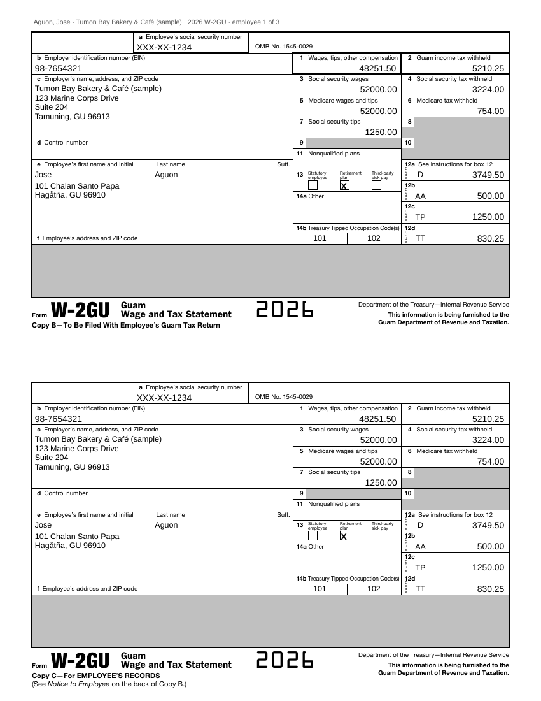
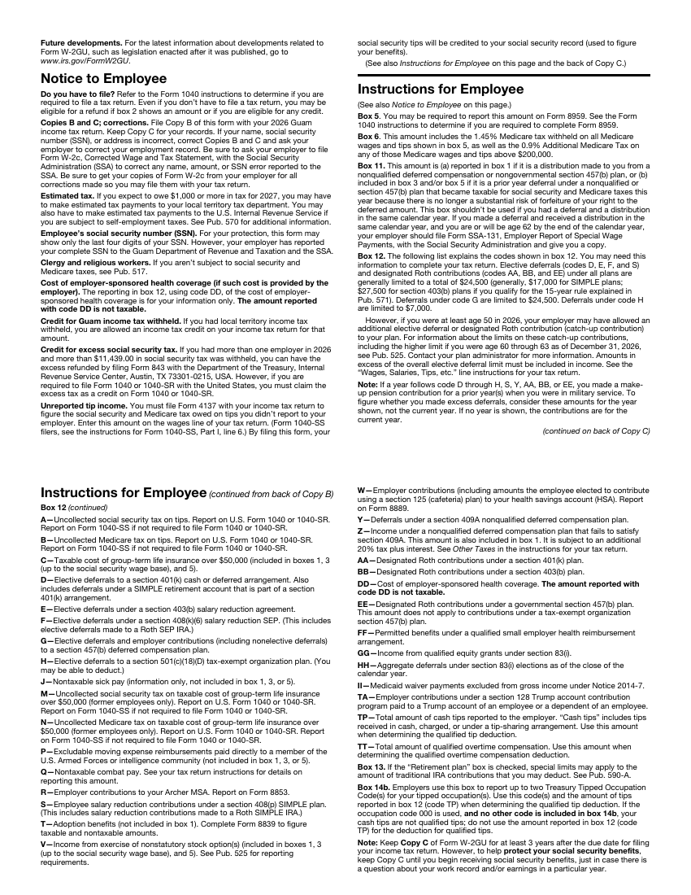
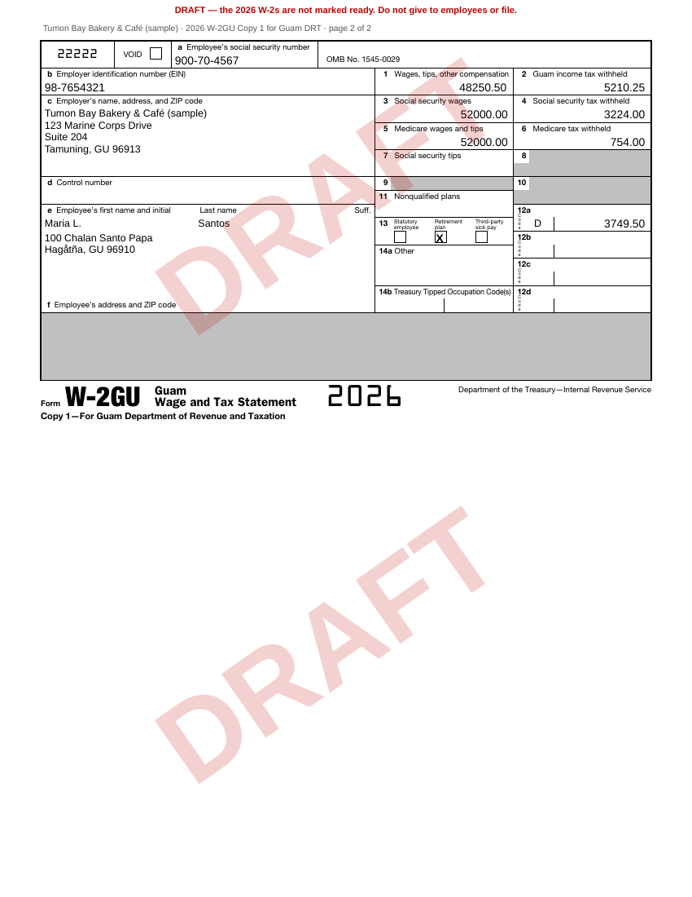
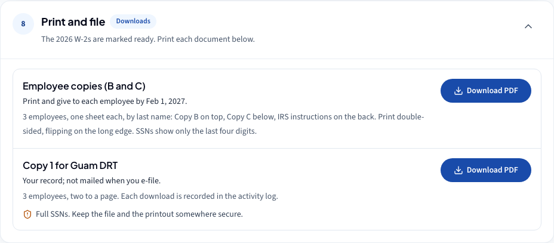
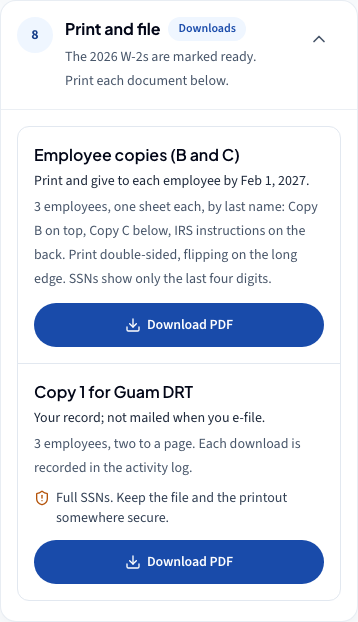
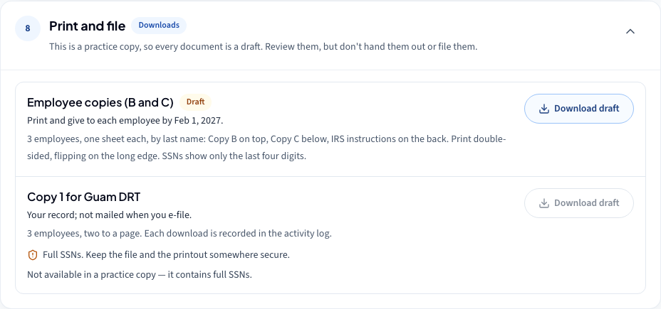
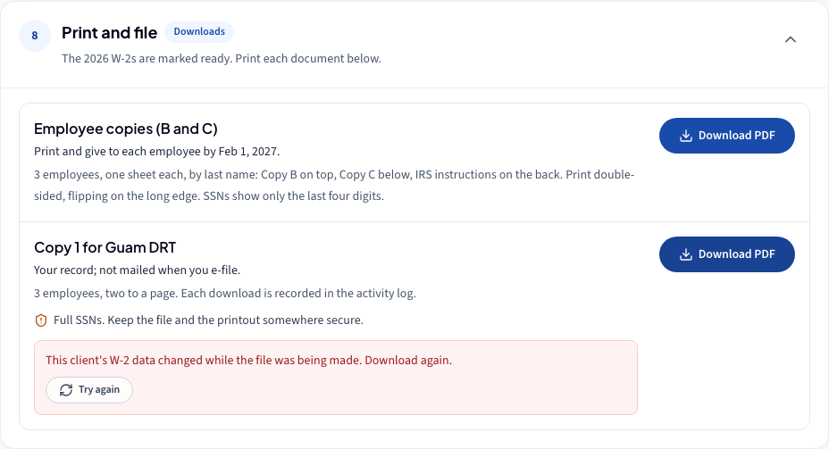

# Official W-2GU copies

Status: Implemented (branch `feature/w2gu-official-copies`). Not yet operationally verified on paper with a real printer.

Cornerstone gives every employee of a client a W-2GU by January 31 (February 1, 2027 for tax year 2026, because January 31 is a Sunday) and keeps or sends Copy 1 for the Guam Department of Revenue and Taxation (DRT). The app fills the IRS 2026 Form W-2GU (`api/lib/assets/irs_form_w2gu_2026.pdf`, downloaded from irs.gov). The IRS says its black copies "may be downloaded, completed, printed, and used". Copy A (red, for SSA) is never produced, because W-2s are e-filed.

## What staff download

Both files come from step 8, **Print and file**, of the year-end checklist: `GET /api/v1/admin/reports/w2_gu_employee_copies?year=2026` and `GET /api/v1/admin/reports/w2_gu_copy_1_drt?year=2026`. Copy 1 has its own endpoint so the access and test-workspace policies can gate it by action name.

| File | Layout | SSN |
| --- | --- | --- |
| Employee copies (B and C) | One sheet per employee, sorted by last name. Front: Copy B on top, Copy C below. Back: the IRS *Notice to Employee* behind Copy B and the *Instructions for Employee* continuation behind Copy C. A gray line above the form names the employee and their position ("employee 3 of 25"). | `XXX-XX-1234` |
| Copy 1 for Guam DRT | Two employees a page, by last name. An unused bottom form on the last page is blank. | Full |

### Why one sheet per employee

Each IRS page holds two copies of the same form, intended for cutting. Filling Copy B pages two employees at a time would make staff cut, sort and pair Copy B with Copy C for every person, and a mistake hands one employee another's SSN digits and wages. With one sheet per employee, staff print the file double-sided (flip on the long edge) and hand each sheet to the person named at the top. The employee cuts or folds it; the backs match the IRS layout, so the notice sits behind Copy B and the instructions behind Copy C.

### The checklist step

Other captures: `print-and-file-phone-practice.png`, `print-and-file-phone-changed-retry.png`, and `print-and-file-desktop-draft.png` (before the W-2s are marked ready).

## Box data

Values come from `W2GuAggregator` rows unchanged: Box 1 (FIT wages from `W2GuTaxableWages`), Box 2 (Guam income tax withheld), Boxes 3–6, Box 7 only when there are Social Security tips, Box 12 entries in the aggregator's order (D, AA, TP, TT; at most four), the Box 13 retirement-plan check, and the Box 14b tipped-occupation codes (two at most; preflight blocks more). Boxes 8, 10, 11, 14a and the control number stay blank because the app does not model them. Employer name, address and EIN print in boxes b and c; the employee's first name and middle initial, last name and address print in boxes e and f.

Nothing prints partly. Long values shrink to fit, down to a minimum size. When a name, address or employer block still won't fit, or an employee has more Box 12 entries than the form's four or more than two Box 14b codes, the download is refused with one line per problem, for example "Maria Cruz: the address is too long to fit Box f — shorten it on the employee's profile."

## Gating and controls

- **Who files.** Copies exist only when the year's W-2 decision says Cornerstone files. Otherwise the endpoint refuses and the step shows "Not needed".
- **Draft or final.** Until the W-2s are marked ready, and again whenever the ready mark no longer matches the current inputs (`W2FilingInputsFingerprint`), every page carries a large DRAFT watermark per form and the line "DRAFT — the 2026 W-2s are not marked ready. Do not give to employees or file." The filename ends in `_DRAFT`. `W2GuOfficialCopies.final?` is the single rule for both the endpoint and the checklist.
- **Data changed during the download.** The PDF is drawn after the company lock is released. Afterwards the endpoint reads the inputs fingerprint, the year-end input revision, the ready mark and the filing decision again, uncached. If anything changed, it returns 409 "This client's W-2 data changed while the file was being made. Download again." and sends no file and writes no audit entry.
- **Box 14b.** More than two Treasury tipped-occupation codes for the year is a blocking preflight finding (`EMPLOYEE_TIPPED_OCCUPATION_CODES_EXCESS`) and a checklist issue in step 3, so the W-2s can't be marked ready while codes would be dropped.
- **Audit.** Every download writes an `AuditLog` entry (`reports#w2_gu_employee_copies` or `reports#w2_gu_copy_1_drt`, category `document_access`) before the file is sent: actor, client, tax year, document kind, whether it holds full SSNs, draft or final, the inputs fingerprint, the ready fingerprint and the employee count. If the entry can't be written, the file is not sent. No SSN appears in params, logs, audit metadata or error messages.
- **Caching.** Responses are `Cache-Control: private, no-store`.
- **Access.** Employee copies: the same as the W-2GU report endpoints, staff with access to the client. Copy 1 (full SSNs) needs `manage_client_administration`, the capability that guards marking the W-2s ready: managers and admins, or an accountant with Client management for that client. For others the checklist row is disabled with "Needs client-management access (contains full SSNs)."
- **Test and practice workspaces.** Copy 1 is blocked by `TestWorkspaceSafetyPolicy`, and the row says "Not available in a practice copy — it contains full SSNs." Employee copies stay available but are always drafts, marked "DRAFT — a practice copy. Do not give to employees or file.", even when a copied ready mark matches.

## Limits

- The template is the 2026 revision only; other years are refused with a message.
- The PDF hides the unused half of each composed page with a clip. Text extraction tools can still read the hidden IRS captions, though nothing prints there.
- Box 12 holds four entries. The aggregator produces at most four (D, AA, TP, TT); more would be refused rather than dropped.
- The employer's name and address are not part of the inputs fingerprint, so changing them after the W-2s are marked ready leaves the copies final. The download-time recheck does catch a change made while a file is being drawn.
