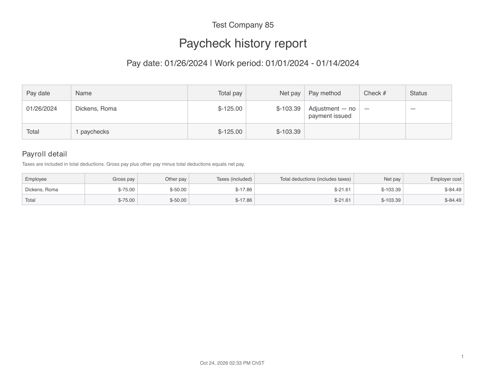
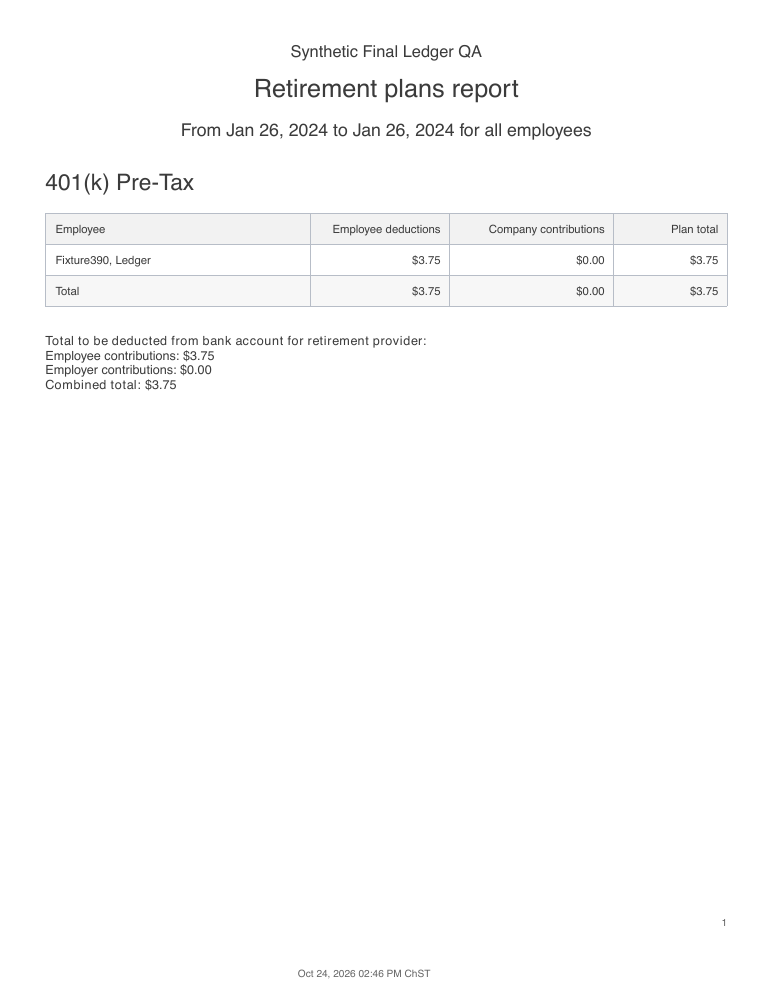
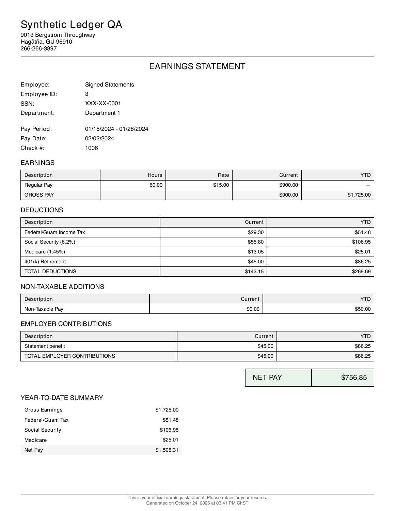

# Corrective component ledger — October 24, 2026

Owner: `payroll-impl-ledger`. Implementation source: `266c827e5af8874bd3c7a2a8bb2ca36e84b9dd8e`, including staging-v2 #377 (`28b14349`). The lead owns merge and release. No staging/production access or historical data repair was performed.

Cornerstone's accountants process multi-client Guam payroll. A corrective supplemental must explain every change in pay, deductions and employer obligations without rewriting the original paycheck. Context and acceptance come from the independently verified A4/A2/A3 inventory in `output/payroll-aire-review-2026-10-24/v-payroll/REPORT.md`, `impl-rules.md`, and the Cornerstone September 19 priorities note in Brain Dump.

## Acceptance

Agent-executed affected-flow QA used only synthetic local data and a dedicated headless Chromium instance. Both 1280×800 and 390×844 fixtures started with $900 gross and a 5% flexible 401(k) contribution of $45. The agent opened the corrective modal, changed regular hours from 60 to 65, reviewed and issued the correction, then reloaded. The saved supplemental had $75 gross, $3.75 contribution and $58.38 net. Each employee's pay-date range report showed $48.75 retirement after reload.

The agent opened employee-summary and retirement report previews through their View controls. Each original report showed $45 and each supplemental showed $3.75; the eight actual UI-triggered PDF responses were extracted and checked. Native PDF iframes did not paint in headless Chromium, so their content was verified from the downloaded bytes and with Poppler. This does not establish native-device, physical-printing or operator acceptance.

The real full-print-package endpoint generated a seven-page negative corrective package. Its employee summary showed positive cash-effect credits for negative taxes and retirement deductions, while employer liability reductions retained their negative signs. Paycheck history now explicitly includes other pay in the gross/deduction/net reconciliation. All pages were rendered and inspected; the automated test verifies signed detail and zero formatting.

## Automated checks

- The new regression matrix covers flexible deductions and employer contributions, all five payroll-field treatments, field mirrors/reporting groups, bonus, non-taxable cash, custom entries, signed hours, hourly rate changes, salary nonexempt rate changes, repeated targets, voiding either supplemental, stale previews/retries, immutable original components, W-2 D/AA, YTD and liability totals. Unsupported loan transitions, ambiguous component detail, custom-column changes and salary overtime-hour changes requiring daily coverage are held.
- Schema load and PostgreSQL integrity passed. RuboCop inspected 1,478 files with no offenses. Brakeman found no warnings. Bundler and npm audits found no vulnerabilities.
- Node 22.22.3 web gate passed: 121 files / 1,129 tests, typecheck, lint and production build. The initial Node 26 run is retained as a superseded harness-environment failure.
- Browser lanes passed: 131 public, 45 release, 10 refresh, 24 pay-item tests.
- Full backend passed: 5,085 examples, 0 failures, 0 pending. Review status is recorded in the final PR and local `RESULT.md`.

There are no migrations or historical backfills. Ordinary nonnegative input rules remain in place; signed field/hour/JSON validation requires a same-owner linked corrective supplemental. Unchanged scheduled loans retain their original identity and create no repayment delta or transaction. Changed loan components remain on hold because this change introduces no loan-ledger transition. Changed flexible employer insurance is also held: the legacy insurance aggregate cannot safely classify that employer liability.

Detailed logs, fixtures, actual PDFs and screenshots are retained in `/Users/leonshimizu/Desktop/ShimizuTechnology/output/payroll-aire-review-2026-10-24/impl/payroll-ledger/`. Browser contexts/processes and servers were stopped after QA. Dedicated UI/release/refresh/pay-item databases were dropped; the final backend database is removed after its run. The worktree and branch are retained for the lead.

## PR #381 review follow-up

Independent review at `fd87e6d8` requested changes for signed statement readers, insurance liability duplication under an available-pay cap, and current annual retirement limits. The four supplied correctness probes were ported first and failed (4/4). The follow-up regression suite passes 20 examples; the affected service suites passed 157 examples before the final added context cases.

Checks and stubs now keep nonzero signed current and YTD components. Corrective issuance initializes statement YTD snapshots through the supplemental pay date. Negative and following ordinary statements are rendered and checked, including each supplemental-void order. The negative fixture has −$150 gross, −$100 other pay, −$33.23 deductions and −$216.77 net. Retirement and employer-benefit deltas are each −$7.50. Its next ordinary stub/check shows $86.25 retirement and benefit YTD, $50 other-pay YTD, and $1,505.31 net YTD. Original money and child components stay immutable; the existing derived statement-YTD refresh also updates subsequent statements.

Insurance uses a canonical scalar containing only non-field employee insurance. Authoritative fields post their own liability. Capped recalculation excludes field mirrors from the scalar. Correction baselines normalize provable old mirror folds and require saved insurance liabilities to reconcile; unknown aggregate provenance and doubled historical liabilities are held for a reviewed ledger correction. Tests cover capped/uncapped transitions, repeat corrections, stale previews and either supplemental void. A post-write check also validates new insurance postings inside the transaction.

Retirement target replay remains historical, while a separate current annual ledger checks the remaining delta against later committed payroll, active reversals, traditional/Roth shared room, employer-match caps, annual additions, compensation and verified opening evidence. Evidence includes later effective elections and current year inputs. Issuance rebuilds this context under the Company financial lock; the preview digest includes it. Contributions that require changing another committed paycheck, or catch-up classifications that cannot be proved, receive an annual plan-administrator reconciliation hold. No committed contribution is silently recapped or rewritten.

The agent reran the modal and report journey at 1280×800 and 390×844 against fresh private data. Both $45 + $3.75 contributions persisted; both YTD rows showed $48.75 after reload. Eight UI-triggered report PDFs were checked. The negative pay stub, its check-stub detail, the next ordinary pay stub/check, the negative employee summary and actual seven-page full package were rendered with Poppler and inspected. Negative corrections issue no payable check face; their stub renderer was exercised separately. Native PDF iframes remain a headless-browser limitation; downloaded PDF bytes were checked and rendered directly. No native device or physical printing was tested.

Follow-up evidence is in `output/payroll-aire-review-2026-10-24/impl/payroll-ledger/review1/`, including the tests-first log, full gate logs, `statement-reconciliation.json`, actual PDFs, rendered pages, modal screenshots and cleanup receipts. The final full-gate counts and reviewer status are recorded in the PR and `RESULT.md`. No web source or schema was changed in this follow-up. The worktree remains for the lead; this worker does not merge.
