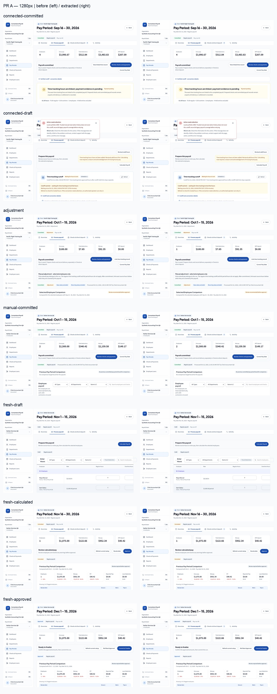
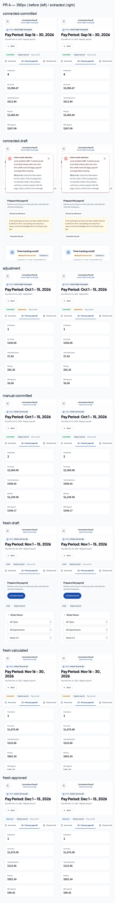

# Pay-run redesign — PR A: extract sections

This change splits the processing page into section components and `usePayRunController`. It preserves the existing DOM, section order, guards, labels, handlers, dialogs, route behavior and saved amounts. `PayPeriodDetail.tsx` is now 125 lines; the worksheet, results, source checkpoint, notices, payments, reports, corrections and dialogs can be reorganized independently in the next two PRs.

Base: `569f96d76c4bcd1d3ccaa53fd2fd2ea9941ef9cc`, target `staging-v2`, owner `payroll-redesign`. The lead reviews and merges this PR before PR B starts from the merged result. This PR does not implement the new header, tabs, compact results or steps.

## Visual and action parity

- **108/108 scroll captures are pixel-identical** across seven states at 1280×800 and 390×844: connected committed, connected draft, adjustment, manual committed, fresh manual draft, calculated and approved.
- A single owned Chromium context compared an archive of the base with the extracted working tree against the same private fixture API. The browser clock was fixed; font subpixel positioning and LCD rendering were disabled. All captures include the real inner `main` scroller.
- The original, unrestricted raster run is retained in the output directory: 99/108 were exact; nine differed by 1–8 pixels with channel deltas no greater than 2. Deterministic rendering removed those differences.
- [Runtime inventories](actions-before.json) and [their extracted equivalents](actions-after.json) match exactly in all 14 state/viewport pairs. [The diff](actions-diff.json) records zero additions and zero losses.
- All **59 source action definitions** also match, including conditional dialog actions, attributes and handlers: [before](source-actions-before.json), [after](source-actions-after.json). No actions moved to a different visible location in this PR.
- [The re-derived section map](sections.json) records the current base ranges and each extracted component's inputs. The older audit ranges were not used as edit offsets.

## Measurements

Coordinates are from the top of the main scroll content at 1280×800. Every current measurement is identical before and after extraction. The [raw measurements](measurements.json) retain the earlier audit as well as the current baseline.

| State | Screens before → after | Totals y | Results y | Cards | Buttons | Callouts |
| --- | --- | --- | --- | --- | --- | --- |
| Connected committed | 8.89 → 8.89 | 275 | 1358 | 20 | 123 | 7 |
| Connected draft | 5.50 → 5.50 | — | — | 9 | 17 | 5 |
| Adjustment | 7.22 → 7.22 | 275 | 1257 | 19 | 48 | 5 |
| Manual committed | 5.84 → 5.84 | 275 | 843 | 17 | 64 | 7 |
| Fresh manual draft | 1.62 → 1.62 | — | — | 3 | 6 | 0 |
| Fresh calculated | 3.96 → 3.96 | 275 | 765 | 12 | 28 | 2 |
| Fresh approved | 3.40 → 3.40 | 275 | 765 | 11 | 24 | 2 |

The original audit's committed connected run measured 8.83 screens, totals y275, results y1358, 22 cards, 123 buttons and seven callouts. Its source predates the merged primitive changes. Current Card counts use #377's flat Card class; the audit counted the older rounded Card class. The October draft's live synthetic source cannot cover that cutoff, so its rejected readiness response also differs from the older audit's populated draft. Fresh runs here are manual fixtures, unlike the earlier connected fresh fixtures. These differences predate this extraction and are not attributed to it.

## Verification

The output directory holds the command logs, full captures, axe JSON, recordings and QA ledger:

`output/payroll-aire-review-2026-10-24/impl/payroll-redesign/pr-a/`

- Baseline characterization: 107/107 existing pay-run refresh/state tests passed before extraction.
- Web gate: TypeScript, ESLint, **124 files / 1,173 tests**, and production build passed. `npm ci` passed; npm audit found zero vulnerabilities.
- Browser lanes: public **131**, release **45**, refresh **10**, pay-items **24** passed; no skipped, unexpected or flaky tests. Existing test selectors were preserved. The release lane also passed with the normal CI test queue adapter after an earlier pass with the production queue adapter.
- API: schema load, database integrity, RuboCop, Brakeman and Bundler Audit passed. **5,065 examples / zero failures** passed on the corrected full RSpec rerun.
- The first full API run had 11 queue-adapter failures because the harness enabled `SOLID_QUEUE_TEST_MODE`; that harness setting was corrected. The initial failure evidence is retained. No application fix was made for those failures.
- Axe: zero violations from `color-contrast`, `select-name`, `landmark-*`, `heading-order` or `aria-prohibited-attr` on all seven captured pay-run states.
- Impeccable **4.6.0** advisory: `[]`, zero findings. It ran outside the repository; no detector skills or hooks were added to the repository.
- Live checks passed: dialog focus containment/return and preserved route, scroll and filters at both widths with normal/reduced motion; worksheet calculation/reload at 1280 ($3,000 gross) and 390 ($3,025 gross after changing 40 to 41 hours). See [interaction results](interaction-results.json) and [QA ledger](qa-ledger.json). The output directory retains all six recordings.

This is an extraction rather than a defect fix. Existing behavioral characterization and before/after runtime evidence were collected first; no artificial failing financial test was added. Read-only training, snapshot and workspace-access behavior remains covered by the existing workspace tests. The workspace and client portal source are unchanged. The new `overview` redirect belongs to PR B.

## Boundaries and integration

The copied October connected draft correctly displays the existing synthetic token/cutoff rejection. A successful October import through that copied AIRE connection is not established by this parity check. Before PR B/C acceptance, refresh that private fixture's legitimate source coverage and finalized-batch provenance; preserve the server guards. The existing browser lanes establish their own isolated synthetic workflow coverage.

No API, financial calculation, migration, provider, deployment or client-portal code changed. No real email, payment, filing, OCR or production/staging access occurred. Native phone keyboards, Safari/touch behavior, physical printing and accountant/operator acceptance are not established by resized Chromium.

PR #382's late-hours entry point has a clear home in `PayRunSourceCheckpoint` and the existing `AirePayrollCockpit` held-hours area. Its old `PayPeriodDetail.tsx` insertion may need to be transplanted during integration; preserve its guard and place the entry point inside Hours when PR C implements the steps. PR #381's financial changes remain independently owned.

CodeRabbit and the lead's independent design/code review remain explicit review statuses, not implied by passing tests. The worktree and branch are retained for the lead. Runtime cleanup and the exact PR head are recorded in the output RESULT.md.
