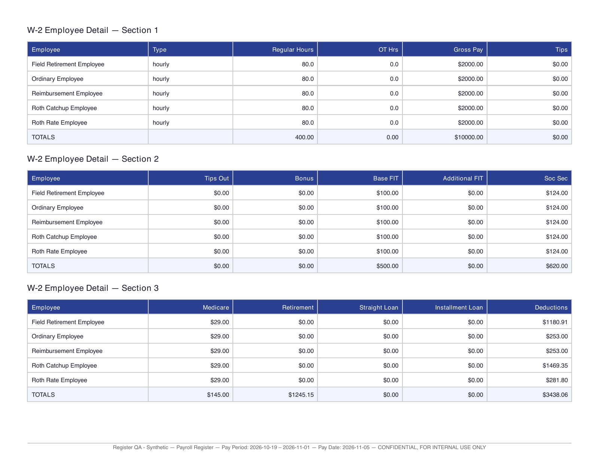
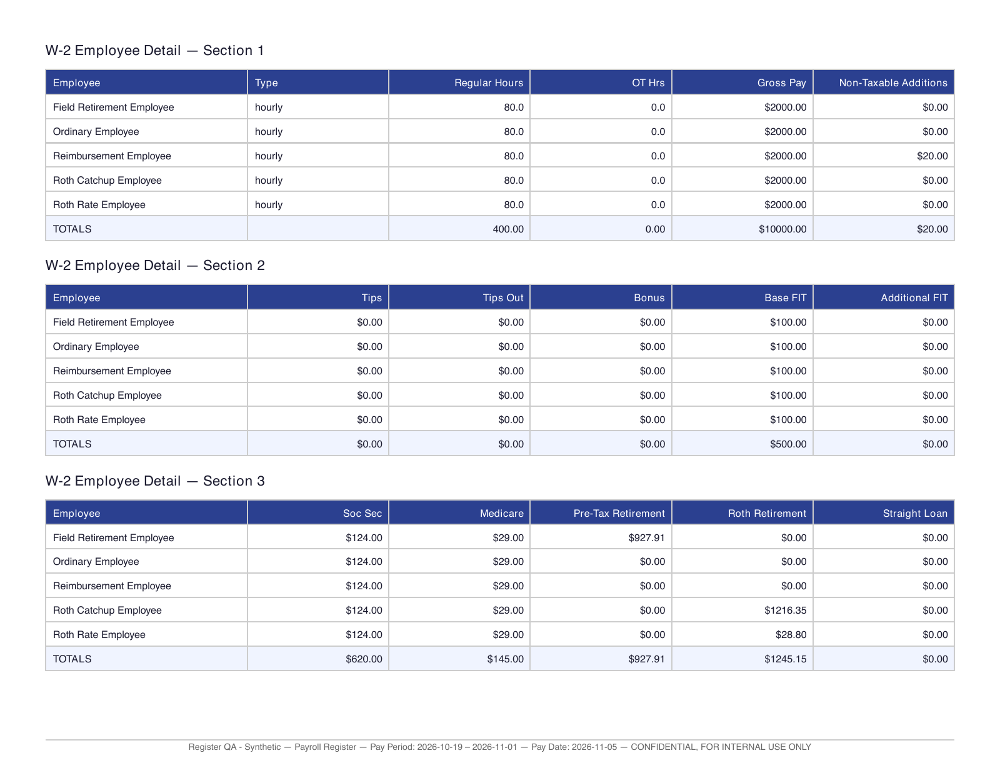
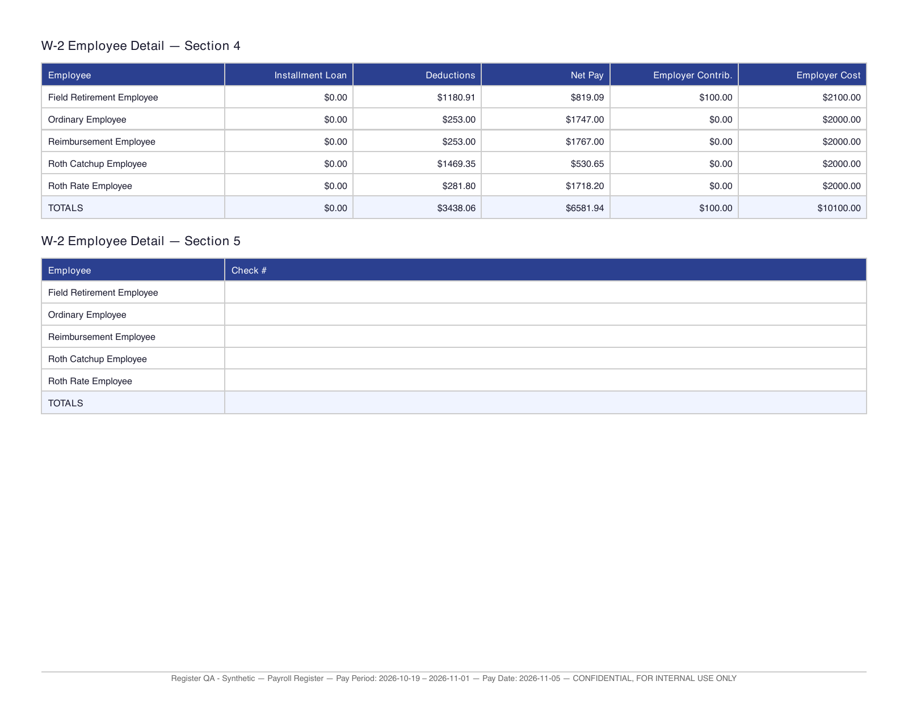

# Payroll register reconciliation — November 2, 2026

Cornerstone accountants use the payroll register to reconcile each paycheck and review the totals before distribution. This change preserves saved financial amounts; it changes report presentation and adds a read-only arithmetic check.

## Scope and source

- Base: `origin/staging-v2` at `ec0e9c50` (the reported staging build was `e45f54dd`). Target: `staging-v2`, held for the November 7 release; do not merge this PR automatically.
- Production source comparison: `origin/main` at `6c78c345`. D1 and D2 are pre-existing in this source, not staging-v2 regressions. No staging or production runtime/data was accessed.
- Product context: Brain Dump `work/shimizu-tech/Cornerstone/3) Meeting with mom and Auntie Daena to go over payroll.md` describes the need to distinguish taxable pay from non-taxable amounts and to reconcile deductions in the preview register.
- Saved calculation: `PayrollCalculator#calculate_net_pay` adds non-taxable pay, adjustments and fields after subtracting `total_deductions`. That stored deduction total includes employee taxes and paid-out tips; employer contributions are separate.
- Retirement source: `PayrollRetirementTotals.for_item(..., for_reporting: true)`, also used by the pay stub, reconciles saved columns, itemized deductions and flexible-field mirrors. Raw legacy columns remain available separately.

## Report audit

| Report | Finding and change |
| --- | --- |
| Register screen | Detailed table omitted built-in retirement and non-taxable additions. Added pre-tax, Roth and combined non-taxable additions columns; retained existing column order. Simple table keeps combined retirement, explicitly labeled pre-tax + Roth, and adds non-taxable additions. |
| Register PDF | Individual Retirement cells used only the traditional column; the footer used traditional + Roth. Now both employee retirement columns and their totals use canonical saved components. Added non-taxable additions and a row reconciliation warning. Retained landscape letter and repeated worker names/headers. |
| Register XLSX/CSV | Existing raw-column exports omitted payroll-field retirement from retirement aggregates. Canonical traditional/Roth amounts now populate these report columns. Added all-source non-taxable total without moving existing columns. XLSX includes Register Review for both simple and detailed companies. |
| Payroll Summary by Employee | PDF and QB Summary Matrix already include canonical pre-tax/Roth deductions, non-taxable Other pay and separate employer contributions. Employee Summary/Totals XLSX needed canonical retirement and combined non-taxable additions; fixed. |
| YTD summary | JSON/PDF/XLSX already include canonical retirement, but omitted built-in non-taxable pay from row/company totals. Added combined non-taxable additions. Screen now shows those additions and Roth beside pre-tax retirement. Employee FIT also includes additional withholding, matching company totals. Imported gross remains the saved source gross. |
| Deductions and Contributions | Unaffected: PDF/XLSX use `QuickbooksPayrollReportData#deduction_contribution_entries_for_item`, with employee/company amounts separate. Non-taxable earnings are outside this report's scope. |
| Check sign-off | Unaffected: PDF/XLSX/preview carry employee/check identity and signature fields, not component or net calculations. |
| Transmittal | Unaffected: lists delivered documents, check identities and tax obligations; it does not reconstruct employee retirement or net pay. |
| Client register | Uses the same shared detail/PDF/CSV path. Updated its independent summary builder to canonical retirement and combined non-taxable additions, with row review. |

## Acceptance and evidence

Agent-executed affected-flow QA uses synthetic data only, on disposable local databases. Required cases: 3% Roth-rate employee ($28.80), Roth catch-up ($1,216.35 after the $24,500 traditional limit), $927.91 field retirement with employer match and a saved mirror, $20 non-taxable addition, ordinary employee, mixed-source fractional reimbursements, and a deliberately broken one-cent row. Tests verify emitted PDF cells and XLSX cells as well as the JSON data used by the screen. Employer match must never reduce net.

Baseline and after images below were rendered from the same synthetic saved amounts. The baseline reproduces all-zero retirement rows with a $1,245.15 footer. After shows $927.91 traditional and $1,245.15 Roth, with a matching $20 non-taxable addition. Both versions fit landscape letter. The synthetic five-worker register remains four pages; no production names or data appear in these images.

Automated gate and browser results are recorded in the PR after execution. Desktop and a narrow browser viewport are in scope; real mobile hardware, live authentication, staging/production acceptance and release delivery are not run here.
